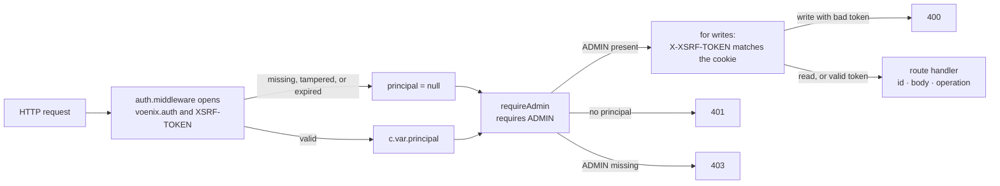

# Authentication and authorization

This guide explains how the TypeScript backend decides **who a caller is**,
**what that caller may do**, and **whether a state-changing request is safe to
process**. Everything lives in
[`src/platform/auth/`](../../../../backend-ts/src/platform/auth); module routes
install a protection and never implement security themselves.

## Contents

- [Three terms that sound similar](#three-terms-that-sound-similar)
- [Where sessions come from](#where-sessions-come-from)
- [The five-minute mental model](#the-five-minute-mental-model)
- [What `createAuth` builds](#what-createauth-builds)
- [The sealed cookies](#the-sealed-cookies)
- [The identity of one request](#the-identity-of-one-request)
- [The four route protections](#the-four-route-protections)
- [How CSRF protection works](#how-csrf-protection-works)
- [Cookie settings and session lifetime](#cookie-settings-and-session-lifetime)
- [Guest identity](#guest-identity)
- [Adding a protected route](#adding-a-protected-route)
- [Tests](#tests)

## Three terms that sound similar

- **Authentication** answers "who is making this request?": the middleware
  opens the `voenix.auth` cookie and sets the principal of the request.
- **Authorization** answers "may that user use this endpoint?": the admin
  protection requires the exact role string `ADMIN`.
- **CSRF protection** answers "did the signed-in user intentionally make this
  state-changing request?": a mutating request needs a token in a header that
  matches the `XSRF-TOKEN` cookie.

## Where sessions come from

The auth code **validates and uses** a session but never verifies credentials.
The account module's login is the one production path that calls
`auth.signIn(c, userId, roles)`; the session stores the user's numeric database
id as a number plus the roles granted at login, so a handler reads it as
`c.var.principal?.userId ?? null` without parsing it. Tests mint sessions directly
through `signedInHeaders` of the test support.

## The five-minute mental model



For a protected write the order is: session, role, CSRF, path id, JSON body,
operation. An anonymous `POST` with invalid JSON receives `401`; an admin with
a malformed id receives `400 Invalid country id` without the body being read.

## What `createAuth` builds

[`auth.ts`](../../../../backend-ts/src/platform/auth/auth.ts) exports one
factory. `createAuth({ sessionSecret })` returns:

| Member | What it does |
| --- | --- |
| `middleware` | Runs on every request (installed by `createApp`): opens the two cookies into `c.var.principal` and `c.var.csrfSession`, and renews a session past half its life. |
| `routes` | `GET /api/antiforgery/token`, which mints a CSRF token. |
| `signIn(c, userId, roles)` | Writes a fresh 24-hour session cookie. |
| `signOut(c)` | Clears it. |
| `guestTokens.tryGet(c)`, `guestTokens.getOrCreate(c)` | The guest identity below. |

The four route protections are plain exports of the same file, because they
read only what the middleware stored on the request.

## The sealed cookies

[`cookies.ts`](../../../../backend-ts/src/platform/auth/cookies.ts) seals a
value with AES-GCM, which encrypts and authenticates in one step: a caller can
neither read nor change a cookie. The key of each cookie is SHA-256 of
`<purpose>:<sessionSecret>`, with the purposes `auth`, `csrf`, and `guest`, so
a value sealed for one cookie never opens as another. The sealed form is
base64url of a random 12-byte IV followed by the ciphertext and its tag.

This is a **new cookie format**: cookies of the Kotlin backend do not open,
and existing development sessions are simply invalidated. Rotating
`AUTH_SESSION_SECRET` signs every user out and turns every visitor into a
fresh guest, exactly as before.

| Cookie | Carries | Type |
| --- | --- | --- |
| `voenix.auth` | `userId`, `roles`, `issuedAtEpochSeconds`, `expiresAtEpochSeconds` | `UserSession` |
| `XSRF-TOKEN` | the token and the `userId` it was minted for (`null` for a guest) | `CsrfSession` |
| `voenix.guest` | a random 48-byte token | string |

## The identity of one request

The middleware sets two request variables, typed through Hono's
`ContextVariableMap`, so every handler reads them as `c.var.principal` and
`c.var.csrfSession` without a generic:

```ts
export interface UserPrincipal {
  userId: number
  roles: string[]
}
```

`principal` is `null` for an anonymous request, for a tampered cookie, and for
an expired session alike. A cookie contains a **claim**; the principal is the
application's **validated identity for this request**.

## The four route protections

A protection is a Hono middleware installed on a sub-app with
`admin.use(requireAdmin)`, which protects every route below it. All four share
the same fail-closed core: a rejected request is answered before the handler,
and for `POST`, `PUT`, `PATCH`, and `DELETE` the CSRF check runs after the
authorization.

| Protection | Who passes | Refusals |
| --- | --- | --- |
| `requireAuthenticated` | any signed-in user | `401` |
| `requireAdmin` | the exact role `ADMIN` (case-sensitive; other roles may be present) | `401`, `403 Admin access required` |
| `guestCapable` | everyone; a mutating request needs a CSRF pair, and a signed-in user needs one minted for that user | `400 Invalid CSRF token` |
| `requireSupplier(accounts)` | the exact role `SUPPLIER` **and** a live link: `accounts.supplierIdOf(userId)` must answer a supplier on this very request; handlers read it as `c.var.supplierId` | `401`, `403 Supplier access required` for both halves |

The `401` and `403` answers keep the auth shape of the Kotlin backend:

```json
{"success":false,"message":"Authentication required","code":null}
```

The supplier protection asks the account module on every request because a
role in a cookie is frozen until the next login, while a revoked supplier login
must lose access with the very next request. `SupplierAccounts` is the one
interface the platform declares for another module to implement.

## How CSRF protection works

The client flow is unchanged:

1. Call `GET /api/antiforgery/token` after signing in.
2. Read `requestToken` from the JSON response and keep the cookies.
3. Send the token in the `X-XSRF-TOKEN` header on every write.

The endpoint generates 32 random bytes as a URL-safe token, answers it in the
body, and stores it with the current user id in the sealed `XSRF-TOKEN`
cookie. A protected write requires a principal, a readable CSRF cookie, the
same user id in both, and a header equal to the stored token; the comparison
is constant-time. The token is bound to a **user id**, not to one cookie:

- a token requested anonymously cannot be used after sign-in;
- switching to another user invalidates the previous token;
- signing in again as the same user does not; and
- requesting a replacement invalidates the previous one.

A failed check answers `400` with the shared
`{"message":"Invalid CSRF token","errors":{}}`.

## Cookie settings and session lifetime

| Setting | `voenix.auth`, `XSRF-TOKEN` | `voenix.guest` |
| --- | --- | --- |
| Path | `/` | `/api` |
| `HttpOnly` | yes | yes |
| `SameSite` | `Lax` | `Lax` |
| `Secure` | on HTTPS requests only | on HTTPS requests only |
| `Max-Age` | none (browser session) | 30 days |

`Secure` is derived from the request URL's scheme, so production must pass the
real scheme to the backend. The session has its own server-checked expiry: a
new session lasts 24 hours; once more than half of that has elapsed, any
request, also a public one, renews it for another 24 hours; an expired session
is anonymous and is not renewed. Roles are not reloaded from the database
during a session's lifetime; there is no server-side revocation list.

`AUTH_SESSION_SECRET` must contain at least 32 UTF-8 bytes; `.env.development`
carries a fixed development value, a deployment supplies its own.

## Guest identity

`guestTokens.getOrCreate(c)` returns the visitor's guest token, issuing a
`voenix.guest` cookie when the request carries no readable one;
`guestTokens.tryGet(c)` returns the token of an existing cookie or `null` and
never sets one, so a read path does not turn a passing visitor into a stored
guest. A tampered cookie counts as missing. Nothing replaces or deletes the
guest cookie: a login and a logout leave it alone, so one browser is one guest
for 30 days, whoever is signed in. The rules that keep that safe (a row is
owned by the guest token only while no account owns it) are unchanged from the
[Kotlin guide](../../backend/conventions/authentication-and-authorization.md#the-guest-tokens-lifetime-around-a-login-and-a-logout).

## Adding a protected route

```ts
const admin = new Hono()
admin.use(requireAdmin)
admin.get('/', …)
admin.post('/', jsonBody(input), …)

routes.route('/api/admin/widgets', admin)
```

Install the protection once on the sub-app, mount the sub-app at its path.
Because the protection applies to the whole subtree, a non-canonical path below
it (`/api/admin/widgets/` with a trailing slash) is refused with `401` for an
anonymous caller and `404` for an authorized one, where Ktor answered `404` to
both; the subtree still fails closed.

## Tests

[`auth.test.ts`](../../../../backend-ts/src/platform/auth/auth.test.ts) pins
every rule of this guide on probe routes: the four protections and their
refusals, CSRF accepted and rejected, the token binding, expiry and sliding
renewal, the cookie flags on HTTP and HTTPS, sign-in and sign-out, and the guest
cookie. Module tests use `signedInHeaders({ userId, roles })` and
`guestHeaders()` from `@test-support/http` and never repeat these cases.
