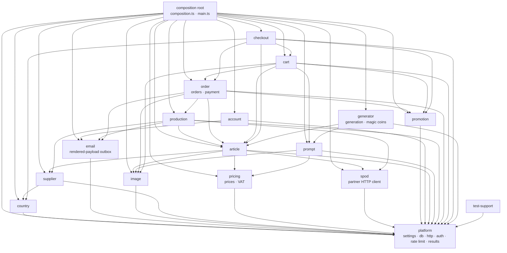

# Backend modules

The TypeScript backend is one process built from modules under
[`backend-ts/src/modules/`](../../../../backend-ts/src/modules). The module
boundaries are part of the architecture: a module imports another module only
through that module's `index.ts`, only along a declared edge of the graph
below, and the lint gate fails on anything else.

Run every command in this guide from [`backend-ts/`](../../../../backend-ts).

## Contents

- [Four terms](#four-terms)
- [The module graph](#the-module-graph)
- [How the boundaries are enforced](#how-the-boundaries-are-enforced)
- [Physical layout](#physical-layout)
- [The module shape](#the-module-shape)
- [Public surface and internal implementation](#public-surface-and-internal-implementation)
- [One `Tables` type for the whole database](#one-tables-type-for-the-whole-database)
- [Application composition](#application-composition)
- [Test support](#test-support)
- [Adding a module or dependency](#adding-a-module-or-dependency)

## Four terms

- A **module** is one folder `src/modules/<name>/` with the five files of
  [Source file organization](source-file-organization.md). It owns tables,
  routes, and the rules of one bounded slice of the shop.
- The **platform** is `src/platform/`: settings, database, HTTP, auth, rate
  limit, results, logging. It is not a module; every module may import any of
  its files directly.
- A module's **capability** is a function on the object its factory returns
  (`countries.isShippable`, `prices.prepare`). It is how another module asks
  this module a question without touching its tables.
- The **composition root** is `src/composition.ts` plus `src/main.ts`: the one
  place that creates every module and hands each one the capabilities it needs.

## The module graph



"A → B" means A may `import … from '@/modules/B'`. The table lists every
module with what it may import besides the platform:

| Module | May import | Responsibility |
| --- | --- | --- |
| `country` | — | Country API; the `find(ids)` lookup Supplier uses and the `isShippable(code)` answer Checkout asks (see the [Country package guide](../packages/country-package.md)) |
| `email` | — | Direct user email and the durable outbox. A leaf: the outbox stores the rendered payload (recipient, subject, html, text) at enqueue time, so it never asks another module to resolve a reference |
| `image` | — | Image decoding, resizing, storage, delivery |
| `supplier` | `country` | Supplier API; labels rows of other modules with supplier names |
| `pricing` | — | Prices and VAT (the former `vat` module is part of it); the `PriceCatalog` capability an owning module writes a price with inside its own transaction |
| `spod` | — | The print-on-demand partner's HTTP client and the pacer that holds its request budget. Owns no table, installs no route; uses the platform's logger only |
| `promotion` | — | Coupon admin and the `PromotionCodes` capability |
| `account` | `email` | Accounts, login, profile; the creator of sessions; `SupplierAccounts` |
| `article` | `image`, `pricing`, `supplier`, `spod` | The catalog: categories, mugs, SPOD articles, the SPOD catalog sync |
| `prompt` | `image`, `pricing` | Prompts, slots, categories, the `PromptCatalog` capability |
| `production` | `email`, `supplier`, `article`, `spod` | Production PDFs, delivery, SPOD submission, fulfillment. It declares the order read contracts as *types*; the composition root injects the order module's implementation, so there is no `production → order` import |
| `order` | `image`, `article`, `promotion`, `production`, `email` | Placed orders and their payment (the former `payment` module is a subfolder); exports one `orders` object with the reads other modules need |
| `cart` | `image`, `article`, `prompt`, `promotion`, `order` | The cart, its lines, print images, reorder |
| `checkout` | `cart`, `promotion`, `order`, `country`, `article` | The one buy journey, in two transactions |
| `generator` | `article`, `prompt` | AI image generation and the Magic Coins it is paid with (the former `magic-coins` module is part of it) |

The composition root and the test support may import every module.

## How the boundaries are enforced

TypeScript has no `internal` visibility, so the rules live in
[`eslint.config.ts`](../../../../backend-ts/eslint.config.ts) and
[`eslint-plugin-boundaries`](https://www.jsboundaries.dev) checks every import:

- `boundaries/elements` classifies the files: `src/platform` is the element
  `platform`, each `src/modules/<name>` is an element of type `module` whose
  name is captured, `test-support` is its own element, and the files directly
  under `src/` are the root.
- `boundaries/dependencies` lists, per module, the modules it may import, in
  the `moduleDependencies` table at the top of the config. The target selector
  of every module edge is `fileInternalPath: 'index.ts'`, which is what makes
  `index.ts` the only importable file: `import … from '@/modules/country/repository'`
  from outside the country module is a lint error.
- The platform has no such restriction: `@/platform/http/respond` and the
  other files are imported by path. The platform is several independent
  foundations, not one module, so it has no `index.ts`.
- Test files (`*.test.ts`) may additionally import `@test-support/*`.

Every module of the graph is declared in that table already, including the
ones that do not exist yet, so a new module needs no change to the config
unless it adds an edge.

## Physical layout

```text
backend-ts/
|- package.json, tsconfig.json, eslint.config.ts, .prettierrc.json, bunfig.toml
|- .env.development            checked in; .env.local is ignored by Git
|- migrations/                 V1__… to V32__…, the SQL files the runner applies
|- src/
|  |- platform/
|  |  |- settings.ts           every variable, parsed once
|  |  |- logging.ts, money.ts, operation.ts, fetch.ts
|  |  |- db/                   database.ts (pool, Tables, read/write), postgres-write.ts, migrate.ts
|  |  |- http/                 app.ts (createApp), respond.ts (ApiError, jsonBody, integerParam, respondResult)
|  |  |- auth/                 cookies.ts (sealed cookies), auth.ts (createAuth, protections)
|  |  `- ratelimit/
|  |- modules/<name>/          index.ts, routes.ts, service.ts (when it has use cases), repository.ts, schema.ts, *.test.ts
|  |- composition.ts, main.ts  the composition root
|  `- migrate.ts               `bun run migrate`
`- test-support/               preload.ts, database.ts, http.ts, values.ts
```

Imports use the alias `@/` for `src/` and `@test-support/` for the test support
(declared in `tsconfig.json`; Bun and the ESLint resolver both read it).

## The module shape

A module exports one factory function and the types another module needs:

```ts
// src/modules/country/index.ts
export function createCountryModule({ db }: { db: Kysely<Tables> }) {
  const repository = createCountryRepository(db)
  return {
    routes: countryRoutes(repository),
    find: repository.find,
    isShippable: repository.isShippable,
  }
}
export type CountryModule = ReturnType<typeof createCountryModule>
export type { Country } from './repository'
```

- The parameter is one object with the module's dependencies: the database and
  the capabilities of other modules it was allowed to import. The composition
  root reads them off the other modules' objects.
- The result is a plain object: `routes`, a Hono sub-app with the module's
  full paths (`/api/countries`, `/api/admin/countries`), plus one property per
  capability. The composition root mounts the routes with
  `app.route('/', countries.routes)` and passes the capabilities on.
- There are no classes and no interfaces with a single implementation. The
  service and the repository are factory functions too, and their types are
  `ReturnType<typeof createX>`. An interface exists where a second
  implementation exists (`ImageGenerator` with its dummy, `MolliePayments`,
  `EmailDelivery`; the SPOD client's seam is its injected `fetch`, and
  `SpodCatalogSource` is a plain data type) or where the implementation lives
  in another module (`SupplierAccounts` in the platform, implemented by
  account; `ProductionOrderReads` in production, implemented by order).
- A capability that must run inside the caller's transaction takes the
  `Transaction<Tables>` as its first parameter instead of opening one.

## Public surface and internal implementation

`index.ts` exports the factory, the module's type, and the value types other
modules exchange with it. The table interfaces, the repository, the service,
the route handlers, the request schemas, and the response types stay inside the
module. The lint rule above turns a deep import into an error, and the
composition root never reaches past the factory.

Every lookup capability accepts a list of ids and returns a `Map`, so a caller
resolves every distinct reference of a list page with one call. An unknown id
is absent from the map rather than mapped to `null`.

## One `Tables` type for the whole database

Kysely types every query against a `DB` interface that lists the tables, and
`Kysely<DB>` is **invariant** in that type: `Kysely<AllTables>` is not
assignable to `Kysely<CountryTables>`, and making every repository generic
breaks Kysely's inference. Since the plan requires handing a transaction from
one module to another, both sides must use the same type.

The platform therefore declares one `Tables` interface in
[`database.ts`](../../../../backend-ts/src/platform/db/database.ts), owning
only `schema_migrations`, and every module **merges** the tables it owns into
it from its `schema.ts`:

```ts
declare module '@/platform/db/database' {
  interface Tables {
    countries: CountriesTable
  }
}
```

This is TypeScript declaration merging, the same mechanism Hono's
`ContextVariableMap` uses. The platform never imports a module, every module
still declares only the tables it owns, and `Kysely<Tables>` and
`Transaction<Tables>` are one type everywhere. The price is that the compiler
no longer stops a module from querying another module's table. That rule now
lives here and in the review: **a module queries only the tables its own
`schema.ts` declares**, and asks the owning module's capability for anything
else. The alternative, one narrow `Kysely<…>` per module with casts at the
composition root and at every transaction hand-over, was rejected for the
casts it would have spread through every module.

## Application composition

[`src/composition.ts`](../../../../backend-ts/src/composition.ts) exports one
function, `createApplication(settings, overrides?)`, which answers
`{ app, start(), stop() }`; [`src/main.ts`](../../../../backend-ts/src/main.ts)
is the process around it:

```ts
loadEnvFiles()
const settings = loadSettings(process.env)
const application = await createApplication(settings)
application.start()                        // the email and the production worker
Bun.serve({ port: settings.port, fetch: application.app.fetch })
// SIGTERM, SIGINT: server.stop(), then application.stop()
```

`createApplication` performs the steps of the Kotlin `Application.kt` in the
order the capabilities allow, with no late binding anywhere:

1. `migrate(settings.database)` on its own client, **before** anything else:
   the production module reads a table while it is created, and every module
   must see the schema it was written for. Then `createDatabase` for the one
   pool.
2. `createAuth(settings.auth)` and `createApp(auth)`: the error answer, the body
   limit, the authentication middleware, the antiforgery route.
3. The modules, each created after the modules it consumes and handed their
   capabilities: country, pricing, supplier, email, image, the one SPOD client,
   promotion, article, prompt, account, generator (with the platform's per-IP
   rate limiter), **order before production** (production is created with
   `order.orders`; the order module itself takes the cart's
   `createPrintImageReads(db)`, a plain repository read created before the
   cart module exists), cart, and last the checkout.
4. The sub-apps, mounted with `app.route('/', x.routes)` in that order, plus
   the two routes that need a later module: `order.adminPdfRoutes(production.productionPdfGenerator)`
   and `image.guestImageRoute(cart.guestImageResolver)`.
5. When `settings.frontend.distPath` is set, the built frontend behind every
   route (see [the full-stack image](../getting-started/full-stack-image.md)).

`start()` starts the two workers; `stop()` ends them and destroys the pool. A
factory that throws (an unwritable image root, a SPOD destination without the
channel configured) destroys the pool before the error travels on.

`overrides` exists for the composed tests and a deployment never sets it:
`mollie` replaces the provider adapter with a stub, `fetch` is the one HTTP
client the email delivery, the image generator, and the SPOD client share, so a
test can prove that nothing reaches the network. The tests of the composition
root and the checkout's journey tests build their application with
[`src/test-fixtures.ts`](../../../../backend-ts/src/test-fixtures.ts), which
turns a test database into `Settings` through `loadSettings`.

## Test support

[`test-support/`](../../../../backend-ts/test-support) is the single way a test
gets a database and an application; see the
[country package guide](../packages/country-package.md#tests) for the shape
every module test copies:

- `preload.ts` runs once per `bun test` (configured in `bunfig.toml`): it
  starts one PostgreSQL container, migrates a template database, and stops the
  container at the end.
- `testDatabase()` gives the calling file a fresh copy of the template in
  `beforeAll` and drops it in `afterAll`.
- `testApp(...routes)` is `createApp` with the test auth and the given sub-apps
  mounted; `signedInHeaders({ userId, roles })` and `guestHeaders()` mint the
  cookies and the CSRF header a request needs.

Production code never imports the test support; the lint rule allows it from
`*.test.ts` files only.

## Adding a module or dependency

1. Create `src/modules/<name>/` with the five files, starting from the country
   module.
2. Merge the module's tables into `Tables` from its `schema.ts`.
3. If the module needs an edge the graph does not have, add it to
   `moduleDependencies` in `eslint.config.ts` *and* to the table in this guide,
   with the reason, in the same change.
4. Create the module in `src/composition.ts` after the modules it depends on.
5. Write `docs/dev/backend-ts/packages/<name>-package.md` and add it to
   [`docs/dev/README.md`](../../README.md).
