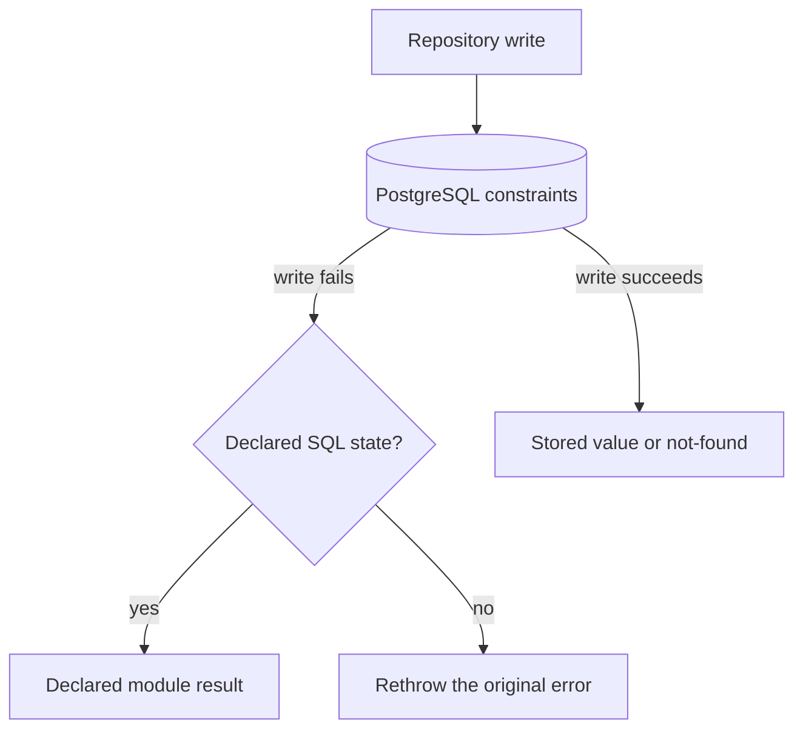

# Backend persistence error handling

This guide explains how a repository turns an expected PostgreSQL constraint
failure into a typed result, and how every repository runs its transactions.

## The rule

Let PostgreSQL enforce unique business rules. A repository declares that SQL
state `23505` (a unique violation) means its generic conflict result, and it
may declare an expected result for a foreign-key violation, SQL state `23503`
or, for a delete blocked by `ON DELETE RESTRICT` since PostgreSQL 18, `23001`.
Every SQL state the repository did not declare is rethrown.

Never inspect or return a constraint name, an index name, or a localized error
message. Names such as `ux_countries_name_lower` are schema details that a
migration may change; they belong in server logs, not in a service result.

## The five-minute mental model



Two requests may reach a write at the same time; a unique index lets only one
of them succeed, and that is the whole concurrency protection.

## Shared implementation

[`executePostgresWrite`](../../../../backend-ts/src/platform/db/postgres-write.ts)
is the one place the SQL states are read:

```ts
export async function executePostgresWrite<T, V extends string>(
  violations: { uniqueViolation?: V; foreignKeyViolation?: V },
  operation: () => Promise<T>,
): Promise<T | V>
```

A repository names the result it wants for a violation and passes the write:

```ts
insert: (country: Omit<Country, 'id'>) =>
  executePostgresWrite({ uniqueViolation: 'conflict' }, () =>
    write(db, async (trx) => {
      const { id } = await trx.insertInto('countries').values({ … }).returning('id').executeTakeFirstOrThrow()
      return { id, ...country }
    }),
  ),
```

The return type is `Promise<Country | 'conflict'>`, and the service maps the
string to `conflict`. A write with one foreign key declares
`foreignKeyViolation: 'countryMissing'` and maps it to
`invalid({ countryId: ['Country not found'] })`. The foreign-key result is
only unambiguous when exactly one relationship can fail the write: an insert or
update with a single reference reports the missing row, a delete that restrict
foreign keys protect reports that the row is still in use. A write with two
references must not declare it.

The `pg` driver reports the SQL state as the error's `code`; Kysely rethrows
the driver error unchanged, so `executePostgresWrite` reads that property and
nothing else.

Call `executePostgresWrite` *around* `write(db, …)`, as above: a constraint
that is checked at commit time (the deferred unique constraints of the SPOD
variants) fails inside `write`'s commit, and only the outer call sees it.

## The two transaction helpers

Repositories do not spell out the transaction policy. It lives in
[`database.ts`](../../../../backend-ts/src/platform/db/database.ts):

```ts
list: () => read(db, (trx) => trx.selectFrom('countries').select(columns).execute()),
delete: (id) => write(db, (trx) => trx.deleteFrom('countries').where('id', '=', id).executeTakeFirst()),
```

`read` opens a read-only transaction, so PostgreSQL rejects an accidental write
instead of performing it; `write` opens a writing one. Neither retries: one
repository call has exactly one observable result. A capability that must join
the caller's transaction takes the `Transaction<Tables>` as a parameter and
runs its statements on it instead of calling either helper.

## How long a statement may wait

Every pooled connection runs under two PostgreSQL bounds, set once in
`createDatabase` through the connection's startup options and overridden by no
module:

| Setting | Value | What it bounds |
| --- | --- | --- |
| `lock_timeout` | `10s` | waiting for a row or table lock another transaction holds |
| `statement_timeout` | `30s` | one statement's own execution |

Without `lock_timeout`, an insert that queues behind an uncommitted competitor
on a unique index waits exactly as long as that competitor's transaction lives.
The migration runner is the deliberate exception: it opens a plain `pg.Client`
without the options, because creating an index on a large table may honestly
run for minutes.

When a bound fires, the driver raises an error with state `55P03` (lock
timeout) or `57014` (statement timeout). Neither is declared, so the error is
rethrown, reaches the app's `onError`, and the client gets the generic `500`.

## Deliberate trade-off

Every `23505` from a write that declares `uniqueViolation` becomes the same
conflict. Country does not say whether the name or the code was duplicated, and
a future unique rule produces the same generic conflict. This loses
field-specific detail but keeps the persistence interface small and avoids a
second query after a failed write. The HTTP message stays generic
(`Country name or code already exists`) and never names the index.

## Tests

For a module with unique writes, test:

1. a normal duplicate create or update returns the conflict;
2. concurrent duplicate writes (`Promise.all` of two creates) leave one stored
   row and one conflict; and
3. an undeclared SQL error is rethrown.

The platform test `postgres-write.test.ts` pins the mapping itself against the
real database; a module tests only its own writes.
