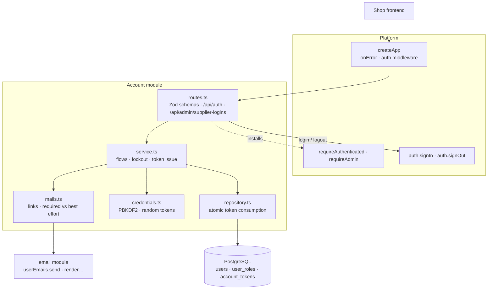

# The Account package

This guide explains the TypeScript code in
[`backend-ts/src/modules/account`](../../../../backend-ts/src/modules/account).

## What this package does

The Account package gives the shop real user accounts. Visitors register with
e-mail and password, confirm their address via a mailed link, and sign in to a
cookie session. Customers manage their profile (shipping address, optional
separate billing address), change their e-mail with re-confirmation, change
their password, and recover access with a password reset link.

The package is the **trusted credential verifier** of the platform auth: a
successful login is the one production code path that calls
`auth.signIn(c, userId, roles)`. Session mechanics, CSRF, and the route
protections stay in the platform and are reused, never reimplemented (see
[Authentication and authorization](../conventions/authentication-and-authorization.md)).

The package also owns the **supplier logins**: an administrator creates a
login for one supplier, the invited person receives a mailed link and sets
their own password, and deleting the login revokes the access again. That is
the account side of the supplier fulfillment feature; everything a supplier
then *does* lives in the production module.

The package touches nothing outside the account itself. A login and a
registration store, verify, and mail. They never move another module's rows
and never mint, renew, or delete the visitor's `voenix.guest` cookie.

## The five-minute mental model



One clock is injected into the module (`now: () => Date`, the system clock in
production). Token expiry, lockout release, and the stored creation timestamp
all read it, which is why the tests can travel through time instead of
sleeping.

## File map

```text
account/
|- index.ts              createAccountModule({ db, auth, userEmails, frontendBaseUrl, now?, pbkdf2Iterations? })
|                        → { routes, supplierAccounts }
|- routes.ts             the request schemas and the 15 routes of both surfaces
|- service.ts            createAccountService(…): every flow; the input and profile types
|- mails.ts              createAccountMails(…): the links and the mail failure policy
|- credentials.ts        createPasswordHasher(iterations), newAccountToken(), tokenHashOf(token)
|- repository.ts         createAccountRepository(db); Address, UserAccount, SupplierLogin, TokenPurpose
|- schema.ts             UsersTable, UserRolesTable, AccountTokensTable, merged into Tables
|- routes.test.ts        the flows over HTTP against the real database
|- credentials.test.ts   the hash encoding, including a hash made by the Kotlin hasher
`- validation.test.ts    the schemas' field names and messages
```

Two placements follow the general rule of
[Source file organization](../conventions/source-file-organization.md):

- The request schemas live in `routes.ts`, next to the handlers that read
  them. The input types they produce live in `service.ts`, which consumes
  them, and each schema is tied to its type with `satisfies`.
- `Address` lives in `repository.ts`, because the repository produces it when
  it reads a user. The profile schema produces the same shape, so what `PUT
  profile` receives is exactly what `GET me` answers: a full replace sends back
  what it read.

`mails.ts` and `credentials.ts` are files of their own because each is one
concern the service uses at several places: the mail policy (which mail
carries which link, which delivery may fail) and the cryptography (password
hashes and random tokens).

### Deliberate boundaries

- **One service.** The customer flows and the administrator's supplier logins
  share one `createAccountService`. Kotlin split them into two seams because
  its interface had reached Detekt's eleven-method limit; without the
  interface, two factories would only duplicate the wiring of the same four
  collaborators. The routes still sit on two disjoint paths with two
  protections.
- **One repository.** `users`, `user_roles`, and `account_tokens` are one
  table graph, and creating a supplier login writes the user row and its role
  in one transaction.
- **Plain results, not `OperationResult`.** The `/api/auth` flows answer
  outcomes the shared mapping cannot express (`400` + `INVALID_LINK` for an
  invalid link, `401` for a session whose user is gone, `502` for a refused
  mail), so the service answers string unions like `'emailTaken' |
  'deliveryFailed'` and each route maps them with an exhaustive `switch`.

## HTTP API

Every route a visitor or customer uses sits under `/api/auth`, because the
frontend calls these paths; the administrator's supplier-login management sits
under `/api/admin/supplier-logins`. Mutations without a meaningful payload
answer `204 No Content`; failures use the shared `ApiError` shape
`{ message, errors, code? }`.

Anonymous endpoints (no session, no CSRF header):

| Method and path | Success | Failure notes |
| --- | --- | --- |
| `POST /api/auth/register` | `204`, confirmation mail sent | `400` invalid input, `409` e-mail exists, `502` the provider did not accept the confirmation mail, `500` a failure of our own |
| `POST /api/auth/login` | `204` + session cookie | `400` invalid input, `401` bad credentials (uniform), `403` e-mail not confirmed, `429` locked out |
| `POST /api/auth/confirm-email` | `204` | `400` invalid input, `400` + `"code": "INVALID_LINK"` for an invalid/expired link |
| `POST /api/auth/resend-confirmation` | always `204` | only `400` invalid input, so the flow is enumeration-safe |
| `POST /api/auth/forgot-password` | always `204` | only `400` invalid input, so the flow is enumeration-safe |
| `POST /api/auth/reset-password` | `204` + notification mail | `400` invalid input, `400` + `"code": "INVALID_LINK"` for an invalid/expired link |
| `POST /api/auth/confirm-change-email` | `204`, login e-mail replaced | `400` + `"code": "INVALID_LINK"` for an invalid/expired link, `409` e-mail taken meanwhile |

The three link flows answer an invalid or expired link with `400` and the
machine-readable `"code": "INVALID_LINK"`, so the frontend can show
link-specific copy without matching on the message text. The code says nothing
about *why* the link failed: an unknown, an already-used, and an expired token
are indistinguishable. Validation failures on the same endpoints carry no
`code`.

| Failure | Status | `message` |
| --- | --- | --- |
| e-mail taken (register, change, confirm change, supplier login) | `409` | `Email already exists` |
| bad credentials | `401` | `Invalid email or password` |
| unconfirmed address | `403` | `Email is not confirmed` |
| locked out | `429` | `Too many failed login attempts` |
| invalid confirmation or change link | `400` + `INVALID_LINK` | `Invalid or expired confirmation link` |
| invalid reset link | `400` + `INVALID_LINK` | `Invalid or expired password reset link` |
| refused confirmation mail | `502` | `Confirmation email could not be delivered` |
| wrong current password | `401` | `Invalid password` |
| session user no longer exists | `401` | `User not found` |

Authenticated endpoints (`requireAuthenticated`; mutations also require the
`X-XSRF-TOKEN` header):

| Method and path | Success | Failure notes |
| --- | --- | --- |
| `GET /api/auth/me` | `200` profile | `401` |
| `PUT /api/auth/profile` | `200` updated profile | `400`, `401` |
| `POST /api/auth/change-email` | `204`, confirmation to the new address, notification to the old | `400`, `401` wrong password, `409`, `502` the provider did not accept the confirmation mail, `500` a failure of our own |
| `POST /api/auth/change-password` | `204` + notification mail | `400`, `401` wrong current password |
| `POST /api/auth/logout` | `204`, session cookie cleared | `401`, `400` CSRF |

The protection is installed **per route**, not on a sub-app: a sub-app mounted
at `/api/auth` with `use(requireAuthenticated)` would protect the anonymous
routes below the same prefix too.

The profile is one type, `AccountProfile`, answered by both `me` and
`profile`: `id`, `email`, `roles` (sorted), `shippingAddress` and
`billingAddress` (an object with all eight fields, or `null`),
`hasSeparateBillingAddress`, and the ISO-8601 `createdAt`.

Admin endpoints (`requireAdmin`; mutations also require the `X-XSRF-TOKEN`
header):

| Method and path | Success | Failure notes |
| --- | --- | --- |
| `POST /api/admin/supplier-logins` | `201` + `Location` + `SupplierLogin`, invitation mail sent | `400` invalid input **or** unknown supplier (as a `supplierId` field error `Supplier does not exist`), `409` e-mail exists, `502` the provider did not accept the invitation but *the login exists*, `500` |
| `GET /api/admin/supplier-logins?supplierId=3` | `200`, a bare array of `SupplierLogin` | `400` `supplierId: ["A positive supplier id is required"]` |
| `DELETE /api/admin/supplier-logins/{userId}` | `204` | `404` `Supplier login not found` for an unknown id, an id that is not a supplier login, **and** a malformed id |

`SupplierLogin` is `{ userId, email, supplierId, createdAt }`, with no
credential or lockout state, because this surface manages *who* may sign in for
a supplier, not how that login is doing. A malformed `userId` answers `404`
rather than the platform's `400` for malformed ids: it can never name a
supplier login, so it gets the same answer as an id that names a customer.

The path is deliberately **not** a child of `/api/admin/suppliers`. That
subtree belongs to the supplier module and carries its own protection; a
disjoint path keeps each module's protection exactly where that module put it.

Two failures on `POST` are decided by the database rather than by a lookup: a
`23505` on the unique e-mail index becomes the `409`, and a `23503` on the
`users.supplier_id` foreign key becomes the `400` with the `supplierId` field
error. Neither response contains a constraint name.

The `502` is the one status whose *message* matters: `The supplier login was
created, but its invitation email could not be delivered`. The row and its
token stay, so a second `POST` would answer `409` for the taken address. The
invited person recovers through the normal "Passwort vergessen" flow, which
replaces the stored reset token with a freshly mailed one.

None of these routes sets `Cache-Control`; the Kotlin account routes did not
either (only the order and checkout routes answer `no-store`).

## Request validation

Each body is checked once by its Zod schema in `routes.ts` (see
[Request validation](../conventions/request-validation.md)). Two field rules
are shared by several bodies:

| Rule | Bodies | Messages |
| --- | --- | --- |
| `emailField`: trimmed; at most 255 characters, no whitespace or control characters, exactly one `@` with text on both sides | register, login, resend, forgot, reset, change-email, confirm-change-email, supplier login | `Email is required`, `Invalid email format` |
| `newPasswordField`: present, at least 8 characters | register, reset, change-password | `Password is required`, `Password must be at least 8 characters` |

The e-mail rule is the one of the email module's recipient check in Kotlin
(`EmailRecipient`), so validation never passes an address the mail provider
would refuse.

Login deliberately does **not** apply the length rule to the password: a
password from before the rule must still sign in, and the login must not tell
which rules current passwords follow. A token is required to be non-blank; a
user id is a JSON integer (`User id is required`).

The profile schema applies the address rules (`Must be at most N characters`
for the six text fields, `Country must be a two-letter code`, `Phone is not a
valid phone number`) to the value as sent, then normalizes it: every field is
trimmed, a blank becomes `null`, and an address with no field left becomes
`null`. A missing `shippingAddress` answers `Shipping address is required`.

## Security behavior worth knowing

- **Uniform login failures.** Unknown e-mail and wrong password produce the
  same `401` body, and the service verifies a placeholder hash for unknown
  users so both paths cost a hash comparison.
- **Enumeration-safe flows.** `resend-confirmation` and `forgot-password`
  always answer `204`. A failed mail delivery, or even a database error, after
  validation is logged and never changes the response.
- **Lockout.** 15 failed logins lock the account for 10 minutes (`429`).
  Locking resets the counter, a successful login resets it too, and the
  increment runs under `SELECT … FOR UPDATE`, so concurrent failures cannot
  lose an attempt.
- **Single-use tokens.** Confirmation, reset, and change-e-mail links carry a
  random 256-bit token (URL-safe Base64) whose lower-case hex SHA-256 is
  stored in `account_tokens`. A token is valid for 24 hours, consuming it
  deletes the row, and issuing a new token replaces the previous one of the
  same purpose (unique `(user_id, purpose)`), so only the latest link counts.
  The stored hash is compared in constant time. A change-e-mail token also has
  to match the address it was issued for; a refused link is **not** consumed.
  The delete checks that it removed the row, so two requests presenting the
  same link at once consume it only once.
- **Password hashing.** `createPasswordHasher` uses PBKDF2-HMAC-SHA256 from
  `node:crypto` with the versioned encoding of the Kotlin `PasswordHasher`:
  `v1$<iterations>$<salt>$<hash>`, a 16-byte salt and a 32-byte hash, both
  standard Base64 without padding. Verification reads the iteration count from
  the encoding, so hashes stored by the Kotlin backend keep verifying and the
  work factor (600 000 in production) can change without invalidating them.
  The Base64 decoding is strict like Java's: a character outside the alphabet
  makes the encoding invalid instead of being skipped.
- **Changing the password keeps sessions valid.** The platform cookie session
  is self-contained, so neither the current nor other sessions are logged out.
- **Login and logout leave the guest cookie alone.** Neither answer carries a
  `voenix.guest` cookie; one browser stays one guest, signed in or not (see
  [Guest identity](../conventions/authentication-and-authorization.md#guest-identity)).
  Logout clears only `voenix.auth`.

## Account mails

Account mails are sent **directly** through the email module's
`userEmails.send(render…(…))`, never stored in the outbox, because they carry
secret links. `mails.ts` owns the policy:

- **Required** deliveries (registration confirmation, change-e-mail
  confirmation, supplier invitation) answer `false` for an `EmailDeliveryError`
  and only for that; the route answers `502`.
- `502` means *the provider*, and only the provider. Anything else a send can
  throw (a rendering failure, any other bug of ours) propagates to the app's
  `onError`, which answers a plain `500 Internal server error` with no
  exception text, recipient, or provider detail. The registration or the token
  that preceded the mail stays stored, so the resend flow still recovers.
  The distinction matters to the customer: `502` says "try the resend", `500`
  says "this cannot succeed until we fix it".
- **Best-effort** notifications (password changed, e-mail change notice) are
  logged on failure and never fail the operation, our own bugs included: the
  change they announce is already stored.
- The password-reset mail of `forgot-password` throws on any failure; its
  caller is enumeration-safe and swallows everything alike.
- The module builds and percent-encodes (`encodeURIComponent`) the complete
  links from `settings.frontend.baseUrl`, which the settings already
  normalized without a trailing slash:
  `{baseUrl}/confirm-email?userId=…&token=…`,
  `{baseUrl}/reset-password?email=…&token=…`,
  `{baseUrl}/confirm-change-email?userId=…&newEmail=…&token=…`, and
  `{baseUrl}/set-password?email=…&token=…` for a supplier invitation.
- The invitation link is a *reset* link with different copy. Setting the first
  password and resetting a forgotten one are the same operation, so it reuses
  the `RESET_PASSWORD` token purpose and `POST /api/auth/reset-password`; only
  the mail text (`renderSupplierInvitation`) and the frontend page differ.

## Persistence

Migration
[`V11__create_users.sql`](../../../../backend-ts/migrations/V11__create_users.sql)
creates the three tables `schema.ts` declares:

- `users`: the e-mail doubles as the login name; a unique index on
  `LOWER(email)` makes uniqueness case-insensitive and concurrency-safe, and
  every lookup by e-mail compares `lower(email) = lower($1)`. Address fields
  are flat columns; `has_separate_billing_address` controls whether the
  billing fields are used. Lockout state lives in `failed_login_count` and
  `locked_until`. The nullable `supplier_id` binds a supplier login to its
  supplier (`ON DELETE RESTRICT`, plus a partial index); customers and admins
  leave it `NULL`.
- `user_roles`: plain text roles (`ADMIN`, `CUSTOMER`, `SUPPLIER`), primary
  key `(user_id, role)`.
- `account_tokens`: SHA-256 token hash, purpose, optional pending new e-mail,
  expiry; unique per `(user_id, purpose)`.

The repository is the only code that queries these tables. As everywhere in
this backend, the database is the authority for uniqueness:
`executePostgresWrite` maps `23505` to `'emailTaken'` and the supplier foreign
key to `'unknownSupplier'` (see
[Persistence error handling](../conventions/persistence-error-handling.md)).
Registration writes no supplier link, so its only refusal is `'emailTaken'`;
`'unknownSupplier'` reaches only the supplier-login creation, which answers it
as the field error `supplierId: Supplier does not exist`.
The change-e-mail confirmation consumes the token and updates the e-mail in
one transaction, so a unique violation rolls the token consumption back and
the link stays usable.

### Creating and deleting a supplier login

Creating one is a single transaction: the `users` row, its one `user_roles`
row with `SUPPLIER` (never `CUSTOMER`), and the `supplier_id` are written
together. Two column values are worth explaining:

- `email_confirmed = true`. Nobody ever mails this address a confirmation
  link, and the login refuses unconfirmed addresses. The accepted risk is a
  typo: a mistyped address hands the invitation to whoever owns that inbox;
  the fix is to delete the login and create it again.
- The stored `password_hash` covers a fresh random 256-bit value that is never
  mailed and never kept, so the login cannot be signed into until the
  invitation link sets a real password.

The token and the mail follow *after* that transaction, exactly like
registration: a provider outage leaves a usable login behind.

Deleting is a hard `DELETE FROM users` restricted to rows whose `supplier_id`
is not null. That restriction is what makes an id "a supplier login", so a
customer id and an unknown id both answer `404`. Roles and tokens cascade away
with the row; `orders.user_id` and `production_jobs.shipped_by_user_id` are
set to `NULL`, so shipped history survives the login that made it.

## Bootstrapping the first administrator

The application seeds no roles and no users. To grant the first `ADMIN` role
on a fresh deployment, register the account normally (registration always
assigns `CUSTOMER`), confirm the e-mail, and then add the role directly in the
database:

```sql
INSERT INTO users_schema.user_roles (user_id, role)
SELECT id, 'ADMIN'
FROM users_schema.users
WHERE LOWER(email) = LOWER('admin@example.com')
ON CONFLICT DO NOTHING;
```

Replace `users_schema` with the configured search path (`DATABASE_SEARCH_PATH`,
default `voenix`) and the e-mail with the administrator's address. The role
becomes effective on the next login, because the session stores its roles
when it is created.

In development `EMAIL_ENABLED` is `false`, so the confirmation mail is never
sent, and the token cannot be read from the database either: `account_tokens`
stores only its SHA-256 hash. Confirm the address in SQL instead, before
granting the role:

```sql
UPDATE users_schema.users SET email_confirmed = true
WHERE LOWER(email) = LOWER('admin@example.com');
```

The same applies to a supplier login whose invitation never left: set a
password hash with `createPasswordHasher(600000).hash(password)` from
`credentials.ts` or, with mail enabled, use "Forgot password".

## Composition

The composition root creates the module after the email module and before
every module whose routes use `requireSupplier`:

```ts
const email = createEmailModule({ db, settings: settings.email, fetch })
const accounts = createAccountModule({
  db,
  auth,
  userEmails: email.userEmails,
  frontendBaseUrl: settings.frontend.baseUrl,
})
app.route('/', accounts.routes)
// later: requireSupplier(accounts.supplierAccounts) in the production routes
```

`supplierAccounts` implements the platform's `SupplierAccounts` interface:
`supplierIdOf(userId)` answers the `users.supplier_id` of that user, or `null`
for a customer, an admin, and a user that does not exist. `requireSupplier`
asks it on every request to a supplier route, so a deleted supplier login
loses access with the very next request instead of keeping the `SUPPLIER`
role its session cookie still carries.

The two optional parameters exist for the tests: `now` (default
`() => new Date()`) and `pbkdf2Iterations` (default 600 000). The work factor
is not an environment variable; the Kotlin `account.pbkdf2Iterations` key was
only ever set by tests.

## Tests

Run from `backend-ts/`:

```sh
bun test src/modules/account    # this module only (needs Docker)
bun run check                   # the full gate
```

`routes.test.ts` builds the module once with a recording `userEmails` fake (an
object whose `send` records the mail or throws the failure a test sets) and a
clock the tests move forward. Confirmation, reset, and invitation links are
always taken from the recorded mails, never from the token table.

| Test | What it states |
| --- | --- |
| [`routes.test.ts`](../../../../backend-ts/src/modules/account/routes.test.ts) | A happy path per route; register duplicate `409`, normal and concurrent; the confirm, reset, and change-e-mail links incl. reuse, replacement, `INVALID_LINK`, and the 24-hour expiry; uniform `401`, `403`, the lockout and its release; session cookie set at login and cleared at logout, no guest cookie on either; a hash stored by Kotlin signs in; the `502`/`500` mail policy; wrong current password; the late `409` at confirm-change-email; the supplier login lifecycle with `supplierIdOf`, the duplicate, the unknown supplier, the `404` matrix, and the `502` that keeps the login |
| [`credentials.test.ts`](../../../../backend-ts/src/modules/account/credentials.test.ts) | The hash encoding: a fixture produced by the JDK's PBKDF2 exactly as the Kotlin hasher calls it, the round trip, iterations read from the encoding, and every malformed encoding refused |
| [`validation.test.ts`](../../../../backend-ts/src/modules/account/validation.test.ts) | Every request schema's field names and messages, and the address normalization |

The platform cases (`401`/`403` of the protections, CSRF, unknown properties,
malformed bodies) are pinned once in `src/platform/**/*.test.ts`. Not ported
from Kotlin: the route tests against stub operations (they proved that a
rejected request never reaches the operation, which the platform tests now
state once), the cancellation test, the migration constraint test, and the
"a supplier with a login cannot be deleted" test, which belongs to the
supplier module's delete.

## Differences to the Kotlin backend

- Unknown properties answer `400 Unknown property`, and a field of the wrong
  JSON type answers that field's message instead of `Invalid request body`
  for the whole body.
- `createdAt` always carries milliseconds (`2026-07-24T10:00:00.000Z`,
  `Date.toJSON`), where Kotlin's `Instant` omitted a zero fraction.
- A token consumption checks that its delete removed the row, so a link
  presented twice at the same moment is consumed once.

## Safe change recipes

### Add a profile field

1. Add a migration under `backend-ts/migrations/` and the column to
   `UsersTable`.
2. Add the field to `Address` (or `AccountProfile`), to the mapping in
   `toUserAccount`, and to `updateProfile` in the repository.
3. Add it to the profile schema with its rule and message, and to
   `validation.test.ts`.
4. Run `bun test src/modules/account`, then `bun run check`.

### Add a mailed link

1. Add the template to the email module and export its `render…` function.
2. Add a token purpose to `TokenPurpose` if the link is a new kind of secret.
3. Add the send to `mails.ts` and decide: required (`sendRequired`, the route
   answers `502`) or best effort.
4. Take the link from the recorded mail in the test, never from the database.
