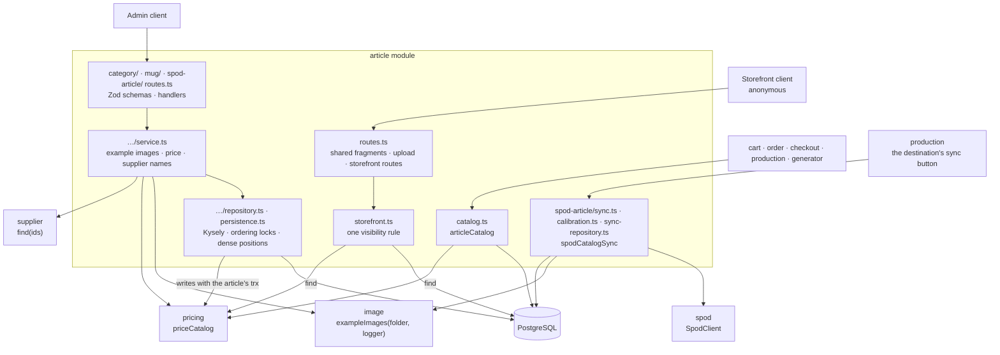

# The Article package

This guide explains the TypeScript code in
[`backend-ts/src/modules/article`](../../../../backend-ts/src/modules/article).
It is the port of the Kotlin module described in the
[Kotlin article guide](../../backend/packages/article-package.md); the
decisions are carried over, the file map, the composition, and the tests are
the TypeScript ones, and [What the port changed](#what-the-port-changed) lists
every difference.

## Contents

- [What this package does](#what-this-package-does)
- [The five-minute mental model](#the-five-minute-mental-model)
- [File map](#file-map)
- [Composition](#composition)
- [HTTP API](#http-api)
  - [Categories](#categories)
  - [Subcategories](#subcategories)
  - [Mugs](#mugs)
  - [SPOD articles](#spod-articles)
  - [The storefront](#the-storefront)
- [The exported capabilities](#the-exported-capabilities)
- [The SPOD catalog sync](#the-spod-catalog-sync)
  - [How one sync run works](#how-one-sync-run-works)
  - [The report and its warning codes](#the-report-and-its-warning-codes)
  - [The sync decisions](#the-sync-decisions)
- [Validation and normalization](#validation-and-normalization)
- [The database schema](#the-database-schema)
- [Concurrency: the ordering locks and the deferred unique rule](#concurrency-the-ordering-locks-and-the-deferred-unique-rule)
- [What the port changed](#what-the-port-changed)
- [Tests](#tests)

## What this package does

The Article package owns the product catalog: the shared category structure
(categories and subcategories) and one table per article type — *mugs*, and
*SPOD articles*, every product the print-on-demand partner Spreadconnect (SPOD)
prints one front motif on. The article type names the **channel** a product is
made through, not the kind of product: a t-shirt and a tote bag are both `SPOD`.

- **Admin routes** for categories, subcategories, mugs (with the variant
  example-image pre-upload), and SPOD articles (no create, no upload: a sync
  run creates them).
- **Three anonymous storefront reads**: the mugs and the SPOD articles a
  customer may buy, and the one type-agnostic navigation both sit in.
- **Two capabilities**: `articleCatalog` (`find` and `printFormats`), which
  Cart, Order, Checkout, Production, and the Generator use for the article
  references they store, and `spodCatalogSync`, which Production triggers on a
  destination.

Every level has a display order that is **dense** (1, 2, 3, … without gaps) and
**unique**: globally for categories, per category for subcategories, per
article type for mugs and SPOD articles. Category and subcategory names are
unique regardless of letter case; articles have no name rule. PostgreSQL
enforces all of these, and the module never asks it whether a rule would hold
before writing.

An article is more than a row: writing one writes its identity, its variants
and their identities, and the price row it owns, all in one transaction. A
rejected article never leaves a price behind, and a rejected price never
creates an article.

## The five-minute mental model



- The Zod schema of a body is its only validation; the service trusts what it
  receives (see [Request validation](../conventions/request-validation.md)).
- The services check what needs another module before a transaction opens —
  the submitted example images, the price (`priceCatalog.prepare`) — and map
  the repository's answers to `OperationResult`s.
- The repositories own the transactions, the ordering locks, and the SQLSTATE
  mapping. The two article repositories write the price with
  `priceCatalog.storeInTransaction(trx, …)` and its siblings, so the price row
  commits or rolls back with the article.
- The module queries only its own tables; supplier names, prices, and pictures
  come from the owning modules' capabilities.

## File map

```text
article/
|- index.ts              createArticleModule(deps) → { routes, articleCatalog, spodCatalogSync }; the exported types
|- schema.ts             the twelve article tables, merged into the platform's Tables
|- routes.ts             shared request fragments (reorderInput, articlePrice, optionalId, …),
|                        exampleImageUpload, storefrontRoutes
|- persistence.ts        ordering locks, nextPosition, moveInSequence, rewritePositions, closePositionGap,
|                        lockCategoryReference, namesOf, unreferencedFilenames
|- price.ts              preparePrice (errors under `price.*`), writePrice (store, replace in place, keep)
|- catalog.ts            articleCatalog: find, printFormats; ArticleType, PrintAspectRatio, CatalogVariant,
|                        catalogKey, spodVariantName
|- storefront.ts         the three anonymous reads and their one visibility rule
|- category/
|  |- routes.ts          articleCategoryInput, articleSubcategoryInput, the category and subcategory routes
|  |- service.ts         both use cases, the subcategory example-image rule
|  `- repository.ts      both repositories' queries, the category locks, the move-retry loop
|- mug/
|  |- routes.ts          mugArticleInput, the mug routes
|  |- service.ts         MugArticleInput; images checked, price prepared, supplier names
|  `- repository.ts      MugArticle, MugArticleListItem, MugDetails; the writes and the variant diff
|- spod-article/
|  |- routes.ts          spodArticleInput, the five SPOD admin routes
|  |- service.ts         SpodArticleInput, the admin use cases, the three picture folders
|  |- repository.ts      SpodArticle, SpodArticleListItem, PrintFrame; reads and the shop-owned write
|  |- sync.ts            createSpodCatalogSync: one run; the report types
|  |- sync-repository.ts the run's two transactions: upsert one article, sweep
|  `- calibration.ts     the magenta design, measurePrintFrame (sharp), createCalibration
|- test-fixtures.ts      test-only: the module on real pricing, supplier, image; SQL seeds; drawn previews
`- *.test.ts             see Tests
```

The sub-folders follow the Kotlin sub-packages (`category`, `mug`, `spod`).
The SPOD one is called `spod-article/` so it is not confused with the `spod`
module, the partner's HTTP client. The Kotlin `persistence/` package is gone:
each slice holds its own repository, and what every repository shares lives in
`persistence.ts` and `price.ts`.

## Composition

```ts
const pricing = createPricingModule({ db })
const suppliers = createSupplierModule({ db, countries })
const images = createImageModule({ settings: settings.image, guestTokens: auth.guestTokens })
const spod = createSpodClient()            // the one client of the application
const article = createArticleModule({ db, images, prices: pricing.priceCatalog, suppliers, spod })
app.route('/', article.routes)
// article.articleCatalog → cart, order, checkout, production, generator
// article.spodCatalogSync → production (the destination's sync route)
```

`createArticleModule` asks `images.exampleImages(folder, logger)` once per
picture folder, all logging under the `article` logger:

| Folder | Written by | Deleted by |
| --- | --- | --- |
| `articles/subcategory-example-images` | the subcategory pre-upload | subcategory update and delete |
| `articles/mugs/variant-example-images` | the variant pre-upload | mug update and delete |
| `articles/spod/listing-images` | the sync | the sync, the SPOD delete |
| `articles/spod/mockups` | the sync | the sync, the SPOD delete |
| `articles/spod/size-charts` | the sync | the sync, the SPOD delete |

## HTTP API

Every route under `/api/admin/articles` requires the `ADMIN` role; mutating
methods also need the CSRF header (the platform's protection). The three
`/api/articles` routes are anonymous. Lists are bare JSON arrays.

### Categories

| Method and path | Success | Errors |
| --- | --- | --- |
| `GET /api/admin/articles/categories` | `200`, every category in display order | |
| `POST /api/admin/articles/categories` | `201`, the category, `Location` | `409 Article category name already exists` |
| `PUT /api/admin/articles/categories/order` | `200`, the complete new order | `404 Article category not found`, `409 Article category order changed concurrently, please retry` |
| `GET /api/admin/articles/categories/{id}` | `200`, the category | `404 Article category not found` |
| `PUT /api/admin/articles/categories/{id}` | `200`, the category | `404`, `409 Article category name already exists` |
| `DELETE /api/admin/articles/categories/{id}` | `204` | `404`, `409 Article category is used by subcategories or articles and cannot be deleted` |

A malformed id answers `400 Invalid article category id`. The body is
`{ "name", "description", "active" }`; the answer adds `id` and `position`.
`position` is never accepted: create appends, delete closes the gap, the
reorder moves one category to the place of another. The reorder body of every
level is `{ "sourceId": 42, "targetId": 7 }` and its answer is the complete new
order, so a client never reconstructs the sequence.

### Subcategories

| Method and path | Success | Errors |
| --- | --- | --- |
| `GET /api/admin/articles/subcategories` | `200`, by category order, then own order | |
| `POST /api/admin/articles/subcategories` | `201`, `Location` | `409 Article subcategory name already exists in this article category`, `400 categoryId: Article category does not exist` |
| `POST /api/admin/articles/subcategories/example-images` | `201`, `{ "filename": "…" }` | `400 file: …` |
| `PUT /api/admin/articles/subcategories/order` | `200`, the new order of the affected category | `404 Article subcategory not found`, `409 Article subcategory order changed concurrently, please retry` |
| `GET /api/admin/articles/subcategories/{id}` | `200` | `404 Article subcategory not found` |
| `PUT /api/admin/articles/subcategories/{id}` | `200` | `404`, `409` name, `400 categoryId: Article category does not exist`, `400 categoryId: Article subcategory is used by articles and cannot be moved to another category` |
| `DELETE /api/admin/articles/subcategories/{id}` | `204` | `404`, `409 Article subcategory is used by articles and cannot be deleted` |

A malformed id answers `400 Invalid article subcategory id`. A subcategory
names its `categoryId` in body and answer. A category change appends in the
new category and compacts the old one. A reorder target from another category
is outside the reordered list and answers `404` like an unknown id.

**The example image.** Upload and save are two requests. The pre-upload takes
a `multipart/form-data` body with a `file` part (any other content type
answers `415` through the platform's `formBody`), stores it through the image
module (always WebP under a minted UUID name), and answers the name; create and
update then carry it as `exampleImageFilename` (`null` removes the image). A
missing part answers `400 file: An example image file part is required`, an
oversized one `400 file: Example image must not exceed 10 MiB`, and what the
storage rejects arrives in the same shape. While saving, a submitted name must
look minted and the file must exist (`Example image filename must be the name
of an uploaded image`, `Example image does not exist` on the field) — also a
name the row already stores, because a vanished stored file means another
writer replaced it. A file a write stops naming is deleted after the commit,
only when no other row names it (asked inside the transaction); a failed delete
is only logged. An upload nobody saves stays behind as an accepted orphan. The
rule itself is the image module's `exampleImages`.

### Mugs

| Method and path | Success | Errors |
| --- | --- | --- |
| `GET /api/admin/articles/mugs` | `200`, `MugArticleListItem` rows in display order | |
| `POST /api/admin/articles/mugs` | `201`, `MugArticle`, `Location` | field errors below |
| `PUT /api/admin/articles/mugs/order` | `200`, the complete new order as list rows | `404 Article not found`, `409 Article order changed concurrently, please retry` |
| `POST /api/admin/articles/mugs/variant-example-images` | `201`, `{ "filename": "…" }` | `400 file: …` |
| `GET /api/admin/articles/mugs/{id}` | `200`, `MugArticle` | `404 Article not found` |
| `PUT /api/admin/articles/mugs/{id}` | `200`, `MugArticle` | `404`, field errors below |
| `DELETE /api/admin/articles/mugs/{id}` | `204` | `404` |

A malformed id answers `400 Invalid article id`. The request carries the
article, `mugDetails`, `mugVariants`, an optional `printAspectRatio` (`16:9`
when absent), and an embedded `price` (the pricing module's `priceInput`).
The answer adds the ids, `position`, and the full `CalculatedPrice`; there is no
`priceId` and no `articleType` on either side, which is what makes a price
belong to exactly one article by construction.

- **The overview list** names what a mug references (`categoryName`,
  `subcategoryName`, `supplierName`), counts its variants, and shows the
  picture of the default variant or, failing that, of the oldest variant with
  one. It runs four queries plus **one** `supplier.find` for the whole page.
- **Variants** come back default first, then by name, then by id.
- **The variant array is a diff**: an entry with an id updates that variant,
  one without inserts, a stored variant the array omits is deleted with its
  image; an id of another article answers `400 mugVariants: One or more
  variants do not belong to this article`. Removals run first, then every
  remaining default flag is cleared, then the submitted flags are written, so
  the one-default index holds at every step.
- **The price**: an omitted `price` keeps the owned row, a submitted one is
  written over it (`replaceInTransaction`), and the delete removes it after the
  identity row (the reference is `ON DELETE RESTRICT`).

Apart from the reorder, a mug write has no `409`: rejections are field errors.

| Field | Message | Decided by |
| --- | --- | --- |
| `categoryId` | `Article category does not exist` | the category lock that found no row |
| `subcategoryId` | `Article subcategory does not exist in this article category` | the lookup inside the locked category |
| `supplierId` | `Supplier does not exist` | SQLSTATE `23503`, the only reference left |
| `mugVariants` | `One or more variants do not belong to this article` | the diff, under the mug's row lock |
| `price` | `An active article requires a price` | the write path, which knows the stored price |
| `price.*` | the pricing module's messages (`Purchase VAT not found`, …) | `priceCatalog.prepare`, before the transaction |
| `mugVariants[i].exampleImageFilename` | `Example image …` | the image storage, before the transaction |

The write order is the old one:

```text
schema                   → 400, nothing happened
check example images     → 400, nothing happened
priceCatalog.prepare     → 400 price.*, no article
BEGIN
  lock article_types('MUG') (create, delete, reorder)
  lock the category, look the subcategory up inside it
  lock the mug row (update, delete)
  write the price with the trx         ← outside the 23503 mapping
  identity, mug, variant identities, variants   ← inside it
COMMIT
delete orphaned image files (best effort)
```

The price write sits outside the `23503` mapping: a VAT deleted after
`prepare` raises the same state, and it must stay a `500` rather than become
`supplierId: Supplier does not exist`.

### SPOD articles

How an operator gets one into the shop is the manual
[Configuring a SPOD article](../../guides/configuring-spod-articles.md).

| Method and path | Success | Errors |
| --- | --- | --- |
| `GET /api/admin/articles/spod` | `200`, `SpodArticleListItem` rows | |
| `PUT /api/admin/articles/spod/order` | `200`, the complete new order | `404 Article not found`, `409 Article order changed concurrently, please retry` |
| `GET /api/admin/articles/spod/{id}` | `200`, `SpodArticle` | `404 Article not found` |
| `PUT /api/admin/articles/spod/{id}` | `200`, `SpodArticle` | `404`, field errors below |
| `DELETE /api/admin/articles/spod/{id}` | `204` | `404` |

There is no create and no upload (sync decision 1); the old
`/api/admin/articles/tshirts/…` paths answer `404`. A malformed id answers
`400 Invalid article id`.

**Two owners.** The sync owns the product: name, descriptions, product type
name, colours with their pictures, the variant matrix, the size chart, the
supplier, and the measured `printFrame` with its `hotspot`. The shop owns
`active` (a run only switches it off), the category path, the position, the
price, and the default variant. The update body is exactly the shop's half:

```json
{ "active": true, "categoryId": 7, "subcategoryId": 42, "defaultVariantId": 34,
  "price": { "purchaseVatId": 1, "salesVatId": 1, "salesTotalInputCents": 1990 } }
```

| Rule | Reported on | Where |
| --- | --- | --- |
| an active article needs a category | `active` | schema |
| an active article needs a default variant (`An active article requires an active default variant`) | `active` | schema |
| the default must be an active variant of this article (`The default variant is not an active variant of this article`) | `defaultVariantId` | write path |
| an active article needs a price | `price` | write path |
| `An article that is missing at Spreadconnect cannot be activated` | `active` | write path |
| `An article without a measured print frame cannot be activated` | `active` | write path |
| unknown category / subcategory | `categoryId` / `subcategoryId` | write path |

The detail answer adds `appearances` (each colour with `mockupImageFilename`
and its ordered `listingImageFilenames`), the flat `spodVariants` in the order
of their colour then id (`name` is the composed `"Black / M"`, plus the three
SPOD ids, `spodVariantId`, `sku`), `printFrame` and `hotspot` (`null` until a
run measured them), the embedded `price`, and
`sync: { spodArticleId, environment, syncedAt, missingSince }`. A list row is
the mug row's twelve fields plus `syncedAt` and `missingAtSpreadconnect`; its
picture is the first listing image of the default variant's colour. The delete
retires an article for good (the next sync of that destination brings it back
if the operator was wrong) and deletes its listing images, mockups, and size
chart when no other row names them.

### The storefront

| Method and path | Success |
| --- | --- |
| `GET /api/articles/mugs` | `200`, the mugs a customer may buy, in display order |
| `GET /api/articles/spod` | `200`, the SPOD articles a customer may buy, in display order |
| `GET /api/articles/categories` | `200`, the navigation over every visible article |

**One visibility rule**: the article is active, its category is set and
active, and it has no subcategory or an active one. `storefront.ts` writes it
once per type (`visibleMugs`, `visibleSpodArticles`) and every read starts from
it, so the navigation never leads into an empty list.

- **No supplier fields and no `active` flags**; only active variants.
- **`articleType`** (`"MUG"`, `"SPOD"`) is the discriminator a grid that merges
  both lists switches on. It stays out of the admin representations.
- **`price`** is the effective gross in cents (a discount already subtracted),
  **`regularPrice`** the gross before the discount, `null` without one. Both
  come from **one** `priceCatalog.find` per page; an empty page asks nothing.
- A SPOD article answers `productTypeName`, `sizeChartImageFilename`, the
  `printFrame`, the colours that still have an active variant, and flat
  variants `{ id, name, appearanceId, size, isDefault }`. **The three SPOD ids
  and the hotspot never appear**: the printer's vocabulary stays inside.
- The navigation runs one `DISTINCT` query per article type and merges them,
  sorted by position then id on both levels.

## The exported capabilities

```ts
articleCatalog.find(references: Iterable<ArticleVariantReference>): Promise<Map<string, CatalogVariant>>
articleCatalog.printFormats(articleIds: Iterable<number>): Promise<Map<number, PrintAspectRatio>>
spodCatalogSync.sync(source: SpodCatalogSource): Promise<SpodSyncResult>
```

**`find`** answers a batch of `{ articleId, variantId }` pairs. The map is
keyed by `catalogKey(reference)` (`"12:34"`), because a JavaScript `Map`
compares object keys by identity; a caller looks its stored pair up with the
same function. Unknown pairs are **absent** — a deleted article, a variant that
never existed, and a pair whose variant belongs to another article read the
same way. One query per article type selects the variant ids, the article half
is matched in memory, and one `priceCatalog.find` resolves every price; an
empty input runs no SQL, a batch without prices asks pricing nothing.

| `CatalogVariant` field | Meaning |
| --- | --- |
| `articleType` | `'MUG' \| 'SPOD'` |
| `articleName`, `variantName` | a SPOD variant's name is `"Black / M"` |
| `purchasable` | active article ∧ active variant ∧ a price exists |
| `grossSalesPriceCents` | the effective gross, `null` without a price row — never a `0` |
| `supplierId`, `supplierArticleNumber` | a SPOD article answers no number |
| the five layout mm fields | `printTemplateWidthMm`, `printTemplateHeightMm`, `documentFormatWidthMm`, `documentFormatHeightMm`, `documentFormatMarginBottomMm`; `null` for SPOD and for a mug without details |
| `outsideColorCode`, `insideColorCode` | `null` for SPOD |
| `spodProduct` | `{ productTypeId, appearanceId, sizeId }`, `null` for a mug |
| `spodHotspot` | the hotspot the frame was measured for, `null` for a mug and an unmeasured SPOD article |

Every field is current master data, not a snapshot: an order line copies what
it needs at checkout. A database failure throws; an empty map would tell a
cart its articles are gone.

**`printFormats`** answers `'16:9' | '1:1'` per known article: a mug's stored
ratio, `1:1` for every SPOD article (its frame is measured for a square design).

**`spodCatalogSync`** is described next.

## The SPOD catalog sync

`spodCatalogSync.sync({ supplierId, access })` runs one sync of the destination
`access.destinationId` (the `SpodAccess` of the `spod` module) and answers
`{ kind: 'reported', report }`, or `{ kind: 'busy' }` while the same
destination is already syncing. The lock is an in-process `Set` of destination
ids — exactly as far as one backend instance goes. Nothing is queued: the
caller is a human waiting for the report.

### How one sync run works

1. **Read the whole listing**, page by page with `limit=100`, until as many
   articles arrived as the partner said it has. A refusal ends the run with
   `status: 'FAILED'` and the client's `SpodError`; a page without a `count`, a
   `count` that changes, a repeated article id, an empty page while more were
   promised, and more than 100 pages end it with `PROVIDER_ANSWER_UNREADABLE`.
   A count of zero with no items is a complete, empty catalog. On a failure
   nothing is written and nothing is swept.
2. **Reconcile each article in one transaction of its own.** Variants without
   all three product ids are dropped, duplicates of the triple too. The
   article is skipped (into `failed`) for several product types, no printable
   variant, an id longer than its 64-character column, or two colours of one
   name. Then its product type is **calibrated**, once per run (decision 7);
   a partner that does not answer the calibration skips the article
   (`CALIBRATION_UNAVAILABLE`) before any picture is downloaded. Then the
   colours are resolved in first-appearance order: the colour value is parsed
   (`parseColorHex`), every listing image of the colour is stored from
   `downloadUrl()` unless a stored image has the same partner image id, and the
   blank front mockup from the views is stored unless the stored one came from
   the same URL. The size chart is asked for and downloaded once per product
   type per run. All partner and CDN I/O happens **before** the transaction
   opens. Files a write orphans are deleted right after its commit.
3. **Sweep**: every article of this destination the listing did not contain,
   and every article of the other environment, is deactivated with its
   variants and stamped `spod_missing_since`. Nothing is deleted; an article
   already marked is left alone.

Inside the transaction colours are upserted by appearance id, a mockup is
replaced only when the run fetched a new one, listing images are rewritten only
when the ordered list of image ids differs, and variants are matched by the
product triple and never deleted. The frame and hotspot are written as
measured every run — `NULL` when the measurement failed, which also takes
`active` off. **A run never activates**: `active` stays only while it was on,
a variant is still sellable, and a frame was measured. A reappearing article
clears its marker, stays inactive, and is warned about. An admin who deletes
the article between the pre-read and the write makes the write answer "gone";
the run deletes the files it minted and prepares the article once more from
nothing.

**A second identical run** lands every article in `unchanged`, downloads no
picture, and costs one `spod_synced_at` bump per article — plus the
re-measurement (one design upload per run and `2 + candidates` paced calls per
product type).

### The report and its warning codes

The report is a diff: `destinationId`, `supplierId`, `environment`, `status`,
`failure`, `startedAt`, `finishedAt`, `fetchedArticles`, the five lists
`created`, `updated`, `unchanged`, `deactivated`, `failed` (each line
`{ articleId, spodArticleId, name, variantsCreated, variantsUpdated,
variantsDeactivated, hotspot, printFrame }`), and `warnings`
(`{ code, spodArticleId, detail }`, the detail naming ids only).

| Code | What happened |
| --- | --- |
| `MIXED_PRODUCT_TYPES` | more than one product type; nothing written |
| `ARTICLE_WITHOUT_VARIANTS` | no printable variant; nothing written |
| `SPOD_ID_UNUSABLE` | an id longer than 64 characters; nothing written |
| `COLOR_NAME_DUPLICATE` | two colours of one (cut) name; nothing written |
| `CALIBRATION_UNAVAILABLE` | the partner did not answer a calibration call; nothing written |
| `TITLE_TRUNCATED` / `DESCRIPTION_TRUNCATED` | the text was cut to its column |
| `COLOR_VALUE_UNREADABLE` | no readable colour; grey `#cccccc`, variants inactive |
| `COLOR_WITHOUT_IMAGE` | no listing image could be stored; variants inactive |
| `IMAGE_DOWNLOAD_FAILED` | one listing image left out; the next run asks again |
| `MOCKUP_UNAVAILABLE` | no storable front mockup; variants inactive, a stored one kept |
| `CALIBRATION_FAILED` | no clean measurement; no frame, no hotspot, inactive; the detail names each hotspot's reason (`FULL_FRONT: LOW_FILL, …`) or `NO_FRONT_VIEW` / `NO_PRINTABLE_HOTSPOT` |
| `SIZE_CHART_UNAVAILABLE` | no storable size chart; a stored one kept |
| `DEFAULT_VARIANT_REPLACED` | the default went inactive; the first active variant took over |
| `EXAMPLE_IMAGE_REPLACED` | the article's list picture changed |
| `ARTICLE_LEFT_WITHOUT_ACTIVE_VARIANT` | every variant went inactive, so did the article |
| `ARTICLE_REAPPEARED` | a missing article is listed again; it stays inactive |

The first five also put the article into `failed`.

### The sync decisions

The nine decisions of the Kotlin guide hold unchanged; their full reasoning is
in [The sync decisions](../../backend/packages/article-package.md#the-sync-decisions).

1. **One backoffice article is one shop article, synced, never typed.** No
   create route, no variant editor, no picture upload; a run is started by hand
   per destination.
2. **Two owners per article** — see [SPOD articles](#spod-articles). The short
   description is the same text truncated.
3. **Orders stay `oneTimeItems`.** The customer's design is per order;
   production keeps its upload → create `NEW` → confirm protocol.
4. **Identity is (destination, environment, backoffice article id)**; variants
   are matched by the product triple, never by the partner's variant id.
   Nothing is deleted on disappearance; `DELETE` is the manual retirement.
5. **The client is shared, the modules stay layered**: `SpodClient` in `spod`,
   the sync in `article`, the trigger in `production` (`production → article`).
6. **Undocumented formats degrade, they never fail the run**: unreadable data
   makes a variant inactive with a warning; only a complete listing may sweep;
   an unanswered calibration or a duplicate colour name skips one article.
7. **The print frame is measured from SPOD previews.** The run uploads a
   2000 × 2000 opaque `#FF00FF` PNG (`calibration-1x1.png`, drawn with sharp)
   once per run, reads the product type's `FRONT` view, asks which of its
   hotspots accept the design, renders one 1000 × 1000 preview per candidate on
   the first article's first colour, downloads it as PNG (`,mediaType=png`),
   and measures it with `measurePrintFrame`: a pixel counts when alpha ≥ 250
   and every channel is within 24 of magenta; the frame is the bounding box in
   percent with two decimals, half up, each edge rounded on its own (so
   `left + width ≤ 100`); the box must span 2 % both ways and be 97 % magenta,
   else `NO_RECTANGLE` / `LOW_FILL`. The largest box wins, ties go to the first
   hotspot. Per product type, per run, stateless; only answers are cached.
   A measurement failure writes no frame (`CALIBRATION_FAILED`); a transport
   failure skips the article (`CALIBRATION_UNAVAILABLE`).
8. **The name tripwire keeps firing on partner renames** (production's
   decision); accepted until the three ids are snapshotted.
9. **Appearances and images are tables of their own**: a colour is a row, a
   `MOCKUP` is not a `LISTING` image, and a colour is sellable only with both a
   mockup and at least one listing image.

## Validation and normalization

| Field | Rule and message |
| --- | --- |
| `name` (category, subcategory) | required after trimming (`Name is required`); at most 200 |
| `description` | optional, at most 1000 after trimming; blank → `null` |
| `active` (category, subcategory) | defaults to `true` |
| `categoryId` (subcategory) | `CategoryId is required`, `CategoryId must be positive` |
| `exampleImageFilename` | trimmed, blank → `null`; existence checked while saving |
| `sourceId`, `targetId` | `SourceId is required`, `… must be positive`, `TargetId must be different from SourceId` |
| `name`, `descriptionShort`, `descriptionLong` (mug) | required; at most 255 / 1000 / 5000 |
| `supplierArticleName`, `supplierArticleNumber` | optional, at most 255 |
| `categoryId`, `subcategoryId`, `supplierId` | optional, positive; `SubcategoryId requires CategoryId` |
| `printAspectRatio` (mug) | optional, trimmed, `16:9` when absent; `PrintAspectRatio must be one of 16:9, 1:1` |
| `mugDetails.*Mm` | `HeightMm must be greater than zero` (an omitted one is `0` and fails); the document-format ones only when present |
| `mugVariants[i]` | `name`, `insideColorCode`, `outsideColorCode` required, at most 255; `id` positive |
| `mugVariants` | `Exactly one variant must be marked as default`, `Variant ids must be unique` |
| `active` (mug) | defaults to `false`; when `true`: complete mug details, an active variant, a category |
| `mugVariants[i].active` | defaults to `false`, so a silent array cannot make a mug visible |
| `defaultVariantId` (SPOD) | optional, positive |
| `active` (SPOD) | defaults to `false`; when `true`: a default variant and a category |
| `price` | the pricing module's `priceInput`, reported under `price.*`; absent or `null` keeps the stored price |

The rules about the whole body (activation, default count, the subcategory
pair) are a `superRefine` and run once every field has the right JSON type.
The service never validates again.

## The database schema

The tables are the Kotlin ones, migrated by
[`V13`](../../../../backend-ts/migrations/V13__create_articles.sql),
[`V19`](../../../../backend-ts/migrations/V19__article_print_aspect_ratio.sql)
(the mug's `print_aspect_ratio`),
[`V20`](../../../../backend-ts/migrations/V20__create_article_tshirts.sql)/
[`V26`](../../../../backend-ts/migrations/V26__article_tshirt_variant_deferred_unique.sql)/
[`V27`](../../../../backend-ts/migrations/V27__article_tshirts_spod_sync.sql)
(the t-shirt tables, dropped again by V29), and
[`V29`](../../../../backend-ts/migrations/V29__article_spod_articles.sql)
(`article_spod_articles`, `_appearances`, `_variants`, `_images`). `schema.ts`
declares twelve: `article_types` (the per-type ordering anchor and identity
target, `MUG` and `SPOD`), `article_category_ordering` (the one-row category
anchor), the two identity registries (`article_identities`,
`article_variant_identities`, which never gain a column), the two category
tables, the two mug tables, and the four SPOD tables. `numeric(5,2)` frame
columns read as strings and are parsed once (`printFrameOf`).
`article_spod_articles.spod_destination_id` references `production_destinations`,
which the production module owns; this module never queries it.

Every invariant PostgreSQL can express lives there; there are no triggers. The
cross-row rules (one default, an active article has an active variant, dense
positions) live in the single write path.

## Concurrency: the ordering locks and the deferred unique rule

**A lock, not a lookup.** Under `READ COMMITTED` two creates would read the
same `max(position)`. So every position writer first locks its sequence's
anchor and only then reads: the row of `article_category_ordering` for
categories, the category row for its subcategories, and the `article_types`
row for an article type (`lockCategoryOrdering`, `lockCategories`,
`lockArticleType` in `persistence.ts`).

**One lock order.** An article write takes the type anchor (only when it
decides a position), then the category row, then the article row. Every
writer of several category rows takes them in ascending id order, one
statement at a time — the subcategory move, the category reorder, and the
category delete compaction alike (the latter two lock all category rows after
reading the order they decide from). A subcategory write reads the subcategory
before it knows which categories to lock; if it moved in between, the
transaction is rolled back and retried (up to three times) instead of taking
one more lock. Holding the category row also means it cannot disappear, so a
missing one is the `categoryId` field error and `23503` can only mean the one
remaining relationship.

**The deferred unique rule.** `UNIQUE (position)` is `DEFERRABLE INITIALLY
DEFERRED`, so a reorder rewrites the sequence in one phase (only rows whose
place changes) and PostgreSQL checks the result at COMMIT.

**How the two `23505`s stay apart** — by where `executePostgresWrite` sits:

| Write | Placement | Declared outcome |
| --- | --- | --- |
| category / subcategory create | inside the transaction, around the insert | name conflict |
| category update | around the transaction (it touches no position) | name conflict |
| subcategory update | inside, around the update and compaction | name conflict, `23503` → `inUse` |
| mug create / update | inside, around the article statements | `23503` → `supplierNotFound` |
| every reorder | around the whole transaction | position conflict at COMMIT |
| category / subcategory delete | around the whole transaction | `23001`/`23503` → in use |

A create's commit-time `23505` is not mapped: under the anchor it cannot
happen, so it is a broken invariant and a `500`. (`executePostgresWrite`
inside a transaction catches the statement's error; the transaction is aborted
by then, and its `COMMIT` rolls back.)

**Every reorder checks for gaps first** (`moveInSequence`): a stored sequence
that is not `1..n` is refused with `409` before anything is written, because a
rewrite would silently repair it. Both `409` sources — a gap, or a position a
writer outside the anchor changed — are retryable and leave nothing behind.

## What the port changed

- **No `*Operations` interfaces, no repository result classes, no
  `UnexpectedFailure`.** Services return `OperationResult`, repositories small
  string unions; an exception reaches the app's `onError` (#251).
- **Validation once, in Zod.** The services no longer re-validate. Two
  consequences: the body rules (activation, default count, `SubcategoryId
  requires CategoryId`) run only when every field has its JSON type, so a body
  that also misses a required field reports the field errors only; and a
  non-integer id is Zod's type message, where Kotlin failed to parse the body.
- **Unknown properties are refused** (`400 … Unknown property`), the backend-wide
  decision of [Request validation](../conventions/request-validation.md). The
  Kotlin SPOD update ignored unknown keys such as `name` or `printFrame`; the
  frontend sends only the five shop-owned fields, so nothing changes for it.
- **`priceCatalog.*InTransaction(trx, …)`** replaces Kotlin's non-suspending
  trick; the transaction is an explicit parameter.
- **`articleCatalog.find` answers a `Map<string, CatalogVariant>` keyed by
  `catalogKey`**, because a `Map` cannot key by value on an object pair.
- **`spodCatalogSync.sync` answers `{ kind: 'reported', report } | { kind: 'busy' }`**;
  the lock is a `Set`, not a coroutine `Mutex` (JavaScript is single-threaded
  between `await`s, so check-and-add is atomic).
- **The measurement uses sharp** (`ensureAlpha().raw()`) instead of ImageIO;
  the rule and its constants are unchanged. Percentages are computed in integer
  hundredths, so `left + width` stays exact without `BigDecimal`.
- **`POST /api/admin/articles/spod` answers `404`**, not `405`: Hono answers an
  unrouted method like an unknown path.
- **Timestamps** (`syncedAt`, `missingSince`, the report's) are ISO strings with
  millisecond precision (`Date.toJSON`); Kotlin printed `Instant.toString()`.
- **Storefront reads** answer the list directly (`c.json`); there is no
  `respondPublicRead`, because a storefront read has no failure besides an
  exception.
- **File organization**: the Kotlin `persistence/` package is split into the
  slices' repositories plus `persistence.ts` and `price.ts`; the Kotlin
  `ArticleModule` handle is the plain object `createArticleModule` returns.
- **Not ported**: the schema-state tests, `ArticleSupplierRelationshipIntegrationTest`,
  the statement-counting data source, and the route-security tests (the
  platform tests 401/403, CSRF, malformed ids, and unknown properties once).

## Tests

All tests run against the Testcontainer database with the real pricing,
supplier, and image modules (images in a temporary directory); the partner is a
stubbed `fetch` behind the real `createSpodClient`.

| File | What it states |
| --- | --- |
| `validation.test.ts` | every request schema once: field names, messages, defaults, normalization, unknown properties |
| `category/routes.test.ts` | one happy path per category and subcategory route; name conflicts, in-use deletes, the two `categoryId` field errors, `404`/`400` messages, the reorder answers, the example image upload and its cleanup |
| `category/service.test.ts` | concurrent case-variant creates (one conflict), concurrent creates and reorders stay dense, a gapped sequence is refused, a rotation outside the anchor loses at COMMIT, two cross-category moves under the ascending lock order |
| `mug/routes.test.ts` | one happy path per mug route; the field errors of the write path, the list with supplier names, the reorder answer and its `409`, the pre-upload |
| `mug/service.test.ts` | the price joins the transaction (a rejected article leaves no price, identity, or variant identity; a rejected price creates no article; the price is rewritten in place and deleted with the mug), the variant diff with default swap and file cleanup (a shared file survives), concurrent writers stay dense, an outsider's rotation makes the reorder `409` |
| `spod-article/routes.test.ts` | the five admin routes, the four write-path activation refusals, the delete with all three kinds of file, the reorder and its `409`, no create and no t-shirt paths |
| `storefront.test.ts` | the visibility matrix over mugs, SPOD articles, and the navigation; the whole public documents; the discounted price; no partner ids in the SPOD answer; the empty catalog |
| `catalog.test.ts` | `find`: purchasable, inactive, draft without price, discounted, unknown and cross-article pairs, the SPOD triple and hotspot, an unmeasured SPOD article; `printFormats` |
| `spod-article/calibration.test.ts` | `measurePrintFrame` on drawn pictures: exact box, translucent rim, half-up edges ending at 100, `LOW_FILL`, `NO_RECTANGLE`, `UNREADABLE_IMAGE`, the design itself |
| `spod-article/sync.test.ts` | whole runs: the first run, the identical re-run without downloads, the overwrite that keeps the shop's half and re-measures the frame, the sweep and the reappearance, the other environment, five malformed or refused listings, `CALIBRATION_FAILED` and `CALIBRATION_UNAVAILABLE`, degraded colours and images, skipped articles, `busy` |

`test-fixtures.ts` holds what they share (the wired module, SQL seeds for VAT,
suppliers, destinations, categories, synced SPOD articles, and the drawn
calibration previews); production code never imports it.
