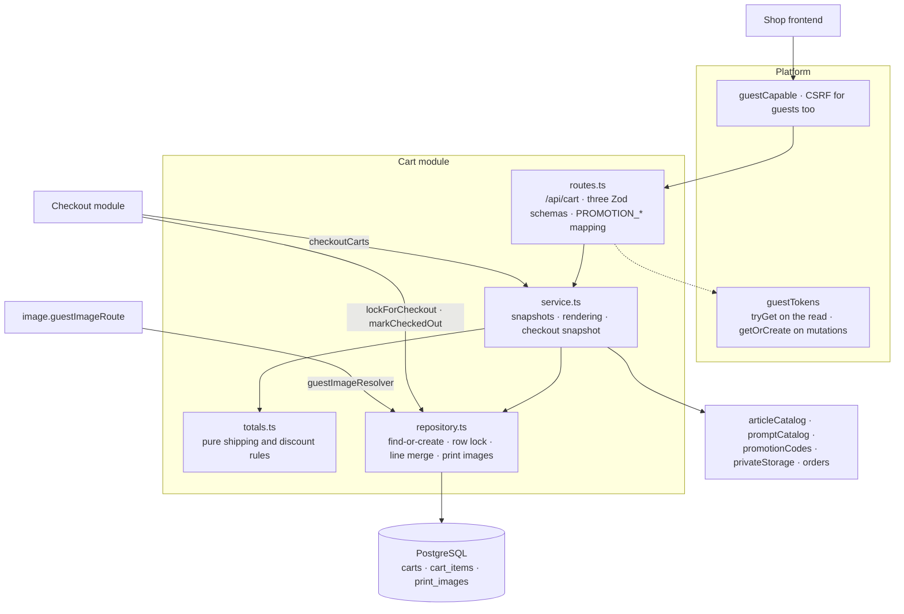

# The Cart package

This guide explains the TypeScript code in
[`backend-ts/src/modules/cart`](../../../../backend-ts/src/modules/cart).

## What this package does

A visitor of the shop picks an article (a mug or a SPOD article), optionally a
generation prompt, uploads the image that is to be printed on it, and puts all
of that into a cart. The cart package owns that cart: the lines with the
prices they were quoted at, the uploaded print images, the coupon code the
cart carries, and the totals the checkout charges.

Two things make it different from most other packages:

- **Most of its callers are anonymous.** A customer fills a cart long before
  they have an account, so an anonymous cart is identified by the guest token
  from the encrypted `voenix.guest` cookie. A signed-in customer's cart is
  identified by their user id instead, and the two never mix: a cart keeps the
  identity it was created with for life.
- **It consumes more capabilities than any other module.** Article's
  `articleCatalog` prices and renders a line, Prompt's `promptCatalog` prices
  the prompt, Promotion's `promotionCodes` validates, renders, and releases
  coupons, Image's `privateStorage` holds the uploaded originals, and Order's
  `orders.orderItem` is the ordered line a reorder starts from.

It exports two things in return: `guestImageResolver`, which the image
module's guest delivery route asks who owns a print image, and
`checkoutCarts`, which the checkout reads, locks, and closes a cart with.

## The five-minute mental model



Read the diagram top to bottom once. A request arrives, the guest-capable
protection decides whether it may mutate anything, the route turns cookies and
session into a `CartOwner`, and the service decides what the cart *means*. The
repository is the only code that talks to the three tables. The checkout and
the image route reach the module only through the two exports.

## File map

```text
cart/
|- index.ts            createCartModule(deps) → { routes, guestImageResolver, checkoutCarts }; CheckoutCart types
|- routes.ts           cartRoutes(service, guestTokens); the three request schemas; the path ids
|- service.ts          createCartService(deps); CartView, CartLine, AppliedPromotion, CheckoutCart, AddItemInput
|- totals.ts           cartTotals(lines, discount): subtotal, shipping, discount, total
|- repository.ts       createCartRepository(db, promotionCodes); CartOwner, StoredCart; the row lock
|- schema.ts           carts, cart_items, print_images, merged into the platform's Tables
|- test-fixtures.ts    the module with fake catalogs and real promotion, order, and image; seeding
|- routes.test.ts      one journey per route and the module errors over HTTP
|- service.test.ts     merge and cap, concurrency, print-image ownership, the upload compensation, checkoutCarts
|- totals.test.ts      the shipping and discount matrix, without a database
`- validation.test.ts  the three schemas' field names and messages
```

`totals.ts` is the one file beyond the standard five: the money rules are a
concern of their own, pure arithmetic that is tested without PostgreSQL, and
both the cart answer and the checkout snapshot use it.

`print_images` lives in the same repository as the cart tables. The ownership
rule of a print image is needed inside the add's transaction *and* by the
guest image route, so one private `ownedBy` predicate in one file serves both.

## HTTP API

Every route lives under `/api/cart` and is guest-capable: guests and signed-in
customers alike may call it, and every mutating method needs a valid CSRF pair
(see [authentication](../conventions/authentication-and-authorization.md)).
Every answer except the upload is the complete recalculated cart.

| Method and path | Body | Success | Module errors |
| --- | --- | --- | --- |
| `GET /api/cart` | none | `200` `CartView`; no cart yet → the empty view; `Cache-Control: no-store` | none |
| `POST /api/cart/images` | multipart, part `file` | `201` `{"id": 42}` | `400` on `file`: missing part, too large, unreadable, unsupported |
| `POST /api/cart/items` | JSON | `200` `CartView` | `400`: field rules, `variantId` not purchasable, `promptId` unusable, `imageId` not the caller's |
| `POST /api/cart/order-items/{orderItemId}` | none | `200` `CartView` | `404` `Order item not found` (unknown, foreign, or malformed id), `409` `ORDER_IMAGE_UNAVAILABLE`, `400` variant no longer purchasable |
| `PATCH /api/cart/items/{itemId}` | `{"quantity": 1..99}` | `200` `CartView` | `400`, `404` |
| `DELETE /api/cart/items/{itemId}` | none | `200` `CartView` | `404` |
| `POST /api/cart/promotion` | `{"promotionCode": "…"}` | `200` `CartView` | `400`/`403`/`409` with a `code`, `404` `Cart not found` |
| `DELETE /api/cart/promotion` | none | `200` `CartView` | `404` `Cart not found` |

The two `404` messages of the item routes are not the same, and that is the
Kotlin behaviour kept: an item id that is not a number answers
`Cart item not found` from the path validator, while an unknown line, a line of
somebody else's cart, and a caller without a cart all answer `Cart not found`
from the operation. A line of another cart is never touched.

The print image itself is delivered by the image module under
`GET /api/images/guest/{size}/{id}`; see [the image package](image-package.md)
and the section on the guest image resolver below.

An example answer:

```json
{
  "id": 12,
  "items": [
    { "id": 34, "articleId": 1, "variantId": 1, "articleType": "MUG",
      "articleName": "Classic mug", "variantName": "White",
      "outsideColorCode": "#ffffff", "insideColorCode": "#ff0000",
      "available": true, "price": 1490, "quantity": 2, "imageId": 77,
      "promptId": 4, "promptPrice": 500 }
  ],
  "subtotal": 3980,
  "shippingCost": 490,
  "discountAmount": 447,
  "total": 4023,
  "totalItems": 2,
  "appliedPromotion": { "id": 3, "name": "Summer", "promotionCode": "SAVE10",
                        "discountType": "PERCENTAGE", "discountValue": 10 }
}
```

`price` and `promptPrice` are snapshots taken when the line was added; the
rest of a line is **current master data, resolved on every read** in one
batched `articleCatalog.find` call. `articleType` is part of that live half
(issue #205): `cart_items` stores only the article and variant ids, and the
type is what a client switches on to render the line, a `"MUG"` with its two
colour codes or a `"SPOD"` article whose colour and size are in its
`variantName` (`"Black / M"`). A line whose reference the catalog no longer
answers keeps its snapshot price and renders with `articleType: null`, `null`
names, and `available: false` instead of disappearing.

The applied promotion is deliberately flat, a `discountType` next to a
`discountValue`: the promotion module stays the authority on what the pair
means, the cart only shows it. A visitor without a cart sees `id: null` and
zeros, so a client can tell "no cart yet" from "cart number zero".

### Request bodies

The three schemas live in `routes.ts` and are strict objects: an unknown
property is a `400`.

| Schema | Field | Rule and message |
| --- | --- | --- |
| `addCartItemInput` | `articleId`, `variantId` | required positive integers: `ArticleId is required`, `ArticleId must be positive` (and the same for `VariantId`) |
| | `quantity` | required, `Quantity must be between 1 and 99` |
| | `promptId`, `imageId` | optional or `null`; when given, positive (`PromptId must be positive`) |
| `cartQuantityInput` | `quantity` | the same quantity rule |
| `promotionCodeInput` | `promotionCode` | trimmed; blank → `PromotionCode is required`; longer than 64 → `PromotionCode must be at most 64 characters` (the `coupon_code` column) |

The image is referenced by id, never uploaded with the add.
`POST /api/cart/images` stores the file first, so a rejected add never leaves a
file behind and the add stays plain JSON.

## Who a cart belongs to

`CartOwner` carries an optional user id and an optional guest token, and which
of them identifies the cart depends on the request:

- a **signed-in** request finds and creates its cart by **user id**;
- an **anonymous** request does the same by **guest token**.

A cart therefore never carries both, and the database enforces that with
`ck_carts_single_owner` plus one partial unique index per identity. A request
that carries neither identity means no cart at all. This is issue #77, and
since issue #110 removed the login claim the separation is permanent: **a
login changes no cart row.** The visitor's cart stays the token's, the
customer's cart stays the account's, and signing in simply shows the other
one. The browser keeps its `voenix.guest` cookie across login, logout, and
registration.

The guest token still matters for a signed-in caller, because two things next
to the cart carry an ownership rule of their own: a print image and an ordered
line a reorder starts from. Both follow the same rule, and it is not a plain
"token **or** user": the token identifies a row that has **no user**, and a row
that carries a user id belongs to that user alone.

For print images the difference matters, because an upload made while signed
in stores *both* owners: the table requires at least one owner and
`fk_print_images_user` is `ON DELETE SET NULL`, so a user-only row would vanish
with the account. `ownedBy` in `repository.ts` therefore compares the token
only against rows whose `user_id` is `NULL`. Without that guard the next person
on a shared browser could fetch the previous customer's uploads through the
guest image route and attach them to a cart of their own.

Reads and mutations differ in one more way:

```ts
// a mutation: the first one turns an anonymous browser into an addressable guest
const mutatingOwner = async (c: Context): Promise<CartOwner> => ({
  guestToken: await guestTokens.getOrCreate(c),
  userId: userIdOf(c),
})

// the read: no cookie means no cart, and no new guest either
carts.cart({ guestToken: await guestTokens.tryGet(c), userId: userIdOf(c) })
```

Looking at a cart must not create a tracked visitor, so `GET /api/cart` never
sets a cookie and answers the empty view to a request with neither identity.

## The three-step add

`POST /api/cart/items` is the one operation with real logic behind it:

1. **Field rules.** `jsonBody(addCartItemInput)` checks the ids and the
   quantity before the handler runs; the service trusts the parsed value.
2. **Snapshots.** `articleCatalog.find` answers whether the variant may be
   bought at all and what it costs right now; `promptCatalog
   .findSalesGrossPriceCents` does the same for the prompt. Both numbers are
   written onto the line and never change again. A later price change moves
   the shop's catalog, not a cart a customer is already looking at.
3. **The write.** `repository.addItem` checks that the image belongs to the
   caller, finds or creates the cart, and merges or appends the line, in one
   transaction. The image check comes first, so a rejected add commits
   nothing, not even an empty cart.

**A price discount needs no step of its own.** Both catalogs answer the
*effective* amount, with a configured price discount already subtracted (see
[the pricing package](pricing-package.md)), so step 2 snapshots the reduced
number without the cart ever learning there is a discount. A mug of 19,90 €
with 20 % off is stored as `price_cents = 1592`, and it stays 1592 when the
discount ends. A discount of 100 % is allowed; such a line has
`price_cents = 0`, and the checkout confirms a free order. The cart shows no
struck-out regular price: a cart, an order, and the confirmation mail state one
amount, the one that is charged.

"Identical" for a merge is the whole snapshot: article, variant, price, prompt,
prompt price, and image. Two lines differing in any of them stay two lines, and
a merge caps the quantity at 99 instead of failing the add.

## Reorder: an ordered line becomes a cart line

`POST /api/cart/order-items/{orderItemId}` is a cart route although it starts
from an order, because what it *produces* is a cart line. The order module
exports the lookup, the cart owns the route:

```ts
const ordered = await orders.orderItem(orderItemId, owner.userId, owner.guestToken)
if (ordered === undefined) return notFound
```

The ordered line contributes exactly four references: article, variant,
prompt, and print image. Everything else is decided again right now, because
the operation ends in the ordinary add: the catalog says whether the variant
can still be bought and what it costs **today** (including today's discount),
the line merges into an identical one, and it gets its position the same way.
That is why reorder adds no second write path, and why the new line always has
quantity 1.

The print image is the one thing a reorder cannot replace: it references the
very same row and copies no file. A line that carries none, an image this
caller may not use, and an image whose file is gone are therefore all the same
answer: `409` with `ORDER_IMAGE_UNAVAILABLE`, the only conflict any cart route
reports. A frontend branches on it to offer a fresh upload.

## Concurrency: two rules, both enforced by PostgreSQL

A cart is one of the few things a customer can hit twice at the same time;
double-clicking "add to cart" is the everyday case.

**One active cart per owner.** Two partial unique indexes say so:

```sql
CREATE UNIQUE INDEX ux_carts_active_guest_session_token
    ON carts (guest_session_token)
    WHERE status = 'ACTIVE' AND guest_session_token IS NOT NULL;

CREATE UNIQUE INDEX ux_carts_active_user_id
    ON carts (user_id)
    WHERE status = 'ACTIVE' AND user_id IS NOT NULL;
```

`lockedOrCreatedCartId` inserts first and ignores a conflict, then re-selects
with the lock:

```ts
await trx.insertInto('carts').values({ … }).onConflict((conflict) => conflict.doNothing()).execute()
const cartId = await activeCartId(trx, owner, { lock: true }) // SELECT … FOR UPDATE
```

Whoever loses the race simply reads the winner's cart. When a checkout
committed `CHECKED_OUT` between the two statements, the loser finds nothing to
lock and runs the pair once more, which now writes the fresh cart the
customer's next line belongs in. The retry is bounded at one: a second miss
needs a second checkout inside a second such window, and it throws instead of
looping. A `SELECT` followed by an `INSERT` would race;
[persistence error handling](../conventions/persistence-error-handling.md)
explains why this codebase never protects a uniqueness rule that way.

**The cart row is the lock.** Every mutation takes `SELECT … FOR UPDATE` on the
cart before it reads anything it is about to write. Merging a line and
computing `max(position) + 1` both read-then-write, so without the lock two
concurrent adds could compute the same position and one would fail on
`UNIQUE (cart_id, position)`. With it they queue up, and two identical parallel
adds become one line of quantity 2. Every cart mutation locks exactly one cart
row, so there is no lock order to agree on. The checkout takes the same lock
with `lockForCheckout`, which is what makes an add that races a checkout wait
and then land in a fresh cart.

## The schema

[`V15__create_carts.sql`](../../../../backend-ts/migrations/V15__create_carts.sql)
creates three tables, declared in `schema.ts`:

- **`print_images`**: a unique file name, the guest token and/or user id that
  owns it, and a CHECK that there is at least one owner. The file itself lives
  in the image module's private storage, always as WebP. The order module reads
  file names from it with one raw statement and declares nothing of it.
- **`carts`**: an optional guest token, an optional user, `status`
  (`ACTIVE`/`CHECKED_OUT`), `ck_carts_single_owner`, one partial unique index
  per identity over active carts, and an optional `promotion_id`.
- **`cart_items`**: the lines, with the price snapshots, an optional prompt and
  print image, a quantity CHECK of 1 to 99, and a position unique within its
  cart.

Both owner columns of a cart may be `NULL` at the same time, and that has
exactly one cause: `fk_carts_user` is `ON DELETE SET NULL`, so deleting an
account leaves its carts behind, unreachable, as the evidence the orders
referencing them need.

| Reference | Rule | Why |
| --- | --- | --- |
| `cart_items (variant_id, article_id)` → `article_variant_identities (id, article_id)` | `CASCADE` | The composite key makes "this variant belongs to that article" a database fact |
| `cart_items.print_image_id` → `print_images` | `RESTRICT` | An image a line still points at must not vanish under it, which is also why the checkout never meets a vanished cart image |
| `cart_items.prompt_id` → `prompts` | `SET NULL` | The snapshot survives a deleted prompt |
| `carts.promotion_id` → `promotions` | `SET NULL` | A deleted promotion simply falls off the carts that held it |

## The upload and its compensation

`POST /api/cart/images` reads the `file` part with the image module's
`readUploadedImage`, stores it through `privateStorage.store` (PNG, JPEG, and
WebP are accepted and normalized to WebP; anything else is a `400` on `file`),
and writes the `print_images` row second.

A row pointing at a file that does not exist would be a broken cart line
forever; a file without a row is an orphan nobody can reach. So if the row
cannot be written, the service deletes the file it just stored and rethrows,
and the client sees `500`. A delete that fails as well is logged and does not
hide the original error. Orphans of an upload that is never added to a cart
are accepted, like the example-image orphans of article and prompt.

## Totals

`cartTotals(lines, discount)` in `totals.ts` is pure arithmetic on whole cents:

- **Subtotal**: article price plus prompt price, times the quantity, per line.
- **Shipping**: `0` for an empty cart and from 5000 cents on, `490` in between.
  It is calculated from the pre-coupon subtotal, so applying a coupon can
  never take free shipping away again.
- **Discount**: the base is subtotal **plus** shipping. A percentage above 100
  counts as 100, halves round up (`percentOfCents` and `roundHalfUp` of
  [`money.ts`](../../../../backend-ts/src/platform/money.ts)), and the result
  never exceeds the base. A 50-euro coupon on a 10-euro cart makes it free,
  never negative.
- **Total**: `subtotal + shipping - discount`.

"Pre-coupon" means exactly that: the subtotal is built from the snapshotted
line prices, which are already discounted. Three discounted mugs at 15,92 €
add up to 4776 cents, so the cart charges 490 cents shipping although the same
mugs at their regular 19,90 € would have shipped free. A coupon stacks on top
for the same reason: a `PERCENTAGE 20` code on one such mug takes 20 % of
1592 + 490. Both are accepted consequences of the one rule that a discounted
price *is* the price (decision E3 of issue #238).

Amounts are JavaScript numbers. They are exact integers up to 2^53, far beyond
anything 99 lines of any price can reach, so the Kotlin backend's reason for
`Long` totals (deviation D13) does not arise.

## Promotion codes

A coupon code can fail for seven reasons, and the frontend tells them apart by
the `code` of the answer. The cart does not map them itself: it hands the
rejection to the promotion module's `toApiError`, the same mapping the
checkout uses, so both answer identically:

```json
{ "message": "Promotion code has expired", "errors": {}, "code": "PROMOTION_EXPIRED" }
```

| Rejection | `code` | Status |
| --- | --- | --- |
| `invalidCode` | `PROMOTION_INVALID_CODE` | 400 |
| `inactive` | `PROMOTION_INACTIVE` | 400 |
| `notStarted` | `PROMOTION_NOT_STARTED` | 400 |
| `expired` | `PROMOTION_EXPIRED` | 400 |
| `loginRequired` | `PROMOTION_LOGIN_REQUIRED` | 403 |
| `totalExhausted` | `PROMOTION_TOTAL_EXHAUSTED` | 409 |
| `perUserExhausted` | `PROMOTION_PER_USER_EXHAUSTED` | 409 |

`applyPromotion` answers `ApplyPromotionResult`: an `OperationResult<CartView>`
or `{ kind: 'rejected', rejection }`. The code is validated **before** anything
is written, so a rejected code never replaces the promotion a cart already
carries. Only the promotion id is stored; what the discount is worth is
recalculated on every read, and whether it may still be used is decided again
at checkout.

The cart names itself when it validates: `validate(code, cartId, userId)`. The
promotion module counts the capacity running checkouts hold, and the cart id
leaves this cart's own hold out of that count. Otherwise the customer whose
checkout reserved the last unit would be told their own code is exhausted.

**Removing** the code also gives that hold back: `removePromotion` calls
`promotionCodes.release(trx, cartId)` inside the cart's own write transaction,
so clearing `promotion_id` and releasing the reservation commit together. A
checkout can end without an order: a refused payment leaves the cart `ACTIVE`
and its reservation standing, and dropping the code is then the customer's
usual next move. From then on nothing else would ever touch that reservation,
and reservations have no expiry. Replacing one code by another releases nothing
on purpose: the reservation is keyed on the cart, so the next checkout
overwrites the same row.

## The guest image resolver

The image module defines `GuestImageResolver`, the question its guest delivery
route asks: "does this caller own image 42, and under which file name?" The
cart answers it with `repository.printImageFilename`, exported as
`guestImageResolver`. It must not distinguish "no such image" from "somebody
else's image": both are `null`, the route answers `404` for both, and an id
cannot be probed for existence. The reorder asks the same function before it
reuses an ordered image.

## The exported `checkoutCarts`

`checkoutCarts` is the cart's side of checkout's first transaction (#247):

```ts
checkoutCarts.activeCart(guestToken, userId)  // Promise<CheckoutCart | null>
checkoutCarts.lockForCheckout(trx, cartId)    // Promise<boolean>: SELECT … FOR UPDATE; still ACTIVE?
checkoutCarts.markCheckedOut(trx, cartId)     // Promise<boolean>: ACTIVE → CHECKED_OUT, true if this call did it
```

- `activeCart` is the cart routes' own lookup, so a signed-in checkout is
  answered with the customer's cart and an anonymous one with the token's. It
  answers `null` when there is no active cart, and a cart without lines is a
  snapshot with an empty list, so "no cart" and "empty cart" can become the
  same `CART_EMPTY` answer. The `CheckoutCart` is shaped so the checkout builds
  its `PlaceOrderInput` without a second read: `cartId`, the caller's `userId`
  and `guestToken` as asked, `promotionId`, the lines as
  `{ articleId, variantId, quantity, priceCents, promptPriceCents, promptId,
  printImageId, articleType }`, and `subtotalCents`, `shippingCostCents`,
  `discountCents`, `totalCents`. The totals come from the same `cartTotals` and
  the same promotion lookup the cart answer uses, so the checkout charges what
  the customer saw. `articleType` is the catalog's current answer (`null` for a
  reference it no longer resolves) and is what the checkout's phone rule for
  SPOD articles asks about.
- `lockForCheckout` runs in the checkout's transaction. Every cart mutation
  and a second checkout of the same cart wait behind it until that transaction
  ends. `false` means the cart is no longer active.
- `markCheckedOut` closes the cart with `UPDATE … WHERE status = 'ACTIVE'`.
  The predicate makes it idempotent: `true` means this call did it, `false`
  that it was already done or the cart does not exist, and neither is a
  failure. The customer's next add starts a fresh cart.

## Composition

```ts
const cart = createCartModule({
  db,
  articleCatalog: article.articleCatalog,
  promptCatalog: prompt.promptCatalog,
  promotionCodes: promotion.promotionCodes,
  orders: order.orders,                    // orderItem
  images,                                  // privateStorage
  guestTokens: auth.guestTokens,
})
app.route('/', cart.routes)
app.route('/', images.guestImageRoute(cart.guestImageResolver))
// createCheckoutModule({ …, checkoutCarts: cart.checkoutCarts })
```

Create it after image, article, prompt, promotion, and order, and install the
image module's guest route afterwards with the cart's resolver.

## Tests

The database tests run against the Testcontainer database with the real
promotion codes, the real `orders.orderItem`, and the real private image
storage in a temporary root. The two catalogs are plain-object fakes a test
edits in place (`variants`, `promptPrices`), because the snapshot is what is
under test, not the catalog
([`test-fixtures.ts`](../../../../backend-ts/src/modules/cart/test-fixtures.ts)).
Ordered lines are seeded with SQL.

| File | What it states |
| --- | --- |
| `routes.test.ts` | the empty view without a cookie; the guest journey (upload, add with the exact wire shape, read, update, remove); the guest cookie of the first mutation; signed-in and guest carts apart in one browser; the upload `400`s; not purchasable, unusable prompt, and foreign image writing nothing; the price snapshot surviving a price change; foreign, unknown, and malformed item ids; apply and remove with the discount; the release of a checkout's reservation; the rejection codes keeping the applied code; the reorder at today's price with its merge, the foreign and malformed order item, `ORDER_IMAGE_UNAVAILABLE` |
| `service.test.ts` | merge and the 99 cap, positions; two concurrent first adds making one cart and one line; concurrent different adds getting distinct positions; the print-image ownership matrix through `guestImageResolver` (including the signed-in upload a kept token no longer reaches); the upload compensation; `activeCart`'s complete snapshot, the signed-in lookup, the empty cart; `lockForCheckout` and `markCheckedOut`; an add racing a checkout landing in a fresh cart |
| `totals.test.ts` | subtotal, the shipping threshold, the percentage cap, rounding of halves and fractional percentages, the fixed-amount cap |
| `validation.test.ts` | the three schemas' field names and messages |

Run them with `bun test src/modules/cart` from `backend-ts/`; they need Docker.

## What the port changed

- **No `CartOperations` seam, no `CartPromotionResult`, no `CartWriteResult`.**
  The routes call the service object directly; applying a code answers an
  `OperationResult` or a `rejected` variant, and the repository answers a
  `StoredCart`, `undefined`, or `'imageNotOwned'`.
- **One repository.** `PrintImageRepository` and `CartGuestImages` are folded
  into `repository.ts`; the resolver is a function of it.
- **Validation once.** The Zod schemas at the route replace the `validate()`
  calls the Kotlin service repeated, including the re-check of the promotion
  code. A promotion code arrives trimmed.
- **No `UnexpectedFailure`.** A database error propagates to the app's
  `onError` and answers `500`; the upload compensation rethrows after deleting
  the file.
- **Removing a code releases the reservation in the same transaction.** Kotlin
  wrote the cart and then released in a second transaction; the port passes
  the cart's `trx` to `promotionCodes.release`.
- **`checkoutCarts` grew for #247.** `lockForCheckout(trx, cartId)` is new, and
  `markCheckedOut` takes the checkout's `trx`. `activeCart` answers the final
  totals including `discountCents` (computed from the promotion as configured
  now, like the cart answer) instead of a `discountCents(discount)` method,
  echoes the caller's identity, and carries each line's `articleType`.
- **Totals are numbers,** not `Long`; see Totals.
- **Path ids and bodies are checked before the guest cookie is issued.** A
  malformed id or a rejected body answers without a `Set-Cookie`; Kotlin
  issued the cookie first. Unknown body properties are a `400`.
- **Not ported:** the route security test (CSRF and the validation `400`s are
  platform tests and schema tests now), the schema constraint test (the
  migrations are copied unchanged), and the composition test, which T14's
  checkout flow test replaces.

## What is deliberately not here

- **The checkout itself.** The cart answers `checkoutCarts` and owns the
  `ACTIVE → CHECKED_OUT` transition, but the order of locking, reserving,
  placing, paying, and closing belongs to the checkout module.
- **`customData` and `originalPrice`.** Both were dead in the .NET source and
  were dropped with the Kotlin migration.
- **Any cart merge at all.** There is only ever one active cart per customer,
  and the guest cart a customer filled before signing in is left alone (issue
  #110).
