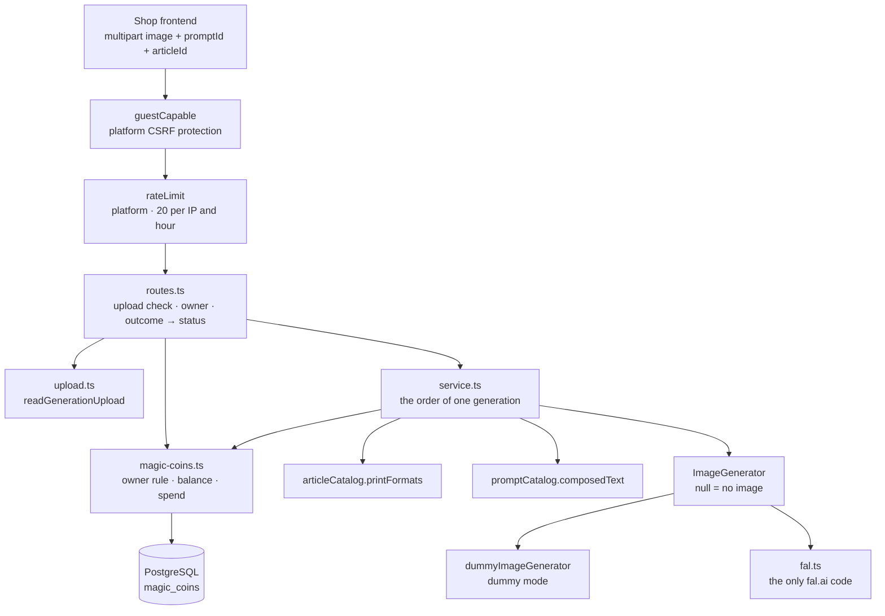

# The Generator package

This guide explains the TypeScript code in
[`backend-ts/src/modules/generator`](../../../../backend-ts/src/modules/generator):
the AI image generation and the **Magic Coins** a visitor pays it with.

## What this package does

A visitor uploads a photo, picks a prompt, and gets an AI-generated image back.
Every generation costs one Magic Coin, and every visitor, guest or signed-in
customer, owns one coin balance that starts with 10 coins.

```text
POST /api/generator/generate    →  raw image bytes
GET  /api/magic-coins/balance   →  {"balance": 9}
```

In the Kotlin backend the coins were a module of their own, `magic-coins`,
exporting the `GenerationCoins` capability to its only consumer, the generator
(#252). The port folds them into this module: the coins are an internal part
of it, and the module exports **no capability** at all. Nothing in the backend
asks the generator for anything; the storefront does.

What the endpoint borrows from elsewhere:

- the prompt text comes from the prompt module's `promptCatalog.composedText`;
- the shape the image must have comes from the article module's
  `articleCatalog.printFormats`: a mug is printed wide (`16:9`), a SPOD article
  square (`1:1`);
- the visitor's identity and the guest cookie come from `platform`;
- the per-IP rate limit comes from `platform`, because the module knows that a
  call costs money, not how many calls an IP gets (see
  [Rate limiting](../conventions/rate-limiting.md));
- the generated image comes from fal.ai, over HTTP.

A generated image is answered and forgotten. It becomes a durable object only
when the customer later puts it into a cart, and that is the cart module's
business. The one table the module owns is `magic_coins`.

## The five-minute mental model



Read the picture from the middle: `service.ts` is the only place that knows
*the order* of a generation, and it knows nothing about HTTP, multipart, or
fal.ai. Hono and multipart live in `routes.ts` and `upload.ts`, the network
lives in `fal.ts`, and the service reaches the provider only through the
`ImageGenerator` function type.

## File map

```text
generator/
|- index.ts               createGeneratorModule({ db, settings, articleCatalog, promptCatalog,
|                         guestTokens, rateLimit, fetch? }) → { routes }; picks the image generator
|- routes.ts              generatorRoutes: the two routes, the protection order, outcome → status
|- upload.ts              readGenerationUpload, the part names, MAX_IMAGE_BYTES, MAX_FILE_PART_BYTES
|- service.ts             createGeneratorService: the order of one generation; GenerationOutcome
|- image-generator.ts     RawImage, ALLOWED_IMAGE_CONTENT_TYPES, ImageGenerator, dummyImageGenerator
|- fal.ts                 createFalImageGenerator, FAL_EDIT_URL: the only code that knows fal.ai
|- magic-coins.ts         MagicCoinsOwner, magicCoinsOwner (the owner rule), describeOwner,
|                         createMagicCoins (balance with the initial grant, the atomic spend)
|- schema.ts              MagicCoinsTable, merged into the platform's Tables
|- routes.test.ts         both routes against the real database, the rate limit, the CSRF order
|- service.test.ts        the order on recording fakes, a failed spend keeping the image
|- upload.test.ts         the multipart reader and its limits
|- fal.test.ts            the fal.ai adapter against a stubbed fetch, and what it logs
`- magic-coins.test.ts    first contact, spend, and concurrent spends
```

`RawImage` and the list of allowed image types sit in `image-generator.ts`
because the upload reader, the service, and the adapter all use them. Nothing
but `index.ts` is importable from another module.

## Composition

```ts
const limiter = createClientIpRateLimiter({
  trustForwardedFor: settings.rateLimit.trustForwardedFor,
  peerAddress: (c) => getConnInfo(c).remote.address ?? '',
})
const generator = createGeneratorModule({
  db,
  settings: settings.generator,
  articleCatalog: articles.articleCatalog,
  promptCatalog: prompts.promptCatalog,
  guestTokens: auth.guestTokens,
  rateLimit: limiter.middleware,
})
app.route('/', generator.routes)
```

The exported surface of `index.ts`:

| Export | What it is |
| --- | --- |
| `createGeneratorModule(deps)` | the factory; `deps.fetch` defaults to the global `fetch` and is a test seam |
| `.routes` | `POST /api/generator/generate` and `GET /api/magic-coins/balance` |
| type `GeneratorModule` | its return type |

The catalogs are typed as `Pick<ArticleCatalog, 'printFormats'>` and
`Pick<PromptCatalog, 'composedText'>`: the module asks each one question, and a
test hands in a plain object with that one function.

Which image generator runs is decided in `index.ts`, once:
`settings.generator.dummyMode` selects `dummyImageGenerator`, everything else
gets `createFalImageGenerator`. No code behind that line knows the difference.
`fetch`'s connections need no closing, so there is no shutdown hook either (the
Kotlin module closed its Ktor client on `ApplicationStopped`).

## HTTP API

| Method and path | Auth | Body | Success |
| --- | --- | --- | --- |
| `POST /api/generator/generate` | anonymous **or** signed in, CSRF token required (`guestCapable`), at most 20 calls per client IP per hour | `multipart/form-data` with a file part `image` and the text parts `promptId` and `articleId` | `200` with the raw image bytes and the generated image's `Content-Type` |
| `GET /api/magic-coins/balance` | anonymous or signed in | none | `200` `{"balance": <int>}` with `Cache-Control: no-store`; issues the guest cookie on first contact |

A generated image has no JSON envelope and no `Content-Disposition` header,
because the frontend store `frontend/src/stores/shop/imageGeneration.ts` reads
the response as a `Blob`. The failures of the generation are:

| Status | When | Body |
| --- | --- | --- |
| `400` | no `image` part, an empty one, one larger than 10 MiB, file parts adding up past 20 MiB, a content type that is not JPEG/PNG/WebP, or a missing/non-numeric `promptId` or `articleId` | `{"message": "Validation failed", "errors": {"<field>": ["…"]}}`, where the field is `image`, `promptId`, or `articleId` |
| `400` | no valid CSRF pair | `{"message": "Invalid CSRF token", "errors": {}}` (platform) |
| `402` | the visitor cannot afford a generation | `{"message": "Not enough Magic Coins", "errors": {}, "code": "INSUFFICIENT_MAGIC_COINS"}` |
| `404` | the prompt is unknown, inactive, archived, or textless | `{"message": "Prompt not found", "errors": {}}` |
| `404` | the article the image would be printed on does not exist | `{"message": "Article not found", "errors": {}}` |
| `429` | the client IP has used up its 20 generations of the hour; with a `Retry-After` header | `{"message": "Too many requests", "errors": {}}` (platform) |
| `502` | fal.ai refused, answered without an image, answered unreadably or too large, was unreachable, or the result could not be downloaded | `{"message": "Generator API error", "errors": {}}` |
| `500` | anything unexpected on our side, including a failing balance lookup | `{"message": "Internal server error", "errors": {}}` |

The `code` on the `402` is a contract: the storefront reads it to open its own
"buy more coins" dialog. Every other error is identified by its status alone.
The balance route has one failure, the `500` of a broken database, and it keeps
`Cache-Control: no-store`.

The messages of the `400`:

| Field | Message |
| --- | --- |
| `image` | `An image file is required` |
| `image` | `Image files may carry at most 10 MiB each and 20 MiB per request` |
| `image` | `Image must be a JPEG, PNG, or WebP file` |
| `promptId` | `A numeric prompt id is required` |
| `articleId` | `A numeric article id is required` |

## The order of one generation

`routes.ts` runs the first step, resolves the owner, and hands the other five
to `service.ts`. The order is a product decision, not an implementation detail:

1. **Check the upload** (`readGenerationUpload`). A rejected upload never
   touches the balance.
2. **Check the balance** (`coins.balance(owner) >= 1`).
3. **Look up the print format** with `articleCatalog.printFormats([articleId])`.
4. **Load the prompt** with `promptCatalog.composedText(promptId)`.
5. **Generate** through the `ImageGenerator`, in the article's aspect ratio.
6. **Spend one coin** with `coins.spend(owner)`.

The coin check happens *before* anything is looked up, so a visitor with an
empty balance is told so instead of being sent looking for a prompt or an
article they could not use anyway. The article comes before the prompt because
it decides the *shape* of the paid request, and an unknown article is the
cheapest ending: no prompt loaded, no provider called, no coin spent. The spend
happens *after* the generation, so nobody pays for an image the provider never
delivered.

The article is asked one question only: which aspect ratio it is printed in.
Whether the visitor may *buy* it is deliberately not checked. An inactive
article, one without a price, and one nobody has a variant of are all generated
for; the cart is where buying is decided. An unknown id is the single
exception, because without a ratio there is no request to send.

Two details of that flow are easy to get wrong:

- **A broken balance lookup is never an empty balance.** `coins.balance`
  throws on a database failure, and the app's `onError` answers `500`.
  Answering a defect on our side with "not enough Magic Coins" would ask the
  customer to pay for it. A failing article or prompt lookup ends the same way.
- **A failed spend keeps the image.** The service catches the failure of the
  spend, logs it with the owner, and still answers the image. The image exists,
  and withholding it would punish the customer for a defect on our side. A
  spend that finds the balance already empty (a concurrent generation took the
  last coin) only warns.

`GenerationOutcome` is the module's own union of the endings after the upload
check: `generated`, `insufficientCoins`, `articleUnavailable`,
`promptUnavailable`, and `upstreamFailure`. The shared `OperationResult` does not
fit, because a payment answer, an upstream answer, and two missing references
that are not the resource of the request path have no equivalent there. The two
`404`s are separate on purpose: only a distinct message tells the client which
of the two ids was wrong.

## The upload

`readGenerationUpload(await c.req.formData())` reads the parts in whatever order
the client sent them. A body that is no multipart form at all is read as an
empty form and answers `An image file is required`.

Two limits answer two different questions:

- **10 MiB per image.** An `image` part past it is refused, even when a later,
  smaller `image` part would have fit.
- **20 MiB of file parts per request.** A body may repeat parts, and any number
  of them below the single-image limit still adds up. Every file part counts,
  whatever its name. Text parts are not counted; the only ones read are the
  tiny ids.

Both refusals are `400` on the `image` field. The transfer itself is bounded
earlier: the application-wide `bodyLimit` refuses any body past 30,000,000
bytes with `413` and buffers the body before the handler runs, so the reader
always sees a complete body (see
[Request size limits](../conventions/request-size-limits.md)).

Repeated parts are not an error: the last `image` file part, the last
`promptId`, and the last `articleId` text part win, the way every form parser
resolves a repeated field. A body with several problems is refused on the
first one the client has to fix: the size, the image, the prompt id, the
article id, and finally the image's type. An id is a whole number, optionally
signed, after trimming; zero and negative ids are numbers and simply answer
`404`.

Each part name is also the field name of every rejection concerning it, from
one constant per part, so an error can never name a field the reader does not
look for (the image module's `FILE_PART_NAME` precedent).

## Dummy mode and the fal.ai adapter

`ImageGenerator` is a function type: an image, the composed prompt, and the
article's ratio go in, an image comes out, and `null` means "the provider did
not deliver an image". Very different failures collapse into that one absent
case, because the service can do exactly one thing about any of them; the
*reason* is logged where it is known, inside the adapter.

- **`dummyImageGenerator`** answers the uploaded image unchanged, in its own
  content type, and ignores the ratio. The coin check and the spend still run.
  The point of dummy mode is to avoid provider cost, not to change what the
  endpoint does.
- **`createFalImageGenerator({ apiKey, fetch, logger })`** posts the upload as a
  `data:` URI to `https://fal.run/fal-ai/nano-banana-2/edit` with the header
  `Authorization: Key <key>` and the body

  ```json
  {"image_urls": ["data:image/png;base64,…"], "prompt": "…", "num_images": 1, "aspect_ratio": "16:9"}
  ```

  then downloads the image from the URL the answer names.

Five properties of the adapter are deliberate:

- **No retry.** Every attempt costs money, and a retry would pay twice for a
  call that may well have succeeded on the provider's side.
- **The paid call never follows a redirect; the download does.** The `POST`
  uses `redirect: 'manual'`, so a `3xx` is a refusal and the key is never
  replayed anywhere. The generated image usually lives behind a CDN that
  redirects, so the download follows redirects; it carries no credential and
  must start from an `https` URL, or it is not fetched at all.
- **Both provider answers are treated as hostile.** The generation answer and
  the downloaded image are read chunk by chunk and dropped the moment they pass
  the 10 MiB a visitor may upload, whatever `Content-Length` announced. A
  refusal's body is never read.
- **The result content type is allowlisted.** What fal.ai reports is used only
  when it is JPEG, PNG, or WebP; anything else, or nothing, becomes
  `image/jpeg`.
- **Nothing the provider wrote is logged.** A refusal is logged by its status,
  an unreadable answer and a transport failure by the error's class name only
  (`SyntaxError`, `ZodError`, `TypeError`, `TimeoutError`). The message of a
  parse error quotes the input it failed on, and an error body may quote back
  what was sent, including the key (`backend/AGENTS.md`).

Each of the two requests has a 120-second timeout through
`AbortSignal.timeout`, because generating an image takes far longer than an
ordinary API call. `fetch` has no separate connect timeout; the Kotlin client's
10-second one is gone.

`aspect_ratio` is not the adapter's decision. It is the article's
`PrintAspectRatio` (`'16:9' | '1:1'`), written into the request verbatim. The
article tables' `CHECK` constraints and fal's own enum use the same spellings,
so nothing between the article table and the provider translates anything.

The fal.ai URL is a constant, never a setting: deployments always call fal.ai,
the adapter tests stub `fetch`, and no configuration mistake can make the
quality gate spend real money.

## Configuration

| Variable | Default | Setting |
| --- | --- | --- |
| `GENERATOR_DUMMY_MODE` | `false` | `settings.generator.dummyMode` |
| `GENERATOR_API_KEY` | empty | `settings.generator.apiKey` |
| `RATE_LIMIT_TRUST_FORWARDED_FOR` | `false` | `settings.rateLimit.trustForwardedFor` (platform) |

A deployment that is not in dummy mode **must** carry an API key; the platform's
settings schema refuses to start without one. The default is deliberately the
strict one: defaulting to dummy mode would let a deployment that forgot its key
start up and hand every customer their own photo back. `.env.development` sets
`GENERATOR_DUMMY_MODE=true`. Enable the forwarded-for flag only behind exactly
one trusted reverse proxy; the reasoning is in
[Rate limiting](../conventions/rate-limiting.md).

## Magic Coins

### Who owns a balance

`MagicCoinsOwner` is a union of two cases:

- `{ kind: 'user', userId }` for a signed-in customer, used when the session's
  user id is a positive whole number;
- `{ kind: 'guest', token }` for everyone else. The token comes from
  `guestTokens.getOrCreate(c)`, which issues the encrypted, HttpOnly
  `voenix.guest` cookie (`SameSite=Lax`, 30 days, path `/api`) when the request
  carries no readable one. A missing or tampered cookie simply produces a fresh
  guest, never an error.

The rule lives in exactly one function, `magicCoinsOwner(c, guestTokens)`, and
both routes use it, so a session user id that is not a positive number falls
back to the guest path everywhere. The database enforces the same "exactly one
owner" rule with an XOR check constraint. A signed-in visitor is never handed a
guest cookie on the side.

`describeOwner` renders an owner for a log line: `user owner 7`, or just
`guest owner`, because a guest token identifies a visitor's session and is never
written to a log.

### No balance merge when a guest signs in

There is deliberately no balance merge when a guest later signs in; the .NET
source had none either. Guests cannot buy coins, so a guest balance is only ever
the free starting amount, and a merge would turn every fresh browser into a way
of topping an account up for free.

A guest balance is therefore not *lost* at the login, it is left where it is.
It sits on the browser's guest token, and nothing replaces that token. The
account balance is what the visitor spends while signed in, and the guest
balance is there again after a logout, for the remaining lifetime of the
`voenix.guest` cookie (see
[Authentication and authorization](../conventions/authentication-and-authorization.md#guest-identity)).

### Persistence: let PostgreSQL resolve the races

Two visitors, or two browser tabs, can hit the module at the same moment. Both
race conditions are pushed into single SQL statements instead of
application-level locking:

- **Get-or-create** (`coins.balance`) runs `INSERT … ON CONFLICT DO NOTHING`
  followed by a `SELECT`, in one transaction. When two first contacts race, the
  partial unique indexes let exactly one insert win, and both read the same row
  afterwards.
- **Spend** (`coins.spend`) is one statement:

  ```sql
  UPDATE magic_coins SET balance = balance - 1, updated_at = CURRENT_TIMESTAMP
  WHERE <owner> AND balance >= 1
  ```

  Success is judged by the affected-row count. With one coin left and two
  concurrent spends, PostgreSQL serializes the row update, the second matches
  zero rows, and the balance never goes negative. The `balance >= 0` check
  constraint is the final safety net. The spend does not create a row: the
  balance check of the same request already did.

The check-then-spend flow around a generation is deliberately **not** one
transaction. The expensive provider call sits between the two, and holding a
transaction open across it is not an option; exact accounting under
concurrency would need a reserve/commit model, which is out of scope. Two
concurrent generations from a balance of one coin may therefore both be
generated while only one is charged. A free generation is acceptable, a paid
failure is not.

The table comes from
[`V10__create_magic_coins.sql`](../../../../backend-ts/migrations/V10__create_magic_coins.sql);
[`V11__create_users.sql`](../../../../backend-ts/migrations/V11__create_users.sql)
adds the foreign key from `user_id` to `users` with `ON DELETE CASCADE`. The
amounts, an initial grant of 10 and a cost of 1, are the constants
`INITIAL_BALANCE` and `GENERATION_COST` of `magic-coins.ts`.

## Differences from the Kotlin module

- **Magic Coins are part of this module** (#252). There is no `GenerationCoins`
  capability, no `MagicCoinsOperations` seam, and no public owner type; the
  balance route is mounted by `createGeneratorModule`.
- **No `UnexpectedFailure` endings.** A failing balance, article, or prompt
  lookup throws to the app's `onError` (`500`), where the Kotlin service mapped
  it to its own `UnexpectedFailure` outcome. The answer is the same.
- **No `GeneratorOperations` seam.** The Kotlin route test stubbed it to prove
  that a refused request generates nothing; the TypeScript tests show it through
  the database instead: the visitor of a refused 21st call has no balance row at
  all, and 25 requests without a CSRF token leave the first real one passing.
- **The upload check runs in the route.** An upload rejection, including the
  content type, is answered before the owner is resolved, so a rejected upload
  no longer issues a guest cookie on the side.
- **The multipart body is read whole.** Ktor streamed the parts and stopped at
  the limit; Hono's `bodyLimit` has already buffered the body, so the reader
  compares sizes and needs no `readChunks` and no drain.
- **The spend needs no `NonCancellable`.** A closed browser tab does not cancel
  the handler's promise, so a generation that reached the provider is always
  charged.
- **Ids are JavaScript numbers.** A `promptId` or `articleId` beyond
  `Number.MAX_SAFE_INTEGER` is refused as non-numeric, where Kotlin read any
  `Long`.
- **Timeouts.** One 120-second `AbortSignal.timeout` per request; the separate
  10-second connect timeout of the Ktor client has no `fetch` equivalent.

## What is deliberately not here

- **No print-image registration.** A generated image becomes durable only when
  the customer adds it to a cart.
- **No limit on the *balance*.** The route is limited (20 calls per client IP
  per hour), but deleting the guest cookie still grants a fresh starting
  balance. Closing that gap is an open product decision recorded in
  [`all-post-migration.md`](../../../migration/all-post-migration.md).
- **No exception hierarchy** for provider failures: the adapter answers `null`.

## Tests

Run from `backend-ts/`:

```sh
bun test src/modules/generator    # this module only
bun run check                     # the full gate
```

The database tests need Docker (`test-support/preload.ts`). The route tests
hand in two plain objects for the catalogs (article 1 is wide, article 2
square, prompt 1 has a text) and build a fresh limiter per app with a constant
`peerAddress`, so every request counts against one address:

```ts
createGeneratorModule({
  db: database.db,
  settings: { dummyMode: true, apiKey: '' },
  articleCatalog,
  promptCatalog,
  guestTokens: testAuth.guestTokens,
  rateLimit: createClientIpRateLimiter({ trustForwardedFor: false, peerAddress: () => '203.0.113.7' }).middleware,
  fetch,
})
```

| Test | What it states |
| --- | --- |
| [`routes.test.ts`](../../../../backend-ts/src/modules/generator/routes.test.ts) | Dummy mode for a guest (identical bytes, guest cookie, balance 10 → 9) and a signed-in visitor (charged to the account, no guest cookie); `402` with its code; the two `404`s, free; a rejected upload on its field; outside dummy mode the provider is called and its failure is a free `502`; the 21st call is `429` with `Retry-After`; requests without a CSRF token spend no slot; the balance route's grant, `no-store`, the user balance, and a failing lookup as `500` on both routes |
| [`service.test.ts`](../../../../backend-ts/src/modules/generator/service.test.ts) | An empty balance asks no catalog and no provider; a failing spend after the generation keeps the image and logs the owner without the guest token |
| [`upload.test.ts`](../../../../backend-ts/src/modules/generator/upload.test.ts) | Any part order and the last repetition winning; a missing or empty image; missing or non-numeric ids; the type allowlist; exactly 10 MiB and one byte more; file parts of any name past 20 MiB |
| [`fal.test.ts`](../../../../backend-ts/src/modules/generator/fal.test.ts) | The exact request (URL, method, no redirect, headers, the four snake_case fields, both ratios), the keyless download, every disappointment as `null` with neither the provider's text nor the key in the log, a parse failure logged as `SyntaxError`, a plaintext result URL never fetched, the content-type allowlist |
| [`magic-coins.test.ts`](../../../../backend-ts/src/modules/generator/magic-coins.test.ts) | Concurrent first contacts create one row; a spend takes one coin and is refused at zero; six concurrent spends of two coins succeed twice and leave zero |

No test calls the real fal.ai API. The platform cases (CSRF, the limiter's
counting, the body limit, the guest cookie's attributes) are pinned once in
`src/platform/**/*.test.ts` and are not repeated here.
