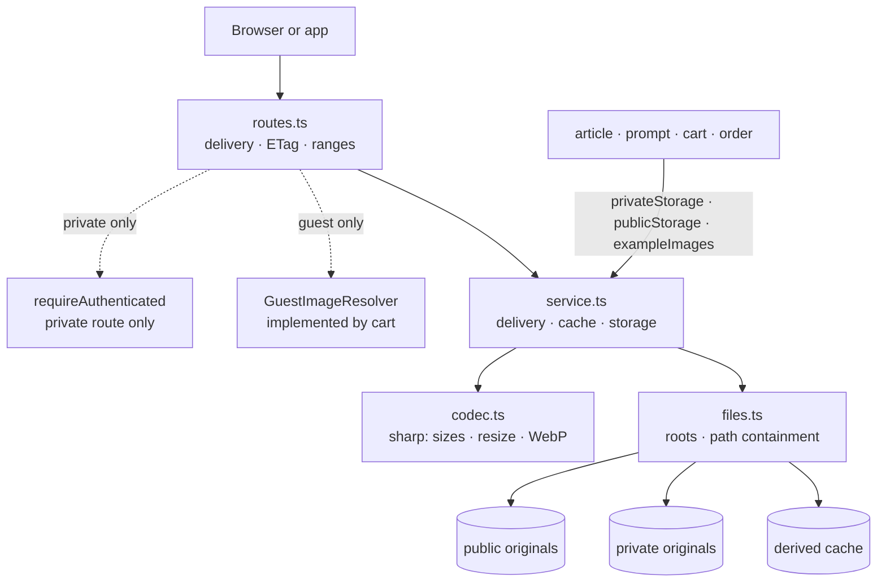

# The Image package

This guide explains the TypeScript code in
[`backend-ts/src/modules/image`](../../../../backend-ts/src/modules/image).
It is the port of the Kotlin module described in the
[Kotlin image guide](../../backend/packages/image-package.md); the decisions
recorded there still hold unless a section below says otherwise.

## What this package does

The image module reads JPEG, PNG, and WebP originals from three configured
local directories, resizes them without cropping, writes the derived files
into a cache, and serves them through a public, an authenticated private, and
a guest route. It also hands other modules what they need to store images
without knowing a single filesystem path:

- `privateStorage`, the print images only their owner may see (Cart stores
  them, Order reads them back for the production PDF);
- `publicStorage(folder)`, the images of one public folder;
- `exampleImages(folder, logger)`, the example-image rule Article and Prompt
  follow on top of a public folder; and
- `readUploadedImage(form)`, the reader of the `file` part every pre-upload
  endpoint receives.

The module owns no database table and does not know who owns a private image.
The guest route asks a `GuestImageResolver` that the cart module implements
and the composition root hands over.

## The five-minute mental model



The service is a deep module on purpose: path containment, symbolic-link
checks, byte and pixel limits, resizing, cache freshness, and atomic
publication stay together, and nothing outside it ever joins a root with a
file name.

## File map

```text
image/
|- index.ts                 createImageModule({ settings, guestTokens }); the exported types and upload helpers
|- routes.ts                imageRoutes, guestImageRoute, GuestImageResolver, the file answer with ETag and ranges
|- service.ts               createImageService(roots): get, publicStorage(folder), privateStorage; ImageStorage
|- codec.ts                 sharp: parseImageSize, writeDerivative, normalizeToWebp, the formats and limits
|- files.ts                 prepareImageRoots, safeRelativePath, resolveFile, directoryInside, isFresh, deleteDerivations
|- upload.ts                FILE_PART_NAME, ImageUpload, UploadedImage, readUploadedImage, uploadRejection
|- example-images.ts        createExampleImages, the example-image rule
|- routes.test.ts           the three routes over HTTP
|- service.test.ts          derivation, the cache, storage, the roots
|- upload.test.ts           the multipart reader
`- example-images.test.ts   the example-image rule against a fake storage
```

The module has no `repository.ts` and no `schema.ts`, because it owns no
table. What Kotlin split into `ImageService`, `ImageFiles`, `ImageCodec`, and
`ImageSettings` is `service.ts`, `files.ts`, and `codec.ts` here: the roots
check moved into `files.ts`, because it is the first of the path rules.

## Composition

```ts
const images = createImageModule({ settings: settings.image, guestTokens: auth.guestTokens })
app.route('/', images.routes)
// the consumers:
//   createArticleModule({ …, exampleImages: images.exampleImages })
//   createPromptModule({ …, exampleImages: images.exampleImages })
//   createCartModule({ …, printImages: images.privateStorage })
//   createOrderModule({ …, printImages: images.privateStorage })
// once the cart exists:
app.route('/', images.guestImageRoute(cart.guestImages))
```

`createImageModule` checks the three roots synchronously while it runs, so a
misconfigured deployment fails at startup, before the server listens.

The exported surface of `index.ts`:

| Export | What it is |
| --- | --- |
| `createImageModule({ settings, guestTokens })` | the factory; `settings` is `Settings['image']`, `guestTokens` is `auth.guestTokens` |
| `.routes` | the public and the private delivery route |
| `.guestImageRoute(resolver)` | a Hono sub-app with `GET /api/images/guest/{size}/{id}` |
| `.privateStorage` | an `ImageStorage` for the print images |
| `.publicStorage(folder)` | an `ImageStorage` for one folder below the public root; throws for an unsafe folder |
| `.exampleImages(folder, logger)` | the example-image rule for one public folder |
| `readUploadedImage(form)` | `Promise<UploadedImage>`: `received` with the upload, `missing`, or `tooLarge` |
| `uploadRejection(message)` | `invalid({ file: [message] })`, answered through `respondFailure` |
| `FILE_PART_NAME` | `'file'`, the part name and the error field |
| types | `ImageStorage`, `ImageUpload`, `UploadedImage`, `ExampleImages`, `GuestImageResolver`, `ImageModule` |

## HTTP API

| Method and path | Access | Successful cache policy |
| --- | --- | --- |
| `GET /api/images/public/{size}/{filename...}` | Anonymous | `public, max-age=86400` |
| `GET /api/images/private/{size}/{filename...}` | Any authenticated session | `private, max-age=3600` |
| `GET /api/images/guest/{size}/{id}` | Whoever the resolver accepts | `private, max-age=3600` |

`{filename...}` is the Hono pattern `:filename{.+}`: the rest of the path,
slashes included.

`size` is one positive width such as `300` or a box such as `300x200`, each
dimension 1 through 4096. The whole image is scaled as large as possible
inside the bounds, keeping its aspect ratio; it is not cropped or padded, and
a smaller original is upscaled.

The filename may contain nested forward-slash segments. Absolute paths, empty
or blank segments, `.` and `..`, backslashes, unsupported extensions, and
symbolic links that leave the selected root are refused. Only `.jpg`, `.jpeg`,
`.png`, and `.webp` delivery names exist; the extension decides the format of
the derived file.

| Outcome | Status | Body |
| --- | --- | --- |
| a derived file | `200` (or `206` for a range) | the image |
| a matching `If-None-Match`, or a satisfied `If-Modified-Since` | `304` | none |
| a range past the end of the file | `416` | none, `Content-Range: bytes */<length>` |
| invalid size | `400` | `Validation failed`, `size: ["Size must be width or widthxheight from 1 through 4096"]` |
| unsafe filename (also an encoded `..%2F`) | `400` | `Validation failed`, `filename: ["Invalid image filename"]` |
| unsupported extension | `400` | `Validation failed`, `filename: ["Unsupported image format"]` |
| missing original, even with a cached file left | `404` | `Image not found` |
| anonymous private request | `401` | the platform's auth refusal |
| a codec or I/O failure | `500` | `Internal server error`, no path or detail |

A path with literal dot segments (`/api/images/public/120/../../x.png`, also
`%2e%2e`) never reaches a handler: the URL resolves the dot segments before
routing, so the request matches no image route and answers `404`.

### The file answer

Every success carries `Cache-Control`, `ETag`, `Last-Modified`,
`Accept-Ranges: bytes`, `Content-Type`, and `Content-Length`. The ETag is
`"<length hex>-<modified millis hex>"`, the value the Kotlin routes sent.
`routes.ts` implements what Ktor's `ConditionalHeaders` and `PartialContent`
plugins did, in about forty lines, because Hono has no equivalent for a file
on disk:

- `If-None-Match` with the ETag (or `*`, weak tags compared by value) answers
  `304`; without an `If-None-Match`, an `If-Modified-Since` at or after the
  modification time answers `304`.
- One `bytes=` range (`0-9`, `100-`, `-500`) answers `206` with
  `Content-Range`. An `If-Range` that no longer matches the ETag or the
  `Last-Modified` value sends the whole file instead.
- A malformed `Range` or one with several ranges is ignored and answered with
  the whole file, which HTTP permits. Ktor answered several ranges with a
  `multipart/byteranges` body; no client of this shop asks for one.

The file is read into memory and sliced. Derived files are display sizes of at
most 4096 × 4096 pixels, so streaming would buy nothing worth its code.

### The guest route

`images.guestImageRoute(resolver)` is its own sub-app because the resolver
belongs to the cart, which is created after image. It needs no session: it
reads whatever identity the request carries and asks the resolver.

```ts
export type GuestImageResolver = (caller: {
  imageId: number
  guestToken: string | null
  userId: number | null
}) => Promise<string | null>
```

- The guest token comes from `guestTokens.tryGet(c)`, which never creates a
  cookie: looking at an image must not create a guest. The route never sends a
  `Set-Cookie`.
- `userId` is the signed-in user's id, or `null`.
- A `null` answer and a non-numeric id both answer `404 Image not found`, so an
  id cannot be probed for existence; an owned image with an invalid size
  answers `400`.
- The resolved name is served from the print-image folder with the private
  route's cache policy, ETag, and range handling.

What the answer means is the cart's rule: a guest token identifies an image
only while that image has no user at all (see
[the Kotlin cart guide](../../backend/packages/cart-package.md#who-a-cart-belongs-to)).

## Storage

```ts
export interface ImageStorage {
  store: (upload: ImageUpload) => Promise<OperationResult<{ filename: string }>>
  exists: (filename: string) => Promise<boolean>
  delete: (filename: string) => Promise<void>
  originalPaths: (filenames: Iterable<string>) => Promise<Map<string, string>>
}
```

`privateStorage` and every `publicStorage(folder)` are the same code bound to
a different root and folder, so their acceptance rules cannot drift apart.
Print images live in the one folder `print-images` below the private root;
callers pass file names only and never learn the folder.

- `store` normalizes the upload to WebP and publishes it under a generated
  lowercase UUID-with-dashes name plus `.webp`. Its only failure is `invalid`
  on the `file` field (see [Upload limits](#upload-limits)).
- `exists` answers whether the name is a stored original.
- `delete` removes the original and every size derivation of it; deleting a
  missing file is not an error.
- `originalPaths` answers the readable original of each stored name. It is the
  one place a path leaves the module, for a consumer that has to *read* the
  bytes (the production PDF). A name the storage cannot answer for is absent
  from the map. The paths are a snapshot: a reader still has to survive a file
  deleted right after the call.

A name that is not a plain file name (a path, `..`, a blank) names nothing:
`exists` answers `false`, `delete` does nothing, and `originalPaths` leaves it
out. A consumer may *receive* a path it has to read, but it never *derives*
one.

Every write goes to a unique temporary file in the target directory and is
moved into place with an atomic `rename`, so a reader never sees a partly
written file.

## The example-image rule

Article subcategories, mug variants, SPOD articles, and prompts store an image
that a row then refers to by name. `exampleImages(folder, logger)` is where
that rule lives; an owning service creates one per folder:

```ts
const examples = images.exampleImages('articles/subcategory-example-images', logger)
```

- `store(upload)` writes the file *before* any row refers to it, so the create
  and update bodies stay plain JSON: a client pre-uploads, then submits the
  name.
- `checkSubmitted(field, filename)` answers `Promise<OperationResult<null>>`
  before the write transaction opens. `null` is valid ("no example image"). A
  name without the minted shape is rejected without asking the storage (`Example
  image filename must be the name of an uploaded image`); a well-shaped name
  whose file is gone is rejected after asking (`Example image does not
  exist`). Both are field errors on the `field` the caller names, so a mug
  variant reports `mugVariants[2].exampleImageFilename`.
- `deleteObsolete(filename)` runs *after* the write committed, for a name no
  row refers to any more. A failure is only logged, as a warning on the owning
  module's `logger`: a row written after the commit can refer to the file
  again, and an orphan is not the client's problem.

The shape check is the regular expression `STORED_IMAGE_FILENAME`; a test pins
that every name `store` mints passes it.

## Upload limits

`readUploadedImage(await c.req.formData())` reads the first *file* part named
`file`; a text part of that name is skipped. It answers `received` with the
bytes and the declared content type, `missing`, or `tooLarge` for more than
10 MiB. Each endpoint chooses its own message for the last two (Article and
Prompt say `Example image must not exceed 10 MiB`, Cart `Image must not exceed
10 MiB`) and answers it with `respondFailure(c, uploadRejection(message), …)`:

```json
{ "message": "Validation failed", "errors": { "file": ["Example image must not exceed 10 MiB"] } }
```

`store` then applies the rules of the pipeline, all on the `file` field:

| Rule | Message |
| --- | --- |
| declared type is not `image/jpeg`, `image/png`, or `image/webp` | `Only JPEG, PNG, and WebP uploads are supported` |
| no bytes | `Image must not be empty` |
| more than 10 MiB | `Image must not exceed 10 MiB` |
| sharp cannot read the header | `Unsupported or invalid image data` |
| more than 40,000,000 pixels, read from the header before decoding | `Decoded image exceeds 40 megapixels` |
| a format other than JPEG, PNG, or WebP (a GIF declared as PNG) | `Invalid image data` |
| declared and detected format differ | `Declared and decoded image formats differ` |
| the pixels do not decode (a truncated file) | `Invalid image data` |

`413` is not this layer's status; it belongs to the application-wide body
limit of 30,000,000 bytes (see
[Request size limits](../conventions/request-size-limits.md)). Hono buffers a
body before the handler runs, so the Kotlin reader's two special cases are
gone: there is no part to stop reading early, and no cut-off part to mistake
for a short image. An oversized `file` part is refused after the body arrived,
which the outer limit already bounds.

## Configuration and roots

| Variable | Development default |
| --- | --- |
| `IMAGE_PUBLIC_ROOT` | `./data/images/public` |
| `IMAGE_PRIVATE_ROOT` | `./data/images/private` |
| `IMAGE_CACHE_ROOT` | `./data/images/cache` |

`settings.ts` only parses the three strings. `prepareImageRoots` in `files.ts`
does the filesystem work when the module is created: it resolves a relative
root against the working directory, creates missing directories, and keeps the
real path of each. It fails with the Kotlin messages when a root is a file
(`Image root is not a directory: …`), is not writable (`Image root is not
writable: …`), or contains another root (`Image roots must not overlap: … and
…`). Every later path is compared against these real paths.

Public and private originals are authoritative. Cached files may be deleted at
any time and are recreated on demand.

## Cache and concurrency

```text
cache/
|- public/<size>/<nested filename>
`- private/<size>/<nested filename>
```

Every request resolves the original first, so a missing original answers
`404` even when a cached file is left. A cached file is fresh when it is a
regular file inside the cache root and its modification time is at least the
original's (millisecond precision).

A miss derives the file with sharp and publishes it atomically. Concurrent
misses for one cache path share one derivation: the service keeps a
`Map<string, Promise<void>>` of running derivations, a request that finds its
key there awaits the same promise, and the entry is removed when it settles.
Different keys run independently.

Three Kotlin mechanisms are simpler here:

- **No processing slots.** Kotlin limited decode and encode work to a
  semaphore of two to eight slots. sharp runs its work on libuv's thread pool,
  whose size already bounds how many images are processed at once.
- **No source-version snapshot.** Kotlin compared the original's identity,
  size, and modification time twice and retried up to three times, so a
  replaced original could not be published as fresh. Here the derived file
  takes the original's modification time (`utimes`) before it is published: an
  original replaced during the derivation is newer than the derived file, so
  the next request derives it again. The same timestamp is the response's
  `Last-Modified`.
- **No per-original lock against delete.** Kotlin kept a derivation that was
  already running from publishing after a delete returned. Here such a
  derivation can leave one cached file behind; it is never served, because
  every request checks the original first, and the cache may be deleted at any
  time. Empty cache directories are not removed either.

## Codecs

[`codec.ts`](../../../../backend-ts/src/modules/image/codec.ts) is the only
file that imports sharp. It keeps the Kotlin output settings: JPEG quality 85
on a white background, PNG compression level 6, and lossy WebP quality 85 with
alpha quality 100, effort 4 (libwebp's method), and sharp YUV
(`smartSubsample`). Decoding refuses more than 40,000,000 pixels
(`limitInputPixels`). sharp bundles libvips and libwebp as prebuilt binaries
for Linux (glibc and musl) and macOS, so the JVM's native-codec smoke test and
its runtime restrictions are gone.

## Differences from the Kotlin module

- An exception is not wrapped: a codec or I/O failure propagates to the app's
  `onError`, which answers `500` (the platform rule, see
  [Operation results](../conventions/operation-results.md)).
- The storage capabilities answer plain values where they cannot fail with a
  client error: `exists` a `boolean`, `delete` nothing, `originalPaths` a
  `Map`. A name that is not a plain file name names nothing instead of being
  `invalid`.
- A public folder that leaves its root through a symbolic link fails the store
  with an exception (a deployment fault) instead of `invalid folder`.
- `publicStorage` is a function of the folder; `PublicImageFolder` is gone, and
  an unsafe folder throws when the storage is created.
- Several ranges in one request are answered with the whole file, not a
  `multipart/byteranges` body. Without `If-None-Match`, `If-Modified-Since` is
  honoured; with one, it is ignored as HTTP prescribes.
- The upload reader takes the already buffered `FormData`. Bun fills in a
  missing part content type from the file name's extension, so a part without
  one is no longer rejected for its declared type when its name says `.png`;
  the bytes are checked either way.
- See [Cache and concurrency](#cache-and-concurrency) for the three dropped
  locking mechanisms.

## Tests

Run from `backend-ts/`:

```sh
bun test src/modules/image    # this module only
bun run check                 # the full gate
```

The module needs no database. Each test file creates its roots in a fresh
temporary directory (`mkdtemp`) and generates its images with sharp.

| Test | What it states |
| --- | --- |
| [`routes.test.ts`](../../../../backend-ts/src/modules/image/routes.test.ts) | The public route with its cache headers, `304`, and a `206` range; `404` and the `400`s; traversal attempts; the private route with and without a session; the guest route for a guest owner (no `Set-Cookie`, `304`), a signed-in owner, a denied image, and a non-numeric id |
| [`service.test.ts`](../../../../backend-ts/src/modules/image/service.test.ts) | Fit-within resizing and upscaling; one derivation for eight concurrent requests (a spy on `writeDerivative`) and no temporary file left; cache invalidation by a newer original; `404` with a stale cache; WebP normalization of the three formats; every upload rejection; the pixel limit from a header; delete with its derivations; `originalPaths` leaving out unknown and non-plain names; the root checks |
| [`upload.test.ts`](../../../../backend-ts/src/modules/image/upload.test.ts) | The `file` part with its content type, text parts skipped, a missing part, exactly 10 MiB accepted and one byte more refused |
| [`example-images.test.ts`](../../../../backend-ts/src/modules/image/example-images.test.ts) | `checkSubmitted` for no name, a stored, a malformed, and a missing name; `deleteObsolete` deleting, doing nothing for `null`, and only logging a failure |

The `401` of the private route is covered once, as the one module-specific
access rule; the generic protection cases live in the platform's tests.
