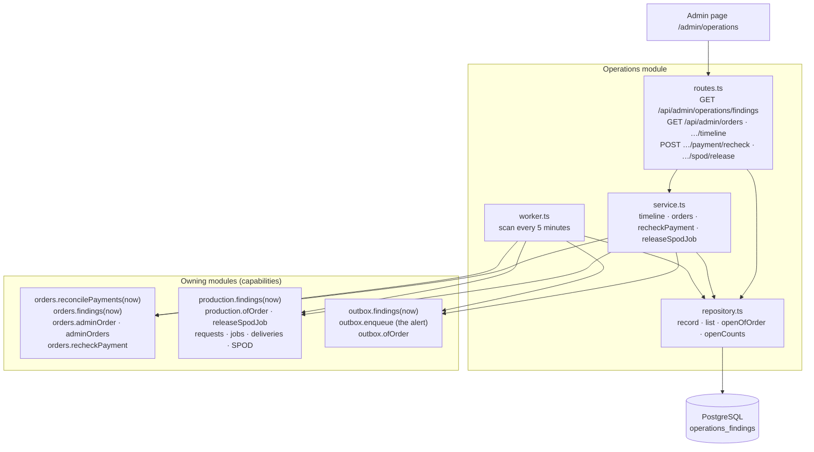

# The Operations package

This guide explains the TypeScript code in
[`backend-ts/src/modules/operations`](../../../../backend-ts/src/modules/operations).

## Contents

- [What this package does](#what-this-package-does)
- [The five-minute mental model](#the-five-minute-mental-model)
- [File map](#file-map)
- [HTTP API](#http-api)
- [The order list and the order timeline](#the-order-list-and-the-order-timeline)
  - [The order timeline](#the-order-timeline)
- [The admin actions](#the-admin-actions)
- [The kinds of finding](#the-kinds-of-finding)
- [The scan](#the-scan)
- [The alert](#the-alert)
- [The design decisions](#the-design-decisions)
- [Composition](#composition)
- [Tests](#tests)

## What this package does

The shop's promise to a customer is: money in, product out. The pipeline that
keeps it (payment, paid transition, production request, split, generation or
submission, delivery, shipment, mails) retries every stage on its own, and
every stage records an attempt counter and a bounded error code. What the
pipeline cannot do by itself is tell anyone that an order stands still. This
module does:

- every five minutes a **worker** first lets the order module ask Mollie about
  every payment that has been under way for over 15 minutes (the
  **reconciliation**, which repairs a lost webhook), then asks the order,
  production, and email modules which of their rows stand still, and records each answer as a **finding** in
  `operations_findings`, the only table this module owns;
- a finding that the next scan no longer reports is **resolved** on its own;
- every scan with a new finding of a **mailed** kind enqueues one **alert
  mail** (`OPERATIONS_ALERT`) to `OPERATIONS_ALERT_EMAIL` that lists them all;
- the admin route `GET /api/admin/operations/findings` lists the open findings
  (and those resolved in the last seven days), and the admin page
  *Operations* (`/admin/operations`) shows them;
- the admin routes `GET /api/admin/orders` and
  `GET /api/admin/orders/{orderId}/timeline` answer "what happened to order
  42?" in one document, assembled from the capabilities of the order,
  production, and email modules and this module's open findings; the admin
  pages *Orders* (`/admin/orders`) and the order timeline
  (`/admin/orders/{orderId}`) show them;
- two admin actions replace SQL typed by hand: the payment recheck (a button
  on the order timeline) and the release of a quarantined SPOD job (a dialog
  on the *Logistics* page). Both delegate to the owning module and land in
  the order's history with the admin's user id.

A finding is one bounded record: a kind, the row it is about, the order that
row belongs to, since when it stands still, and its attempt counter and error
code. It never carries customer data or a provider's text.

## The five-minute mental model



The boundaries are:

1. **Each owning module judges its own rows.** The rule "this payment is
   stuck" is written next to the payment table, in the order module, by the
   code that knows what a payment is. The operations module never queries
   another module's table.
2. **The operations module only remembers.** It turns "what is stuck right now"
   into a history with a beginning (`first_seen_at`) and an end
   (`resolved_at`), and answers the admin page.

## File map

```text
operations/
|- index.ts            createOperationsModule({ db, orders, production, outbox, settings,
|                      frontendBaseUrl }) → { routes, worker }
|- schema.ts           OperationsFindingsTable, merged into the platform's Tables
|- repository.ts       createFindingRepository(db) → { record(findings, alert), openOfOrder,
|                      openCounts, list }; Finding, the union of the three owning modules'
|                      finding types; which kinds are mailed; Alert, UnalertedFinding
|- service.ts          createOperationsService: the order timeline and the order list, assembled
|                      from orders.adminOrder/adminOrders, production.ofOrder, outbox.ofOrder,
|                      and the open findings; the two actions, orders.recheckPayment and
|                      production.releaseSpodJob
|- routes.ts           operationsRoutes(repository, service): the findings list, the order list,
|                      the timeline, the two actions with the release's body schema; no-store
|- worker.ts           createOperationsWorker({ reconcilePayments, sources, repository, outbox,
|                      alertEmail, frontendBaseUrl, logger }) → { runOnce, start, stop };
|                      FindingSource; the alert (mail, or log without an address)
|- worker.test.ts      reconcile first, upsert, resolve, reappear, the alert, the loop
`- routes.test.ts      the admin guard, no-store, the findings lists, the order list, the timeline,
                       the two actions with CSRF
```

The findings list only forwards to the repository; `service.ts` exists for the
two order reads, which assemble one answer from three other modules. The
finding rules themselves live in the owning modules:
[`order/payment/repository.ts`](../../../../backend-ts/src/modules/order/payment/repository.ts)
(`findings`),
[`production/findings.ts`](../../../../backend-ts/src/modules/production/findings.ts),
and [`email/outbox.ts`](../../../../backend-ts/src/modules/email/outbox.ts)
(`stalledEmails`). The alert mail is rendered by the email module
([`email/templates/operations-alert.ts`](../../../../backend-ts/src/modules/email/templates/operations-alert.ts)).


## HTTP API

| Method and path | Who | Answer |
| --- | --- | --- |
| `GET /api/admin/operations/findings` | admin | `200`, a JSON array of the open findings, newest `firstSeenAt` first |
| `GET /api/admin/operations/findings?resolved=true` | admin | `200`, the findings resolved within the last seven days, same order, each with `resolvedAt` |

Both answer `Cache-Control: no-store`; without a session the platform answers
`401`, without the admin role `403`. Any other value of `resolved` is the open
list. One finding on the wire:

```json
{
  "kind": "DELIVERY_STALLED",
  "subject": { "type": "DELIVERY", "id": 2 },
  "orderId": 42,
  "since": "2026-10-16T10:00:00.000Z",
  "attemptCount": 3,
  "lastErrorCode": "SFTP_CONNECT_FAILED",
  "firstSeenAt": "2026-10-16T10:05:00.000Z",
  "alertedAt": null
}
```

`orderId` is `null` only for a mail that was enqueued without an order (the
SPOD ops alert and the operations alert). `alertedAt` is the time the alert
mail about the finding was enqueued, and stays `null` for a listed-only finding
and in a deployment without `OPERATIONS_ALERT_EMAIL` (see [The alert](#the-alert)).

## The order list and the order timeline

"What happened to order 42?" used to be SQL across seven tables of three
modules. Two admin routes answer it instead. The operations module owns none of
those tables, so it asks each owner for its part and adds its own open
findings; no query here touches another module's table.

| Method and path | Who | Answer |
| --- | --- | --- |
| `GET /api/admin/orders` | admin | `200`, the 50 newest orders |
| `GET /api/admin/orders?email=kunde@example.com` | admin | `200`, the newest 50 orders placed with exactly that address, compared case-insensitively; a blank value is no filter |
| `GET /api/admin/orders/{orderId}/timeline` | admin | `200`, the [timeline document](#the-order-timeline); `404 {"message":"Order not found"}` for an unknown and a non-numeric id alike |

All three answer `Cache-Control: no-store`. They share the path
`/api/admin/orders` with the order module's production PDF routes
(`…/{orderId}/production-pdfs`). Hono dispatches each request by its full path
to the one route that matches; the order module's guards on that prefix may run
in front of these routes as well, and since they are the same two guards
(`requireAdmin`, `no-store`) that is harmless. One row of the list, through
`orders.adminOrders({ email, limit: 50 })` and `openCounts` (the open findings
grouped by `order_id`):

```json
{
  "orderId": 42,
  "createdAt": "2026-10-16T09:00:00.000Z",
  "status": "PAID",
  "paymentStatus": "PAID",
  "total": 4070,
  "email": "kunde@example.com",
  "openFindings": 1
}
```

### The order timeline

One document per order, from four sources: `orders.adminOrder(orderId)` (the
order, its payments, and its [history](order-package.md#the-order-history)),
`production.ofOrder(orderId)` (the request, the jobs with their deliveries and
SPOD row), `outbox.ofOrder(orderId)` (the mails attributed to the order), and
`openOfOrder(orderId)` from this module's table. The order is read first; an
unknown order ends there with the `404`. The access token never leaves the
order module.

```json
{
  "order": {
    "orderId": 42, "createdAt": "…", "status": "PAID", "paymentStatus": "PAID",
    "subtotal": 3580, "shippingCost": 490, "discountAmount": 0, "total": 4070,
    "items": [{ "orderItemId": 1, "articleName": "Tasse", "…": "the OrderView line" }],
    "email": "kunde@example.com", "phone": "+49 30 1",
    "shippingAddress": { "firstName": "Erika", "…": "…" }, "billingAddress": { "…": "…" },
    "cartId": 7, "promotionId": null, "updatedAt": "…"
  },
  "payments": [{ "paymentId": 1, "molliePaymentId": "tr_…", "status": "PAID", "amount": 4070, "createdAt": "…", "updatedAt": "…" }],
  "production": {
    "request": { "id": 1, "attemptCount": 1, "lastErrorCode": null, "createdAt": "…", "processedAt": "…" },
    "jobs": [{ "jobId": 3, "supplierId": 1, "fulfillmentChannel": "SFTP", "generationAttemptCount": 1,
      "lastGenerationErrorCode": null, "generatedAt": "…", "preparedAt": "…", "shippedAt": null,
      "shippedByUserId": null, "shippedByChannel": null, "shippingCarrier": null, "trackingNumber": null,
      "deliveries": [{ "deliveryId": 2, "destinationId": 1, "attemptCount": 1, "lastErrorCode": null, "deliveredAt": "…" }],
      "spod": null }]
  },
  "emails": [{ "emailJobId": 5, "kind": "ORDER_CONFIRMATION", "recipient": "…", "attemptCount": 1, "lastErrorCode": null, "createdAt": "…", "sentAt": "…" }],
  "events": [{ "id": 1, "occurredAt": "…", "kind": "ORDER_PLACED", "actorType": "CUSTOMER", "actorId": null, "cause": null, "details": null }],
  "findings": [{ "kind": "DELIVERY_STALLED", "subject": { "type": "DELIVERY", "id": 2 }, "since": "…", "attemptCount": 3, "lastErrorCode": "SFTP_CONNECT_FAILED", "firstSeenAt": "…", "alertedAt": null }]
}
```

`production.request` is `null` before the order is paid, and then `jobs` is
empty. A SPOD job carries `spod` with `externalReference`, `createState`,
`createAmbiguousCount`, `attemptCount`, `lastErrorCode`, `confirmedAt`, and
`remoteState`; an SFTP job carries `null`. `findings` lists only the open
ones. The four reads are separate, so the document is not one snapshot: a row
that moves while it is read may show its new state in one section and the old
one in another, which a reload settles.

## The admin actions

| Method and path | Who | Answer |
| --- | --- | --- |
| `POST /api/admin/orders/{orderId}/payment/recheck` | admin | `200 {"status":"PAID","paymentStatus":"PAID"}`, the order's two statuses read after Mollie answered; `404 {"message":"Order not found"}` for an unknown and a non-numeric id; `409 {"message":"The order has no payment"}` |
| `POST /api/admin/production/jobs/{jobId}/spod/release` | admin | `200` with the job's admin view (as `GET /api/admin/production/jobs` answers it); `400 Validation failed` for a body the schema refuses or a `confirmation` that is not the job's reference; `404 {"message":"Production job not found"}`; `409` for a job not in `OUTCOME_UNKNOWN` and for a partner order id another job holds |

Both are `POST`s behind `requireAdmin`, which also checks the CSRF pair
(`400 Invalid CSRF token` without it), and both answer `Cache-Control:
no-store`. Neither answer carries provider text or a database object name. The
release shares the path `/api/admin/production/jobs` with production's job
routes, the same arrangement as the order routes above.

**The payment recheck** is `orders.recheckPayment(orderId, adminUserId)`: the
order module's `refreshed` with the cause `ADMIN_RECHECK`, the same path the
webhook, the detail read, and the reconciliation take. A payment Mollie
reports paid pays the order (production request, confirmation mail, promotion
redemption); a status that changed is recorded as `PAYMENT_STATUS_CHANGED`
with the admin's user id; an unchanged one records nothing. The recheck has no
body. See [Reading a status](order-package.md#reading-a-status-stored-versus-refreshed).

**The SPOD release** takes one of two bodies:

```json
{ "decision": "NOT_CREATED", "confirmation": "ORD-42-JOB-7" }
{ "decision": "CREATED", "externalReference": "spod-123", "confirmation": "ORD-42-JOB-7" }
```

The route's Zod schema is a discriminated union on `decision`, strict on
unknown properties; `externalReference` is 1 to 128 characters without
control characters. Whether `confirmation` is the job's reference only the
production module can tell (it knows the job's order), so that comparison is
the one rule checked behind the route; a mismatch answers the same
`400 Validation failed` shape with the error on `confirmation`.
`production.releaseSpodJob` performs the runbook's write and records
`SPOD_JOB_RELEASED`; the guards and the runbook are in
[SPOD fulfillment](spod-fulfillment.md#reconciling-a-quarantined-job-outcome_unknown),
the implementation in the
[Production package](production-package.md#releasing-a-quarantined-spod-job).

## The kinds of finding

The thresholds are constants in the owning module, not settings: they describe
what "stuck" means for that table, and nobody tunes them per deployment.

| Kind | Owner | Subject | Rule (against the scan's `now`) |
| --- | --- | --- | --- |
| `PAYMENT_UNRESOLVED` | order | payment | the order is `PENDING`, its current payment is under way (`OPEN`, `PENDING`, `AUTHORIZED`), and was created more than an hour ago |
| `PAYMENT_PAID_ORDER_UNPAID` | order | payment | the current payment is `PAID` and the order is not (amount mismatch, or paid on a cancelled order) |
| `PRODUCTION_REQUEST_STALLED` | production | request | `processed_at IS NULL` and (older than 15 minutes or 3 attempts) |
| `JOB_GENERATION_STALLED` | production | job | an SFTP job without its document, and (older than 15 minutes or 3 attempts) |
| `DELIVERY_STALLED` | production | delivery | undelivered, its job's document exists, and (the document is older than an hour or 3 attempts) |
| `SPOD_SUBMISSION_STALLED` | production | job | a SPOD job, not prepared, not quarantined, and (older than an hour or 3 attempts) |
| `SPOD_QUARANTINED` | production | job | `create_state = 'OUTCOME_UNKNOWN'` |
| `SPOD_REMOTE_ATTENTION` | production | job | the partner reported `NEEDS_ACTION` or `CANCELLED`, and the job is not shipped |
| `SHIPMENT_OVERDUE` | production | job | prepared more than seven days ago and not shipped |
| `EMAIL_STALLED` | email | mail | unsent, and (older than an hour or 3 attempts); carries the mail's own kind |

`since` is the `created_at` of the subject row unless the owning module's guide
says otherwise; the details per kind (`since`, which counter) are in
[the Order package](order-package.md#payments-that-stand-still-findingsnow),
[the Production package](production-package.md#findings-for-operations), and
[the Email package](email-package.md#the-two-reads-for-operations).

An abandoned checkout (a `PENDING` order whose payment ended) is **not** a
finding. It is not a broken promise but a customer who left, and listing every
one would bury the real findings.

## The scan

[`worker.ts`](../../../../backend-ts/src/modules/operations/worker.ts) has the
shape of the other two workers: `runOnce`, `start` (one scan at once, then
every five minutes, until `stop`), and `stop` (aborts the sleep and resolves
once the scan in progress is finished). A scan that throws is logged with the
error's class and the next scan tries again. Run one worker per database.

One scan does four things, all against the same `now`:

1. **Reconcile.** It calls `orders.reconcilePayments(now)`: the order module
   asks Mollie about every payment under way for over 15 minutes and applies
   the answer exactly as the webhook would (see
   [Reading a status](order-package.md#reading-a-status-stored-versus-refreshed)).
   One failing payment does not hold up the others: the reconciliation logs
   each failure itself and moves on.
2. **Collect.** It calls `findings(now)` of every source, each a plain read
   transaction of the owning module, outside any write of this module.
3. **Record**, in one transaction of its own
   ([`repository.ts`](../../../../backend-ts/src/modules/operations/repository.ts)):

   ```sql
   INSERT INTO operations_findings (kind, subject_type, subject_id, order_id, since, attempt_count, last_error_code)
   VALUES …
   ON CONFLICT (kind, subject_type, subject_id) WHERE resolved_at IS NULL
   DO UPDATE SET last_seen_at = now(), attempt_count = excluded.attempt_count,
                 last_error_code = excluded.last_error_code;

   UPDATE operations_findings SET resolved_at = now()
   WHERE resolved_at IS NULL AND last_seen_at < now();
   ```

   The conflict target names the `WHERE` of the partial unique index
   `ux_operations_findings_open`; PostgreSQL only uses a partial index as the
   arbiter of an `ON CONFLICT` when the statement repeats its predicate. A
   known open finding keeps its `first_seen_at` and `since` and gets its
   counter and code refreshed. The resolve needs no list of what was reported:
   `now()` is the start time of the transaction, so every row the upsert
   touched or inserted has `last_seen_at = now()`, and every open row with an
   older `last_seen_at` is one this scan did not report.

4. **Alert**, in the same transaction: see [The alert](#the-alert).

A resolved row is never touched again. A finding that resolves and later
reappears is a new row with a new `first_seen_at`, and the old one stays as
history.

## The alert

The last step of the record transaction tells an operator about the new
findings. Of the findings the scan reported, the repository keeps the
**mailed** ones and selects their open rows that have no `alerted_at` yet:

```sql
SELECT … FROM operations_findings
WHERE resolved_at IS NULL AND alerted_at IS NULL
  AND (kind, subject_type, subject_id) IN ((…), (…))
ORDER BY id;
```

When there is at least one, the worker renders **one** `OPERATIONS_ALERT` with
`renderOperationsAlert` and stores it with `outbox.enqueue(trx, mail)` in the
same transaction, and the repository sets `alerted_at = now()` on exactly those
rows. A scan without a new mailed finding enqueues nothing. A finding seen
again already has `alerted_at` and is not mailed again; a finding that resolved
and reappears is a new row and is in the next mail again.

| Mailed | Listed only (on the admin page, never in a mail, `alerted_at` stays `NULL`) |
| --- | --- |
| `PAYMENT_UNRESOLVED`, `PAYMENT_PAID_ORDER_UNPAID`, `PRODUCTION_REQUEST_STALLED`, `JOB_GENERATION_STALLED`, `DELIVERY_STALLED`, `SPOD_SUBMISSION_STALLED`, `SHIPMENT_OVERDUE`, `EMAIL_STALLED` of every mail kind but one | `SPOD_QUARANTINED`, `SPOD_REMOTE_ATTENTION`, and `EMAIL_STALLED` whose stalled mail is itself an `OPERATIONS_ALERT` |

The table does not store the stalled mail's kind, so the rule is applied to
the reported `Finding` objects (`EmailFinding.emailKind`) before the select,
not to the rows.

The mail (German, like every mail of the shop) has one block per finding: the
German name of its kind (a table of cases in the template, so no provider text
can reach it), the subject type and id, the order number, `since`, the attempt
count and error code, and a link to the admin timeline of the order
(`{FRONTEND_BASE_URL}/admin/orders/{orderId}`; none when the finding has no
order). The subject names the count, `Betrieb: 3 neue Befunde`. It carries no
customer data.

**Without an address.** `OPERATIONS_ALERT_EMAIL` is optional (it is required
only together with `PRODUCTION_SPOD_WEBHOOK_SECRET`, because the SPOD ops alert
uses the same address). Without it the findings are still recorded, no mail is
enqueued, `alerted_at` stays `NULL`, and the worker logs one `error` line per
new mailed finding (inserted in this scan) naming its kind and subject. The
admin page works regardless. Configuring the address later mails the open
findings that were never alerted with the next scan.

## The design decisions

These decisions were taken in issue #282.

### Decision 1: One module looks across the pipeline, and nothing imports it

`operations` may import `order`, `production`, and `email`; no module imports
`operations`. It is the only place that sees the whole pipeline, so the
question "which orders stand still?" has one answer and one admin page. It is
created in the composition root after order and production, its routes are
mounted like every other module's, and its worker starts and stops next to the
email and production workers.

The module queries only `operations_findings`. Every fact about another
module's rows comes from a capability over that module's own tables.

*Rejected:* one SQL view or query across `payments`, `production_*`, and
`email_jobs` in this module. It would be shorter, but it would make operations
the second owner of every rule about those tables and break the rule that a
module queries only its own tables.

### Decision 2: Each owning module reports its own stalled rows

Order, production, and email each expose `findings(now)` and declare their own
finding type (`OrderFinding`, `ProductionFinding`, `EmailFinding`) with the
kinds and subject types they produce; the operations module's `Finding` is the
union of the three. `now` is a parameter, so every rule is tested against a
fixed instant on both sides of its threshold.

So that a mail can be attributed to an order, `email_jobs` got a nullable
`order_id` (V33) without a foreign key: email stays a leaf, and a deleted
order must not fail an unrelated job. `outbox.enqueue(trx, email, { orderId })`
stores it; the order confirmation, the producer notification, and the shipping
notification pass theirs.

### Decision 3: Findings are recorded, not computed per request

The worker writes what it saw into a table instead of the admin route asking
the three modules on every page load. Only a table can say *since when* the
shop knows about a finding (`first_seen_at`), that it went away
(`resolved_at`), and whether an operator was already alerted (`alerted_at`). One open row per kind and subject is the database's job: the
partial unique index `ux_operations_findings_open` holds it, and the upsert
relies on it instead of a prior existence query.

The table (`V33__operations_findings.sql`):

| Column | Meaning |
| --- | --- |
| `kind`, `subject_type`, `subject_id` | what is stuck, and which row; unique among the open rows |
| `order_id` | the order the subject belongs to, no foreign key |
| `since` | when the subject entered the state it is stuck in, as the owning module reports it |
| `attempt_count`, `last_error_code` | the subject's own counter and code, refreshed by every scan |
| `first_seen_at`, `last_seen_at` | the first and the latest scan that reported it |
| `alerted_at` | when the alert mail about it was enqueued; `NULL` for a listed-only finding and without an address |
| `resolved_at` | the first scan that no longer reported it; `NULL` while open |

### Decision 4: The scan reconciles the payments before it collects the findings

A payment that stands still is almost always a webhook that never arrived, and
the order module already has the repair: `refreshed`, which the order detail
page calls. The scan runs it for every payment under way for over 15 minutes
*before* it collects the findings, so a payment the reconciliation just paid
or ended is never reported as `PAYMENT_UNRESOLVED`, and an operator only hears
about a payment Mollie itself still reports as open after an hour. The
reconciliation is a capability of the order module (`orders.reconcilePayments`)
and the worker receives it as a function; the operations module never talks to
Mollie.

*Rejected:* reconciling in the order module's own timer. It would be a fourth
worker for one query, and the ordering "repair first, then judge" would be a
race between two loops instead of two lines in one scan.

### Decision 5: One alert per scan, and some kinds are listed only

A scan mails all its new findings in **one** mail, not one mail per finding: an
SFTP or provider outage that stalls fifty orders is one mail, not fifty. The
mail is enqueued in the record transaction, so a finding is marked alerted
exactly when its mail is stored.

Two kinds are listed only, `SPOD_QUARANTINED` and `SPOD_REMOTE_ATTENTION`,
because the SPOD channel already mails each of those state transitions (the
SPOD ops alert, [SPOD fulfillment](spod-fulfillment.md)), and a second mail for
the same fact is noise. An `EMAIL_STALLED` about a stalled `OPERATIONS_ALERT` is
listed only as well: otherwise a broken outbox would enqueue one new alert about
the stalled alert per scan, and the operator would receive hundreds of alerts
about alerts once the outbox heals. Every other `EMAIL_STALLED` is mailed,
through the very outbox that is stalled; that is accepted, because the finding
is on the admin page anyway and the mail arrives as soon as the outbox heals,
which is also when an operator can act on it.

Both alerts share one address, `OPERATIONS_ALERT_EMAIL`, which replaced the
former SPOD-only alert address: there is one operations mailbox, not
one per channel.

*Rejected:* storing the stalled mail's kind in `operations_findings` to decide
the listed-only rule from the row. The rule is only needed at the moment the
finding is reported, and the reported `Finding` already carries it.

### Decision 6: Admin actions instead of SQL

The two repairs an operator needs most, asking Mollie about a payment now and
releasing a quarantined SPOD job, are routes of this module, each delegating to
the owning module and each recorded in the order's history with the admin's
user id. The operations module is where the admin looks at the stuck order,
so the button belongs next to it; the write itself stays with the owner of the
table.

This **reverses a recorded decision**: the SPOD runbook used to keep the
release a manual `UPDATE`, "deliberately not an endpoint", because it starts a
paid production. A SQL statement typed under pressure into the production
database is the riskier path (no check of the job id, no `WHERE` guard
enforced, nobody recorded), so the release is an endpoint with three guards
instead: the typed job reference, the explicit decision, and the
`SPOD_JOB_RELEASED` event naming the admin
([SPOD fulfillment](spod-fulfillment.md#reconciling-a-quarantined-job-outcome_unknown)).

*Rejected:* a release without the typed confirmation, behind a plain "Are you
sure?" dialog. One click away is exactly what the old decision warned against;
typing the reference that was just searched in the backoffice ties the click
to that search.

## Composition

```ts
const operations = createOperationsModule({
  db,
  orders: order.orders,   // reconcilePayments(now), findings(now), adminOrder, adminOrders, recheckPayment
  production,             // findings(now), ofOrder, releaseSpodJob: requests, jobs, deliveries, SPOD orders
  outbox: email.outbox,   // findings(now), ofOrder: email_jobs; enqueue: the alert mail
  settings: settings.operations, // { alertEmail: string | null }, OPERATIONS_ALERT_EMAIL
  frontendBaseUrl,        // settings.frontend.baseUrl, for the timeline links
})
app.route('/', operations.routes)
operations.worker.start()
// at shutdown
await operations.worker.stop()
```

The three parameters are typed as `Pick`s of the modules' own types (`Orders`,
`ProductionModule`, the email module's `outbox`) with exactly the members this
module calls; the composition root passes the modules' own objects. The same
`settings.operations.alertEmail` goes to the production module as `alertEmail`,
for the SPOD ops alert.

## Tests

Run from `backend-ts/`:

```sh
bun test src/modules/operations
```

| File | What it states |
| --- | --- |
| [`worker.test.ts`](../../../../backend-ts/src/modules/operations/worker.test.ts) | the reconciliation runs before the findings are read and with the same `now`, so a finding it resolves is not recorded in that scan; a scan inserts new findings and refreshes a known one with its counter and code while keeping `first_seen_at`; a finding no longer reported is resolved, an empty scan resolves everything, a reappearing finding is a new row and the old one keeps its `resolved_at`; several new findings are one `OPERATIONS_ALERT` and all get `alerted_at`, a finding seen again is not mailed again, a reappearing one is; the two SPOD kinds and a stalled `OPERATIONS_ALERT` are listed only; without an address nothing is mailed, `alerted_at` stays `NULL`, and one `error` line per new mailed finding names its kind and subject; `start` scans at once, a second `start` throws, and `stop` ends the loop without waiting for the interval |
| [`routes.test.ts`](../../../../backend-ts/src/modules/operations/routes.test.ts) | through the composed application, so the order routes are checked next to the order module's PDF routes on the same path: `401` without a session, `403` without the admin role, `no-store`; the open list with the exact wire shape, newest `firstSeenAt` first; `?resolved=true` with `resolvedAt` and without a finding resolved eight days ago; the timeline of a seeded order with a row in every section (exact document, no access token, only the open finding), an order with empty sections, the `404` for an unknown, a non-numeric, and an exponent id; the order list newest first with its `openFindings`, the case-insensitive exact e-mail filter, a blank filter, and the cap at 50; the payment recheck (`200` with the status pair, `409` without a payment, `404` for an unknown and a non-numeric id) and the SPOD release (`CREATED` with the view and the `SPOD_JOB_RELEASED` event naming the admin, `NOT_CREATED`, the second release and an SFTP job as `409`, the wrong confirmation and five refused bodies as `400` with nothing written, the `404`s), each `401` without a session, `403` without the admin role, and `400 Invalid CSRF token` without the CSRF header |

The rules of every kind are tested in their owning module, against seeded rows
on both sides of every threshold and a fixed `now`: `order/findings.test.ts`,
`production/findings.test.ts`, and the `outbox.findings` tests in
`email/outbox.test.ts`. `src/composition.test.ts` proves that the composed
application starts the operations worker (its first scan records a stalled
mail) and stops it with the other two.
