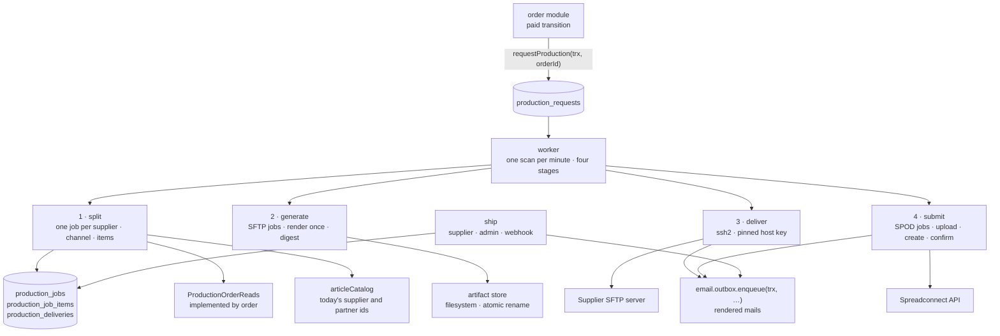

# The Production package

This guide explains the TypeScript code in
[`backend-ts/src/modules/production`](../../../../backend-ts/src/modules/production).
The print-on-demand channel has a guide of its own,
[SPOD fulfillment](spod-fulfillment.md).

## Contents

- [What this package does](#what-this-package-does)
- [The five-minute mental model](#the-five-minute-mental-model)
- [The one-way edge to the order module](#the-one-way-edge-to-the-order-module)
- [File map](#file-map)
- [Composition](#composition)
- [Destination management](#destination-management)
- [The production PDF](#the-production-pdf)
- [The durable request and the split](#the-durable-request-and-the-split)
- [Artifact generation](#artifact-generation)
- [Delivery](#delivery)
- [Producer notification](#producer-notification)
- [Fulfillment](#fulfillment)
- [What the port changed](#what-the-port-changed)
- [Tests](#tests)

## What this package does

The Production module turns a paid order into production work and lets the
suppliers report what they shipped. It owns eight responsibilities:

- **Destination management.** Admin CRUD for a supplier's delivery accounts,
  one per channel (`SFTP` push, `SPOD` API), plus the button that syncs a SPOD
  destination's catalog. Destinations are database rows, not configuration.
- **On-demand production PDF.** From one order, one PDF per involved supplier:
  an address page plus one page per physical item. The admin order page
  downloads it through `productionPdfGenerator`.
- **The durable request and the split.** The order module's paid transition
  calls `requestProduction(trx, orderId)`: one cheap row in the caller's
  transaction. The worker later splits it into one job per supplier, with the
  job's item lines and its frozen fulfillment channel, plus one delivery per
  enabled destination of an SFTP supplier.
- **The immutable artifact.** Each **SFTP** job's PDF is generated exactly once,
  stored on the filesystem, and recorded by its SHA-256 digest.
- **SFTP delivery.** The worker pushes every artifact to the supplier's enabled
  destinations: pinned host key, upload to a temporary name, rename to
  `ORD-{orderId}.pdf`.
- **The producer notification.** A delivered PDF enqueues an informational mail
  to the producer in the same commit that sets `delivered_at`.
- **Print-on-demand submission.** A SPOD job's designs are uploaded, the
  partner's order is created, its id persisted, and the order confirmed; see
  [SPOD fulfillment](spod-fulfillment.md).
- **Fulfillment.** The supplier and admin job lists, the PDF download, and the
  one ship write every reporter goes through (a supplier, an admin, the
  partner's webhook), which enqueues the customer's shipping mail in its own
  transaction.

## The five-minute mental model



One durable row triggers everything the worker does. The fulfillment half
starts from an HTTP request instead. PostgreSQL holds the retry state, the
filesystem holds the immutable bytes, and only a confirmed external acceptance
closes a delivery. Every stage is idempotent and every failure is a bounded
error code; no exception message, credential, remote path, or partner text is
ever persisted or logged.

## The one-way edge to the order module

Production needs three things from paid orders, and it declares them as
TypeScript types in [`orders.ts`](../../../../backend-ts/src/modules/production/orders.ts),
exported from `index.ts`. The order module implements them and the
composition root hands that implementation to `createProductionModule` as
`orders`. Production never imports order; order imports production
(`requestProduction`, `productionPdfGenerator`, the types). That is the
one-way edge `order → production` of decision #248: no `ProductionOutbox`, no
`ProductionSource` port, no late binding.

```ts
export interface ProductionOrderReads {
  productionData(orderId: number): Promise<ProductionData | null>
  fulfillmentOrders(orderIds: Iterable<number>): Promise<Map<number, FulfillmentOrder>>
  shippingNotificationOrder(orderId: number): Promise<ShippingNotificationOrder | null>
}
```

| Read | Who uses it | What it carries |
| --- | --- | --- |
| `productionData` | the split, the generation, the submission, the on-demand PDF | the shipping address, the customer's e-mail and phone (for the SPOD partner only), the Berlin order date, and the lines: snapshotted names, quantity, the unit price (for the SPOD partner only), the print image path, the five mug measurements, the snapshotted `spodHotspot`, and `articleId`/`variantId` |
| `fulfillmentOrders` | the job lists, the producer mail | per order: id, Berlin date, recipient name, the five address fields. Nothing else, which is the data minimization of the supplier surface |
| `shippingNotificationOrder` | the ship transaction | the recipient's e-mail, first name, and the ready-built order link. The access token never crosses the boundary |

Two things on a line are **not** snapshots, and production resolves them
itself through `articleCatalog.find(lines)` on every load
([`createOrderLoader`](../../../../backend-ts/src/modules/production/orders.ts)):
the **supplier** a line is routed to (a supplier assigned later heals a
waiting request) and the partner's **three product ids** (a mapping fixed
today heals a waiting SPOD job, SPOD fulfillment decision 8). Today's variant
name comes with them, for the SPOD name tripwire. Everything else the order
snapshotted at placement, including the hotspot (#260, decisions 8 and 14).

The loader maps every source problem to one bounded code: `SOURCE_NOT_FOUND`
(`null`), `SOURCE_INVALID` (an order without lines), and
`SOURCE_UNAVAILABLE` (the read threw; only the error's class is logged).

## File map

```text
production/
|- index.ts                 createProductionModule(deps) → { routes, productionPdfGenerator,
|                           requestProduction, worker: { start, stop } }; the exported types
|- orders.ts                the three read contracts, ProductionItem/ProductionOrder after the live
|                           catalog lookup, createOrderLoader, orderLabel, pdfFileName
|- schema.ts                the nine production tables, merged into the platform's Tables
|- routes.ts                destinationRoutes(service); the destinationInput schema
|- service.ts               createDestinationService: create/replace rules, the sync trigger
|- repository.ts            createDestinationRepository: base row plus channel detail row
|- delivery/
|  |- requests.ts           requestProduction(trx, orderId); the request repository and the
|  |                        transactional split
|  |- worker.ts             createProductionWorker → { runOnce, start, stop }; the split stage
|  |- generation.ts         the generation stage
|  |- deliverer.ts          the delivery stage and the producer notification
|  `- sftp.ts               deliverOverSftp (ssh2), the fingerprint check
|- pdf/
|  |- renderer.ts           renderProductionPdf (pdf-lib + fontkit), ProductionPdfError, sha256Hex
|  |- generator.ts          the on-demand productionPdfGenerator
|  |- artifact-store.ts     createArtifactStore: write and digest-verified load
|  `- fonts/LiberationSans-Regular.ttf
|- spod/                    the print-on-demand channel, see spod-fulfillment.md
|  |- submitter.ts, repository.ts, print-image.ts
|- fulfillment/
|  |- routes.ts             the supplier, admin, and webhook routes; the shipInput schema
|  |- service.ts            the job views, the one ship path, the webhook handling
|  |- repository.ts         the job reads and the guarded ship write
|  |- carrier.ts            the bounded carrier list and its tracking links
|  `- webhook.ts            the partner's payload reduced to bounded values; the secret compare
|- test-fixtures.ts         fakes, SQL seeds, the embedded SFTP server (tests only)
`- *.test.ts                see Tests
```

## Composition

```ts
const production = await createProductionModule({
  db,
  settings: settings.production,          // { artifactRoot, spod: { webhookSecret, alertEmail } | null }
  email,                                  // its outbox
  suppliers,                              // find(ids), for supplier names
  articleCatalog: article.articleCatalog, // today's supplier and partner ids
  spodCatalogSync: article.spodCatalogSync,
  spod,                                   // the application's one SpodClient
  accounts,                               // SupplierAccounts, implemented by account
  orders,                                 // ProductionOrderReads, implemented by order
})
app.route('/', production.routes)
production.worker.start()
// order receives production.requestProduction and production.productionPdfGenerator
// at shutdown
await production.worker.stop()
```

The factory is `async` because it does two things before anything of the
module runs:

- It **refuses to start** when a `channel = 'SPOD'` destination exists while
  `settings.production.spod` is `null`, with
  `A print-on-demand destination exists, so production.spod.webhookSecret and production.spod.alertEmail are required`.
  A channel whose shipments arrive by webhook could not report one, and a
  worker started first could submit a paid order during a startup that is
  about to fail. The half-filled block (only one of
  `PRODUCTION_SPOD_WEBHOOK_SECRET`, `PRODUCTION_SPOD_ALERT_EMAIL`, or a secret
  under 32 characters) already fails in the platform's `loadSettings`.
- It **creates the artifact root** (`PRODUCTION_ARTIFACT_ROOT`, default
  `./data/production/artifacts`), so an unusable root fails the startup rather
  than the first generation.

`worker.start()` scans once immediately and then every minute; `stop()` aborts
between rows and resolves when the row in progress is finished. Run **one**
worker per database: the partner offers no idempotency key, so a second worker
could create a second paid order (see [SPOD fulfillment](spod-fulfillment.md)).

## Destination management

A destination is one way of reaching a supplier's producer: an **SFTP** account
a PDF is pushed to, or a **SPOD** account an order is submitted to. It is stored
as two rows: the base row in `production_destinations` (supplier, channel,
label, `enabled`, notification fields) and one detail row in the table of its
channel (`production_destination_sftp` or `production_destination_spod`). The
API mirrors that: a body and an answer carry the block of their channel; an
answer carries the other block as `null`.

### Routes

All routes sit under `requireAdmin` (authentication, the `ADMIN` role, CSRF on
writes):

| Method and path | Success | Purpose |
| --- | --- | --- |
| `GET /api/admin/production/destinations` | `200` | Every destination, ordered by supplier then id |
| `POST /api/admin/production/destinations` | `201` + `Location` | Create a destination |
| `GET /api/admin/production/destinations/{id}` | `200` | Read one destination |
| `PUT /api/admin/production/destinations/{id}` | `200` | Fully replace a destination |
| `POST /api/admin/production/destinations/{id}/sync-articles` | `200` | Sync this destination's SPOD catalog |
| `DELETE /api/admin/production/destinations/{id}` | `204` | Delete an unreferenced destination |

| Failure | Answer |
| --- | --- |
| unknown id | `404 Production destination not found` |
| a non-numeric id | `400 Invalid production destination id` |
| delete of a destination with deliveries or synced articles | `409 Production destination is in use and cannot be deleted; disable it instead` |
| a body the schema refuses | `400 Validation failed` with the field errors below |

```json
{
  "supplierId": 1,
  "channel": "SPOD",
  "label": "Spreadconnect",
  "enabled": true,
  "spod": { "environment": "STAGING", "accessToken": "…", "timeoutSeconds": 30 }
}
```

An `SFTP` body brings `sftp` instead, with `host`, `port`, `username`,
`password`, `hostKeyFingerprint`, `remotePath`, and `timeoutSeconds`.

### Syncing the SPOD article catalog of a destination

`POST …/{id}/sync-articles` is the trigger of the sync the
[article module](article-package.md#the-spod-catalog-sync) runs. Production
reads what the sync cannot read itself, the supplier, the installation, and
the token, and calls `spodCatalogSync.sync({ supplierId, access })`. It opens
no transaction. The admin waits for the answer. The server closes a connection
that stays silent for 255 seconds (`idleTimeout` in `src/main.ts`, Bun's
maximum), and a paced sync of a large catalog can take longer: the client then
loses its connection while the run completes server-side. Its writes land, but
its `SpodSyncReport` is lost with the connection; look at the articles instead of
starting the sync again (a second start answers `SYNC_RUNNING` until the first
run ends).

| Answer | When |
| --- | --- |
| `200` with the `SpodSyncReport` | the run happened, also when its `status` is `FAILED` |
| `404 Production destination not found` | no destination with that id |
| `409`, code `CHANNEL_WITHOUT_CATALOG` | an `SFTP` destination: *Only print-on-demand destinations have a SPOD catalog to sync* |
| `409`, code `SYNC_RUNNING` | that destination is syncing already: *This destination is already syncing; wait for that run to finish* |
| `500` | the route broke, for example a database failure while reading the destination |

A **disabled** destination may sync (Joe, decision D5 on issue #224): a sync
writes nothing a customer sees, and preparing next season's catalog on a
switched-off destination is normal.

### The write-only secrets

The SFTP password and the SPOD access token are one mechanism:

1. The answer type `DestinationResponse` has no secret field.
2. No admin read selects the `password` or `access_token` column. Only three
   process-internal reads do: the delivery stage (SFTP), the submission stage
   and the sync source (SPOD).
3. The schema hands the secret to the service as `secret`, apart from the
   stored values; the repository takes it as a separate argument of `insert`
   and `update`, so no printable value holds it.
4. Log lines carry ids only, and a rejected body's field errors never echo a
   value.

A replace without a secret (absent, `null`, or blank) keeps the stored one; a
non-blank secret is stored exactly as typed, spaces included. A create requires
one: `sftp.password: Password is required` or
`spod.accessToken: AccessToken is required`.

### Validation rules

[`destinationInput`](../../../../backend-ts/src/modules/production/routes.ts) in
`routes.ts` is the field matrix:

- `supplierId` (*SupplierId is required*, *SupplierId must be positive*),
  `channel` (*Channel is required*, *Channel must be one of: SFTP, SPOD*), and
  `label` (*Label is required*, at most 255) are required.
- The body must carry **exactly** the block of its channel; otherwise a
  `channel` error: *SFTP destinations require the sftp block*, *SPOD
  destinations must not carry the sftp block*, and so on. An unknown channel
  says nothing about the blocks. This rule runs even when other fields fail, so
  one answer names every problem.
- `sftp`: `host`, `username`, `hostKeyFingerprint` required (the host key is
  always pinned), `port` 1–65535 defaulting to 22, `remotePath` at most 1024
  defaulting to `/`, `password` at most 255.
- `spod`: `environment` `PRODUCTION` or `STAGING` (*Environment is required*,
  *Environment must be one of: PRODUCTION, STAGING*), `accessToken` at most 512.
  There is no base-URL field: the environment decides the host in the `spod`
  module.
- `timeoutSeconds` is required and 1–3600 in both blocks.
- `notificationEmail` is optional and needs one `@` with text on both sides;
  `notificationName` is optional, at most 255. Blank is `null`.
- `enabled` defaults to `true`; `false` is the operational off-switch.

The service adds the rules the schema cannot check:

| Rule | Field error |
| --- | --- |
| the supplier does not exist (foreign key) | `supplierId`: *Supplier not found* |
| a second **enabled** SPOD destination of the supplier (partial unique index) | `channel`: *Supplier already has an enabled SPOD destination; disable it first* |
| a replace names another channel | `channel`: *Channel cannot be changed after creation* |
| a replace names another supplier | `supplierId`: *Supplier cannot be changed after creation* |
| a SPOD destination while `settings.production.spod` is `null`, enabled or not | `channel`: *This deployment has no production.spod configuration, so no SPOD destination can be stored* |

The channel is fixed because open deliveries point at the destination; the
supplier is fixed because a synced SPOD article carries the supplier of the
destination it came from.

### Persistence and typed constraint results

PostgreSQL enforces the shape (`V6`, `V22`): the supplier foreign key, the
channel check, the composite foreign key `(id, channel)` from each detail table
with a constant `channel` column (a detail row can only belong to a base row of
its own channel, and is deleted with it), the ranges, and the partial unique
index `supplier_id WHERE enabled AND channel = 'SPOD'`.
`executePostgresWrite` maps the expected failures by SQL state, never by
constraint name: `23505` → `enabledSpodExists`, `23503` on a write →
`supplierNotFound`, a foreign-key failure on delete → `inUse`. The unique rule
has a normal and a concurrent test (two simultaneous creates end as one `201`
and one `400`).

## The production PDF

[`renderProductionPdf(order, supplierId)`](../../../../backend-ts/src/modules/production/pdf/renderer.ts)
renders one supplier's share of an order with pdf-lib:

1. An **address page** of 239 mm × 99 mm: the shipping address centered (the
   name approximated as bold with a fill-plus-stroke rendering mode), the label
   `ORD-{orderId}` reading bottom-to-top in a 20 pt left column.
2. One page per **physical** unit: a line with quantity 3 is three pages. The
   left column reads `ORD-{orderId} ({index}/{total})`, 1-based within the
   share; the right column reads `article | supplier article number | variant`
   top-to-bottom (a blank number is left out). The image sits between the
   columns: with a print template it is confined to the template width, sits on
   the bottom margin, and is centered; without one it is centered in the whole
   area. Either way it scales to fit, keeping its aspect ratio. The document
   format fields override the page size.

The font is **Liberation Sans**, the file the Kotlin renderer took from the
PDFBox jar, copied into `pdf/fonts/` and embedded as a Type0 font through
`@pdf-lib/fontkit` (extended Latin and Cyrillic). Every print image is decoded
by sharp and embedded as PNG: the stored print images are WebP, which pdf-lib
cannot embed, and decoding every source the same way makes PNG and JPEG
sources take the same path.

A missing image is never a blank page. `ProductionPdfError` is the bounded,
retryable vocabulary, and also the job's generation codes: `MISSING_IMAGE`,
`UNREADABLE_IMAGE`, `INVALID_SOURCE` (no line for the supplier, a non-positive
quantity or measurement, a page too narrow for the two columns, a line without
supplier), and `RENDER_FAILURE` (logged by class only).

`productionPdfGenerator.generate(orderId)` is the on-demand download for the
admin order page. It answers
`{ kind: 'generated', documents } | { kind: 'orderNotFound' } | { kind: 'failed', error }`,
one document per supplier in first-appearance order, each
`{ supplierId, fileName: 'ORD-{orderId}.pdf', mediaType: 'application/pdf', bytes, sha256 }`.
The name repeats across the suppliers of an order by design: a supplier only
ever receives its own document. Nothing is stored.

## The durable request and the split

### Why a request row

Payment completion has taken the customer's money, so nothing on the
production side may abort that transaction.
[`requestProduction(trx, orderId)`](../../../../backend-ts/src/modules/production/delivery/requests.ts)
inserts one row into `production_requests` in the **caller's** transaction:
no order read, no routing. If the caller rolls back, no request exists. The
unique `order_id` makes repeated and concurrent calls answer the same id.

### The tables

| Table | One row per | Open while |
| --- | --- | --- |
| `production_requests` | order | `processed_at IS NULL` |
| `production_jobs` | request and supplier, with `fulfillment_channel`, `file_name`, the digest, `generated_at`, `prepared_at`, and the shipping columns | `shipped_at IS NULL` |
| `production_job_items` | job and 1-based position: the snapshotted names, supplier article number, quantity | — |
| `production_deliveries` | SFTP job and destination | `delivered_at IS NULL` |
| `production_spod_orders`, `production_spod_designs` | SPOD job, and its item positions | see [SPOD fulfillment](spod-fulfillment.md#the-tables) |

There is no in-progress status that could strand. The foreign keys along the
lifecycle (request → job → delivery, job → SPOD order) are `RESTRICT`; the rows
that only describe their owner (the destination detail rows, the job items, the
designs) cascade. `prepared_at` is the channel-neutral "ready to ship": set
with `generated_at` on an SFTP job, when the remote order is confirmed on a
SPOD job; a CHECK requires it of every shipped job. The shipping columns stay
`NULL` until `shipped_at` is set, the carrier is one of the seven names, and a
shipment has one reporter, a user or a channel, never both
(`shipped_by_user_id` is `ON DELETE SET NULL`).

### The split

The worker's first stage
([`worker.ts`](../../../../backend-ts/src/modules/production/delivery/worker.ts))
scans the open requests in id order, counts an attempt, loads the order, and
groups the lines by today's supplier (suppliers in first-appearance order,
lines in order). Then, in **one** transaction
([`completeSplit`](../../../../backend-ts/src/modules/production/delivery/requests.ts)):

1. read the enabled destinations of every supplier;
2. create each job with its channel: `SPOD` when the supplier has an enabled
   SPOD destination, `SFTP` otherwise (also for a supplier without any);
3. write the job's item lines (a blank supplier article number becomes `NULL`);
4. create one delivery per enabled destination of every SFTP job (a SPOD job
   gets none);
5. mark the request processed.

Every insert ignores a duplicate on its identity, so a repeated split heals.
The channel and the deliveries are a snapshot: a destination configured later
affects later orders only. An SFTP supplier without an enabled destination
still gets its job (the supplier page serves the PDF); the split logs it.

| Code | Meaning | Recovery |
| --- | --- | --- |
| `SOURCE_NOT_FOUND`, `SOURCE_INVALID`, `SOURCE_UNAVAILABLE` | the order read failed | order data heals |
| `ITEM_WITHOUT_SUPPLIER` | a line's article has no supplier today | an admin assigns one |
| `SPLIT_FAILED` | the split transaction threw | infrastructure heals |

All or nothing: jobs for the resolvable suppliers alone could attach a late
line to a job whose artifact already exists, and that line would never be
produced.

## Artifact generation

The second stage
([`generation.ts`](../../../../backend-ts/src/modules/production/delivery/generation.ts))
takes the SFTP jobs with `generated_at IS NULL` in id order, counts an attempt,
renders the supplier's PDF from the order as it is now, and:

1. writes the bytes to a temporary file **in the final directory** and renames
   it atomically to `{artifactRoot}/{jobId}/ORD-{orderId}.pdf` (the job id
   keeps two suppliers' copies apart);
2. records `content_sha256`, `generated_at`, and `prepared_at` in one
   statement guarded by `generated_at IS NULL`.

From then on the job is closed: no later change to master data or images
touches the bytes, and every delivery ships provably the same file. A crash
between the two steps leaves an open job whose next attempt replaces the file,
so the recorded digest always describes the bytes under the final path. The
codes are the source codes, the `ProductionPdfError` names, and
`ARTIFACT_WRITE_FAILED`.

[`createArtifactStore(root)`](../../../../backend-ts/src/modules/production/pdf/artifact-store.ts)
`load(jobId, fileName, sha256)` recomputes the digest and answers `loaded`,
`missing`, or `digestMismatch`: tampered or lost bytes never reach a supplier.
A file name that is not a plain name throws.

## Delivery

The third stage
([`deliverer.ts`](../../../../backend-ts/src/modules/production/delivery/deliverer.ts))
walks the open deliveries whose job artifact exists, in id order, counts an
attempt, reads the destination (the one admin-independent read of the SFTP
password), loads the artifact with digest verification, and uploads it.
`delivered_at` is set only after the server accepted the renamed file. One
destination's failure never blocks a sibling, and attempts are unbounded.

| Code | Meaning | Recovery |
| --- | --- | --- |
| `DESTINATION_MISSING` | the destination row or its detail row is gone | configuration is repaired |
| `DESTINATION_DISABLED` | the destination is switched off | an admin re-enables it |
| `ARTIFACT_MISSING`, `ARTIFACT_DIGEST_MISMATCH` | the file is gone or not the generated one | the file is restored |
| `CONNECTION_FAILED` | resolution, TCP connect, or the handshake timed out | the network heals |
| `HOST_KEY_REJECTED` | the server key does not match the pinned fingerprint | an admin verifies the fingerprint |
| `AUTH_FAILED` | the server refused the credentials | an admin fixes them |
| `TRANSFER_FAILED` | the upload or the rename failed after authentication | path or permissions are fixed |
| `DELIVERY_FAILED` | the upload threw unexpectedly | infrastructure heals |
| `SOURCE_NOT_FOUND` | the upload succeeded, but the order behind the producer mail is gone | order data heals; the next scan uploads again |

[`deliverOverSftp`](../../../../backend-ts/src/modules/production/delivery/sftp.ts)
is the `ssh2` client:

1. **Pinned host key, always.** The SHA-256 of the presented key, base64 as
   `ssh-keygen -l` prints it, must equal the destination's
   `hostKeyFingerprint` (with or without `SHA256:` and padding). A blank pin or
   another algorithm never matches. A mismatch closes the connection before any
   credential is sent.
2. **Password authentication only.**
3. **Temporary upload plus rename.** The bytes go to `{remotePath}/{name}.part`,
   an earlier final file is removed, then the rename to `ORD-{orderId}.pdf`: a
   hotfolder never sees a partial file.
4. **The destination timeout** bounds the connection and authentication
   together (`readyTimeout`) and each transfer step on its own.

The code is chosen by the stage reached (connect, authenticate, transfer), and
a rejected host key always wins. Delivery stays **at least once**: power can
fail after the server accepted the file and before `delivered_at` is written;
the stable name makes the retry overwrite the same file.

## Producer notification

Email is not a delivery channel: the producer gets an informational mail
without attachment, and only when the destination names a notification
address. The delivery stage owns the retries of the upload, the email module
those of the mail.

The completion is one transaction: set `delivered_at` (guarded by
`delivered_at IS NULL`, so at most one mail per delivery), and when the
destination has an address, render `renderProducerPdfNotification` and
`email.outbox.enqueue(trx, …)` it. A failing enqueue rolls `delivered_at` back
and the delivery stays open. The mail is rendered **now**, because the payload
outbox stores the finished mail (#248): the recipient, the producer name, and
the label are the destination's values at delivery time, the item count is the
sum of the job's snapshotted quantities, and the order date comes from the
`fulfillmentOrders` read.

## Fulfillment

Fulfillment is the part a person looks at: a supplier sees the packages it has
to build, prints the document of each, and reports what it shipped, which tells
the customer their package is on its way.

### What a supplier may see

The item lines come from the job's snapshot, the header from
`fulfillmentOrders`, whose type has nine fields and nothing else: no e-mail
address, phone, price, billing address, or token. The views are built field by
field, so even an implementation that answered more could not widen a supplier
answer. A test pins that `email`, `phone`, `price`, `total`, and `token` never
appear in one.

### The endpoints

Every job answer carries `Cache-Control: no-store`: it names a customer and an
address, and a shared cache would hand one supplier another's page.

| Method and path | Who | Answers |
| --- | --- | --- |
| `GET /api/supplier/me` | supplier | `{ supplierId, supplierName }` |
| `GET /api/supplier/production-jobs?status=OPEN\|SHIPPED` | supplier | a bare array of supplier job views |
| `GET /api/supplier/production-jobs/{jobId}/pdf` | supplier | the stored PDF as `attachment; filename="ORD-{orderId}.pdf"` |
| `POST /api/supplier/production-jobs/{jobId}/ship` | supplier | the updated supplier job view |
| `GET /api/admin/production/jobs?status=&supplierId=` | admin | a bare array of admin job views |
| `GET /api/admin/production/jobs/{jobId}/pdf` | admin | the same download, for every supplier's job |
| `POST /api/admin/production/jobs/{jobId}/ship` | admin | the updated admin job view, for every supplier's job |
| `POST /api/production/webhooks/spod/{secret}` | only the partner | always `202` with the body `[accepted]` |

The supplier subtree uses `requireSupplier(accounts)`, which resolves the
supplier on every request (`c.var.supplierId`); the admin subtree
`requireAdmin`. The supplier's scope is never a parameter: it is a `WHERE`
clause, so a foreign job reads exactly like an unknown one (`404 Production job
not found`), and so does a job id that is not a number. The webhook is outside
both subtrees; see [SPOD fulfillment](spod-fulfillment.md#the-webhook-how-a-shipment-comes-back).

`status` defaults to `OPEN`; another name is `400` with code `INVALID_STATUS`
(*Unknown production job status*). A `supplierId` that is present but not a
positive number is `400` with `INVALID_SUPPLIER_ID` (*Invalid supplier id*),
never an unfiltered page. Open jobs come oldest first and **uncapped**: a job
that is not shown is a job nobody repairs. Shipped jobs come by
`shipped_at DESC, id DESC`, capped at the **100** most recent; the id breaks the
tie of two jobs shipped in one transaction, so the cut is stable.

A job appears from the split on, with its lines. `pdfAvailable` is `false`
until the artifact exists, and forever on a SPOD job. The admin view adds the
supplier `{ id, name }`, `fulfillmentChannel`, `generationAttemptCount`,
`lastGenerationErrorCode`, the SPOD half (`externalReference`, `remoteState`),
and who reported the shipment (`shippedByUserId`, `shippedByChannel`, the raw
`shippingCarrierReported` next to the mapped `shippingCarrier`). `shippedAt`
is an ISO timestamp.

A page loads its jobs once, then resolves every header with **one**
`fulfillmentOrders` call and every item line with one query; the admin list adds
one `suppliers.find`. A job whose header is missing is logged and dropped from
a page, and fails loudly as the answer of a ship, because the shipment is
committed by then.

### The download

A SPOD job has no document and answers `404` like any other unknown address.
For an SFTP job the store verifies the digest before a byte is served:

| Situation | Answer |
| --- | --- |
| the artifact does not exist yet | `409`, code `ARTIFACT_NOT_GENERATED` |
| the digest says it exists, the file is gone | `409`, code `ARTIFACT_MISSING` |
| the file is not the generated one | `409`, code `ARTIFACT_DIGEST_MISMATCH` |

### Reporting a shipment

```json
{ "carrier": "DHL", "trackingNumber": "00340434161094042557" }
```

Both fields are optional and independent; blank is absent. The carrier is one
of `DHL`, `DPD`, `GLS`, `HERMES`, `UPS`, `DEUTSCHE_POST`, `OTHER` (*Carrier must
be one of: …*); the number is at most 128 characters without control
characters. There is **no** `trackingUrl`: the mail leaves under the shop's
name, so the shop builds the link from its own template per carrier
([`carrier.ts`](../../../../backend-ts/src/modules/production/fulfillment/carrier.ts)),
and `OTHER` shows the number as text (decision J2 of issue #119). The number is
percent-encoded with a space as `%20`, because two templates end in a path
segment and a fragment where `+` is a literal plus.

All three reporters end in one guarded statement
([`repository.ts`](../../../../backend-ts/src/modules/production/fulfillment/repository.ts)):

```sql
UPDATE production_jobs
SET shipped_at = now(), prepared_at = COALESCE(prepared_at, now()),
    shipped_by_user_id = ?, shipped_by_channel = ?,
    shipping_carrier = ?, shipping_carrier_reported = ?, tracking_number = ?
WHERE id = ? AND shipped_at IS NULL
  [AND prepared_at IS NOT NULL]   -- a human ship only
  [AND supplier_id = ?]           -- a supplier ship only
```

If it touched a row, the same transaction reads the job's item snapshot,
renders `renderShippingNotification`, and enqueues it: shipped and notified are
one commit, and a failing enqueue rolls the shipment back. The order half of
the mail (recipient, first name, link) is read before the transaction; a job
whose order is gone fails the ship loudly. If no row was touched, the row is
read back in the transaction to say why:

| Situation | Answer |
| --- | --- |
| unknown job, or another supplier's | `404 Production job not found` |
| already shipped | `409`, code `ALREADY_SHIPPED` |
| not prepared yet (decision J1 of issue #119) | `409`, code `NOT_READY` |

Two concurrent ships end as one `200`, one `409`, and exactly one mail: the
guard on `shipped_at IS NULL` is what makes "one mail per shipment" true now
that the outbox no longer deduplicates (#248). The supplier ship records the
login, the admin ship the administrator (`shipped_by_user_id`).

There is no un-ship endpoint: the mail is the point of no return. Before the
email worker's next scan an operator may delete the open `email_jobs` row
(`payload->>'kind' = 'SHIPPING_NOTIFICATION'`) and clear the job's shipping
columns by hand; after it, the honest repair is to write to the customer.

## What the port changed

- **The live lookup moved here.** Kotlin's order module resolved the supplier
  and the partner ids through the catalog; the read contract now carries the
  `articleId`/`variantId` reference and production calls `articleCatalog.find`.
- **Rendered mails.** Every mail is rendered when it is enqueued, in the
  transaction that causes it; an order that vanished keeps the producer
  delivery open with `SOURCE_NOT_FOUND`. The outbox's unique
  `(kind, source_id)` is gone, so every "one mail" rule rests on a guarded
  write.
- **No delivery adapter seam.** There is one push channel, so the stage calls
  `deliverOverSftp` directly; `UNSUPPORTED_CHANNEL` and the duplicate-adapter
  check went with the registry. A non-SFTP destination behind a delivery is a
  broken database and throws.
- **ssh2 instead of MINA SSHD.** The fingerprint rule is unchanged. The timeout
  bounds connection plus authentication and then each transfer step, where
  MINA had an idle timeout. `stop()` lets a running upload finish (each step is
  bounded) instead of interrupting it.
- **pdf-lib instead of PDFBox.** Same layout constants and font file; every
  image is decoded by sharp.
- **Validation in Zod at the route.** An unknown `environment` is a field error
  (Kotlin failed to read the body); the service's rules (missing secret,
  unconfigured SPOD) answer only once the schema passed.
- **The startup check** runs in the async factory, before the worker exists.
- **The on-demand generator** throws when the order cannot be read.
- **Timestamps** are ISO strings with millisecond precision.

## Tests

All database tests run against the Testcontainer database with the real email
outbox and supplier lookup; the order reads, the article catalog, the SPOD
client, the catalog sync, and the supplier logins are fakes from
[`test-fixtures.ts`](../../../../backend-ts/src/modules/production/test-fixtures.ts),
which also seeds orders, suppliers, users, and destinations with SQL and starts
an in-process `ssh2` SFTP server with a fresh ed25519 host key.

| File | What it states |
| --- | --- |
| `validation.test.ts` | `destinationInput` and `shipInput`: field names, messages, defaults, the block rule, no echoed secret |
| `destinations.test.ts` | one happy path per destination route for both channels, the write-only secrets against the columns, the service's field errors, the enabled-SPOD conflict normal and concurrent, the in-use delete, the unconfigured-SPOD refusal, the startup refusal, the sync route's five answers |
| `pdf/pdf.test.ts` | page count, page sizes, and text per direction (pdfjs-dist), one embedded image per item page (pdf-lib), a WebP source, the typed failures, the generator's per-supplier documents, the artifact store, the PNG conversion with its two budgets |
| `delivery/pipeline.test.ts` | `requestProduction` (repeated, concurrent, rolled back, refused); the worker end to end into the embedded SFTP server with digest-equal remote bytes and one producer mail, idempotent on re-run; the mixed SFTP/SPOD split; source and generation codes and their recovery; failed and disabled deliveries recovering; the enqueue failure rolling `delivered_at` back; the SFTP client's fingerprint, password, closed-port, and silent-server cases |
| `spod/submission.test.ts` | see [SPOD fulfillment](spod-fulfillment.md#tests) |
| `fulfillment/fulfillment.test.ts` | both surfaces: own versus foreign jobs, the minimization pin, `no-store`, the status and supplier-id codes, one batched header read, the download and its conflicts, ship by supplier and admin with the one mail, the concurrent ship, the webhook (see SPOD fulfillment), the carrier links |

Not ported: the Kotlin outbox, lifecycle, public-API, queued-email, resolver,
schema-state, legacy-fixture, and pixel-rendering tests, and the route-security
tests (the platform tests 401/403, CSRF, and unknown properties once).
