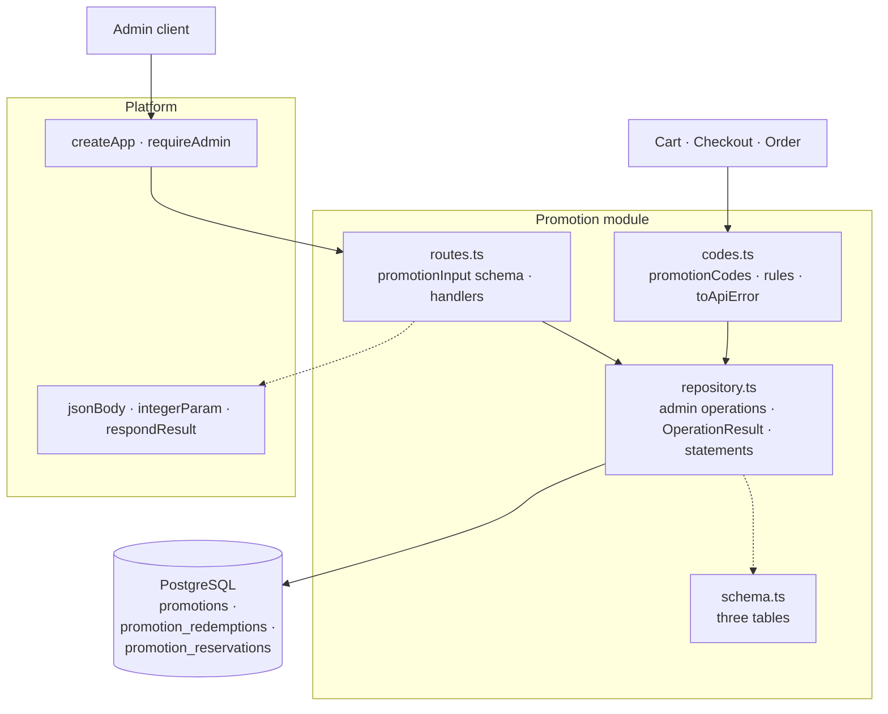

# The Promotion package

This guide explains the TypeScript code in
[`backend-ts/src/modules/promotion`](../../../../backend-ts/src/modules/promotion).

## What this package does

The Promotion package provides the admin lifecycle of promotions: coupon codes
with a percentage or fixed-amount discount, an optional activity window, and
optional usage limits. Coupon codes are unique regardless of letter case, and
PostgreSQL enforces that invariant.

A coupon is a **cart-level** campaign, and that keeps it apart from the price
discount an article or a prompt may carry on its Price (see
[the Pricing package](pricing-package.md)): a coupon has a code the customer
types, an activity window, and usage limits, and it is capped when it exceeds
the cart, while a price discount is simply configured on one price and rejected
when it is too large. The two stack, deliberately and without any special case:
a cart line is snapshotted at its already discounted price, so a 20 % coupon
takes another 20 % off that reduced amount (decision E3 of issue #238).

A promotion that has been redeemed at least once is *locked*. Its
configuration can no longer be changed and it can no longer be deleted, so
that recorded redemptions keep referring to the terms customers actually used.
An administrator may still activate or deactivate a locked promotion.

Next to the admin routes the module exports the `promotionCodes` capability:
`validate` answers what a customer-entered code is worth right now, `reserve`
holds its capacity while a checkout runs, `redeem` records a redemption,
`release` gives a hold back, and `find` resolves promotion ids a consumer has
already stored. The capability has no HTTP surface of its own. Cart validates
and renders codes, Checkout reserves them, and Order redeems them when a
payment is confirmed, so that the coupon rules exist exactly once in the
system.

## The five-minute mental model



The boundaries are:

1. **The route file owns the HTTP contract**: paths, the `promotionInput` Zod
   schema with the field rules, the id parameter, and the three conflict
   messages.
2. **`codes.ts` owns the coupon rules**: the activity window, the usage
   limits, the order in which they are checked, and the HTTP mapping every
   consumer answers a rejected coupon with.
3. **The repository owns persistence and the admin answers**: the admin
   operations answer `OperationResult` directly (there is no service; the
   routes call the repository), single-statement writes run on `db`, the
   update runs in its own `write` transaction, and the single statements the coupon
   capability runs in a transaction it is handed. The derived
   `coupon_code_normalized` column is written through `normalizedCouponCode`,
   so storing a code and looking one up cannot disagree.

## File map

```text
promotion/
|- index.ts            createPromotionModule({ db }) → { routes, promotionCodes }; toApiError; the value types
|- routes.ts           promotionInput schema, the response messages, promotionId, promotionRoutes(repository)
|- codes.ts            createPromotionCodes(db); PromotionCodeResult, PromotionRejection, ApplicablePromotion, toApiError
|- repository.ts       createPromotionRepository(db); the statements taking a trx; PromotionInput, Promotion, StoredPromotion, Discount
|- schema.ts           the three table interfaces, merged into the platform's Tables
|- routes.test.ts      one happy path per route and the module errors
|- repository.test.ts  concurrent duplicate codes, the update racing a redemption
|- codes.test.ts       the capability: every reason, reservations, redemption, release, find, toApiError
`- validation.test.ts  the schema's field names and messages
```

`codes.ts` is the one file beyond the standard five. The capability is a
concern of its own, with its own result type and rules, and the admin routes
do not use it.

The composition root creates the module once, mounts its routes, and hands the
capability on:

```ts
const promotion = createPromotionModule({ db })
app.route('/', promotion.routes)
// createCartModule({ …, promotionCodes: promotion.promotionCodes })
// createCheckoutModule({ …, promotionCodes: promotion.promotionCodes })
// createOrderModule({ …, promotionCodes: promotion.promotionCodes })
```

## HTTP API

Every route requires an authenticated user with the `ADMIN` role; mutating
methods also require the `X-XSRF-TOKEN` header. The protection is installed on
the whole `/api/admin/promotions` subtree.

| Method and path | CSRF | Success response |
| --- | --- | --- |
| `GET /api/admin/promotions` | No | `200` with a JSON array of `Promotion` values ordered by name, then id |
| `POST /api/admin/promotions` | Yes | `201` with `Promotion` and `Location` |
| `GET /api/admin/promotions/{id}` | No | `200` with `Promotion` |
| `PUT /api/admin/promotions/{id}` | Yes | `200` with the updated `Promotion` |
| `DELETE /api/admin/promotions/{id}` | Yes | `204` without a body |

| Result or failure | HTTP status | `message` |
| --- | --- | --- |
| unknown id | `404` | `Promotion not found` |
| create with a code another promotion has (any letter case) | `409` | `Coupon code is already in use` |
| update with a taken code, or a configuration change of a locked promotion | `409` | `Coupon code is already in use or the promotion is locked` |
| delete of a promotion a redemption, a reservation, or an order references | `409` | `Promotion is still in use and cannot be deleted` |
| invalid input | `400` | `Validation failed`, with the field-error map |
| invalid id | `400` | `Invalid promotion id` |

The create response uses a relative location such as `/api/admin/promotions/42`.
`PUT` replaces every field, so it uses the same body and rules as `POST`. Its
conflict carries no reason, so one message covers both causes; a client tells
them apart because it already knows `isLocked` from the representation.

### Request and response bodies

A request body is flat. Every field may be omitted or `null` except
`isActive`, which defaults to `false` when omitted (a promotion you forget to
switch on stays off) and must be a boolean when sent:

```json
{
  "name": "Summer sale",
  "couponCode": "Summer10",
  "discountType": "PERCENTAGE",
  "discountValue": 10,
  "startsAt": null,
  "endsAt": null,
  "usageLimitTotal": 100,
  "usageLimitPerUser": 1,
  "isActive": true
}
```

A response groups the discount into a nested object:

```json
{
  "id": 42,
  "name": "Summer sale",
  "couponCode": "Summer10",
  "discount": { "discountType": "PERCENTAGE", "discountValue": 10 },
  "startsAt": null,
  "endsAt": null,
  "usageLimitTotal": 100,
  "usageLimitPerUser": 1,
  "isActive": true,
  "redemptionCount": 0,
  "isLocked": false
}
```

The two shapes are deliberately **not** symmetric: the validation error keys
stay the flat `discountValue` the frontend knows, while the response keeps the
discount as one value. The frontend maps the discount in one direction only.

Values come back as they are stored:

- `name` and `couponCode` are trimmed, but `couponCode` keeps its letter case.
  Only `coupon_code_normalized` is upper-cased, so `"  Sommer25  "` is stored
  and returned as `"Sommer25"` while the uniqueness rule sees `SOMMER25`.
- `startsAt` and `endsAt` are UTC: `"2026-06-01T00:00:00+02:00"` comes back
  as `"2026-05-31T22:00:00.000Z"`.

Because the stored value always equals the accepted value, the input rules
reject the two cases where the `numeric(12,2)` column would silently change
it: a percentage with more than two decimal places, and a fixed amount above
the column's capacity.

## Validation and normalization

`promotionInput` in `routes.ts` carries the field rules; the field names and
messages are the ones of the Kotlin `PromotionInput.validate()`.

| Field | Rule | Messages |
| --- | --- | --- |
| `name` | required after trimming; at most 255 characters | `Name is required`, `Name must be at most 255 characters` |
| `couponCode` | required after trimming; at most 64 characters | `CouponCode is required`, `CouponCode must be at most 64 characters` |
| `discountType` | required; `PERCENTAGE` or `FIXED_AMOUNT` | `DiscountType is required`, `DiscountType must be PERCENTAGE or FIXED_AMOUNT` |
| `discountValue` | required number; positive. Percentage: at most 100, at most two decimals. Fixed amount: whole cents, at most 9999999999 | `DiscountValue is required`, `DiscountValue must be positive`, `DiscountValue must be at most 100 for percentage promotions`, `DiscountValue must have at most 2 decimal places for percentage promotions`, `DiscountValue must be whole cents for fixed amount promotions`, `DiscountValue must be at most 9999999999 for fixed amount promotions` |
| `startsAt`, `endsAt` | optional ISO-8601 timestamps with `Z` or an offset; `startsAt` not after `endsAt` | `StartsAt must be an ISO-8601 timestamp` (and `EndsAt …`), `StartsAt must not be after EndsAt` on both fields |
| `usageLimitTotal`, `usageLimitPerUser` | optional; a positive 32-bit integer | `UsageLimitTotal must be an integer`, `UsageLimitTotal must be positive` (and `UsageLimitPerUser …`) |
| `isActive` | optional boolean, default `false` | `IsActive must be a boolean` |

The two rules that read two fields (the discount value against the type, the
window) are `superRefine` steps with a `when` guard: each runs only when the
fields it reads passed their own rules, so an unknown discount type leaves the
value unjudged, as before, while an error in an unrelated field does not stop
it. Their messages are therefore listed after the single-field messages in the
`errors` map. The schema trims the text and parses the timestamps to `Date`;
the repository derives `coupon_code_normalized` with `normalizedCouponCode`.

## The promotionCodes capability

```ts
validate(code: string, cartId: number, userId: number | null): Promise<PromotionCodeResult>
reserve(trx: Transaction<Tables>, promotionId: number, cartId: number, userId: number | null): Promise<PromotionCodeResult>
redeem(trx: Transaction<Tables>, promotionId: number, orderId: number, cartId: number, userId: number | null): Promise<PromotionCodeResult>
release(trx: Transaction<Tables>, cartId: number): Promise<void>
find(ids: Iterable<number>): Promise<Map<number, ApplicablePromotion>>
```

`validate`, `reserve`, and `redeem` answer a discriminated union:

```ts
type PromotionCodeResult =
  | { kind: 'applicable'; promotion: ApplicablePromotion } // id, name, couponCode, discount
  | PromotionRejection
```

| Rejection `kind` | Meaning | `toApiError` status and `code` |
| --- | --- | --- |
| `invalidCode` | No promotion carries this code, or it no longer exists | `400` `PROMOTION_INVALID_CODE` |
| `inactive` | The promotion is switched off | `400` `PROMOTION_INACTIVE` |
| `notStarted` | The activity window has not begun | `400` `PROMOTION_NOT_STARTED` |
| `expired` | The activity window has ended | `400` `PROMOTION_EXPIRED` |
| `loginRequired` | The promotion limits usage per user, and the caller is a guest | `403` `PROMOTION_LOGIN_REQUIRED` |
| `totalExhausted` | The total usage limit is used up | `409` `PROMOTION_TOTAL_EXHAUSTED` |
| `perUserExhausted` | This customer has used up their personal allowance | `409` `PROMOTION_PER_USER_EXHAUSTED` |

`toApiError(rejection)` returns `{ status, body }`, the body an `ApiError`
with the message (for a human) and the stable `code` (for the client). It lives
here because the cart, when the code is entered, and the checkout, when it is
reserved, must answer the same reason with the same status and code:

```ts
if (result.kind !== 'applicable') {
  const { status, body } = toApiError(result)
  return c.json(body, status)
}
```

`validate` is the advisory answer for the moment a customer enters a code. It
trims the input and matches case-insensitively, then applies two rule groups
in this order: availability (`inactive`, `notStarted`, `expired`) and usage
limits (`loginRequired`, `totalExhausted`, `perUserExhausted`). Both window
boundaries belong to the window, and "now" is `new Date()`.

The order inside the second group is behaviour, not style. A guest entering a
per-user-limited code is told that a login is required *even when the total
limit is already exhausted*, because logging in may still let them use it.

`redeem` is the authority **over the usage limits**, and only over those. It
re-checks them under the promotion row lock and records the redemption, so a
promotion with `usage_limit_total = N` can never be redeemed more than N
times. A guest (`userId = null`) may redeem a promotion that carries only a
total limit. `redeem` deliberately does *not* re-check the active flag or the
window: a promotion that expires between the checkout and the payment must
still be redeemed, because the customer has already been charged. The unique
`order_id` makes the database the authority for "one order redeems at most
once": a second redemption of the same order fails with SQL state `23505`,
which aborts the caller's transaction.

### The reservation lifecycle

A usage limit is only honest if it also counts the checkouts that are running
right now. `reserve` writes one row into `promotion_reservations`, keyed on the
**cart**, and every limit check counts those rows next to the redemptions.

```text
validate ──▶ reserve ──▶ redeem      the payment succeeded
  (cart)     (checkout)  │
                         └─▶ release  the order was cancelled, its payment ended
                                      terminally, or the customer removed the code
```

- `reserve` joins the caller's transaction, checkout TX1, which also places the
  order. It takes the same `FOR UPDATE` lock on the promotion row that
  `redeem` takes and re-checks everything: the active flag, the window, the
  customer eligibility, and the limits. Two carts racing the last unit
  therefore produce exactly one holder, and the hold commits or rolls back
  with the order it was taken for.
- The cart is the identity, so `cart_id` is unique. A repeated checkout of the
  same cart overwrites its own row, and every count excludes the caller's own
  cart. Nobody can lose the capacity they are holding.
- `redeem` joins the caller's transaction, the paid transition of the order,
  inserts the redemption, and deletes the reservation of the same cart, so the
  capacity moves from in-flight to recorded without being counted twice or
  being free in between.
- `release` is one idempotent `DELETE` in the caller's transaction, so an
  order's cancel or payment-ended write and the release commit together; a cart
  that removes its own coupon wraps it in a transaction of its own. No lock on
  the promotion row is taken, because giving capacity back cannot overshoot a
  limit.
- `validate` counts the reservations of every cart except the given one, which
  is why an exhausted promotion is refused when the code is entered rather
  than only at checkout.

A reservation has **no expiry**. It ends through `redeem` or `release` and
through nothing else; the accepted cost is that a crash between the
reservation and its order, or a terminal payment webhook that never arrives,
leaves a row that holds capacity until an administrator removes it. Deleting
the cart removes it too (`ON DELETE CASCADE`).

`find` is the reader half, set in, map out: the current name, code, and
discount of every known id, unknown ids absent, no availability rule applied.
An empty list answers without touching the database.

Database failures are exceptions throughout the capability; the consuming
module answers them with its own error policy.

## Persistence and concurrency

`schema.ts` maps
[`V12__create_promotions.sql`](../../../../backend-ts/migrations/V12__create_promotions.sql)
(`promotions`, `promotion_redemptions` with its `ON DELETE RESTRICT` foreign
key), the `order_id` column V16 adds (unique, `RESTRICT`), and
[`V18__create_promotion_reservations.sql`](../../../../backend-ts/migrations/V18__create_promotion_reservations.sql),
whose three foreign keys each answer a deletion differently: the promotion is
`RESTRICT`, the cart `CASCADE`, the user `SET NULL`. `discount_value` is
`numeric(12,2)`; `pg` reads it as a string, and the repository parses it to a
number once, in `toStoredPromotion`.

PostgreSQL is the authority for code uniqueness. Create runs no preliminary
existence query; of two racing creates with a case-variant code exactly one
insert succeeds, and the other's `23505` becomes the `conflict` value through
`executePostgresWrite`. Delete needs no lock: the restricting foreign keys
reject it with `23503`/`23001`, mapped to `conflict` as well; the route answers
it with its own delete message. The answer is generic on
purpose, because the SQL state cannot say which reference held the promotion
back (see
[Persistence error handling](../conventions/persistence-error-handling.md)).

### All three writers lock the promotion row

The admin update (which must reject a configuration change once a redemption
exists), `reserve`, and `redeem` (neither of which may hand out capacity twice)
all start with `lockPromotion`:

```sql
SELECT … FROM promotions WHERE id = $1 FOR UPDATE
```

The lock serializes them. Whichever transaction arrives second waits, and only
*then* issues its counting query. Under `READ COMMITTED` every statement takes
a fresh snapshot, so that count already contains what the first one committed.
That is why the counts are separate statements after the lock and never a
subquery of the locking `SELECT`, whose snapshot predates the wait.

The admin update then decides in one place:

1. No row: `notFound`.
2. No redemptions: the full update runs.
3. Redemptions exist, and the input matches the stored configuration except
   for `isActive` (`changesOnlyActivation`, comparing timestamps as instants
   and the discount as a number): only `is_active` is written.
4. Otherwise `conflict`, which the route answers with its update message.

A guard inside the writing statement (`UPDATE … WHERE NOT EXISTS (SELECT …
FROM promotion_redemptions …)`) is not enough: it evaluates against its own
snapshot and is not re-checked when a redemption commits concurrently. The
repository test races exactly that case.

## Differences to the Kotlin backend

- **Validation types.** Values the Kotlin JSON parser refused before
  `validate()` ran now get a field error: a non-number `discountValue` reports
  `DiscountValue is required`, a non-string timestamp the timestamp message, a
  non-integer or out-of-range limit `… must be an integer`, and an explicit
  `null` for `isActive` `IsActive must be a boolean`.
- **Response notation.** `discountValue` is a JSON number without trailing
  zeros (`10`, not `10.00`), and timestamps carry milliseconds
  (`2026-05-31T22:00:00.000Z`, not `2026-05-31T22:00:00Z`). Both parse to the
  same value.
- **`reserve` and one `release(trx, cartId)` join the caller's transaction**
  (checkout TX1, #247); Kotlin's `releaseAbandoned` in its own transaction is
  gone, and a caller without a transaction opens one with `write`.
- **`validate` requires the cart.** Kotlin's `reservationKey` was optional;
  every caller has a cart, so `cartId` is a required parameter.
- **No injected `Clock`.** The activity-window clock is `new Date()`; tests set
  it with Bun's `setSystemTime`.

## Tests

Run from `backend-ts/`:

```sh
bun test src/modules/promotion    # this module only
bun run check                     # the full gate
```

| Test | What it states |
| --- | --- |
| [`routes.test.ts`](../../../../backend-ts/src/modules/promotion/routes.test.ts) | One happy path per route (ordering, redemption counts, trimming, UTC, `201` + `Location`, `204`), `404`, `400 Invalid promotion id`, the three `409` answers, and the accepted activation change of a redeemed promotion |
| [`repository.test.ts`](../../../../backend-ts/src/modules/promotion/repository.test.ts) | Concurrent case-variant creates and updates leave one code and one conflict; an admin update racing a redemption waits for the row lock and conflicts |
| [`codes.test.ts`](../../../../backend-ts/src/modules/promotion/codes.test.ts) | `validate` with trimming, every reason, the login hint, both window boundaries, reservations of other carts; `reserve` idempotency, refusals, per-user counts, two concurrent reserves of the last unit, rollback; `redeem` recording, limit re-checks, window ignored, consuming the reservation, rollback, once per order, two concurrent redeems of the last unit; `release`; `find`; `toApiError` |
| [`validation.test.ts`](../../../../backend-ts/src/modules/promotion/validation.test.ts) | Every message of `promotionInput`, the defaults, and the cross-field guards |

The tests insert the minimal `users`, `carts`, and `orders` rows the foreign
keys need with Kysely's `sql` instead of importing those modules. The platform
cases (`401`/`403`, CSRF, malformed bodies, the body limit) are pinned once in
`src/platform/**/*.test.ts`.
