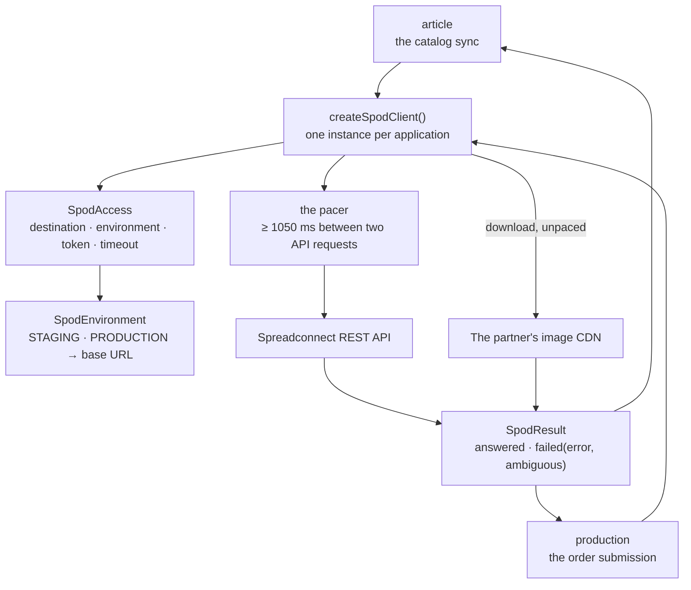

# The SPOD package

This guide explains the TypeScript code in
[`backend-ts/src/modules/spod`](../../../../backend-ts/src/modules/spod).

## What this package does

The SPOD package is the one place in this backend that knows the HTTP API of
the print-on-demand partner **Spreadconnect (SPOD)**. It owns the client, the
vocabulary of a provider call (`SpodAccess`, `SpodEnvironment`, `SpodResult`,
`SpodError`), the request and answer shapes of the ten calls, and the two
readings the partner's answers need, `parseColorHex` and `downloadUrl`.

It is a **leaf module**: it imports no other module, and from the platform only
the logger (`createLogger`). It owns no table, installs no route, and has no
worker. What it has is one factory, `createSpodClient`, and two modules consume
the client it returns:

- `production` submits an order through it: upload a design, create the order
  in state `NEW`, read it, confirm it, and ask which placements a product type
  offers (see [SPOD fulfillment](../../backend/packages/spod-fulfillment.md));
- `article` reads the merchant's backoffice catalog through it and turns it
  into this shop's SPOD articles: list the articles, read a size chart, read a
  product type's views, render a preview, and download an image one of those
  answers points at (see
  [the article guide](article-package.md#the-spod-catalog-sync)).

The client is a module of its own because two modules need it
([SPOD sync decision 5](../../backend/packages/article-package.md#decision-5--the-client-is-shared-the-modules-stay-layered),
kept by [the TypeScript article guide](article-package.md#the-spod-catalog-sync)):
`article` depending on `production`, or a second client next to the first,
would either have inverted the layering or split the partner's request budget
in two.

## The five-minute mental model



The ownership rules are:

1. **There is exactly one client per application.** The composition root calls
   `createSpodClient()` once and hands the same object to article and
   production. The partner allows 60 requests per minute for the whole
   account, so one pacer has to hold that budget for every module and every
   supplier at once.
2. **Where to talk and how to authenticate is a property of the call**, not of
   the client. Every API call takes a `SpodAccess` and reads the installation,
   the token, and the timeout off it.
3. **What the partner wrote leaves this module only as a typed answer.** A call
   answers `{ kind: 'answered', value }` or
   `{ kind: 'failed', error, ambiguous }`, and `SpodError` is a four-value
   union. A successful answer *does* carry partner text (titles, descriptions,
   skus, image URLs), because that is the catalog the article module mirrors;
   that module validates it, truncates it to its columns, and stores the
   bounded subset it needs. What never leaves this module is the untrusted
   rest: a raw failure body, a decoder message, the access token, and, into a
   log line, any URL at all.
4. **The module never decides what to do about a failure.** It never retries,
   never deactivates anything, never writes. Retrying belongs to the
   database-backed production worker; degrading belongs to the sync run.

## File map

```text
spod/
|- index.ts          the public surface: createSpodClient, the types, downloadUrl, parseColorHex
|- client.ts         createSpodClient({ fetch, now, sleep, logger }) with the ten calls and the pacer;
|                    SpodAccess, SpodEnvironment, SPOD_ENVIRONMENTS, spodEnvironmentOfStoredValue,
|                    SpodResult, SpodError, the order request shapes (SpodOrderRequest …)
|- catalog.ts        the Zod schemas and types of the catalog answers (SpodCatalogPage,
|                    SpodCatalogArticle, SpodCatalogVariant, SpodCatalogImage, SpodSizeChart),
|                    SpodBinary, downloadUrl, parseColorHex
|- previews.ts       the views answer (SpodViews, SpodView, SpodHotspotName, SpodViewImage) and the
|                    preview request and answer (SpodPreviewRequest, SpodPreviewConfiguration,
|                    SpodPreviews, SpodPreviewImage)
|- client.test.ts    every call's request and answer, the error mapping, the pacer, the download, logging
`- catalog.test.ts   parseColorHex and downloadUrl
```

The module has none of the five standard files except `index.ts`: there is no
route, no service, no repository, and no table. The files are named after the
concepts of [Source file organization](../conventions/source-file-organization.md).

The answer types are inferred from their Zod schemas
(`type SpodCatalogPage = z.output<typeof spodCatalogPage>`), so the type and
the lenient reading below can never drift apart. The schemas themselves stay
inside the module.

These types read only the keys a sync run uses. `SpodCatalogPage` carries the
page's `items` and the catalog's total `count`; the `count` is `number | null`,
because a page that carries none is a malformed answer the caller has to refuse
rather than a listing that happens to end early. The paging cursor is the
`limit`/`offset` the *caller* passed, so their echo in the body is not read.
`SpodCatalogVariant` carries the three product ids, the colour's name and value,
the size, the `sku`, and `productTypeName`, the partner's name of the product
kind, which the shop stores as an article's subtitle. Which pictures a colour
gets is decided from `SpodCatalogArticle`'s `images`: every one whose
`appearanceId` is that colour, in the listing's order.

One thing about an image answer is undocumented and lives next to the type, so
the article module never reads the partner's URL format itself:

- **`downloadUrl(image)`**: the partner writes the Spreadshirt image server's
  URL with the literal placeholder `lookupId` where the product id belongs
  (`…/products/lookupId/views/1,width=1000,…,appearanceId=2,mediaType=png/1`),
  and the CDN answers that with a `404` whose body is a placeholder picture.
  The id is in the same answer as `productId`; putting it in is what makes the
  URL a picture (seen on the staging installation on 2026-08-25, and verified
  against the CDN: the bare number works, a `P` prefix or the `.com` host does
  not). A URL without the placeholder, or an image without a product id
  (`productId` is `0`), is used as it is. The partner's support says to use the
  URL exactly as answered (2026-10), but the staging CDN still answers it with
  that `404` (checked again on 2026-10-06), so the replacement stays.

Which of a colour's images the shop shows is the operator's choice in the
backoffice (issue #260); the Kotlin `frontImage` ranking was deleted then and is
not ported.

## The ten calls

This module serves **no** HTTP route. Its API is the ten calls it makes
outwards. Every call answers a `Promise<SpodResult<T>>`.

| Call | Partner endpoint | Answers |
| --- | --- | --- |
| `uploadDesign(access, fileName, png)` | `POST /designs/upload` (multipart, part `file`, `image/png`) | the design id the print image was filed under |
| `createOrder(access, request)` | `POST /orders` | the partner's order id, always created in state `NEW` |
| `getOrder(access, orderId)` | `GET /orders/{id}` | the order's state |
| `confirmOrder(access, orderId)` | `POST /orders/{id}/confirm` | `undefined`; this is the moment production is ordered |
| `availableHotspots(access, productTypeId, designId)` | `GET /productTypes/{id}/hotspots/design/{designId}` | the placement names this product type offers |
| `articles(access, limit, offset)` | `GET /articles?limit=…&offset=…` | one `SpodCatalogPage` of the merchant's backoffice articles |
| `sizeChart(access, productTypeId)` | `GET /productTypes/{id}/size-chart` | the `SpodSizeChart` (its `sizeImageUrl`) |
| `download(url, timeoutSeconds)` | the URL a previous answer carried | a `SpodBinary`: the image bytes and their content type |
| `views(access, productTypeId)` | `GET /productTypes/{id}/views` | `SpodViews`: each view's name, placement names, and mockup per colour |
| `previews(access, productTypeId, request)` | `POST /productTypes/{id}/previews` | `SpodPreviews`: the URLs of the rendered previews, one per view |

The first five produce an order and are described step by step in
[SPOD fulfillment](../../backend/packages/spod-fulfillment.md); the next three
read the catalog; the last two calibrate a product type, what its sides look
like and where a design lands on them
([SPOD sync decision 7](../../backend/packages/article-package.md#decision-7--the-print-frame-is-measured-from-spod-previews),
and [the sync decisions](article-package.md#the-sync-decisions) of the
TypeScript article guide).

### The order request

`SpodOrderRequest` is `{ externalOrderReference, email, phone, shipping: {
address }, oneTimeItems }`, with one `SpodOneTimeItem` per (product type,
design) pair, each with a `SpodQuantityItem` per size and colour and a
`SpodConfiguration` (`image: { designId }`, `view`, `hotspot`) per placement.
Three fields are not the caller's to choose, so `createOrder` adds them when it
serializes the request:

- `orderItems: []`. Every line of this shop is a unique print, so nothing is
  ever ordered from a pre-created article, but the partner requires the field.
- `state: 'NEW'`. The partner also accepts `CONFIRMED` at creation, and this
  shop never uses it: an order created `NEW` produces nothing until it is
  confirmed, which is the only reason a creation whose outcome nobody knows can
  be repeated at all.
- `shipping.preferredType: 'STANDARD'`. The customer never chooses (issue #205,
  decision 5).

### The preview request

The preview request is sent as
`{ "configurations": [ { "designId", "hotspot" } ], "appearanceId": "<string>", "width": 1000, "height": 1000 }`;
the partner accepts only multiples of 50 for the size. Both calibration
endpoints write the colour id as a **string**, unlike the number of an order's
`appearanceId`, so `SpodViewImage` and `SpodPreviewRequest` carry a `string`.
A missing `views`, `hotspots`, or `images` array reads as an empty list.

## The four rules of the client

These four sentences shape every line of `client.ts`.

**Nothing the provider wrote is ever logged, and neither is anything of ours
that is secret.** Not an error body, not a decoder message (a `JSON.parse` or
Zod message quotes the input it stumbled over, so the message *is* the
untrusted content), not the access token, and not the request URL. What reaches
a log line is this adapter's own words (a destination id, a call name, a host),
at most the HTTP status *number*, and the `name` of a caught error
(`TimeoutError`, `SyntaxError`, `ZodError`). The error object itself is never
logged: a fetch error's message may carry the URL it failed on.

**This client never retries.** Retries belong to the database-backed worker.
That is not a style preference: the partner offers no idempotency key for
`POST /orders`, so a blind retry inside the adapter could create a second real
order whose id nobody knows. `ambiguous` on a failure is how the adapter tells
its caller which failures left the outcome undecided:

| What happened | `error` | `ambiguous` |
| --- | --- | --- |
| `429` | `RATE_LIMITED` | `false` |
| any other status outside `200`–`299`, below `500` (redirects included) | `REFUSED` | `false` |
| `500` and above | `PROVIDER_UNAVAILABLE` | `true` |
| fetch rejected: timeout, reset, DNS, a body cut off mid-transfer | `PROVIDER_UNAVAILABLE` | `true` |
| a `2xx` whose body is not JSON or not the expected shape | `PROVIDER_ANSWER_UNREADABLE` | `true` |

A `4xx` is the partner saying "I did not do this"; everything else that comes
back without a usable answer may have created an order.

**Requests are paced, not throttled after the fact.** The pacer keeps at least
**1050 ms** between any two API requests the
client makes, measured on the monotonic `performance.now()`. Each call chains
its wait onto a promise queue, which is the in-process mutex: concurrent callers
queue up behind each other instead of all sleeping the same interval and then
firing together. 60 requests per minute would be exactly 1000 ms; the extra
50 ms absorb the jitter between reading the clock and the request leaving. A
`429` that happens anyway is the retryable `RATE_LIMITED`. The queue lives in
memory, so it holds the budget for the one backend process; a second process
would need a share of the budget of its own.

**Where to talk and how to authenticate travels with the call.** Every API call
takes a `SpodAccess { destinationId, environment, accessToken, timeoutSeconds }`,
sends the token as `X-SPOD-ACCESS-TOKEN`, aborts after `timeoutSeconds` through
`AbortSignal.timeout`, and derives its URL from the `SpodEnvironment`, never
from a column: no admin input can point this shop at an arbitrary host.
`SPOD_ENVIRONMENTS` is `['PRODUCTION', 'STAGING']`, the values the
`ck_production_destination_spod_environment` check constraint allows;
`spodEnvironmentOfStoredValue(value)` reads a stored value back and throws on
anything else, because that is a broken database. `destinationId` is the only
part of an access that may be logged; never pass a `SpodAccess` to a logger.

Every request is sent with `redirect: 'manual'`: this API never answers with a
redirect, so a `3xx` is a refusal to be judged, not a route to be walked.
Walking it would replay the request, order body and token included, against a
URL this adapter never chose.

## The download is the one documented exception

`download(url, timeoutSeconds)` is the only call whose URL does **not** come
from `SpodEnvironment`. It comes out of an answer the partner gave this shop (a
mockup image, a size chart), so it is *bounded* instead of trusted (SPOD sync
decision 5):

- **https only.** A `http` URL, a relative one, or anything that is not a URL
  is refused before a request goes out.
- **No redirect is followed**, as for every call.
- **No access token is sent.** The CDN does not ask for one, and a token sent
  to a host this adapter did not choose would be a token given away.
- **The `User-Agent` is `Spreadconnect_API_flow`**. The
  CDN's bot protection answers every other non-browser client with a `403`,
  whatever the other headers say. The partner's support named this value in
  October 2026. If downloads start failing with `403` again, this value is the
  first thing to check.
- **Only an image is accepted.** The answer's content type must be `image/*`;
  `SpodBinary.contentType` is that type without its parameters.
- **At most 10 MiB is read**, whatever the answer's
  `Content-Length` claims. The body is read chunk by chunk and the stream is
  cancelled the moment the cap is exceeded. It is the same 10 MiB a visitor may
  upload: a product image has no business being larger than the picture
  printed on it.
- **It is not paced.** The 60-per-minute budget belongs to the API; pacing a
  few hundred CDN images behind it would make a sync take minutes for nothing.

Only the host of the URL may be logged. It is picked apart by hand rather than
parsed, without user info, port, path, query, and fragment, so a
partner-written `https://secret@host/` or `https://host/a.png?signature=secret`
cannot put its secret in a log line. A URL or an answer that is not a usable
image becomes `PROVIDER_ANSWER_UNREADABLE` with `ambiguous: false`; there is
deliberately no error code of its own, because every caller acts on all three
refusals in the same way. A refusal status and a failed request are judged like
every API call.

## The catalog answers are read leniently

Two decisions run through every schema in `catalog.ts` and `previews.ts`, both
from the SPOD sync decisions (6 and 4).

**Every field except an id has a default.** The partner documents neither which
fields are optional nor what a sparse article looks like, and a sync that
refuses to decode a page is a sync that writes nothing at all. A missing field
becomes an empty value (`''`, `0`, `[]`, or `null` for the nullable ones), and
the judgement (skip it, deactivate it, warn about it) happens in the sync run.
Unknown keys are dropped. An id has no default, because an article or a variant
without identity is nothing this shop could store or match.

**Ids are strings.** `{"id": 42}` and `{"id": "42"}` are one and the same
article: every id field reads a number or a string into a `string`. The three
*product* ids (`productTypeId`, `appearanceId`, `sizeId`) and an image's
`productId` are `number`s instead, read from a number or a quoted integer:
they are what an order is placed with. The order answers are read the same way,
so `{"id": 12345}` from `POST /orders` is the order `"12345"`; without that, a
creation this shop really performed would fail to read, count as ambiguous, and
quarantine the job after a second orphan, on every order.

`parseColorHex(value)` is the one interpretation this module performs. The
partner's `appearanceColorValue` is undocumented, and two things are known from
its answers: a two-tone garment lists its colours separated by commas, and a
colour may or may not carry the `#`. Only the first colour is taken (a shop
swatch shows one), three- and six-digit hex are both accepted
case-insensitively, and the result is normalized to lowercase `#rrggbb`, so two
spellings of one colour are one value in the database. Anything else answers
`null`, and the sync makes that colour's variants inactive with a bounded
warning instead of inventing a colour a customer would order by.

## Composition

The module has no `createSpodModule`: a client with no database and no routes
needs no module object. The composition root creates the one client and passes
it on:

```ts
const spod = createSpodClient()
// createArticleModule({ db, …, spod })
// createProductionModule({ db, …, spod })
```

`createSpodClient` takes four optional seams, all defaulted for a deployment:

| Parameter | Default | Why it is a parameter |
| --- | --- | --- |
| `fetch` | the global `fetch` | tests pass a function that records the request and answers a `Response` |
| `now` | `performance.now()` | the pacer's monotonic clock; tests pass a fake one |
| `sleep` | `setTimeout` in a promise | tests record the waits instead of waiting |
| `logger` | `createLogger('spod')` | tests capture the lines to prove nothing secret is in them |

The consuming modules' own tests drive their submission and sync stages through
the same `fetch` seam, so no test ever reaches the real partner and nothing is
mocked globally.

## Differences to the Kotlin package

- `SpodResult` is a discriminated union with `kind: 'answered' | 'failed'`
  instead of a sealed interface, and `SpodError` and `SpodEnvironment` are
  string unions instead of enums; `SpodEnvironment.ofStoredValue` is
  `spodEnvironmentOfStoredValue`.
- `SpodAccess` is a plain object with no redacting `toString`. The client never
  logs it; the rule moves to the caller: never hand a `SpodAccess` to a logger.
- `orderItems`, `state`, and `shipping.preferredType` are not fields of the
  request types with defaults but constants `createOrder` adds, so no caller can
  send anything else.
- An API call that fails without a status logs the error's `name`, not the
  error with its stack, exactly like a download. Kotlin kept the throwable for
  API calls because the URL in it was the shop's own; the TypeScript rule is
  simpler and logs no URL at all.
- The timeout is one `AbortSignal.timeout(seconds)` for the whole exchange,
  where Ktor set the connect, request, and socket timeouts separately.
- The client has nothing to close: `fetch` holds no client object.

## Tests

Run from `backend-ts/`:

```sh
bun test src/modules/spod    # this module only
bun run check                # the full gate
```

No test of this module touches the database or the network. Every test builds
the client with a stubbed `fetch` that turns `(url, init)` into a `Request`,
records it, and answers a `Response`; a fake clock that only the recording
`sleep` advances; and a pino logger that writes into an array.

| Test | What it states |
| --- | --- |
| [`client.test.ts`](../../../../backend-ts/src/modules/spod/client.test.ts) | The exact request of every call (method, URL, `X-SPOD-ACCESS-TOKEN`, content type, body; the multipart upload; the whole order contract with the three added constants), no redirect followed; ids answered as numbers reading like quoted ones; `429` → `RATE_LIMITED`, `4xx` and `3xx` known, `5xx`, a rejected fetch, a timeout, and an unreadable answer ambiguous; the pacer's waiting arithmetic, concurrent callers queueing, and downloads unpaced; the catalog fixtures ported from the Kotlin `SpodClientTest` and `SpodCalibrationCallsTest` (two pages with sparse articles, missing arrays read as empty, a missing `count` read as `null`); the download's refusals (not https, not an image, over the cap, a refusal status); and that neither the token, nor a provider body, nor a URL, path, query, or user info ever reaches a log line |
| [`catalog.test.ts`](../../../../backend-ts/src/modules/spod/catalog.test.ts) | `parseColorHex` (every accepted spelling, the first of a two-tone value, everything that is no colour) and `downloadUrl` (the placeholder replaced, left alone without one or without a product id) |

The behaviour of the consumers is tested where it lives: the submission
protocol in `production`, the sync run in `article`.
