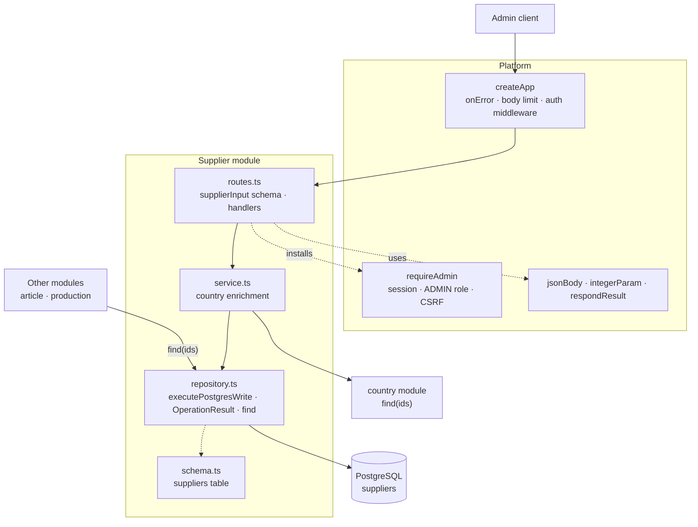

# The Supplier package

This guide explains the TypeScript code in
[`backend-ts/src/modules/supplier`](../../../../backend-ts/src/modules/supplier).
It has the shape of the [Country package](country-package.md), the reference
module; read that guide first.

## What this package does

- admin endpoints for listing, creating, reading, fully replacing, and
  deleting suppliers;
- validation and normalization of supplier input;
- PostgreSQL persistence through Kysely; and
- one capability for other modules: `find(ids)`, which labels rows that
  reference suppliers (article, production) with the supplier's name.

Suppliers may refer to a country. The database keeps that relationship valid
and clears it automatically when the country is deleted. Other tables refer to
suppliers as well: `production_destinations`, `production_jobs`, the article
tables (`article_mugs`, `article_tshirts`, `article_spod_articles`), and the
`users.supplier_id` link of a supplier login. Those references are what a
supplier delete has to respect.

## The five-minute mental model



The boundaries are:

1. **The route file owns the HTTP contract**: paths, the Zod schema of the
   body, the id parameter, the messages, and the mapping from a result to a
   status code. The schema also normalizes: text is trimmed and a blank or
   omitted optional field becomes `null`.
2. **The service owns the country join**: it adds the nested `country` to
   every answer and passes a failure on unchanged.
3. **The repository owns persistence and constraint mapping**, and answers
   `OperationResult` itself (`notFound`, `conflict`, or the `countryId` field
   error). Reads run in `read`; every write is a single statement on `db`. It
   queries the `suppliers` table only.
4. **The country is read through the Country module's `find` capability**,
   never through its table: the module receives `countries` as a dependency.

## File map

```text
supplier/
|- index.ts            createSupplierModule({ db, countries }) → { routes, find }; export type SupplierSummary
|- routes.ts           supplierInput schema, SUPPLIER_RESPONSES, supplierId, supplierRoutes(service)
|- service.ts          createSupplierService(repository, findCountries); SupplierInput, Supplier
|- repository.ts       createSupplierRepository(db); StoredSupplier, SupplierSummary
|- schema.ts           SuppliersTable, merged into the platform's Tables
|- routes.test.ts      one happy path per route and the module-specific errors
|- service.test.ts     one batched country lookup per list; find(ids)
`- validation.test.ts  the schema's field names and messages
```

The composition root creates the country module first and hands its `find` on:

```ts
const countries = createCountryModule({ db })
const suppliers = createSupplierModule({ db, countries: { find: countries.find } })
app.route('/', suppliers.routes)
// later: createArticleModule({ …, suppliers: { find: suppliers.find } })
```

## HTTP API

Every route requires an authenticated user with the `ADMIN` role. Mutating
methods also require the `X-XSRF-TOKEN` header.

| Method and path | CSRF header | Success response |
| --- | --- | --- |
| `GET /api/admin/suppliers` | No | `200` with a JSON array of `Supplier` values |
| `POST /api/admin/suppliers` | Yes | `201` with `Supplier` and a relative `Location` header |
| `GET /api/admin/suppliers/{id}` | No | `200` with `Supplier` |
| `PUT /api/admin/suppliers/{id}` | Yes | `200` with the replaced `Supplier` |
| `DELETE /api/admin/suppliers/{id}` | Yes | `204` with no body |

| Result or failure | HTTP status | `message` |
| --- | --- | --- |
| `notFound` | `404` | `Supplier not found` |
| `conflict` (delete of a referenced supplier) | `409` | `Supplier is in use and cannot be deleted` |
| invalid supplier input | `400` | `Validation failed`, with the field-error map |
| unknown `countryId` on create or update | `400` | `Validation failed`, with `countryId: ["Country not found"]` |
| invalid supplier id | `400` | `Invalid supplier id` |

The create response uses a relative location such as
`/api/admin/suppliers/42`. The protection runs before the id is parsed, as in
the Country module; the malformed body, `415`, and `500` answers are the
platform's.

### `PUT` is a full replacement

`PUT /api/admin/suppliers/{id}` deliberately uses replacement semantics, and
`POST` and `PUT` share one schema:

- `name` is always required;
- every optional property becomes the submitted value or `null`;
- an omitted optional property also becomes `null`; and
- old optional values are not retained.

Replacing a supplier with `{"name": "Globex"}` therefore clears its previous
address, country, contact data, email, and website. The Vue supplier dialog
sends every editable property as a value or `null`, so it fits this contract.
There is intentionally no partial update hidden behind `PUT`.

## Validation and normalization

`supplierInput` in `routes.ts` implements the field rules and produces the
normalized `SupplierInput` the service stores unchanged:

| Field | Rule | Normalization |
| --- | --- | --- |
| `name` | required after trimming; at most 255 characters | trimmed |
| `postalCode` | optional; at most 20 characters after trimming | trimmed, blank → `null` |
| `email` | optional; at most 255 characters and a valid email shape | trimmed, blank → `null` |
| other text fields | optional; at most 255 characters after trimming | trimmed, blank → `null` |
| `countryId` | optional integer; a non-null value must reference an existing country | — |

The messages are the Kotlin ones, field label included:
`Name is required`, `Name must be at most 255 characters`,
`FirstName must be at most 255 characters`,
`PostalCode must be at most 20 characters`,
`Email must be a valid email address`, and so on. The email check requires
one `@`, nonempty text on both sides, and no whitespace; the length message
wins over the shape message. A non-string optional field answers Zod's
default type message, and an unknown property answers `Unknown property`
(see [Request validation](../conventions/request-validation.md)).

Whether a country exists is not a schema rule: the database answers it, see
[Persistence](#persistence).

## Representation and ordering

```text
Supplier: id, name, title, firstName, lastName, street, houseNumber, city,
          postalCode, countryId, phoneNumber1, phoneNumber2, phoneNumber3,
          email, website, country
```

The same `Supplier` is the answer of list, detail, create, and update. It
carries both `countryId` and the nested `country` (`{ id, name, countryCode }`
or `null`); `null` properties are written out. The list is a bare JSON array,
ordered by `name` and then `id`, so equal names have a stable order.

The repository loads supplier rows without joining the `countries` table. The
service collects every distinct country id of the result and calls
`countries.find(ids)` once, so a list never issues one country query per
supplier; `service.test.ts` pins that.

Supplier rows and their country use two read snapshots. If a country is
deleted between the two reads, that one answer keeps the old `countryId` with
`country: null`; the next read sees PostgreSQL's `ON DELETE SET NULL` and
answers both as `null`. An atomic cross-table snapshot is not needed for this
admin view, and a join would break the module boundary.

## The exported `find` capability

```ts
find: (ids: Iterable<number>) => Promise<Map<number, SupplierSummary>>
interface SupplierSummary { id: number; name: string }
```

It is the same ids-in, map-out shape as the Country module's `find`. A caller
collects every distinct supplier id of its own result page and resolves them
with one call. An empty input answers an empty map without a database round
trip, and an unknown id is absent from the map, so a dangling reference reads
like a missing one.

`SupplierSummary` carries only `id` and `name`; it is deliberately not the
`Supplier` admin representation:

- A consumer that references suppliers needs to *label* its rows. Contact
  data, address, and the nested country belong to supplier administration and
  would turn every consumer into a second supplier UI.
- Everything an article knows about *its own* relationship to a supplier, such
  as the supplier article number, is article master data stored in the article
  row. Production reads those values from the order or article side, never
  from this capability.

`find` is the repository's function, exported directly from the factory's
result, so it reads the same table as the admin routes.

## Persistence

`schema.ts` maps the `suppliers` table of
[`V3__create_suppliers.sql`](../../../../backend-ts/migrations/V3__create_suppliers.sql)
(generated `bigint` id, text-length limits, the `(name, id)` ordering index,
the country lookup index, and the optional country foreign key) and merges it
into the platform's `Tables`. The repository selects every column under its
camel-case name, so a row is already a `StoredSupplier`; insert and update
answer the stored row through `RETURNING`.

Every write is a single statement on `db` (one statement is atomic on its own,
so it needs no `write` transaction) inside `executePostgresWrite`; see
[Persistence error handling](../conventions/persistence-error-handling.md):

- **Create and update** declare `foreignKeyViolation:
  invalid({ countryId: ['Country not found'] })` in the repository. The
  country is the only foreign key these writes can fail, so the mapping is
  unambiguous, and PostgreSQL is the concurrency-safe authority: there is no
  preliminary existence query. The update is one statement, so a bad country
  changes nothing.
- **Delete** declares `foreignKeyViolation: conflict`. Every table that
  references suppliers does so with `ON DELETE RESTRICT`, so the delete fails
  while a production destination or job, an article (mug, t-shirt, SPOD
  article), or a supplier login still points at the supplier. The repository
  answers `conflict`, the route `409 Supplier is in use and cannot be
  deleted`; neither the constraint nor the table name leaks. The referencing
  row has to be removed first.
- The country foreign key uses `ON DELETE SET NULL`: deleting a country blanks
  the supplier's `countryId`.

Supplier names are deliberately **not unique**. The source behavior allows
equal names, so there is no unique conflict and no concurrency test for one;
the stable `id` ordering keeps their list order deterministic.

### Differences to the Kotlin backend

- Validation runs once, in the Zod schema at the route; the service no longer
  re-validates, and the schema produces the trimmed, `null`-for-blank values
  the Kotlin service normalized.
- An unknown property is rejected (`z.strictObject`), and a value of the
  wrong JSON type answers `400 Validation failed` with a field error, where
  Kotlin already failed the deserialization of the body.
- There is no `UnexpectedFailure`: a database exception propagates to the
  app's `onError`, which answers `500`.
- Create and update read the stored row with `RETURNING` instead of a second
  `SELECT`.
- The Kotlin guide names four restricting tables; the code has more since the
  article tables of the t-shirt and SPOD article migrations. The `409` covers
  all of them.

## Tests

Run from `backend-ts/`:

```sh
bun test src/modules/supplier    # this module only
bun run check                    # the full gate
```

The route tests use the real Country module for the enrichment, not a stub:

```ts
const database = testDatabase()
const app = () =>
  testApp(
    createSupplierModule({ db: database.db, countries: createCountryModule({ db: database.db }) })
      .routes,
  )
```

| Test | What it states |
| --- | --- |
| [`routes.test.ts`](../../../../backend-ts/src/modules/supplier/routes.test.ts) | One happy path per route with country enrichment and normalization, the list order, the full replacement, `404`, `400` for an unknown country on create and update (nothing stored, nothing changed), and `409` for a supplier a production destination references |
| [`service.test.ts`](../../../../backend-ts/src/modules/supplier/service.test.ts) | A list resolves every distinct country with one `find` call; `find(ids)` answers known summaries, leaves unknown ids out, and answers an empty input with an empty map |
| [`validation.test.ts`](../../../../backend-ts/src/modules/supplier/validation.test.ts) | Trimming and `null` normalization, every field's message, the email shape, and the unknown-property answer |

The platform cases (`401`/`403`, CSRF, malformed ids and bodies, the body
limit) are pinned once in `src/platform/**/*.test.ts` and are not repeated
here.

## Safe change recipes

### Add a persisted supplier field

1. Add a migration under `backend-ts/migrations/`.
2. Add the column to `SuppliersTable` in `schema.ts`, and to `StoredSupplier`,
   the `columns` list, and `toRow` in `repository.ts`.
3. Add it to `supplierInput` in `routes.ts` with its message; `SupplierInput`
   and `Supplier` follow from `StoredSupplier`.
4. Extend the tests and this guide, then run `bun run check`.

### Add another table that references suppliers

Use `ON DELETE RESTRICT` (or decide explicitly otherwise). The delete's
`foreignKeyViolation: conflict` covers it without a code change; say so in this
guide.
