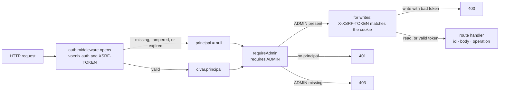

# Authentication and authorization

This guide explains how the TypeScript backend decides **who a caller is**,
**what that caller may do**, and **whether a state-changing request is safe to
process**. Everything lives in
[`src/platform/auth/`](../../../../backend/src/platform/auth); module routes
install a protection and never implement security themselves.

## Contents

- [Three terms that sound similar](#three-terms-that-sound-similar)
- [Where sessions come from](#where-sessions-come-from)
- [The five-minute mental model](#the-five-minute-mental-model)
- [What `createAuth` builds](#what-createauth-builds)
- [The sealed cookies](#the-sealed-cookies)
- [The identity of one request](#the-identity-of-one-request)
- [The five route protections](#the-five-route-protections)
- [Access tokens](#access-tokens)
- [Which admin routes a token opens](#which-admin-routes-a-token-opens)
- [How CSRF protection works](#how-csrf-protection-works)
- [Cookie settings and session lifetime](#cookie-settings-and-session-lifetime)
- [Guest identity](#guest-identity)
- [Adding a protected route](#adding-a-protected-route)
- [Tests](#tests)

## Three terms that sound similar

- **Authentication** answers "who is making this request?": the middleware
  opens the `voenix.auth` cookie and sets the principal of the request.
- **Authorization** answers "may that user use this endpoint?": the admin
  protection requires the exact role string `ADMIN`.
- **CSRF protection** answers "did the signed-in user intentionally make this
  state-changing request?": a mutating request needs a token in a header that
  matches the `XSRF-TOKEN` cookie.

## Where sessions come from

The auth code **validates and uses** a session but never verifies credentials.
The account module's login is the one production path that calls
`auth.signIn(c, userId, roles)`; the session stores the user's numeric database
id as a number plus the roles granted at login, so a handler reads it as
`c.var.principal?.userId ?? null` without parsing it. Tests mint sessions directly
through `signedInHeaders` of the test support.

## The five-minute mental model



For a protected write the order is: session, role, CSRF, path id, JSON body,
operation. An anonymous `POST` with invalid JSON receives `401`; an admin with
a malformed id receives `400 Invalid country id` without the body being read.

## What `createAuth` builds

[`auth.ts`](../../../../backend/src/platform/auth/auth.ts) exports one
factory. `createAuth({ sessionSecret, secureCookies, accessTokens })` returns:

| Member | What it does |
| --- | --- |
| `middleware` | Runs on every request (installed by `createApp`): opens the two cookies into `c.var.principal` and `c.var.csrfSession`, renews a session past half its life, and resolves an `Authorization: Bearer` header into `c.var.tokenPrincipal`. |
| `routes` | `GET /api/antiforgery/token`, which mints a CSRF token. |
| `signIn(c, userId, roles)` | Writes a fresh 24-hour session cookie. |
| `signOut(c)` | Clears it. |
| `guestTokens.tryGet(c)`, `guestTokens.getOrCreate(c)` | The guest identity below. |

The five route protections are plain exports of the same file, because they
read only what the middleware stored on the request.

## The sealed cookies

[`cookies.ts`](../../../../backend/src/platform/auth/cookies.ts) seals a
value with AES-GCM, which encrypts and authenticates in one step: a caller can
neither read nor change a cookie. The key of each cookie is SHA-256 of
`<purpose>:<sessionSecret>`, with the purposes `auth`, `csrf`, and `guest`, so
a value sealed for one cookie never opens as another. The sealed form is
base64url of a random 12-byte IV followed by the ciphertext and its tag.

This is a **new cookie format**: cookies of the Kotlin backend do not open,
and existing development sessions are simply invalidated. Rotating
`AUTH_SESSION_SECRET` signs every user out and turns every visitor into a
fresh guest, exactly as before.

| Cookie | Carries | Type |
| --- | --- | --- |
| `voenix.auth` | `userId`, `roles`, `issuedAtEpochSeconds`, `expiresAtEpochSeconds` | `UserSession` |
| `XSRF-TOKEN` | the token and the `userId` it was minted for (`null` for a guest) | `CsrfSession` |
| `voenix.guest` | a random 48-byte token | string |

## The identity of one request

The middleware sets two request variables, typed through Hono's
`ContextVariableMap`, so every handler reads them as `c.var.principal` and
`c.var.csrfSession` without a generic:

```ts
export interface UserPrincipal {
  userId: number
  roles: string[]
}
```

`principal` is `null` for an anonymous request, for a tampered cookie, and for
an expired session alike. A cookie contains a **claim**; the principal is the
application's **validated identity for this request**. `principal` and
`csrfSession` come from the cookies only.

A third variable, `c.var.tokenPrincipal`, carries the identity of an
[access token](#access-tokens): `undefined` when the request presents no
`Authorization: Bearer` header, `null` when it presents one that is no valid
token, and a `UserPrincipal` otherwise. Only `requireAdminOrToken` reads it.

## The five route protections

A protection is a Hono middleware installed on a sub-app with
`admin.use(requireAdmin)`, which protects every route below it. All share the
same fail-closed core: a rejected request is answered before the handler, and
for `POST`, `PUT`, `PATCH`, and `DELETE` the CSRF check runs after the
authorization. The one exception is a request that `requireAdminOrToken`
admits by its bearer token: it needs no CSRF pair.

| Protection | Who passes | Refusals |
| --- | --- | --- |
| `requireAuthenticated` | any signed-in user | `401` |
| `requireAdmin` | the exact role `ADMIN` (case-sensitive; other roles may be present) | `401`, `403 Admin access required` |
| `requireAdminOrToken` | with a bearer header: a valid access token whose user holds `ADMIN` now; without one: exactly `requireAdmin` | `401` invalid token (also next to a valid session cookie), `403 Admin access required`, or the refusals of `requireAdmin` |
| `guestCapable` | everyone; a mutating request needs a CSRF pair, and a signed-in user needs one minted for that user | `400 Invalid CSRF token` |
| `requireSupplier(accounts)` | the exact role `SUPPLIER` **and** a live link: `accounts.supplierIdOf(userId)` must answer a supplier on this very request; handlers read it as `c.var.supplierId` | `401`, `403 Supplier access required` for both halves |

The `401` and `403` answers keep the auth shape of the Kotlin backend:

```json
{"success":false,"message":"Authentication required","code":null}
```

The supplier protection asks the account module on every request because a
role in a cookie is frozen until the next login, while a revoked supplier login
must lose access with the very next request. `SupplierAccounts` is the one
interface the platform declares for another module to implement.

## Access tokens

An access token is the second way to authenticate, made for an AI client on
the MCP endpoint (see the [MCP package guide](../packages/mcp-package.md)). An
admin creates a named token in the dashboard (`/admin/access-tokens`), and the
client sends it as `Authorization: Bearer <token>`.

- A token is `vnx_` followed by 32 random bytes in base64url. The middleware
  answers `null` for a bearer value without the prefix without asking the
  database.
- Only its SHA-256 hash is stored, in the account module's `access_tokens`
  table. The plain token leaves the server once, in the answer that creates
  it.
- A token has no expiry. Deleting its row revokes it with the next request.
- It acts as the admin who created it. `AccessTokens.principalOf`, declared
  here and implemented by the account module like `SupplierAccounts`, reads
  the user's roles from `user_roles` **on every request** and writes nothing.
  A role in a session cookie is frozen until the next login; a token's role
  is not, so removing `ADMIN` turns the very next request into a `403`.
- `last_used_at` is stamped by `requireAdminOrToken` through
  `AccessTokens.markUsed`, only after the token passed the `ADMIN` check. A
  refused request, a token on a route that does not accept one, and an
  anonymous `Bearer vnx_…` write nothing. The account module stamps at most
  once a minute, so an MCP tool call, which passes the token on `/api/mcp` and
  again on the admin route it dispatches to, stamps once.

**A token counts only where a route opts in.** `requireAdmin`,
`requireAuthenticated`, `guestCapable`, and `requireSupplier` never read
`c.var.tokenPrincipal`; on their routes a request that carries only a token is
anonymous. Only `requireAdminOrToken` accepts one. When a request presents a
bearer header there, the token is the only credential that counts: an invalid
one answers `401` even when a valid admin session cookie travels along, and a
valid one becomes `c.var.principal`, so handlers read the acting admin as
always. That principal stays the token's: every other protection refuses a
principal that is `c.var.tokenPrincipal` with `401`, so a `requireAdmin`
below an open sub-app (a nested sub-app or an inline guard) stays locked for
the token instead of seeing an admin.

**Why a token needs no CSRF pair.** CSRF exists because a browser attaches
cookies to a request a foreign page triggers. A browser never attaches an
`Authorization` header on its own, so a foreign page cannot ride on a token.

**Why not every protected route.** A stolen token on every route could change
the admin's own account or mint new credentials. The token routes themselves
(`/api/admin/access-tokens`) stay behind `requireAdmin`, so a token can neither
create a second token that outlives its revocation nor revoke one.

## Which admin routes a token opens

The rule for choosing: an admin route is locked (`requireAdmin`) by default.
It may switch to `requireAdminOrToken` only when all of this holds:

1. it does not belong to orders or production,
2. none of its answers can contain text a customer entered, and
3. it creates no login or credential.

A new admin route is therefore not reachable for an AI client until its author
decides so, and the MCP endpoint list follows the protection by itself.
Opening every route and keeping a list of locked ones lost because a new route
that answers customer text would be open until someone remembers to lock it.

| open for a token (`requireAdminOrToken`) | module |
| --- | --- |
| `/api/admin/countries` | country |
| `/api/admin/prices`, `/api/admin/vat` | pricing |
| `/api/admin/promotions` | promotion |
| `/api/admin/suppliers` | supplier |
| `/api/admin/prompts` (with categories and slots) | prompt |
| `/api/admin/articles/mugs`, `/spod`, `/categories`, `/subcategories` | article |
| `/api/admin/operations` (findings, menu counts, last scan) | operations, its `admin` sub-app only |
| `/api/admin/images/orphans` | image |
| `/api/mcp` | mcp |

| locked (`requireAdmin`) | why |
| --- | --- |
| `/api/admin/orders` (list, timeline, payment recheck, production PDFs) | orders; e-mail, names, addresses |
| `/api/admin/production/jobs` (list, PDF, ship, SPOD release) | production; names, addresses |
| `/api/admin/production/destinations` | production; sets the SFTP and SPOD credentials |
| `/api/admin/supplier-logins` | creates logins; lists e-mail addresses a supplier can change |
| `/api/admin/access-tokens` | creates credentials |
| `/api/admin/images/background-removal` | multipart and binary only, so MCP cannot use it; every call costs money |

The open routes answer admin-written master data, the partner's catalog text
(SPOD articles), fixed error codes and numeric ids (findings), and generated
image file names (orphans).

## How CSRF protection works

The client flow is unchanged:

1. Call `GET /api/antiforgery/token` after signing in.
2. Read `requestToken` from the JSON response and keep the cookies.
3. Send the token in the `X-XSRF-TOKEN` header on every write.

The endpoint generates 32 random bytes as a URL-safe token, answers it in the
body, and stores it with the current user id in the sealed `XSRF-TOKEN`
cookie. A protected write requires a principal, a readable CSRF cookie, the
same user id in both, and a header equal to the stored token; the comparison
is constant-time. The token is bound to a **user id**, not to one cookie:

- a token requested anonymously cannot be used after sign-in;
- switching to another user invalidates the previous token;
- signing in again as the same user does not; and
- requesting a replacement invalidates the previous one.

A failed check answers `400` with the shared
`{"message":"Invalid CSRF token","errors":{}}`.

## Cookie settings and session lifetime

| Setting | `voenix.auth`, `XSRF-TOKEN` | `voenix.guest` |
| --- | --- | --- |
| Path | `/` | `/api` |
| `HttpOnly` | yes | yes |
| `SameSite` | `Lax` | `Lax` |
| `Secure` | unless `FRONTEND_BASE_URL` is local HTTP | unless `FRONTEND_BASE_URL` is local HTTP |
| `Max-Age` | none (browser session) | 30 days |

`Secure` comes from the settings, not from the request: every cookie carries it
unless `FRONTEND_BASE_URL` is an `http:` URL, which the settings allow only for
`localhost`, `127.0.0.1`, and `[::1]`. Until November 2026 it was derived from
the request URL's scheme. Render ends TLS at its proxy, so the container saw
only HTTP and production cookies went out without `Secure`. The request's
`Host` header was rejected as the switch too, since a client sets it; a
setting no request can change was the remaining choice. The session has its own server-checked expiry: a
new session lasts 24 hours; once more than half of that has elapsed, any
request, also a public one, renews it for another 24 hours; an expired session
is anonymous and is not renewed. Roles are not reloaded from the database
during a session's lifetime; there is no server-side revocation list.

`AUTH_SESSION_SECRET` must contain at least 32 UTF-8 bytes; `.env.development`
carries a fixed development value, a deployment supplies its own.

## Guest identity

`guestTokens.getOrCreate(c)` returns the visitor's guest token, issuing a
`voenix.guest` cookie when the request carries no readable one;
`guestTokens.tryGet(c)` returns the token of an existing cookie or `null` and
never sets one, so a read path does not turn a passing visitor into a stored
guest. A tampered cookie counts as missing. Nothing replaces or deletes the
guest cookie: a login and a logout leave it alone, so one browser is one guest
for 30 days, whoever is signed in. The rules that keep that safe (a row is
owned by the guest token only while no account owns it) are unchanged from the
[Kotlin guide](https://github.com/bitstorm-tech/voenix-shop-kotlin/blob/kotlin-backend/docs/dev/backend/conventions/authentication-and-authorization.md#the-guest-tokens-lifetime-around-a-login-and-a-logout).

## Adding a protected route

```ts
const admin = new Hono()
admin.use(requireAdmin)
admin.get('/', …)
admin.post('/', jsonBody(input), …)

routes.route('/api/admin/widgets', admin)
```

Install the protection once on the sub-app, mount the sub-app at its path.
Use `requireAdmin` unless the route meets the
[rule for choosing](#which-admin-routes-a-token-opens) and you decided to open
it for access tokens.
Because the protection applies to the whole subtree, a non-canonical path below
it (`/api/admin/widgets/` with a trailing slash) is refused with `401` for an
anonymous caller and `404` for an authorized one, where Ktor answered `404` to
both; the subtree still fails closed.

## Tests

[`auth.test.ts`](../../../../backend/src/platform/auth/auth.test.ts) pins
every rule of this guide on probe routes: the five protections and their
refusals, the bearer token on every protection (also next to a session
cookie, and below an open sub-app), CSRF accepted and rejected, the token
binding, expiry and sliding renewal, the cookie flags with `Secure` on and off, sign-in and sign-out, and the guest
cookie. Module tests use `signedInHeaders({ userId, roles })`,
`tokenHeaders(principal)` (a token registered with the in-memory lookup of
`testAuth`), and `guestHeaders()` from `@test-support/http` and never repeat
these cases. The account module's tests run a real token against a real
`requireAdminOrToken` route.
