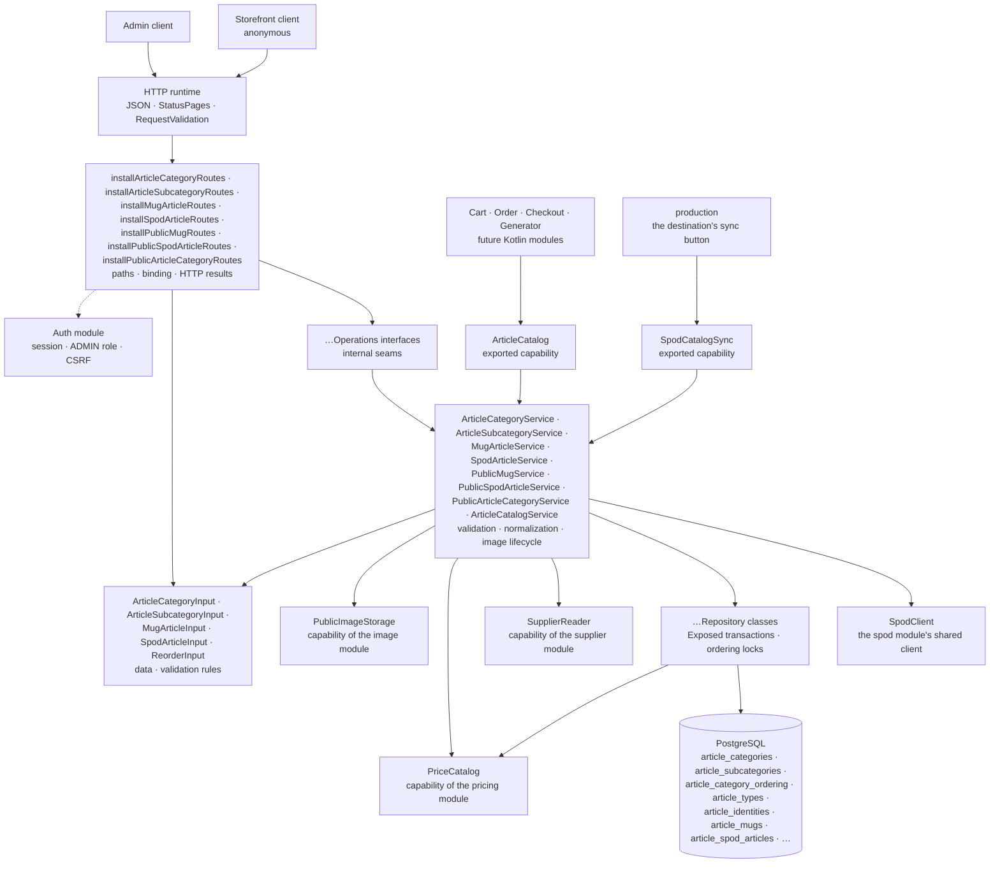

# The Article package

This guide explains the Kotlin code in
[`backend/modules/article/src/shop/voenix/article`](../../../../backend/modules/article/src/shop/voenix/article).

This guide covers the whole module: the article database schema, the category
structure of categories and subcategories, the mug admin slice (writing **and**
reading), the SPOD article admin slice, the three anonymous storefront routes,
and the exported `ArticleCatalog` capability. The plan and the decisions behind
them live in
[`article-migration.md`](../../../migration/article-migration.md); everything the
Vue frontend has to change because of them is listed in
[`article-post-migration.md`](../../../migration/article-post-migration.md).

## Contents

- [What this package does](#what-this-package-does)
- [The five-minute mental model](#the-five-minute-mental-model)
- [Sub-packages](#sub-packages)
  - [How the files are grouped](#how-the-files-are-grouped)
- [Production file map](#production-file-map)
- [HTTP API](#http-api)
  - [Categories](#categories)
  - [Subcategories](#subcategories)
  - [Mugs](#mugs)
  - [SPOD articles](#spod-articles)
  - [The storefront](#the-storefront)
- [The exported capability](#the-exported-capability)
- [Validation and normalization](#validation-and-normalization)
- [The database schema](#the-database-schema)
- [Concurrency: the ordering locks and the deferred unique rule](#concurrency-the-ordering-locks-and-the-deferred-unique-rule)
  - [Why a lock and not a lookup](#why-a-lock-and-not-a-lookup)
  - [Why the unique rule is deferred](#why-the-unique-rule-is-deferred)
  - [How the two conflicts stay apart](#how-the-two-conflicts-stay-apart)
  - [Why every reorder checks for gaps first](#why-every-reorder-checks-for-gaps-first)
- [Tests](#tests)

## What this package does

The Article package owns the product catalog: the shared category structure
(categories and subcategories) and one table per article type: mugs, and
*SPOD articles* — every product the print-on-demand partner Spreadconnect
(SPOD) prints one front motif on, a t-shirt as much as a tote bag. The article
type names the channel a product is made through, not the kind of product: the
kind is data (the partner's product type name and the category structure).
The SPOD slice has its schema, its Exposed tables, its admin routes, its
storefront route, and its half of the exported capability. Until issue #260 the
same slice was the t-shirt slice with the type `TSHIRT`.

Today it provides the authenticated admin lifecycle of *categories* and
*subcategories*: create, read, update, delete, and an explicit reorder each,
plus the pre-upload of a subcategory's example image. It also provides an admin
slice per article type, *mugs* and *SPOD articles*, and the two differ: a mug
has the overview list, one article in full, create, update, delete, an explicit
reorder, and the pre-upload of a variant's example image, while a SPOD article
has no create route and no upload at all. A SPOD article is written by a
**sync run** against the print-on-demand partner's backoffice, and the admin
edits only the shop-owned half of it (see [SPOD articles](#spod-articles)). That
run is the module's second exported capability, `SpodCatalogSync`. On top of
that it serves the three anonymous storefront reads: the mugs a customer may
buy, the SPOD articles a customer may buy, and the one type-agnostic navigation
both are sorted into.

Every one of those levels has a display order that is **dense** (positions run
1, 2, 3, … without gaps) and **unique**: globally for categories, inside the
owning category for subcategories, and per article type for mugs and SPOD
articles.
Category and subcategory names are unique regardless of letter case; articles
have no name rule at all. PostgreSQL enforces all of these rules, and the
module never asks it whether a rule would hold before writing.

An article is more than a row. Writing one writes its identity, its variants
and their identities, and the price row it owns, all in one transaction. A
rejected article can therefore never leave a price behind, and a rejected price
can never create an article. That is one implementation per type, not one
shared one: the two slices are deliberate copies of each other, because what
they share is the shape of the problem and not the columns.

The shop itself reads three of those things without a session: the list of mugs
a customer may buy, the list of SPOD articles, and the navigation both sit in. What
"may buy" means is one rule: the article and its category are active, and the
article either has no subcategory or an active one. All three routes apply it,
so the navigation can never lead into an empty list.

Other Kotlin modules read the catalog through one exported capability,
`ArticleCatalog`. It answers a whole batch of article-variant references at
once and is described in [The exported capability](#the-exported-capability).

## The five-minute mental model



The ownership rules are the ones every product module in this backend follows:

1. [`Application.kt`](../../../../backend/app/src/shop/voenix/Application.kt)
   installs shared JSON, `StatusPages`, `RequestValidation` (including
   `validateArticleRequests()`), authentication, and the product modules once.
   It also hands Article the `publicStorage` of the `ImageModule` that
   installing Image returned, the `PriceCatalog` that installing Pricing
   returned, and the `SupplierReader` that installing Supplier returned. That
   last capability turns the supplier id of an article into the supplier name
   its list row shows, for both types. Since the catalog sync it also hands Article the
   application's single `SpodClient`, which the SPOD article sync reads the
   backoffice with, and binds the returned `SpodCatalogSync` to the
   production module.
2. The route installers install the auth-owned `AdminRouteProtection` around their
   complete route subtree, so authentication, the `ADMIN` role, and CSRF are
   checked before a handler parses an id or a request body.
3. The `validate()` methods of the input types are the single implementation of
   their field rules. Ktor's `RequestValidation` calls them at the HTTP
   boundary, and the services call the same methods defensively for direct
   callers.
4. The services normalize valid data, own the example-image lifecycle, and turn
   expected outcomes into `OperationResult` values rather than exceptions.
5. The repositories own Exposed queries, transaction boundaries, the ordering
   locks, and the mapping of PostgreSQL error states. The two per-type article
   repositories are the ones that also hold `PriceCatalog`, because the price
   write has to happen inside the transaction they open.

## Sub-packages

Article is one of the modules that is split into sub-packages, like Account,
`email`, and `production`. The split follows responsibilities, not layers:

```text
article/
|- ArticleCatalog.kt
|- ArticleCatalogService.kt
|- ArticleFieldRules.kt
|- ArticleModule.kt
|- ArticlePrices.kt
|- ExampleImage.kt
|- PublicReadRouting.kt
|- ReorderInput.kt
|- category/
|  |- ArticleCategory.kt
|  |- ArticleCategoryRoutes.kt
|  |- ArticleCategoryService.kt
|  |- ArticleSubcategory.kt
|  |- ArticleSubcategoryRoutes.kt
|  |- ArticleSubcategoryService.kt
|  |- PublicArticleCategory.kt
|  |- PublicArticleCategoryRoutes.kt
|  `- PublicArticleCategoryService.kt
|- mug/
|  |- MugArticle.kt
|  |- MugArticleInput.kt
|  |- MugArticleRoutes.kt
|  |- MugArticleService.kt
|  |- MugDetails.kt
|  |- PublicMug.kt
|  |- PublicMugRoutes.kt
|  `- PublicMugService.kt
|- spod/
|  |- PrintFrameMeasurement.kt
|  |- PublicSpodArticle.kt
|  |- PublicSpodArticleRoutes.kt
|  |- PublicSpodArticleService.kt
|  |- SpodArticle.kt
|  |- SpodArticleInput.kt
|  |- SpodArticleRoutes.kt
|  |- SpodArticleService.kt
|  |- SpodCalibration.kt
|  |- SpodCatalogSync.kt
|  |- SpodCatalogSyncService.kt
|  `- SpodSyncReport.kt
`- persistence/
   |- ArticleCatalogRepository.kt
   |- ArticleCategories.kt
   |- ArticleCategoryRepository.kt
   |- ArticleIdentities.kt
   |- ArticleMugRepository.kt
   |- ArticleMugs.kt
   |- ArticlePriceWrite.kt
   |- ArticleSpodArticles.kt
   |- ArticleSpodRepository.kt
   |- ArticleSpodSyncImages.kt
   |- ArticleSpodSyncRepository.kt
   |- ArticleSpodSyncVariants.kt
   |- ArticleSubcategoryRepository.kt
   |- ArticleTypes.kt
   |- DensePositions.kt
   |- PublicArticleCategoryRepository.kt
   |- PublicArticleVisibility.kt
   |- PublicMugRepository.kt
   |- PublicSpodArticleRepository.kt
   |- StoredPrintAspectRatio.kt
   `- UnreferencedFilenames.kt
```

- the root holds the runtime handle, the exported capability, and the public
  values that capability exchanges; the last two share `ArticleCatalog.kt`. The
  root also holds what every slice shares: `ReorderInput` (the body of every
  reorder route), `ExampleImage` (the answer of a pre-upload, which the mug variants use
  exactly like subcategories do), the field rules both
  article inputs apply in `ArticleFieldRules.kt`, the price preparation both
  article services run in `ArticlePrices.kt`, and `respondPublicRead` in
  `PublicReadRouting.kt`, the one answer shape every anonymous route of this
  module has. Re-typing a failed `OperationResult` of another module is done
  with the platform's `asFailure()` from `shop.voenix.operation`;
- `category` holds categories and subcategories, and, since the shop sells two
  article types, the storefront navigation, which belongs to no type at all;
- `persistence` holds the Exposed tables, the repositories, and the ordering
  lock helpers;
- `mug` holds the mug slice: the admin half and the storefront half. They sit
  in one sub-package because the storefront answer is defined by the admin
  state. A mug is visible exactly while it and its category path are active;
- `spod` holds the SPOD article slice: the admin half, the storefront half, and
  the sync that writes the articles in the first place (`SpodCatalogSync.kt`
  with the exported capability and its input, `SpodCatalogSyncService.kt` with
  one run, `SpodCalibration.kt` and `PrintFrameMeasurement.kt` with how a run
  measures the print frame, `SpodSyncReport.kt` with what a run answers). Do
  not confuse it with
  the leaf module `shop.voenix.spod`, which holds the partner's HTTP client: this
  package is `shop.voenix.article.spod`. It is a sibling of `mug` and not a
  generalization of it:
  the two types share the *shape* of an article (identity, position, variants,
  one owned price) but not a single column beyond that, so one union type would
  have to make every field of both nullable and no rule of either would fit it
  any more.

Sub-packages are **not** visibility boundaries. The compilation module is the
real boundary, so `internal` declarations keep collaborating across
`category` and `persistence` while staying invisible to every other module.

### How the files are grouped

A file here is one concern, not one type. Kotlin lets declarations that belong
together share a source file, and this module groups them the way the
backend-wide rule in
[`source-file-organization.md`](../conventions/source-file-organization.md) describes:

- a **domain file** holds a representation together with the small value types
  that belong to it: `ArticleCategory.kt` holds the category and the input
  that writes it, `MugArticle.kt` the three admin representations of a mug, and
  `PublicMug.kt` the two storefront ones;
- a **service file** holds the service, the seam interface it implements, and
  the private helpers of both. `MugArticleService.kt`, for example, holds
  `MugArticleService` and `MugArticleOperations`, and `SpodArticleService.kt`
  holds the SPOD pair;
- a **routes file** holds the top-level `install…Routes` function with the
  HTTP helpers around it;
- a **repository file** holds the repository, the sealed results it answers
  with, and the stored value types it builds. `ArticleMugRepository.kt` holds
  `ArticleMugWriteResult`, `ArticleMugDeleteResult`, `ArticleMugOrderResult`,
  and `StoredMug` next to the writes that produce them;
- a **table file** holds the Exposed tables of one part of the schema together
  with the lock helpers that guard their positions.

A declaration keeps a file of its own when it is large enough to be a concern
by itself, or when so many components share it that no single file is its
owner: `MugDetails` (request, response, and the storefront read all use it),
`ReorderInput`, `ExampleImage`, and `isDenseBy` in `DensePositions.kt`.

Where a declaration lives is invisible to the rest of the code, because the
package does not change with the file. The list below therefore names types,
and mentions a file only where it matters which one owns a helper.

## Production file map

- `ArticleModule` is the assembled runtime handle. `createArticleModule`
  builds the object graph,
  `Application.installArticleModule(database, images, prices, suppliers, spod)`
  installs the routes and returns the handle, and
  `validateArticleRequests()` registers the input types with the
  shared Request Validation plugin. The handle is public because the
  composition root has to hand two capabilities to two different modules: the
  `catalog` to everything that stores an article reference, and the
  `spodSync` to the production module that triggers a run. Its other
  properties stay `internal`.
- `ArticleCatalog`, `ArticleVariantReference`, `CatalogVariant`,
  `SpodProductRef`, `ArticleType`, `PrintAspectRatio`, and its
  `PrintAspectRatioSerializer` (public only because a consumer's serializable
  type has to name it) are the public types of the catalog capability, and
  `SpodCatalogSync`, `SpodCatalogSource`, `SpodSyncResult`,
  `SpodSyncReport`, `SpodSyncStatus`, `SpodSyncLine`, `SpodSyncWarning`,
  `SpodSyncWarningCode`, and `PrintFrame` (a report line carries the measured
  frame) are the public types of the sync one — the production route serializes
  the report it is handed. Everything else is `internal`. `ArticleCatalogService` implements the capability
  and `ArticleCatalogRepository` performs its stored reads: one query per article
  type, merged into one map;
  `StoredCatalogVariant` is what that read answers, with the price as a
  reference. The section [The exported capability](#the-exported-capability)
  describes the contract itself.
- `ReorderInput` is the shared reorder body `{ sourceId, targetId }`.
  Categories, subcategories, mugs, and SPOD articles order the same way, so they
  share one input and one set of rules instead of four near-identical bodies.
- `ExampleImage` is the answer of a pre-upload, `{ "filename": "…" }`. The mug
  variant image is the one pre-upload this module still has — a SPOD article's
  pictures arrive with a sync run, not with an admin (SPOD sync decision 1).
  Reading such a request is not this module's code any more: `ImageUpload`,
  `UploadedImage`, `receiveUploadedImage`, and `respondUploadRejection` live in
  the `image` module since Prompt became a second consumer with the same policy,
  and Article imports them from there (see the
  [Image package guide](image-package.md)).
- `ArticleCategory` and `ArticleSubcategory` are the single representations for
  list, detail, create, update, and reorder responses. They are `internal`:
  being serialized by a public route does not make a type part of the module
  interface.
- `ArticleCategoryInput` and `ArticleSubcategoryInput` are the models shared by
  create and update, and they own the field rules and the normalization.
- `ArticleCategoryOperations` and `ArticleSubcategoryOperations` are the
  internal seams the routes use and route tests stub. Each one sits in the file
  of the service that implements it, so a reader sees the promise and the
  implementation at once.
- `ArticleCategories.kt` maps the three PostgreSQL tables the category structure
  uses, `ArticleCategories`, `ArticleSubcategories`, and
  `ArticleCategoryOrdering`. It also owns the two locks that order their
  position writers: `lockCategoryOrderingInTransaction()` for the single anchor
  row, and `lockCategoriesForOrderingInTransaction(ids)` for the category rows,
  which are the anchors of the subcategory sequences themselves.
- `ArticleCategoryWriteResult` (`Stored`, `NotFound`, `NameConflict`),
  `ArticleCategoryDeleteResult` (`Deleted`, `NotFound`, `InUse`), and
  `ArticleCategoryOrderResult` (`Reordered`, `NotFound`, `PositionConflict`)
  keep persistence outcomes inside the repository and service. Each one exists
  because its write really has those distinct outcomes, and all three sit in
  `ArticleCategoryRepository.kt` next to the writes that answer with them. The
  three subcategory results do the same in `ArticleSubcategoryRepository.kt`.
- `MugArticle` is the single admin representation of a mug, `MugArticleInput`
  the shared create/update body, and `MugDetails` serves both directions,
  because the request and the response carry the same nine measurements.
  `MugVariant` and `MugVariantInput` are two types on purpose: the id of a
  stored variant always exists, while its *absence* in a request is what asks
  for a new one.
- `MugArticleListItem` is the row of the overview list and the one second
  representation the mug slice has. It is not a smaller `MugArticle`. It spells
  out what a mug only *references*, that is, the names of its category,
  subcategory, and supplier. It leaves out the descriptions, measurements,
  variants, and the calculated price that the table does not show. Answering the
  list with the full representation would mean reading every variant and
  recalculating every price for a screen that displays none of them.
- `PublicMug` and `PublicMugVariant` are the storefront representations of the
  mug slice, and each of them differs from its admin counterpart by what a
  customer may not see: no supplier fields and no `active` flags anywhere, and a
  `price` that is one number, the effective gross sales total in cents, next to
  the nullable `regularPrice` that carries the amount before a discount. Three
  fields that are nullable in `MugArticle` are not nullable here (`categoryId`,
  `mugDetails`, `price`), because the database refuses an active mug without a
  category, without its details, and without a price. That is what removed the
  legacy `price: 0` the storefront showed while the cart refused the same
  article: there is no fallback to write. They carry one field the admin
  representation does not, `articleType`; see
  [Why `articleType` came back](#why-articletype-came-back).
- `PublicMugOperations`, `PublicMugService`, `PublicMugRepository`, and
  `installPublicMugRoutes` are the storefront slice, separate from the admin one
  all the way down. `installPublicMugRoutes` installs its route **outside** the
  `authenticate` block. Anonymous access is not a rule the handler applies; it
  is the absence of the admin subtree around it. The service below it
  needs neither the image storage nor the supplier capability, because a
  customer uploads nothing and never learns who produces a mug. The one
  capability it does use is `PriceCatalog`.
- `PublicSpodArticle`, `PublicSpodAppearance`, and `PublicSpodVariant` are the
  storefront types of the second article type, with
  `PublicSpodArticleOperations`, `PublicSpodArticleService`,
  `PublicSpodArticleRepository`, and `installPublicSpodArticleRoutes` mirroring
  the mug slice one for one. The rule that is this type's own is what it leaves
  out: **the three SPOD ids and the hotspot never reach a customer.** They
  identify the printable product and its placement at the print-on-demand
  partner, and they are the partner's vocabulary, not the customer's. The
  colour, the size, and the picture are what an article is to the person buying
  it. The article type `SPOD` itself is the one exception: it is the
  discriminator a storefront switches on. `PrintFrame` is shared with the admin
  side, because nobody writes a frame any more — a sync run measures it.
- `PublicArticleCategory` and `PublicArticleSubcategory` are the storefront
  navigation, and they belong to no article type: a category is a menu entry
  when *any* visible article sits in it.
  `PublicArticleCategoryOperations`, `PublicArticleCategoryService`,
  `PublicArticleCategoryRepository`, and `installPublicArticleCategoryRoutes`
  serve the one route `GET /api/articles/categories`. The mug-only
  `GET /api/articles/mugs/categories` was **removed** with the second article
  type rather than joined by a SPOD twin: it could only ever answer half a
  menu, and there is no compatibility layer for it.
- `PublicArticleVisibility.kt` holds the join and the condition that decide what
  a customer may see, once per article type. All three storefront reads start
  from it. Writing the rule twice is what would let the navigation offer a
  category whose articles no list shows. The legacy backend had that
  duplication, once per service.
- `StoredPublicMug` and `StoredPublicSpodArticle` are the public counterparts of
  `StoredMug` and `StoredSpodArticle`: a visible article with the *reference* to its
  price instead of the amount. The amount is calculated by another module from
  the current VAT entries, so persistence answers with the id and the service
  resolves every id of the page in one `PriceCatalog.find`.
- `ArticleTypes`, `ArticleIdentities`, `ArticleVariantIdentities`, `ArticleMugs`,
  and `ArticleMugVariants` map the five tables the mug slice writes, in three
  files: `ArticleTypes.kt` for the type registry, `ArticleIdentities.kt` for the
  two identity registries, and `ArticleMugs.kt` for the mug row and its variant
  row. `ArticleTypes.kt` owns `lockArticleTypeForOrderingInTransaction(type)`,
  the anchor of the per-type position sequence. The last taken position, the
  dense rewrite of a reorder, and the gap compaction of a delete are the same
  work for every ordered table and live in `DensePositions.kt`.
- `SpodArticle` is the single admin representation of a SPOD article, with the
  `sync` block (`SpodArticleSync`) that says where the article comes from and
  what the last run saw; `SpodArticleInput` is the update body and carries the
  shop-owned half alone (there is no create body at all); `SpodAppearance` is
  one colour with its pictures and `SpodVariant` one colour × size, both
  response-only because the sync writes them; and `SpodArticleListItem` is the
  row of the overview list, the mug list row's twelve fields plus `syncedAt` and
  `missingAtSpreadconnect`.
- `SpodCatalogSync` is the exported capability with its input
  `SpodCatalogSource(supplierId, access)` and its outcome `SpodSyncResult`
  (`Reported(report)` or `Busy`); `SpodSyncReport` is the diff one run
  answers, with `SpodSyncLine`, `SpodSyncStatus`, and the closed
  `SpodSyncWarningCode` enum next to it; `SpodCatalogSyncService` is one
  run — listing, per-article reconciliation, sweep, file cleanup — and holds
  the per-destination `Mutex` that makes a second concurrent run `Busy`.
- `SpodCalibration` is the calibration half of one run, in `SpodCalibration.kt`:
  it lives exactly as long as the run, uploads the calibration design once, and
  measures each product type once, answering a `Calibration` — `Measured` with
  the hotspot and frame, or `Failed` with the reasons in the shop's own words —
  and the URL of each colour's blank front mockup
  ([SPOD sync decision 7](#decision-7--the-print-frame-is-measured-from-spod-previews)).
  `PrintFrameMeasurement.kt` is the pure half of it: `calibrationDesignPng()`
  draws the magenta square and `measurePrintFrame(png)` reads the box back out
  of a preview as a `PrintFrameMeasurement`, with `MeasurementFailure` as the
  closed list of reasons; neither touches the partner, so both are unit-tested.
- `PrintFrame` is the rectangle of the mockup a design is placed in, in percent
  of the mockup. Admin, storefront, and the sync report answer it with the same
  type, because all three only read it: the frame is *measured* by a sync run,
  never typed. It is `null` in the admin read until a run has measured one.
- `ArticleSpodArticles`, `ArticleSpodAppearances`, `ArticleSpodVariants`, and
  `ArticleSpodImages` map the four tables of the second article type, in
  `ArticleSpodArticles.kt`. The file also owns `spodVariantName(colorName,
  sizeLabel)`, the **one** place a SPOD variant is named `"Black / M"`, because
  the variant table stores no name and no colour; `toPrintFrame()`, which turns
  the four nullable frame columns into a frame or `null`; and
  `appearancePicturesInTransaction`, the one query that reads the mockup and the
  listing images of a set of colours for the admin and the storefront read alike.
  The gap a delete leaves is compacted by `closePositionGapInTransaction` in
  `DensePositions.kt`.
- `ArticleSpodRepository` is `ArticleMugRepository` a second time: the same
  three locks in the same order, the same price-inside-the-transaction rule, the
  same `23503`-means-supplier mapping, and the same reorder that wraps its whole
  transaction because the position rule is deferred. `ArticleSpodWriteResult`,
  `ArticleSpodDeleteResult`, `ArticleSpodOrderResult`, and `StoredSpodArticle`
  sit next to the writes that answer with them. The delete result carries three
  kinds of orphaned file — listing images, mockups, and size charts — because a
  SPOD article has three kinds of picture in three folders.
  `namesInTransaction`, the one-query lookup of the category and subcategory
  names a list row shows, is shared with the mug repository rather than copied.
  It asks the same question about the same two tables for both types.
- `ArticleSpodSyncRepository` is the **writing half of the sync** and nothing
  else: one transaction per article (`upsert`) plus one `sweep` at the end, the
  read `findForSync` that decides what still has to be downloaded, and the
  prepared values a run hands it (`PreparedSpodArticle` with the measured
  hotspot and frame, `PreparedAppearance`, `PreparedImage`, `PreparedMockup`,
  `PreparedVariant`, `PreparedSizeChart`, answered as a `SyncWriteOutcome` of
  kind `CREATED`, `UPDATED`, or `UNCHANGED`). It writes the SPOD-owned half
  only; `active` can go off but never on — and it goes off when the run could
  not measure a frame. `ArticleSpodSyncImages.kt` writes the pictures of a
  colour: the mockup, replaced when the run fetched a new one, and the listing
  images, rewritten when the ordered list of image ids differs.
  `ArticleSpodSyncVariants.kt` holds the colour and variant half of that
  reconciliation — colours upserted by the partner's appearance id, listing
  images rewritten only when their ordered list of image ids changed, variants
  matched by the product triple, and never a row deleted.
- `DensePositions.kt` holds the four helpers every position sequence of this
  module is built from. `isDenseBy(position)` asks whether a stored order really
  is `1..n`; all four reorders (categories, subcategories, mugs, and SPOD articles)
  ask it before they rewrite anything. `rewriteDensePositionsInTransaction`
  numbers a list from 1 and writes only the rows whose place really changed,
  `maxPositionInTransaction` reads the last taken place, for the whole table
  or, with a `scope`, for one category, and `closePositionGapInTransaction`
  renumbers the tail behind a deleted row in one `UPDATE`, which the deferred
  unique rule on the article positions allows. The four take no locks and open no
  transactions: the caller runs them under the ordering lock of its sequence.
  Each is written once here instead of once per level.

- `ArticlePriceWrite.kt` holds `writePriceInTransaction`, the store-replace-keep
  decision both article repositories make about the price row their article
  owns, and `UnreferencedFilenames.kt` holds
  `unreferencedFilenamesInTransaction(column, candidates)`, the one query that
  answers which of the file names a write dropped no row refers to any more.
  It is asked for mug variant example images, SPOD article pictures, and SPOD
  size charts alike.
- `StoredMug` is a mug together with the id of its price row. The price id is
  next to the article rather than inside it, because no article contract carries
  one and the price itself is calculated outside the transaction. Persistence
  answers with the reference and the service turns it into the embedded price.
- `ArticleMugWriteResult` (`Stored`, `NotFound`, `CategoryNotFound`,
  `SubcategoryNotFound`, `SupplierNotFound`, `PriceRequired`, `UnknownVariant`)
  and `ArticleMugDeleteResult` (`Deleted`, `NotFound`) keep those outcomes
  inside persistence. `Stored` and `Deleted` also report the example images the
  write orphaned, because those files may only be deleted after the commit.
- `ArticleMugOrderResult` (`Reordered`, `NotFound`, `PositionConflict`) is the
  outcome of the one mug write that has a conflict. `Reordered` carries the
  whole new order as list rows, still without the supplier names. The service
  fills in that one label, exactly as it does for the list.
- The three subcategory results say what their writes can produce beyond the
  category ones:
  `ArticleSubcategoryWriteResult` adds `CategoryNotFound` and `InUse` and
  reports the example image a write replaced, and
  `ArticleSubcategoryDeleteResult.Deleted` carries the example image of the
  removed row. Both exist because the file may only be deleted after the
  transaction committed.

## HTTP API

Every route under `/api/admin/articles` requires an authenticated user with the
exact `ADMIN` role. Mutating methods also require the shared `X-XSRF-TOKEN`
header. The three storefront routes under `/api/articles` are anonymous; they
are described in [The storefront](#the-storefront).

### Categories

| Method and path | CSRF | Success response |
| --- | --- | --- |
| `GET /api/admin/articles/categories` | No | `200` with a JSON array of `ArticleCategory` values in display order |
| `POST /api/admin/articles/categories` | Yes | `201` with `ArticleCategory` and `Location` |
| `PUT /api/admin/articles/categories/order` | Yes | `200` with the complete new order |
| `GET /api/admin/articles/categories/{id}` | No | `200` with `ArticleCategory` |
| `PUT /api/admin/articles/categories/{id}` | Yes | `200` with the updated `ArticleCategory` |
| `DELETE /api/admin/articles/categories/{id}` | Yes | `204` without a body |

Lists are bare JSON arrays, not `{ "items": [...] }` wrappers. An invalid id
returns `400 Invalid article category id` after the security checks and before
any operation runs. An unknown id returns `404 Article category not found`,
including on the reorder route, where the legacy backend answered `409`.

A request body carries only what a client decides:

```json
{ "name": "Mugs", "description": "Everything you can drink from", "active": true }
```

The response adds the id and the position the module decided:

```json
{
  "id": 42,
  "name": "Mugs",
  "description": "Everything you can drink from",
  "position": 3,
  "active": true
}
```

`position` is response-only. It is never accepted from a client: `POST`
appends behind the last category, `DELETE` closes the gap, and
`PUT .../order` moves one category to the place of another. `PUT .../{id}`
replaces name, description, and activation and leaves the position untouched.

The reorder body names the two categories involved:

```json
{ "sourceId": 42, "targetId": 7 }
```

The answer is the complete list in the new order, so a client never has to
reconstruct the sequence itself:

```json
[
  { "id": 7, "name": "Posters", "description": null, "position": 1, "active": true },
  { "id": 42, "name": "Mugs", "description": null, "position": 2, "active": true }
]
```

`description` comes back trimmed, and a blank description becomes `null`,
because the response is read back from the stored row.

#### The three category conflicts

A category write can be rejected with `409` for three different reasons, and
each route can produce only one of them. The shared `OperationResult.Conflict`
carries no reason, so the meaning is the stable message of the route:

| Route | Message |
| --- | --- |
| `POST`, `PUT .../{id}` | `Article category name already exists` |
| `DELETE .../{id}` | `Article category is used by subcategories or articles and cannot be deleted` |
| `PUT .../order` | `Article category order changed concurrently, please retry` |

### Subcategories

| Method and path | CSRF | Success response |
| --- | --- | --- |
| `GET /api/admin/articles/subcategories` | No | `200` with a JSON array of every `ArticleSubcategory`, ordered by its category's display order and then by its own |
| `POST /api/admin/articles/subcategories` | Yes | `201` with `ArticleSubcategory` and `Location` |
| `POST /api/admin/articles/subcategories/example-images` | Yes | `201` with `{ "filename": "…" }` |
| `PUT /api/admin/articles/subcategories/order` | Yes | `200` with the complete new order of the affected category |
| `GET /api/admin/articles/subcategories/{id}` | No | `200` with `ArticleSubcategory` |
| `PUT /api/admin/articles/subcategories/{id}` | Yes | `200` with the updated `ArticleSubcategory` |
| `DELETE /api/admin/articles/subcategories/{id}` | Yes | `204` without a body |

A subcategory names its category on both sides of the contract:

```json
{
  "categoryId": 7,
  "name": "Classic",
  "description": "The plain ones",
  "exampleImageFilename": "0f1b2c3d-4e5f-4a6b-8c9d-0e1f2a3b4c5d.webp",
  "active": true
}
```

```json
{
  "id": 42,
  "categoryId": 7,
  "name": "Classic",
  "description": "The plain ones",
  "exampleImageFilename": "0f1b2c3d-4e5f-4a6b-8c9d-0e1f2a3b4c5d.webp",
  "position": 2,
  "active": true
}
```

The legacy backend accepted a flat `articleCategoryId` and answered with a
nested category object. The same category is already available from the
category routes, so nesting it here would only make the request and the
response disagree about the shape of one relationship.

`position` counts inside the owning category and is response-only. `POST`
appends behind the last subcategory of its category, `DELETE` closes the gap,
`PUT .../order` moves one subcategory to the place of a sibling, and a `PUT`
that changes `categoryId` appends in the new category and compacts the one it
left. The reorder body is the shared `{ sourceId, targetId }`, and its answer
is the dense list of the affected category only. A target from another
category is outside that list and therefore as unknown as a missing id.

#### The example image

Uploading and saving are two requests. `POST .../example-images` takes a
`multipart/form-data` body with a `file` part, stores it through Image's
`PublicImageStorage` (always WebP, file name a UUID with dashes) in the folder
`articles/subcategory-example-images`, and answers with the name:

```json
{ "filename": "0f1b2c3d-4e5f-4a6b-8c9d-0e1f2a3b4c5d.webp" }
```

The create and update bodies then carry that name, which keeps them plain JSON.
A body without an `exampleImageFilename`, or with `null`, means "no example
image", so that is how an image is removed; the legacy `removeExampleImage`
flag has no successor.

The `file` part is read chunk by chunk and refused as soon as it exceeds
10 MiB, so an oversized upload is rejected while it is still arriving. That
rejection, a body without a `file` part, and everything the image storage
rejects (an unsupported format, a broken file) all answer the same way:
`400 Validation failed` with the message on the `file` field. See
[`image-package.md`](image-package.md) for why `413` is deliberately not used
here.

The service follows one rule here: store, check a submitted name, delete an
obsolete one after the commit. That rule is not written in this module. It lives
once in the image module's `ExampleImages`, which this slice holds one of, for
its own folder and under its own logger (see
[`image-package.md`](image-package.md#the-example-image-rule)).

While saving, a submitted file name has to look like a name the storage mints
and the file has to exist, otherwise the write is a field error on
`exampleImageFilename`. That includes a name the row already stores. It cannot
have been swept, because the sweep only removes files no row refers to. So a
stored name whose file is gone means another writer replaced it and deleted the
file, and accepting the name again would point the row at nothing.

Files are cleaned up in one direction only. A file that a subcategory stops
referring to, whether because the image was replaced or removed or because the
subcategory was deleted, is deleted *after* the transaction committed, and a
failed deletion is only logged. A file that no subcategory ever refers to,
because the write after the upload failed, stays behind as an accepted orphan;
removing those is separate, deferred work.

Nothing makes a file name exclusive: the pre-upload hands a client one name,
and two subcategories may carry it. The write therefore asks, inside its own
transaction, whether any other row still names the file before it reports it as
obsolete, so dropping one of two references keeps the picture the other one
shows.

#### The subcategory conflicts and the two category field errors

| Route | Status and message |
| --- | --- |
| `POST`, `PUT .../{id}` | `409 Article subcategory name already exists in this article category` |
| `DELETE .../{id}` | `409 Article subcategory is used by articles and cannot be deleted` |
| `PUT .../order` | `409 Article subcategory order changed concurrently, please retry` |
| `POST`, `PUT .../{id}` | `400 Validation failed`, `categoryId`: `Article category does not exist` |
| `PUT .../{id}` | `400 Validation failed`, `categoryId`: `Article subcategory is used by articles and cannot be moved to another category` |

The last two are field errors rather than conflicts, because both say the same
thing: the submitted `categoryId` is not a value this subcategory may take.
That also keeps every route at exactly one `409` meaning, which is what makes
the stable message of the route enough to tell the two conflicts apart. It
follows the rule Supplier already uses for a missing referenced country (see
[`persistence-error-handling.md`](../conventions/persistence-error-handling.md)).

### Mugs

The mug is the first article type, and `article_mugs` is its own table rather
than a row in a shared `articles` table. The admin routes are below; the
anonymous route the shop reads is in [The storefront](#the-storefront).

| Method and path | CSRF | Success response |
| --- | --- | --- |
| `GET /api/admin/articles/mugs` | No | `200` with a JSON array of `MugArticleListItem` values in display order |
| `POST /api/admin/articles/mugs` | Yes | `201` with `MugArticle` and `Location` |
| `PUT /api/admin/articles/mugs/order` | Yes | `200` with the complete new order |
| `POST /api/admin/articles/mugs/variant-example-images` | Yes | `201` with `{ "filename": "…" }` |
| `GET /api/admin/articles/mugs/{id}` | No | `200` with `MugArticle` |
| `PUT /api/admin/articles/mugs/{id}` | Yes | `200` with the updated `MugArticle` |
| `DELETE /api/admin/articles/mugs/{id}` | Yes | `204` without a body |

An invalid id is `400 Invalid article id`, an unknown one
`404 Article not found`. Every mug route gives the same two answers.

A request carries the article, its details, its variants, and its price:

```json
{
  "name": "Classic mug",
  "descriptionShort": "A mug",
  "descriptionLong": "A classic white mug",
  "active": true,
  "categoryId": 7,
  "subcategoryId": 42,
  "supplierId": 3,
  "supplierArticleName": "Classic 300",
  "supplierArticleNumber": "4711",
  "printAspectRatio": "16:9",
  "mugDetails": {
    "heightMm": 95,
    "diameterMm": 82,
    "printTemplateWidthMm": 200,
    "printTemplateHeightMm": 90,
    "fillingQuantity": "300 ml",
    "dishwasherSafe": true,
    "documentFormatWidthMm": null,
    "documentFormatHeightMm": null,
    "documentFormatMarginBottomMm": null
  },
  "mugVariants": [
    {
      "name": "White",
      "insideColorCode": "#ffffff",
      "outsideColorCode": "#ffffff",
      "isDefault": true,
      "active": true,
      "exampleImageFilename": "0f1b2c3d-4e5f-4a6b-8c9d-0e1f2a3b4c5d.webp"
    }
  ],
  "price": { "purchaseVatId": 1, "salesVatId": 1, "salesTotalInputCents": 1490 }
}
```

The response adds what the module decided, namely the ids, the display
position, and the complete calculated price:

```json
{
  "id": 12,
  "position": 3,
  "name": "Classic mug",
  "…": "every submitted field, trimmed",
  "mugVariants": [ { "id": 34, "name": "White", "…": "…" } ],
  "price": { "id": 8, "salesTotal": { "net": 1252, "tax": 238, "gross": 1490 }, "…": "…" }
}
```

Three properties of that contract are deliberate:

- **`position` is response-only.** `POST` appends behind the last mug of the
  type, `DELETE` closes the gap, and `PUT .../order` moves one mug to the place
  of another.
- **There is no `priceId` anywhere.** The request embeds a `PriceInput` and the
  response embeds the full `CalculatedPrice`, whose `id` is the only place a
  price id appears. This is what makes a price belong to exactly one article
  *by construction*: an id can only come into existence while an article is
  written, so no request can attach a price that belongs to someone else. The
  `UNIQUE (price_id)` rule in the database is the backstop, not the mechanism.
- **`articleType` is gone.** It said `"MUG"` on every row of a route that only
  serves mugs.
- **`printAspectRatio` is optional in the request and always present in the
  response.** It is the shape the image printed on this article is generated
  in (`"16:9"` for the wrap-around print of a mug, `"1:1"` for a square chest
  print), and it is the wire form of `PrintAspectRatio`, the enum the exported
  `ArticleCatalog.printFormats` answers with. A body that omits it means
  `"16:9"`, which is what every mug was printed in before the field existed, and
  an update that omits it writes that default like every other field it omits.
  A ratio outside the pair is a `printAspectRatio` field error, not a body that
  fails to parse: the field is received as text and validated, so a client gets
  the same `400` shape it gets for every other value it got wrong.

#### The overview list

`GET /api/admin/articles/mugs` answers a bare array with one row per mug. The
rows come in display order, `position` first and `id` as the stable
tie-breaker:

```json
[
  {
    "id": 12,
    "position": 1,
    "name": "Classic mug",
    "active": true,
    "categoryId": 7,
    "categoryName": "Mugs",
    "subcategoryId": 42,
    "subcategoryName": "Classic",
    "supplierId": 3,
    "supplierName": "Porcelain Ltd",
    "variantCount": 2,
    "exampleImageFilename": "0f1b2c3d-4e5f-4a6b-8c9d-0e1f2a3b4c5d.webp"
  },
  {
    "id": 13,
    "position": 2,
    "name": "Draft mug",
    "active": false,
    "categoryId": null,
    "categoryName": null,
    "subcategoryId": null,
    "subcategoryName": null,
    "supplierId": null,
    "supplierName": null,
    "variantCount": 0,
    "exampleImageFilename": null
  }
]
```

`exampleImageFilename` is the picture the table shows: the image of the default
variant or, when the default has none, the image of the oldest variant that
has one. A mug without variants, or without a single variant image, has none.
That is how the legacy list chose the picture too.

A `supplierName` is `null` when the mug names no supplier *and* when the
supplier module does not answer for the id. The reference itself is always
reported, because it is what the mug stores.

**The list reads a constant number of queries.** Four statements answer it: the
mugs, the variants of *all* of them, and one per category level for the
distinct categories and subcategories they name. On top of that comes exactly
one `SupplierReader.find` call carrying every distinct supplier id of the page.
Nothing is read per row, and an integration test measures that: listing three
mugs must run the same statements as listing one.

#### Moving a mug

`PUT /api/admin/articles/mugs/order` moves one mug to the place of another. The
body is the shared reorder input, the same one the two category levels use:

```json
{ "sourceId": 12, "targetId": 9 }
```

The answer is the **complete** new order as the rows the list answers with,
supplier names included and resolved in the same single batched lookup. A
client therefore never has to reconstruct the positions it did not send:

```json
[
  { "id": 9, "position": 1, "name": "Draft mug", "…": "…" },
  { "id": 12, "position": 2, "name": "Classic mug", "…": "…" }
]
```

`order` is a literal path segment next to `/{id}`, so a reorder never reaches
the item routes. Three answers are possible besides the order itself:

| Answer | When |
| --- | --- |
| `400 Validation failed` | an id is missing, not positive, or equal to the other one |
| `404 Article not found` | one of the two ids is not in the order. This is the same answer an unknown mug gets, where the legacy backend mixed `404` and `409` |
| `409 Article order changed concurrently, please retry` | the stored sequence is not the one this move may rewrite |

The `409` is the one conflict the mug routes have, and it has two sources that
are described under [the ordering locks](#concurrency-the-ordering-locks-and-the-deferred-unique-rule):
a stored sequence that already had a gap, and a position another writer changed
while the move was written. Neither writes anything, so a retry is the right
reaction to both.

#### One mug in full

`GET /api/admin/articles/mugs/{id}` answers the same `MugArticle` that create
and update answer with: every stored field, the details, the variants, and the
embedded `price`. The amounts of that price are recalculated from the current
VAT entries on every read, so a write and a later read of the same mug agree.

Variants always come back in the same order, the default first, then by name,
then by id:

```json
{
  "id": 12,
  "position": 1,
  "name": "Classic mug",
  "descriptionShort": "A mug",
  "descriptionLong": "A classic white mug",
  "active": true,
  "categoryId": 7,
  "subcategoryId": 42,
  "supplierId": 3,
  "supplierArticleName": "Classic 300",
  "supplierArticleNumber": "4711",
  "printAspectRatio": "16:9",
  "mugDetails": { "heightMm": 95, "…": "…" },
  "mugVariants": [
    { "id": 34, "name": "White", "isDefault": true, "…": "…" },
    { "id": 35, "name": "Black", "isDefault": false, "…": "…" }
  ],
  "price": { "id": 8, "salesTotal": { "net": 1252, "tax": 238, "gross": 1490 }, "…": "…" }
}
```

Neither body carries `priceId` or `articleType`. Both response shapes are
locked by integration tests that compare the **whole** JSON document, so a
field that reappears fails the test. The embedded `price` is the one part
compared separately: its shape belongs to the pricing module, which locks it
with its own tests, and `salesTotal` is a `PriceAmount` with `net`, `tax`, and
`gross`.

#### The variant array is a diff

`mugVariants` is not a list of new rows, it is the complete intended state:

| Entry | Effect |
| --- | --- |
| with an `id` that belongs to this article | the variant is updated |
| without an `id` | a variant is inserted |
| a stored variant the array does not mention | the variant is deleted, and its example image with it |
| with an `id` of another article | `400`, `mugVariants`: `One or more variants do not belong to this article` |

The statements run in that order for a reason. At most one variant may be the
default (a partial unique index), so the write first removes what left, then
clears the default flag on every remaining variant, and only then writes the
submitted flags. Swapping the default between two variants would otherwise
collide halfway through, even though the result is legal.

#### The price of an article

An omitted `price` keeps the price row the mug already owns, and a submitted
one is written **over that same row**, so the id a client already knows stays
valid. That is also how the legacy backend behaved. Deleting the article
deletes its price in the same transaction. The article row goes first, because
the price reference is `ON DELETE RESTRICT`.

The order of the steps is what makes the two failure directions symmetric:

```text
validate input          → 400, nothing happened
check example images    → 400, nothing happened
prices.prepare(price)   → 400 with price.* field errors, no article written
BEGIN
  lock article_types('MUG')
  lock category, look the subcategory up inside it
  write the price into this transaction
  ── from here the 23503 mapping is in force ──
  mint the identity, write the mug, mint variant identities, write variants
COMMIT                  → any failure rolls the price back with the article
delete orphaned image files (best effort)
```

`prepare` never touches the `prices` table, so it can run before the
transaction opens; `storeInTransaction`, `replaceInTransaction`, and
`deleteInTransaction` are not suspending and therefore can only ever run inside
the transaction their caller opened.

The price write sits inside the transaction and **outside** the `23503`
mapping, and the line above is where that boundary runs. A price references two
VAT rows with `ON DELETE RESTRICT`, and `prepare` resolved them before the
transaction opened. A VAT deleted in between makes the price statement raise
the same state the supplier reference raises. Inside the mapping that would be
answered as `400 supplierId: Supplier does not exist`, which is simply wrong.
Outside it the VAT race stays an unexpected failure and becomes a `500`, and
the mapping keeps covering only statements whose one client-fallible reference
is the supplier.

#### Why every other mug rejection is a field error

Apart from the reorder, a mug write has no `409` at all. There is no unique
name, and the position cannot collide while the type anchor is locked, so a
conflict reaching one of these routes would not be something a client did. The
routes treat one as a broken invariant. What look like conflicts elsewhere are
field errors here:

| Field | Message | Decided by |
| --- | --- | --- |
| `categoryId` | `Article category does not exist` | the lock that found no row |
| `subcategoryId` | `Article subcategory does not exist in this article category` | the lookup inside the locked category |
| `supplierId` | `Supplier does not exist` | SQL state `23503`, the only reference left that can fail |
| `mugVariants` | `One or more variants do not belong to this article` | the diff, under the mug's row lock |
| `price` | `An active article requires a price` | the write path, which knows the stored price too |
| `mugVariants[0].exampleImageFilename` | `Example image …` | the image storage, before the transaction |

#### The variant example image

`POST .../mugs/variant-example-images` is the same pre-upload as the
subcategory one, through the same `PublicImageStorage`, into the folder
`articles/mugs/variant-example-images`, and with the same answers: `201` with
the minted name and `400 Validation failed` on the `file` field both without a
`file` part and above 10 MiB. Create and
update then carry that name in `mugVariants[i].exampleImageFilename`.

The checking and deleting are the same `ExampleImages` rule the subcategory
slice uses, with this folder and this service's logger; only the field path
differs, because it names the variant's index.

Every submitted name is checked, including one the variant already stores, for
the same reason the subcategory checks it: a stored name whose file is gone can
only mean another writer replaced it. Files a variant stops referring to,
whether replaced, removed, or deleted with the article, are deleted after the
commit and a failure is only logged; files no variant ever referred to stay
behind as accepted orphans. Two variants may name the same file, so the write
asks inside its transaction whether any variant row still names it before
reporting it as obsolete.

### SPOD articles

How an operator gets a SPOD article into the shop — in the Spreadconnect
backoffice first, then in this admin — is the manual
[Configuring a SPOD article](../../guides/configuring-spod-articles.md). This
section describes the contract behind that screen.

A *SPOD article* is the second article type: every product the print-on-demand
partner prints one motif on its front, whether a t-shirt or a tote bag. Its
`ArticleType` is `SPOD`, because the type names the **channel** a product is
made through (issue #260, decision 2): a mug is laid out into a PDF, a SPOD
article is ordered from the partner. Which kind of product it is, is data — the
partner's product type name, which the storefront shows as a subtitle, and the
category the operator files it under. Adding a new kind of SPOD product
therefore needs no code: it is created in the backoffice and synced.

`article_spod_articles` is its own table next to `article_mugs` rather than a set
of nullable columns inside it, with three tables below it: the colours
(`article_spod_appearances`), the colour × size variants
(`article_spod_variants`), and the pictures of a colour (`article_spod_images`).
Unlike a mug, **a SPOD article is never typed into this admin**. It is created
by a *sync run* against the print-on-demand partner's backoffice
([The sync decisions](#the-sync-decisions)): the product, its colours, its
sizes, and its pictures already exist over there, and retyping the three
partner ids into a variant matrix was the main way to produce a wrong mapping.

#### The two owners of a SPOD article

Every field of a SPOD article belongs to exactly one of two owners, and the
owner decides who may write it (SPOD sync decision 2):

| SPOD-owned — written by sync runs, read-only in the admin | Shop-owned — never touched by a sync run |
| --- | --- |
| `name`, `descriptionShort`, `descriptionLong` (the short text is the same text truncated) | `active`, but only ever switched *off* by a run |
| `productTypeName`, the partner's name of the product kind | `categoryId` and `subcategoryId` |
| the colours with their name, hex, order, and pictures | `position` (the display order) |
| the whole variant array: size label, the three SPOD ids, `sku`, the partner's variant id | the price with its VAT choices |
| the size-chart image | which variant is the default one |
| a variant's `active` flag (stored listing image and readable colour → active) | |
| `printFrame` and `hotspot`, measured from the partner's previews by every run (SPOD sync decision 7); empty when the last run could not measure them, and then the article is off | |
| `supplierId` (the supplier behind the destination it was synced from) | |

The partner's `b2bPrice` and `d2cPrice` are deliberately **not** stored (Joe,
decision D3 on issue #224): what the shop charges is the shop's own price row.

The print frame changed owners with issue #260 (decision 6): an operator used
to calibrate it by hand, and every frame typed that way was wrong. It is now
the box SPOD itself renders for the chosen hotspot, measured by every sync run
([SPOD sync decision 7](#decision-7--the-print-frame-is-measured-from-spod-previews)).
A run that cannot measure it writes no frame and no hotspot, and the article
cannot be activated until a run can. Because the measurement holds for a square
design only, a SPOD article is always printed `1:1` and has no print aspect
ratio of its own (decision 10).

#### The routes

Five routes are left, and none of them creates an article. The anonymous route
the shop reads is in [The storefront](#the-storefront):

| Method and path | CSRF | Success response |
| --- | --- | --- |
| `GET /api/admin/articles/spod` | No | `200` with a JSON array of `SpodArticleListItem` values in display order |
| `PUT /api/admin/articles/spod/order` | Yes | `200` with the complete new order |
| `GET /api/admin/articles/spod/{id}` | No | `200` with `SpodArticle` |
| `PUT /api/admin/articles/spod/{id}` | Yes | `200` with the updated `SpodArticle` |
| `DELETE /api/admin/articles/spod/{id}` | Yes | `204` without a body |

There is no create route (the path serves `GET`, so a `POST` answers
`405 Method Not Allowed`) and no picture upload: every picture comes from the
partner. The old t-shirt paths `/api/admin/articles/tshirts/…` went with the
`TSHIRT` type and answer `404`.

`DELETE` stays on purpose (Joe, decision D4 on issue #224): it is the manual
retirement of an article that will not come back. A sync run never deletes
anything.

The sync itself is triggered on the **destination**, not on the article:
`POST /api/admin/production/destinations/{id}/sync-articles` belongs to the
production module (see the
[Production package guide](production-package.md)), because a run is scoped to
one destination's token. That route is the whole of the compile-time edge
`production → article`.

An invalid id is `400 Invalid article id`, an unknown one
`404 Article not found`, and the reorder is again the only route that can
answer `409 Article order changed concurrently, please retry`. What the
[mug section](#mugs) says about the embedded price, the response-only
`position`, the absent `priceId`, and the absent `articleType` holds here word
for word; the diff semantics of the variant array do not, because the admin
does not submit variants at all.

#### What an operator may write

The update body is the shop-owned half and nothing else:

```json
{
  "active": true,
  "categoryId": 7,
  "subcategoryId": 42,
  "defaultVariantId": 34,
  "price": { "purchaseVatId": 1, "salesVatId": 1, "salesTotalInputCents": 1990 }
}
```

A field this body does not carry is not "optional" but *somebody else's*. The
HTTP runtime ignores unknown keys, so a client that still sends `name`,
`printFrame`, or `printAspectRatio` is not rejected — the value simply never
reaches the write path, which is the honest outcome, because the next sync
would overwrite it anyway.

Six rules guard a SPOD article write. Two are field rules of the body, because
they are facts about the body itself, and four belong to the write path,
because only it knows the stored row. Five of them are about `active`; the
third one is not, because naming a variant that is not an active variant of
this article is wrong for an inactive article too:

| Rule | Reported on | Where |
| --- | --- | --- |
| an active article needs a category | `active` | body |
| an active article needs a default variant | `active` | body |
| the named default variant must be an **active variant of this article** | `defaultVariantId` | write path |
| an active article needs a price | `price` | write path |
| an article the partner no longer lists cannot be activated (`An article that is missing at Spreadconnect cannot be activated`) | `active` | write path |
| an article without a measured print frame cannot be activated (`An article without a measured print frame cannot be activated`) | `active` | write path |

The last rule is also a CHECK of the table, so the field error only comes first:
the database would refuse the row anyway.

#### What a read answers

The detail read adds what the sync decided — the colours, the variants, the
measured frame, and a `sync` block of its own:

```json
{
  "id": 12,
  "position": 1,
  "name": "Classic tee",
  "…": "…",
  "supplierId": 3,
  "productTypeName": "Men's T-Shirt",
  "sizeChartImageFilename": "0f1b2c3d-4e5f-4a6b-8c9d-0e1f2a3b4c5d.webp",
  "printFrame": { "leftPct": 35.6, "topPct": 18.9, "widthPct": 28.4, "heightPct": 28.4 },
  "hotspot": "MEDIUM_FRONT",
  "appearances": [
    {
      "id": 3,
      "colorName": "Black",
      "colorHex": "#101010",
      "position": 1,
      "mockupImageFilename": null,
      "listingImageFilenames": [
        "11111111-1111-4111-8111-111111111111.webp",
        "22222222-2222-4222-8222-222222222222.webp"
      ]
    }
  ],
  "spodVariants": [
    {
      "id": 34,
      "name": "Black / M",
      "appearanceId": 3,
      "sizeLabel": "M",
      "spodProductTypeId": 812,
      "spodAppearanceId": 5,
      "spodSizeId": 77,
      "spodVariantId": "998877",
      "sku": "1234-M-BLACK",
      "isDefault": true,
      "active": true
    }
  ],
  "price": { "id": 8, "salesTotal": { "net": 1672, "tax": 318, "gross": 1990 }, "…": "…" },
  "sync": {
    "spodArticleId": "554433",
    "environment": "STAGING",
    "syncedAt": "2026-08-24T09:15:00Z",
    "missingSince": null
  }
}
```

`"…": "…"` marks the fields this example leaves out — the two descriptions,
`active`, and the two category ids — the same way it does inside `price`.

- **A colour is a row of its own.** `appearances` are the partner's colours in
  the partner's order, each with its pictures: `listingImageFilenames` are every
  image the partner lists for that colour, in its order, and
  `mockupImageFilename` is the blank front image the editor lays the frame on,
  fetched from the partner's views (`null` when no run could store one). The
  variants stay a **flat array** —
  cart lines, the default variant, and the production tripwire all point at a
  variant id — and each one names its colour by `appearanceId`, the shop's id
  of the colour row. `spodAppearanceId` is the partner's id of the same colour.
- **The variants come in the order of their colour**, then by id.
- **`printFrame` and `hotspot` are `null`** for an article the last run could
  not measure; the sync report says why.

The three parts of the identity are answered separately, because an admin
screen shows them separately. `missingSince` is `null` for every article the
last run found; it is a timestamp for one the partner stopped listing.

The overview row (`SpodArticleListItem`) carries the same twelve fields the
mug row carries plus exactly two of these: `syncedAt`, which says how current
the partner's data is, and the boolean `missingAtSpreadconnect`, which is the
row's warning sign. Its `exampleImageFilename` is the first listing image of the
default variant's colour. The rest of the identity is in the detail read.

A variant is still **named, never given a name** — the table has no `name`
column, and `spodVariantName` composes `"Black / M"` from the colour's name and
the size in the one place it lives — but the whole variant type is
response-only. The admin's only say about the array is `defaultVariantId`.
`spodVariantId` and `sku` are the partner's own names for the row: neither is a
key here, but an operator comparing this screen with the backoffice needs to
find the same row over there.

#### How one sync run works

`SpodCatalogSync` is the article module's second exported capability;
`SpodCatalogSyncService` implements it. One run takes a `SpodCatalogSource`
(the supplier id plus the destination's `SpodAccess`) and does the same three
things every time:

1. **Read the whole listing**, page by page with `limit=100`, until as many
   articles have arrived as the partner said it has. Anything else — a refusal,
   a page that answered nothing while more were promised, more than 100 pages —
   ends the run with `status: "FAILED"` and the bounded `failure` code. So do
   the three ways a listing can be *malformed* rather than merely short: a page
   that carries no count at all, a count that changes from one page to the next,
   and an article id that arrives twice; the last two would otherwise let a
   handful of repeated articles add up to the promised total and pass as the
   whole catalog. A stated count of zero with no items is not malformed — it is
   a complete listing of an empty catalog. On a failure nothing is written and
   nothing is deactivated, because deactivating from an incomplete list would
   empty a shop over a network hiccup.
2. **Reconcile each article in one transaction of its own**, and delete the
   picture files that article no longer refers to right after its transaction —
   through the same `ExampleImages` rule an uploaded picture follows. Variants
   without all three product ids are dropped, duplicates of the product triple
   are dropped, then the colours are resolved in the order they first appear in
   the variants: the colour value is parsed, every image the listing names
   for that colour is stored, in the listing's order — downloaded from its
   `downloadUrl()` unless a stored image of the colour already has the same
   partner image id — and the colour's blank front mockup is stored from the
   product type's views, unless the stored mockup came from the same URL. Then
   the product type is **calibrated**, once per run: the run measures which
   front hotspot prints largest and where, and writes that hotspot and frame
   into the article ([decision 7](#decision-7--the-print-frame-is-measured-from-spod-previews)).
   The product type name is taken from the variants, cut to
   255 characters, and stored as an empty string when the partner names none.
   The size chart is fetched once per product type per run. Everything that
   talks to the partner or to the image storage happens *before* the
   transaction opens, so no transaction ever waits for a CDN. If an admin
   deletes the article between the read of its stored row and that
   transaction, the write finds nothing to update and answers so instead of
   re-inserting a row whose picture files the delete already removed; the
   article is then prepared once more, from scratch.
3. **Sweep**: every article of this destination the listing did not contain —
   and every article of the *other* environment of the same destination — is
   deactivated and stamped with `spod_missing_since`. Nothing is ever deleted;
   the shop-owned half of the row would be gone for good, and the article may
   come back.

Inside the transaction the colours are upserted by the partner's appearance id,
a colour's mockup is replaced only when the run fetched a new one, and its
listing images are rewritten only when the ordered list of image ids differs
from the stored one — so an identical run writes no picture row at all. A
colour the partner stopped listing keeps its row and its pictures; its variants
go inactive. Variants are matched by the product triple and never deleted. The
hotspot and the four frame columns are written as measured, every run — `NULL`
when the measurement failed, which also switches `active` off.

Three properties are worth remembering:

- **A run never activates an article.** `active` can only ever go *off* — when
  the last sellable variant disappeared, when the article did, or when the run
  could not measure its frame. Switching an article on is an operator's
  decision, always.
- **A reappearing article clears its missing marker but stays inactive**, with
  the warning `ARTICLE_REAPPEARED`.
- **A second identical run is a no-op for the pictures and the rows**: every
  article lands in `unchanged`, no picture is downloaded (that is what the
  stored partner image ids, the stored mockup URLs, and the stored size-chart
  URL are for), and each article costs one `spod_synced_at` bump. The frame is
  the one thing measured again — one design upload and a few paced calls per
  product type (decision 7) — and it lands in `unchanged` too when nothing
  moved.

An article is matched by `(destination, environment, SPOD article id)` and a
variant by the product triple `(productTypeId, appearanceId, sizeId)` — never
by the partner's variant id, which it may renumber. The environment is part of
the key because one destination row is switched from `STAGING` to
`PRODUCTION`, and the two installations number their articles independently
(SPOD sync decision 4).

#### The report and its warning codes

`SpodSyncResult` is either `Busy` — that destination is already syncing, and
there is no report to give, because nothing was read and nothing was written —
or `Reported(report)`. The report is a **diff, not a log**: every article the
run saw appears in exactly one of `created`, `updated`, `unchanged`,
`deactivated`, and `failed`, so "nothing changed" is a visible answer. Next to
the five lists it carries `destinationId`, `supplierId`, `environment`,
`status` (`COMPLETED` or `FAILED`), the bounded `failure`, `startedAt`,
`finishedAt`, `fetchedArticles`, and `warnings`.

A warning is something the run *degraded* instead of failing on (SPOD sync
decision 6). The codes are a closed enum, so what the admin screen prints is a
code of this shop's own and never a sentence the partner wrote — and the detail
next to a code names ids only, never partner text:

| Code | What happened |
| --- | --- |
| `MIXED_PRODUCT_TYPES` | the article's variants name more than one product type; the shop stores one per article, so nothing was written |
| `ARTICLE_WITHOUT_VARIANTS` | no variant this shop could sell; nothing was written |
| `SPOD_ID_UNUSABLE` | the partner's article id, one of its variant ids, or the id of one of its listing images is longer than the 64-character column that has to store it; nothing was written |
| `TITLE_TRUNCATED` / `DESCRIPTION_TRUNCATED` | the text was longer than the column and was cut to fit |
| `COLOR_VALUE_UNREADABLE` | `appearanceColorValue` was not a colour; that colour's variants are inactive and wear a neutral grey |
| `COLOR_WITHOUT_IMAGE` | not one listing image of the colour could be stored — the partner lists none, or none could be fetched; its variants are inactive and keep whatever pictures they had |
| `IMAGE_DOWNLOAD_FAILED` | one listing image could not be downloaded or stored; it is left out, and the next run asks for it again |
| `MOCKUP_UNAVAILABLE` | the partner answered no front mockup for the colour, or it could not be downloaded or stored; its variants are inactive — the editor has nothing to lay the frame on — and the stored mockup, if any, is kept |
| `CALIBRATION_FAILED` | no front hotspot of the article's product type measured cleanly; the article has no frame and no hotspot, is inactive, and the detail names the reason per hotspot tried (`FULL_FRONT: LOW_FILL, MEDIUM_FRONT: NO_RECTANGLE`) or the one reason nothing could be tried (`NO_FRONT_VIEW`, `NO_PRINTABLE_HOTSPOT`, or a `SpodError`) |
| `SIZE_CHART_UNAVAILABLE` | the product type answered no size chart, its URL was longer than the 1024-character column, or it could not be stored; the stored one, if any, is kept |
| `DEFAULT_VARIANT_REPLACED` | the default variant is no longer active, so another active one took its place |
| `EXAMPLE_IMAGE_REPLACED` | the picture the shop shows this article with — the first listing image of the default variant's colour — changed |
| `ARTICLE_LEFT_WITHOUT_ACTIVE_VARIANT` | every variant went inactive, so the article was deactivated with them |
| `ARTICLE_REAPPEARED` | an article that was missing is listed again; it stays inactive until an admin says so |

Three of them also put the article into `failed`, because nothing of it was
written: `MIXED_PRODUCT_TYPES`, `ARTICLE_WITHOUT_VARIANTS`, and
`SPOD_ID_UNUSABLE`. Everything else was written — including an article none of
whose pictures could be fetched, which is what SPOD's staging installation
produces: it lists image URLs its CDN answers with `404`. Such an article
appears in the admin screen with every variant inactive and is filled in by the
first run after the CDN answers.

#### The tables of a SPOD article

[`V29__article_spod_articles.sql`](../../../../backend/modules/platform/resources/db/migration/V29__article_spod_articles.sql)
is where the two owners and the partner's own model — article → colour → size —
became a schema. It replaced the two t-shirt tables of
[`V20`](../../../../backend/modules/platform/resources/db/migration/V20__create_article_tshirts.sql)
and
[`V27`](../../../../backend/modules/platform/resources/db/migration/V27__article_tshirts_spod_sync.sql)
by four, and it is destructive on purpose: every synced t-shirt was dropped and
comes back with the next sync of its destination, order lines and the type
registry were renamed from `TSHIRT` to `SPOD`. That is allowed because the shop
is not in production and holds no real order data.

- **`article_spod_articles`** keeps everything `article_tshirts` had after `V27`
  — the identity of the synced article, `UNIQUE (spod_destination_id,
  spod_environment, spod_article_id)`, the restricted destination and supplier
  references — except `print_aspect_ratio`, and adds `spod_product_type_id`,
  `spod_product_type_name`, and `spod_hotspot`. Its four
  `print_frame_*_pct numeric(5, 2)` columns are **nullable** now, and three
  CHECKs guard them: the four are `NULL` together or set together (and then no
  edge is negative, `left + width <= 100`, `top + height <= 100`); the hotspot is
  `NULL` exactly when the frame is; and an active article needs a price, a
  category, a frame, and a hotspot.
- **`article_spod_appearances`** is one row per colour: the partner's
  `spod_appearance_id`, `color_name`, `color_hex`, and `position` (the
  partner's order), unique per article by appearance id and by name.
- **`article_spod_variants`** is one row per colour × size, as before. Its id is
  still an `article_variant_identities` id, the colour columns moved to the
  appearance it references, and it keeps `spod_product_type_id` and
  `spod_size_id` — the third SPOD id is its appearance's. Two variants of one
  article may not resolve to the same printable product, and one colour may not
  offer the same size twice; both rules are `DEFERRABLE INITIALLY DEFERRED`, so
  a run that moves rows around inside one transaction is judged on the result.
- **`article_spod_images`** holds the pictures of a colour with a `role`:
  `LISTING` for every image the partner lists (with its `spod_image_id`), and at
  most one `MOCKUP` per colour (a partial unique index), the blank front image
  the editor lays the frame on, with the `source_url` it was fetched from
  ([`V30__article_spod_images_source_url.sql`](../../../../backend/modules/platform/resources/db/migration/V30__article_spod_images_source_url.sql))
  — each role's own mark of "already stored", so the next run downloads only
  what differs.

The activation rules differ from the mug's, and the ownership is why: an active
SPOD article needs a category, a price, a measured frame, and an active default
variant, and it may not be one the partner no longer lists.

#### The sync decisions

The synced SPOD article rests on nine decisions. The first eight were made
together for issue #224, when the type was still the t-shirt, by the council
with the contested points decided by Joe; issue #260 made them hold for every
SPOD article, rewrote decision 7, and added decision 9. Most of them are explained in
the sections above; this list gathers them with their reasons, and the code
cites them by number ("SPOD sync decision 4"). Two facts of the
[official API docs](https://api.spreadconnect.app/docs/) shaped them:
`GET /articles` lists the merchant's backoffice articles with the three product
ids, `sku`, and `appearanceColorValue` per variant and the listing images per
colour, while the formats of `appearanceColorValue` and `perspective` are
undocumented.

##### Decision 1 — One backoffice article is one shop article, synced, never typed

The backoffice is the source of truth for the product. Retyping the three
partner ids into every colour × size variant and re-uploading the partner's
mockups was double bookkeeping and the main way to produce a wrong mapping, so
manual creation, the variant matrix editor, and the two picture pre-uploads
were removed. A run is started by hand per destination: no scheduler and no
`Article.*` webhook — the operator edits in the backoffice and presses the
button.

##### Decision 2 — Two owners per article

Explained in [The two owners of a SPOD article](#the-two-owners-of-a-spod-article). The short
description is the same text truncated, so no third "seeded once" ownership
exists.

##### Decision 3 — Orders stay `oneTimeItems`

The backoffice article carries a fixed design; the shop's design is generated
per customer, so the synced article is a template with a placeholder design.
Ordering by `sku` would print the partner's stock design instead of the
customer's image. Production keeps its protocol — upload the design, create a
`NEW` order with `oneTimeItems`, confirm
([SPOD fulfillment decision 4](spod-fulfillment.md#decision-4--the-submission-protocol-and-its-idempotency)).

##### Decision 4 — Identity is (destination, environment, backoffice article id)

A run is scoped to one destination, and its token decides what exists. The
environment is part of the key because one destination row is switched from
`STAGING` to `PRODUCTION`, and the two installations' article ids are
unrelated: without it, production article *n* would silently merge into
staging article *n* and inherit its shop-owned data. Variants are matched by the
product triple, never by the partner's variant id. Nothing is deleted on
disappearance, only deactivated; `DELETE` stays as the manual retirement (Joe).
A destination with synced articles can be disabled but not deleted, its supplier
is immutable after creation, and a disabled destination may still sync (Joe) —
only the channel is checked.

##### Decision 5 — The client is shared, the modules stay layered

`SpodClient` lives in the leaf module `spod`; `article` owns the sync and
exports it as `SpodCatalogSync`; `production` owns the trigger route on the
destination, which adds the one edge `production → article`. One client
instance per application keeps the partner's 60 requests per minute under a
single pacer. The image download is the one exception to "the base URL comes
from the environment": its URL comes from the partner's authenticated answer,
so it is bounded instead — https only, no redirects, no token, `image/*` only,
10 MiB, and unpaced, because it hits a CDN, not the API (see the
[SPOD package guide](spod-package.md)).

##### Decision 6 — Undocumented formats degrade, they never fail the run

An unreadable colour value and a colour without a stored listing image make the
variant inactive with a bounded warning instead of failing the article or
inventing data a customer would order by. A listing failure writes nothing and
deactivates nothing; only a complete listing may sweep.

##### Decision 7 — The print frame is measured from SPOD previews

This supersedes the original decision 7, "the print frame stays manual", which
left the frame to an admin calibrator — and every frame typed that way was
wrong: both synced shirts carried the editor default while the partner printed
somewhere else (issue #260). The API still offers no print-area geometry
relative to a mockup — `printAreas` are millimetres of the garment, `views`
carry images without coordinates — so the sync *looks* instead of asking
(issue #260, decisions 6, 7, 10, 11, 12):

- **The design is a magenta square.** The run draws a 2000 × 2000 opaque
  `#FF00FF` PNG in code and uploads it once per run as a design
  (`calibration-1x1.png`). Magenta is on no garment and no mockup background,
  so every magenta pixel of a preview is the design. The square is `1:1`
  because that is the one ratio a SPOD article prints (decision 10); the box
  only holds for a design of that ratio, which is why the ratio left the
  article.
- **Per product type the run reads the views**, takes the one named `FRONT`
  (its hotspot names and its blank mockup per colour), asks which of those
  hotspots accept the design (`availableHotspots`), renders one preview per
  accepted hotspot on the article's first colour at 1000 × 1000, downloads it
  as PNG, and measures.
- **The measurement rule** (`measurePrintFrame`): a pixel is magenta when it is
  opaque (alpha ≥ 250 — the renderer blends a translucent rim around the
  design, which is not the design) and within 24 of `#FF00FF` on every
  channel; the frame is the bounding box of those pixels, in percent of the
  picture with two decimals (half up; the right and bottom edges are rounded
  on their own, so `left + width` never exceeds 100 by a rounding hair). The
  measurement validates itself (decision 12): the box has to be at least 2 %
  of the picture in both directions and at least 97 % of it has to be magenta,
  else the result is `NO_RECTANGLE` or `LOW_FILL` and the article gets no frame
  rather than a wrong one.
- **The largest box wins** (decision 7): the hotspot with the largest measured
  `width × height`, a tie going to the first in the view's order. There is no
  name-based guessing and no admin field.
- **Per product type, per run, stateless** (decision 11): one instance of
  `SpodCalibration` lives as long as one run, caches the views and the
  measurement per product type, and writes the same hotspot and frame into
  every article of that type in the run; the box is the same on every colour,
  so one measurement per type is enough (verified on staging, white and black
  identical). Nothing survives the run and nothing is invalidated — a changed
  mockup is simply measured again next time. The design stays in the partner's
  account, like every per-order design production uploads; the API cannot
  delete one.
- **A failed measurement is visible, not silent.** The article is written with
  `NULL` frame and hotspot, `active` goes off, and the report carries
  `CALIBRATION_FAILED` with the reason per hotspot tried. The admin screen
  shows the measured frame on the mockup and cannot change it (decision 13).

**The rate budget.** The partner allows 60 requests per minute for the whole
account, paced by the one `SpodClient`. Calibration costs, per product type met
in a run, `2 + candidates` paced calls — the views, the hotspot check, and one
preview per accepted hotspot, at most five — plus one design upload per run;
the preview and mockup downloads hit the image server and are not paced. A
catalog of twenty articles of one product type pays for one product type. The run stays
synchronous, as every run is: the admin who pressed the button waits for it.

##### Decision 8 — The name tripwire keeps firing on partner renames

[SPOD fulfillment decision 8](spod-fulfillment.md#decision-8--what-reaches-production-stays-live)
compares today's composed variant name with the order line's snapshot, and the
sync makes the partner a second author of that name. A backoffice rename
therefore quarantines in-flight jobs of that colour as a false alarm. Joe
accepted this operationally — the alert is visible and resolved by hand, see
[the runbook](spod-fulfillment.md#spod_mapping_changed-after-a-rename-in-the-backoffice)
— until issue #225 snapshots the three ids and compares ids instead of names.

##### Decision 9 — Appearances and images are tables of their own

The partner's own model is article → appearance (colour) → size: `/articles`
names `appearanceId`, `appearanceName`, `appearanceColorValue`, and the image
ids per variant, and it lists the images per colour. The shop mirrors that
(issue #260, decision 15) instead of repeating the colour and its picture on
every size row, as the t-shirt tables did:

- **A colour is a row.** `article_spod_appearances` holds the name, the hex
  value, and the partner's order once per colour. The variant keeps the size
  and the ids an order needs and points at its colour; cart lines, the default
  variant, and the production tripwire keep pointing at the variant id, so
  nothing outside this package changed shape.
- **A mockup image is not a listing image.** `article_spod_images` holds both,
  told apart by `role`. The `MOCKUP` is exactly one per colour, the blank front
  image of the product type's views: it is the editor's backdrop and the only
  picture the frame is laid on, because it is pixel-identical to the preview the
  frame was measured on ([decision 7](#decision-7--the-print-frame-is-measured-from-spod-previews)).
  The `LISTING` images are every picture the partner lists for that colour, in
  its order, as chosen in the backoffice — the product photos the wizard, the
  cart, and the checkout show. A listing photo may show a model or an angle the
  frame does not fit, so it can never be the backdrop, and the blank mockup is
  no product photo. The old guess at "the front image without a model" went
  away with the split.
- **A colour is sellable only with both**: its mockup and at least one listing
  image. Otherwise its variants are inactive (`MOCKUP_UNAVAILABLE`,
  `COLOR_WITHOUT_IMAGE`), the same rule a failed download always followed.
- **The storefront listing still shows one picture** — the first listing image
  of the default variant's colour. A gallery over all listing images is a later
  issue; the table already holds what it will need.

### The storefront

Three routes serve the shop itself. They need no session, no role, and no CSRF
token, and each of them answers a bare JSON array:

| Method and path | Success response |
| --- | --- |
| `GET /api/articles/mugs` | `200` with the mugs a customer may buy, in display order |
| `GET /api/articles/spod` | `200` with the SPOD articles a customer may buy, in display order |
| `GET /api/articles/categories` | `200` with the navigation over every visible article, subcategories nested |

**One visibility rule, applied by all three.** An article appears when it is
`active`, its category is set and `active`, and it either has no subcategory or
an active one. The navigation answers the categories and subcategories that
those articles use. A category nobody sells a visible article in is not a
navigation entry a customer could follow, and neither is an empty subcategory.
The rule is written once per article type in `PublicArticleVisibility.kt` and
every read starts from it, so the navigation can never lead into an empty list.

The mug list is the admin mug without what a customer may not see:

```json
[
  {
    "articleType": "MUG",
    "id": 12,
    "position": 1,
    "name": "Classic mug",
    "descriptionShort": "A mug",
    "descriptionLong": "A classic white mug",
    "categoryId": 7,
    "subcategoryId": 42,
    "price": 1490,
    "regularPrice": null,
    "mugDetails": { "heightMm": 95, "…": "…" },
    "variants": [
      {
        "id": 34,
        "name": "White",
        "insideColorCode": "#ffffff",
        "outsideColorCode": "#ffffff",
        "isDefault": true,
        "exampleImageFilename": "0f1b2c3d-4e5f-4a6b-8c9d-0e1f2a3b4c5d.webp"
      }
    ]
  }
]
```

- **No supplier fields and no `active` flags.** Who produces a mug is not a
  customer's business, and both flags would be constant: the list only contains
  visible mugs, and `variants` only their active variants.
- **`price` is one number**: the effective gross sales total in integer cents,
  recalculated from the current VAT entries on every read. It is never absent,
  because an active mug has a price row and the database enforces that. What is
  gone is the legacy `0` *sentinel*: the legacy backend showed `price: 0` for an
  article without a price while the cart refused the very same article. A `0`
  here is now a real calculated price, because pricing accepts a zero amount and
  rejects only negative ones — a 100 % discount produces exactly that.
- **`price` is what the customer pays, `regularPrice` is what was crossed out.**
  A price may carry a discount, and `price` is then already reduced by it. That
  is the whole reason no consumer of a price had to change for the feature:
  everything that charges reads the effective amount and is correct without
  knowing that a discount exists. `regularPrice` is the *only* field that knows,
  and it is non-`null` exactly when there is a discount; [the pricing
  guide](pricing-package.md#the-storefront-fields) explains the field and its
  `null`. The SPOD example below is discounted, the mug is not.
- **The variants are ordered like everywhere else**: the default first, then by
  name. A SPOD article orders its variants by the partner's order of their
  colours, then by id; it has no `name` column to sort by.
- **`position` stays**, because it *is* the order of the array.

The SPOD article list is the same idea with the SPOD article's own fields:

```json
[
  {
    "articleType": "SPOD",
    "id": 31,
    "position": 1,
    "name": "Classic tee",
    "descriptionShort": "A tee",
    "descriptionLong": "A classic heavy cotton tee",
    "categoryId": 8,
    "subcategoryId": 51,
    "price": 1592,
    "regularPrice": 1990,
    "productTypeName": "Men's T-Shirt",
    "sizeChartImageFilename": "0f1b2c3d-4e5f-4a6b-8c9d-0e1f2a3b4c5d.webp",
    "printFrame": {
      "leftPct": 35.6,
      "topPct": 18.9,
      "widthPct": 28.4,
      "heightPct": 28.4
    },
    "appearances": [
      {
        "id": 3,
        "colorName": "Black",
        "colorHex": "#101010",
        "mockupImageFilename": null,
        "listingImageFilenames": ["1a2b3c4d-5e6f-4a7b-8c9d-0e1f2a3b4c5d.webp"]
      }
    ],
    "variants": [
      {
        "id": 88,
        "name": "Black / M",
        "appearanceId": 3,
        "size": "M",
        "isDefault": true
      }
    ]
  }
]
```

- **The three SPOD ids and the hotspot are not here, and that is a rule rather
  than an omission.** They name the printable product and its placement at the
  print-on-demand partner. What a customer needs is the colour, the size, and
  the picture; the printer's vocabulary stays inside the backend, where the
  production module resolves it at submission time. The one word of the
  partner's the storefront sees is the article type `SPOD`, because a client
  has to tell the two types apart.
- **`printFrame` is what the preview needs**: the rectangle of the mockup the
  generated design is placed in, in percent. It is never `null` here, because
  the database refuses an active article without a measured frame. There is no
  `printAspectRatio`: a SPOD article is always printed square. The mug list
  carries neither — a mug's shape is fixed and its preview is the editor's
  own; the generator asks the capability for the ratio instead.
- **`productTypeName` is the subtitle**: the partner's name of the product kind,
  possibly an empty string.
- **`sizeChartImageFilename` belongs to the article**, not to a variant: every
  variant of one article is measured by the same chart, exactly as every
  variant is printed in the same frame.
- **`appearances` are the colours that still have something for sale**, in the
  partner's order, each with its mockup and its listing images. A colour whose
  variants are all inactive is not offered.
- **A variant is a colour in a size**, with `name` the composed `"Black / M"`
  that the admin list, the exported capability, and the order line all spell the
  same way, `appearanceId` pointing into `appearances`, and the size on its own
  so a picker can show a size button.

#### Why `articleType` came back

The article migration *removed* `articleType` from the mug contracts, and this
ticket puts it back into the storefront representations. That is a deliberate
reversal, not a regression, and the reason is the one that made the removal
right at the time: back then a mug was the only article type there was, so the
field said `"MUG"` on every row of a route that only ever answered mugs. That
is a constant, and a constant is noise.

With a second type in the shop the field stops being constant *for the client*.
A storefront that shows mugs and SPOD articles in one grid merges two arrays,
and a cart line, an order line, or a wizard step then has to tell a mug with
measurements from a SPOD article with a colour and a size. A discriminated union needs
a discriminator, and inventing one in the frontend from "does it have
`mugDetails`?" is exactly the kind of structural guessing that breaks when a
third type arrives.

It stays out of the **admin** representations for the original reason, unchanged:
`/api/admin/articles/mugs` answers mugs and nothing else, so a type field there
would still be a constant. The wire value is the enum constant's name, `"MUG"`
or `"SPOD"`, which is also the value stored in `article_types`, so one word
means the same thing in the database, in Kotlin, and on the wire.

The navigation is the shop menu:

```json
[
  {
    "id": 7,
    "name": "Mugs",
    "position": 1,
    "subcategories": [
      {
        "id": 42,
        "name": "Classic",
        "exampleImageFilename": "0f1b2c3d-4e5f-4a6b-8c9d-0e1f2a3b4c5d.webp",
        "position": 1
      }
    ]
  }
]
```

It knows no article types at all, and it never says which kind of article fills
an entry: a category appears while *some* visible article sits in it, and it
disappears with the last one, whatever type that was. The legacy endpoint
answered a map from article type to category list, so a client had to know the
string `"MUG"` to find the mugs; the mug-only `GET /api/articles/mugs/categories`
that the article migration introduced answered one type only. Both are gone. The
Vue adaptation is listed with every other changed contract in
[`article-post-migration.md`](../../../migration/article-post-migration.md).

**A constant number of data accesses, whatever the catalog holds.** Each
article list runs one query for the visible articles with the categories that
decide their visibility, one for the active variants of all of them, and exactly
one `PriceCatalog.find` for every price of the page. An empty catalog asks the
pricing module nothing at all. The navigation runs one `DISTINCT` query per
article type (two today) and merges them in Kotlin; a third type would add a
third query and nothing else.

## The exported capability

The module exports two capabilities. `SpodCatalogSync` is the newer one and
is described where the SPOD articles are, in [SPOD articles](#spod-articles): the production
module's destination screen triggers a catalog sync through it. The rest of
this section is about the other one.

`ArticleCatalog` is what every module that *stores an article reference* uses
this package for. `installArticleModule(...)` returns it, and since the Cart migration the
composition root **binds** it: a cart resolves the article and variant of every
line it renders through this capability, and refuses an add whose variant is not
`purchasable`. Three more modules bind the same capability today: Order (the
line snapshot it writes at placement), Checkout (it asks the types of the cart's
lines to decide whether a phone number is required), and, since issue #205,
the Generator, which asks `printFormats` for the shape an article is printed in.

```kotlin
public interface ArticleCatalog {
    public suspend fun find(
        references: Set<ArticleVariantReference>
    ): Map<ArticleVariantReference, CatalogVariant>

    public suspend fun printFormats(articleIds: Set<Long>): Map<Long, PrintAspectRatio>
}
```

Set in, map out. That is the shape every reader capability in this backend has
(`CountryReader`, `VatReader`, `SupplierReader`, `PriceCatalog.find`). A cart
page, an order, or a PDF job resolves every distinct reference it holds in one
call instead of one query per line.

**The reference is a pair.** `ArticleVariantReference(articleId, variantId)` is
what a cart line and an order line store. Both halves are part of the key even
though variant ids are unique on their own: a reference whose variant belongs
to a *different* article is unknown, not silently resolved to that other
article's data. The database states the same rule one level down through the
composite foreign key of `article_variant_identities`. The article *type* is
not part of the reference; it is one of the answers.

**Unknown references are absent.** A deleted article, a variant that never
existed, and a mismatched pair all read the same way: the key is missing from
the map. Nothing is mapped to `null`, so a caller handles one case instead of
three.

**What `CatalogVariant` answers.**

| Field | Meaning |
| --- | --- |
| `articleType` | `ArticleType.MUG` or `ArticleType.SPOD`; the enum is closed, because a new type is a new table and a new branch in every consumer. `SPOD` names the channel, not the product kind |
| `articleName`, `variantName` | The two names a production page and an order line print |
| `purchasable` | The whole buy rule in one flag: active article ∧ active variant ∧ price present |
| `grossSalesPriceCents` | The effective gross sales total in cents — a price discount is already subtracted — recalculated from the current VAT entries; `null` when the article owns no price, never a `0` standing in for a missing one |
| `supplierId`, `supplierArticleNumber` | Who produces it and under which number. The number is article master data and therefore *not* part of `SupplierSummary`. A SPOD article answers a supplier but always `null` as the number: `article_spod_articles` has no such column, because a SPOD article is identified at its producer by the three SPOD ids below, not by a number on a paper page |
| `printTemplateWidthMm`, `printTemplateHeightMm`, `documentFormatWidthMm`, `documentFormatHeightMm`, `documentFormatMarginBottomMm` | The five layout measurements `ProductionItem` overrides its page size, print area, and bottom margin with |
| `outsideColorCode`, `insideColorCode` | The two colors a consumer renders a stored reference with; `null` for an article type that has no colors, which is why they are nullable although every mug variant carries both |
| `spodProduct` | The `SpodProductRef(productTypeId, appearanceId, sizeId)` the print-on-demand partner identifies one printable product by; `null` for every type that is not produced that way, and a mug is one of them |
| `spodHotspot` | The SPOD hotspot (for example `MEDIUM_FRONT`) the article's print frame was measured for, which is the placement the customer previewed; `null` for a mug and for a SPOD article no sync run has measured yet — such an article cannot be active, so it is never purchasable either |

**The colors are the fourth question, and the boundary at the same time.**
`CatalogVariant` answers four questions: *may this be bought?*, *what does it
cost?*, *what does producing it need?*, and *what does it look like?* The last
one means what a consumer needs to render a reference it has **stored**, even
one that is no longer purchasable. A cart line, an order line, and a production
preview all name a variant a customer already chose, and they cannot get its
colors from the storefront read, which only answers articles still on offer.
Browsing copy stays out: height, diameter, filling quantity, and the dishwasher
flag help a customer *choose* an article, so they belong to the storefront
representation. The colors sit on the variant row, so an article without its
details answers them anyway; it loses the layout measurements and nothing else.

Only five of the nine mug measurements are exported. Height, diameter,
filling quantity, and the dishwasher flag describe the physical mug; they are
catalog copy for the storefront and production has no use for them. The
measurements are whole millimetres here and `Double` in `ProductionItem`.
Widening them is the adapter's job, and that adapter lives in the module that
owns the order line. **Article does not depend on `production`**, so the
capability names no production type at all.

**Purchasability is one answer, not three facts.** The legacy backend let the
storefront and the cart each combine the parts themselves, which is how a
`price: 0` article could be offered and then refused. Here the module that owns
the rule computes it, and the three reasons for `false` are distinct in the
data: the article is inactive, the variant is inactive, or no price exists. The
last one is only reachable while the article is inactive, because the database
refuses an active article without a price.

**Nothing here is a snapshot.** Every field is current master data. That is why
the Order migration must copy the supplier article number and the layout
measurements into the order line at checkout instead of reading them again at
production time (recorded in
[`article-migration.md`](../../../migration/article-migration.md)).

**The print format is a second lookup, keyed by the article alone.**
`printFormats(articleIds)` answers what shape each of those articles is printed
in, as a `PrintAspectRatio`: `WIDE_16_9` (`"16:9"`) or `SQUARE` (`"1:1"`). It
is not a field of `CatalogVariant`, because it answers a different question at a
different moment: the image generator asks it while a customer is still
*designing* something for an article, long before a variant, a cart line, or an
order exists. Every variant of one article is printed the same way, so the
article id is the whole key. The two rules of `find` hold here as well: an id
nobody minted is absent from the map, and an empty set runs no SQL. Persistence
answers it per article type, one query for the mugs and one for the SPOD
articles, and merges their rows into the same map, so a later type changes
nothing about the capability. A SPOD article has no ratio column: it is always
answered `SQUARE`, because its print frame is measured for a square design.

The enum's `wireValue` is the one spelling used everywhere: it is what the
`print_aspect_ratio` column of `article_mugs` stores, what the CHECK on that
column allows, what the admin contract sends and receives, and what the generator's
upstream API is asked for. `PrintAspectRatioTest` compares the enum against the
CHECK of that column, so a third ratio cannot be added on one side alone.

**One query per article type, then one price lookup.** Each type's query joins
the referenced variants with their articles — and a SPOD variant with its
colour as well — mugs and SPOD articles in the same transaction, and one `PriceCatalog.find` resolves every price of the merged
answer. The two per-type maps cannot collide: a variant id is minted once by
`article_variant_identities` and therefore names a row in exactly one type
table.
A batch whose articles own no price asks the pricing module nothing, and an
empty reference set touches the database not at all. Unlike the routes, the
capability reports no `OperationResult`: a database failure surfaces as an
exception, because an empty map would tell a cart that its articles are gone.

## Validation and normalization

| Field | Rule |
| --- | --- |
| `name` | Required after trimming; at most 200 characters |
| `description` | Optional; at most 1000 characters after trimming |
| `active` (category, subcategory) | Optional; defaults to `true` |
| `categoryId` (subcategory) | Required; positive |
| `exampleImageFilename` (subcategory) | Optional; checked while saving, not as a field rule |
| `sourceId`, `targetId` | Required; positive; different from each other |
| `name` (mug) | Required after trimming; at most 255 characters |
| `descriptionShort` / `descriptionLong` (mug) | Required; at most 1000 / 5000 characters |
| `supplierArticleName`, `supplierArticleNumber` | Optional; at most 255 characters |
| `categoryId`, `subcategoryId`, `supplierId` | Optional; positive; `subcategoryId` requires `categoryId` |
| `printAspectRatio` (mug) | Optional; defaults to `16:9`; must be `16:9` or `1:1` after trimming |
| `mugDetails.*Mm` | Greater than zero; the optional document-format ones only when present |
| `mugVariants[i]` | `name`, `insideColorCode`, `outsideColorCode` required, at most 255 characters; ids positive and distinct |
| `mugVariants[i].active` | Optional; defaults to `false` |
| `mugVariants` | Exactly one default when the array is not empty |
| `active` (mug) | Optional; defaults to `false`; when `true` requires mug details, at least one active variant, and a category |
| `defaultVariantId` (SPOD) | Optional; positive; that it names an *active variant of this article* is the write path's rule |
| `active` (SPOD) | Optional; defaults to `false`; when `true` requires a category and a `defaultVariantId` |

The SPOD body has no `name`, no descriptions, no `supplierId`, no
`sizeChartImageFilename`, no variant array, no print frame, and no print ratio
at all: those are the sync's or fixed (see [SPOD articles](#spod-articles)). A
field rule for them would be a rule about somebody else's data.

Three database rules guard a SPOD article's synced rows:
`(article_id, spod_product_type_id, appearance_id, spod_size_id)` — two
variants of one article that resolve to the same printable product would be the
same product sold twice —, `(appearance_id, size_label)` — one colour offers a
size once —, and `(article_id, color_name)` on the colours. All three are
`DEFERRABLE INITIALLY DEFERRED`, like `ux_article_spod_articles_position`: they
describe a legal *end state*, not a legal state after every single row, so a
reconciliation that renames two colours into each other's names inside one
transaction is not refused halfway through.

The two `active` defaults differ on purpose, and both are the legacy ones. A
category or subcategory row that says nothing is visible; an article of either
type and its variants, when they say nothing, are not. It matters for the
activation rule: an active article needs at least one active variant, so a
variant array that never mentions `active` cannot make an article visible by
accident.

The SPOD article's field rules are not the mug's with other columns: its body
describes only what the shop decides about a synced product — where it is
filed, which variant is the default, and whether it is on sale.

The mug matrix is the legacy `ArticleRequestValidator` with three additions: an
active mug also needs a category (the legacy storefront silently hid such
articles), reference ids must be positive like everywhere else in this backend,
and the variant array may not address the same variant twice, because it is a
diff.

The last activation rule, that an active article needs a price, is deliberately
**not** a field rule, for a mug and for a SPOD article alike. An update may keep a
price it does not resubmit, so the
answer depends on the stored article; the write path owns that rule and answers
it as a `price` field error before PostgreSQL's CHECK would turn it into a
`500`.

Whether the two reorder ids, the category, or the named image file exist is
deliberately **not** a field rule. Only the database or the image storage can
answer that, and the answer can change between the check and the write, so an
unknown reorder id becomes `404` and the other two become the field errors
listed above, decided by the write itself, not by a lookup before it.

After validation the service trims the texts and turns blank ones into `null`.
The HTTP boundary rejects invalid input before the operations are called, and
the services call the same pure input methods for direct callers, so bypassing
Ktor cannot push invalid values into persistence.

## The database schema

Flyway migration
[`V13__create_articles.sql`](../../../../backend/modules/platform/resources/db/migration/V13__create_articles.sql)
creates the complete article schema in one step. Three ideas shape it.

**One table per article type.** `article_mugs` merges what the legacy backend
kept in `articles` plus `article_mug_details`. A future article type gets its
own table instead of more nullable columns in a shared one.

**Two identity registries.** `article_identities` carries an id and the article
type, and nothing else. `article_variant_identities` carries an id, its
`article_id`, and the article type. The `article_id` is the point of its
composite foreign key to `article_identities (id, article_type)`, which is what
makes "this variant belongs to that article, and both are mugs" a database
fact. They exist so that Cart, Order, and every later consumer have one
foreign-key target across all article types. Their review rule: *these tables
never gain another column*. `article_mugs` carries a constant `article_type`
column and references `article_identities (id, article_type)`, which makes
"this row's identity is registered as a mug" a database fact rather than a
convention.

**Every invariant PostgreSQL can express lives in the database.** The mug
table alone declares that details are all-or-none, that measurements are
positive, that a subcategory requires a category, and that an active article
has a price, its details, and a category. Supplier and price references are
`ON DELETE RESTRICT`, and `UNIQUE (price_id)` backs the rule that a price
belongs to exactly one article.

One later migration extends the mug table:
[`V19__article_print_aspect_ratio.sql`](../../../../backend/modules/platform/resources/db/migration/V19__article_print_aspect_ratio.sql)
adds `article_mugs.print_aspect_ratio text NOT NULL DEFAULT '16:9'` with a
`CHECK (print_aspect_ratio IN ('16:9', '1:1'))`. Every mug written before the
column existed is backfilled with `'16:9'`, and the `DEFAULT` stays afterwards
for the same reason: a mug that says nothing about the shape it is printed in is
a mug printed the way every mug was printed. The CHECK is the same closed pair
the `PrintAspectRatio` enum carries.

**The second article type is the first use of that idea.** The SPOD article —
created as the t-shirt by
[`V20__create_article_tshirts.sql`](../../../../backend/modules/platform/resources/db/migration/V20__create_article_tshirts.sql),
made a synced article by
[`V27__article_tshirts_spod_sync.sql`](../../../../backend/modules/platform/resources/db/migration/V27__article_tshirts_spod_sync.sql),
and rebuilt as the generic SPOD article by
[`V29__article_spod_articles.sql`](../../../../backend/modules/platform/resources/db/migration/V29__article_spod_articles.sql)
— has the row `'SPOD'` in `article_types`, the identity target and the ordering
lock anchor of its positions, and four tables. `article_spod_articles` mirrors
the mug table: the same identity adoption, the same constant `article_type`
column, the same deferred position rule, and the same "an active article is a
complete article" CHECK — for a SPOD article that means a price, a category,
and a measured print frame with its hotspot, since it has no detail block.
`article_spod_variants` has the same identity adoption and the same partial
unique index for the one default variant; between the two sit the colours
(`article_spod_appearances`), and below the colours their pictures
(`article_spod_images`). What each of them holds, and which CHECK guards the
frame, is in [The tables of a SPOD article](#the-tables-of-a-spod-article).
Two small migrations followed `V29`:
[`V30__article_spod_images_source_url.sql`](../../../../backend/modules/platform/resources/db/migration/V30__article_spod_images_source_url.sql)
gives a picture row the URL a mockup was fetched from, and
[`V31__order_items_spod_hotspot.sql`](../../../../backend/modules/platform/resources/db/migration/V31__order_items_spod_hotspot.sql)
belongs to the order module: it snapshots the hotspot on the order line (see
the [Order package guide](order-package.md)).

Only what a SPOD article really is differs from a mug. It carries no
measurements and no supplier article data and no print ratio; instead it has
the identity of the synced article at the partner, the product type, a
`size_chart_image_filename`, and the nullable measured frame. A variant carries
the size label and two of the three ids the print-on-demand partner identifies
one printable product by; the third, the appearance, is its colour's. A SPOD
variant has **no `name` column**. Its name is composed once in Kotlin from the
colour's name and the size (`"Black / M"`).

There are deliberately **no triggers**. The cross-row invariants live in the
single application write path instead: at least one default variant, an active
article needs an active variant, a dense position sequence. A constraint
trigger fires at COMMIT and would turn a precise `400` into a `500`.

## Concurrency: the ordering locks and the deferred unique rule

The display order is the interesting part of this slice, because four
different writes change it: create appends, delete compacts, reorder rewrites,
and a subcategory that changes its category leaves one sequence and joins
another.

### Why a lock and not a lookup

A preliminary `SELECT max(position)` is not protection. Under PostgreSQL's
default `READ COMMITTED` isolation two concurrent creates read the same
maximum and then write the same position. The module therefore gives every
position writer one row to queue on:

```sql
SELECT id FROM article_category_ordering FOR UPDATE
```

`article_category_ordering` holds exactly one row and no data. The row *is* the
lock. Its single-row shape is a database rule too (`CHECK (id = 1)`), so it
cannot accidentally become a table with two anchors. Whoever arrives second
waits, and only then reads the positions it decides from, because every
following statement takes a fresh snapshot.

Subcategory positions are dense *per category*, so the anchor is the category
row itself. One anchor per sequence, the same idea one level down:

```sql
SELECT ... FROM article_categories WHERE id = ? FOR UPDATE
```

That lock does a second job. While the target category row is held it cannot
disappear, so the reference from the subcategory to it can no longer fail. A
missing row is simply a lock that found nothing, which is where the
`categoryId` field error comes from. What is left for SQL state `23503` to
mean is the one remaining relationship: an article uses this subcategory.

Article positions are dense *per article type*, so their anchor is the
`article_types` row of the type. The same idea once more:

```sql
SELECT article_type FROM article_types WHERE article_type = 'MUG' FOR UPDATE
```

A SPOD article write locks `'SPOD'` in the same statement. That the two types
have two anchor rows is the whole point of a per-type sequence: a SPOD write
and a mug write never wait for each other, and both start their own sequence
at 1.

Taking that anchor is a rule of each article repository, not a habit of one
method: **every** writer that decides a position takes it first. Create appends
behind the last article of the type, delete compacts the gap it leaves, and
reorder rewrites the sequence.

An article write takes up to three locks, and always in this order, which is
what keeps it free of deadlocks with the category-structure writers: the type
anchor first (only when a position is decided), then the category row, then the
article row itself. The category lock does the same second job it does for
subcategories. While it is held the category cannot disappear and no
subcategory can leave it, so the only reference a mug write can still fail on
is the supplier, and that is what makes SQL state `23503` unambiguous there.
The mug row lock keeps two
writers of one mug from interleaving their variant diffs.

A move locks two rows, and two moves in opposite directions would deadlock if
each took its rows in the order it happened to need them. The rows are
therefore locked one statement at a time in ascending id order. A write has to
read the subcategory before it knows which categories to lock, and the
subcategory can move in between; the transaction then notices under the lock
that it holds the wrong one and starts over instead of taking one more lock,
which keeps the ascending order intact.

That order only buys freedom from deadlocks while **every** writer of more than
one category row follows it, and the category writers are the ones that have to
be made to. A reorder and a delete compaction touch their rows in the *new
display order*, which has nothing to do with the ids, and the category ordering anchor
does not help here: the subcategory and mug writers never take it, so nothing
serializes the two slices against each other. Both writes therefore lock the
stored category rows through the same ascending helper before they change one:

```sql
SELECT id FROM article_category_ordering FOR UPDATE           -- the category writers queue
SELECT ... FROM article_categories                         -- read, check, decide the new order
SELECT ... FROM article_categories WHERE id = ? FOR UPDATE -- 1, 2, 3 … ascending
UPDATE article_categories SET position = ...               -- only now, in display order
```

All rows are locked, not only the ones that will move: which rows a rewrite
touches is known after the new order is decided, and locking them in *that*
order is what the whole rule forbids. A category sequence is short, and it
cannot change under the transaction anyway, because creating or deleting a
category needs the anchor it already holds.

The row locks are taken after the read, not before it. The reorder decides from
the order it read, and a position that a writer *outside* the anchor changed in
between is caught by the deferred unique rule at COMMIT, the `409` described
below. Locking first would hide that case behind a fresh read instead.

### Why the unique rule is deferred

Positions are unique, but the rule is declared
`UNIQUE (position) DEFERRABLE INITIALLY DEFERRED`, so PostgreSQL checks it
when the transaction commits instead of after each statement. That is what
lets a reorder write the new sequence in **one phase**:

```text
before:  First(1)  Second(2)  Third(3)  Fourth(4)
move Fourth in front of Second
writes:  Fourth := 2, Second := 3, Third := 4     (duplicates exist in between)
commit:  First(1)  Fourth(2)  Second(3)  Third(4)
```

The legacy backend needed two phases for the same move: first push every row
to a temporary high position, then write the final one. Half as many
statements, and the intermediate state is never visible to another
transaction anyway.

### How the two conflicts stay apart

Both the name rule and the position rule report SQL state `23505`, and no code
in this repository may look at a constraint name to tell them apart. What
distinguishes them is *when* PostgreSQL raises the state, so the repository
uses the **placement** of `executePostgresWrite`:

| Write | Placement | Declared outcome |
| --- | --- | --- |
| create | inside the transaction, around the insert | `NameConflict`. Only a statement-time `23505` reaches it |
| mug create and update | inside the transaction, around the article statements only | `SupplierNotFound` for `23503`; no `23505` is declared at all |
| update | inside the transaction, around the update | `NameConflict`; the subcategory update also declares `InUse` for `23503` |
| reorder | around the whole transaction | `PositionConflict`. Only the COMMIT can raise `23505` here |
| delete | around the whole transaction | `InUse` for `23001` from the restricting foreign keys |

A `23505` that create's COMMIT raises is therefore *not* mapped: under the
ordering lock a create cannot collide on a position, so such a failure means
something is broken and becomes a `500` instead of a business-looking `409`.

The subcategory update is the one write that declares both states at once, and
it may do so because the ordering lock has already ruled the other foreign key
out. A category change writes `category_id`, which the composite key
`(subcategory_id, category_id)` of `article_mugs` references, so an article
that uses the subcategory rejects the statement itself. No query asks whether
one does.

`PositionConflict` is a real possibility only for a writer that ignores the
ordering lock, a manual database fix for instance. The rejected transaction
rolled back completely, so the sequence is intact and the client may simply
retry; that is what the message says.

### Why every reorder checks for gaps first

All four reorders do one more thing under their anchor before they write:
they verify that the stored positions really are `1..n` (`isDenseBy`) and
answer `409` when they are not, **without writing anything**. That is the
legacy rule (`ValidateDenseGlobalSequence`, which the legacy backend applied to
its one global sequence), and it is kept because a rewrite from a list would
otherwise repair a broken sequence silently. Every row a client sees would
jump, although it only asked to move one. A gap can only come from a writer
that bypassed the anchor, so refusing the move and leaving the evidence in
place is the honest answer. Repairing it is a deliberate act, not a side effect
of a drag-and-drop.

A reorder can therefore answer `409` for two reasons that look identical from
outside: the sequence was already gapped when it read it, or the deferred
unique rule rejected its COMMIT. Both are retryable, and neither changes a
stored row, so a client reacts to them the same way. That is why they share
one message per route.

## Tests

- `ArticleCategoryInputValidationTest`, `ArticleSubcategoryInputValidationTest`,
  and `ReorderInputValidationTest` cover the field-rule matrices once.
- The multipart reader is covered by `ExampleImageUploadTest` in the `image`
  module, which is where it lives now. What the article routes add, the answers
  to a missing `file` part and to an oversized body, stays in the two route
  security tests.
- `ArticleCategoryRouteSecurityAndValidationTest` covers route-subtree
  protection, CSRF ordering, id binding, validation-before-operation,
  `201` + `Location`, the `204` delete, and every HTTP result mapping against
  stubbed operations.
- `ArticleCategoryAdminIntegrationTest` runs the authenticated and
  CSRF-protected flows through real Ktor routes and PostgreSQL: create with
  trimming and appending, the case-insensitive duplicate conflict on create
  and update, `404` answers, the full update, delete with gap compaction and
  the `409` caused by a referencing subcategory, and the reorder with its
  complete dense answer.
- `ArticleCategoryConcurrencyIntegrationTest` proves the ordering design:
  two concurrent reorders serialize and both succeed, a create running next to
  a reorder cannot corrupt the sequence, concurrent case-variant creates leave
  one row and one conflict, a manually gapped sequence is refused with a
  conflict and nothing moves, and a position written outside the ordering lock
  makes the reorder fail at COMMIT with a retryable `409`.
- `ArticleSubcategoryRouteSecurityAndValidationTest` covers the same route
  contract for subcategories, plus the pre-upload: what the storage rejects, a
  body without a `file` part, and an oversized body that never reaches the
  storage.
- `ArticleSubcategoryAdminIntegrationTest` runs the flows against PostgreSQL:
  per-category appending and the list order, the case-insensitive duplicate
  that is free again in another category, `404` answers, the unknown category
  as a field error, a category change that appends in the target and compacts
  the source, the composite foreign key that refuses to move *and* to delete a
  subcategory an article uses, delete with gap compaction, the reorder with its
  dense per-category answer including a target from another category, and the
  complete image lifecycle: an unknown or malformed file name rejected while
  saving, the orphan a rejected write leaves behind, the stored name whose file
  another writer removed, the old file deleted after the commit, `null` removing
  the image, and the file two subcategories share, which the one that drops it
  must not delete.
- `ArticleSubcategoryConcurrencyIntegrationTest` mirrors the category
  concurrency proofs one level down, where the anchor is the category row,
  including the gapped sequence that is refused before anything is written.
- `ArticleCategoryLockOrderConcurrencyIntegrationTest` proves the one rule the
  two slices share instead of an anchor: category rows are taken in ascending
  id order by everyone. A raw connection holds one row so that the writers
  provably need each other's rows, and only then releases it: once for a
  category reorder next to a subcategory move between categories, and once for
  two subcategory moves in opposite directions. A writer that took its rows in
  the order it happens to need them deadlocks in both, and `40P01` is mapped
  nowhere, so the operation fails.
- `MugArticleInputValidationTest` covers the mug field-rule matrix once,
  including the two fields the write contract must *not* have and the print
  aspect ratio: an unsupported one is a field error, a trimmed supported one is
  accepted, and an absent one reads as `16:9`.
- `PrintAspectRatioTest` is the pin between the enum and the database: it reads
  the CHECK out of `V19__article_print_aspect_ratio.sql`, the one ratio column
  there is (a SPOD article has none, it is always square), and compares it with
  the wire values of `PrintAspectRatio`, and it proves that JSON carries those wire
  values rather than the constant names.
- `MugArticleRouteSecurityAndValidationTest` covers the mug route contract
  against stubbed operations: the protected subtree including both read routes,
  CSRF before id binding, the id binding of `GET .../{id}`, validation before
  any operation, `201` + `Location`, the bare list array a read answers without
  a CSRF token, the `204` delete, every result mapping, and the variant
  pre-upload.
  The reorder route is covered there too: that `order` is a literal segment the
  item routes never see, the validation before the operation, and the mapping of
  its own `409`.
  The storefront route is covered in the same file, because it is the other
  half of the same operations: an anonymous client reaches it, gets a bare
  array, and never touches an admin operation while doing so. The single error
  it can report is covered there too, and so is the `404` of the removed
  mug-only categories path.
- `PublicMugIntegrationTest` runs the storefront half against PostgreSQL. Its
  main subject is the visibility matrix of the legacy `ArticleService` tests,
  written through the admin routes and read by a client without a session: a mug
  without a subcategory, one in an active subcategory, one in an inactive one,
  one in an inactive category, one switched off after it was written, and a
  draft. Then it reads the same list again after switching the category and the
  subcategory back on. It also compares the response as a whole JSON document,
  which is what pins `articleType: "MUG"` as well as what must stay gone, names
  the fields the public contract must never regain (`active`, `priceId`, and
  every supplier field) while proving the supplier *is* stored, checks the
  display order by swapping two positions behind the module's back, the active
  variants with the default first, the empty catalog that asks the pricing
  module nothing, that one mug and three mugs cost the same three data
  accesses, measured with the same statement-counting data source the admin
  list uses, and the discounted mug that answers `price: 1592` next to
  `regularPrice: 1990` while an undiscounted one answers `regularPrice: null`.
- `PublicSpodArticleIntegrationTest` asks the SPOD articles the same questions:
  the six-row visibility matrix, the whole-document comparison (colours with
  their listing images, flat variants naming their colour, the measured frame,
  the product type name), the display order, the active variants in the order
  of their colour with a colour without an active variant left out, the
  anonymous access next to the closed admin subtree and the `404` of the old
  `/api/articles/tshirts`, the empty catalog, one article costing the same
  statements as three, and the discounted article next to the undiscounted
  one. The question that is its own is the SPOD rule: no field names the
  printer's ids or the hotspot, and the answer is searched as raw text for the
  ids and the hotspot really stored, so nesting cannot hide a leak.
- `PublicArticleCategoryIntegrationTest` covers the shared navigation with mugs
  and SPOD articles in one catalog: a category filled only by a SPOD article
  appears the same way as one filled only by a mug, an empty category never
  does, a category survives losing its mug while a visible SPOD article is left
  in it and disappears
  with the last visible article of any type, the removed
  `GET /api/articles/mugs/categories` answers `404`, and the menu of one
  article costs the same two queries as the menu of four.
- `MugArticleReadIntegrationTest` runs the read slice against PostgreSQL: the
  list order (proved by swapping two positions behind the module's back), the
  complete list document compared as JSON, the example-image matrix (default
  with an image, default without one, no default at all, no variants), the
  supplier names resolved in exactly one batched lookup including an id the
  supplier module does not answer for, the detail document with its variant
  order and without `priceId` or `articleType`, the single price lookup, which
  is none at all for a mug without a price, and the `404`. Its
  statement-counting data source proves the absence of an N+1: one mug and three
  mugs run the same SQL. The reorder answer is checked there as well, because it
  is the same list: the complete new order, its supplier names from one batched
  lookup, the stored positions behind it, and the `404` for an id that is not in
  the order.
- `MugArticleAdminIntegrationTest` runs the write slice against PostgreSQL with
  the real pricing module: create with its price and its position, an omitted
  price that keeps the stored row and a submitted one that rewrites it in place,
  the three reference field errors, the invariants that cannot be reached
  through the API on create *and* on update, both atomicity directions (a
  rejected price leaves no article, a rejected article leaves no price row, no
  identity, and no variant identity), the delete that removes article, variants,
  price, and files, the omitted variant `active` that is stored as `false` and
  cannot make an article visible, the print aspect ratio through the whole write
  slice (stored as submitted, reset to `16:9` by an update that omits it, and a
  field error for a ratio this shop does not print), and the contract rule that
  a submitted `priceId` is never honored.
- `MugArticleExampleImageIntegrationTest` owns the file half of the same slice,
  because every rule about those files is a cross-row rule: the variant diff
  with its default swap and every image-cleanup case, a malformed and an unknown
  file name rejected while saving, a name the variant already stores whose file
  another writer removed, which is rejected too and accepted again once the
  file is back, and the file two variants share, which the one that drops it
  must not delete.
- `MugArticleConcurrencyIntegrationTest` proves the type anchor, one test per
  position writer: concurrent creates append one after another instead of
  reading the same maximum twice, a create running next to a delete still
  leaves a dense sequence, two concurrent reorders serialize and both answer a
  dense order, and a create running next to a reorder cannot corrupt it. Two
  more tests describe the writer no lock can reach: a manually gapped sequence
  is refused with `409` and nothing is written, and a rotation committed outside
  the anchor makes the reorder lose the deferred unique check at COMMIT.
- `SpodArticleInputValidationTest` covers the SPOD field-rule matrix once: the
  positive reference ids, the subcategory that needs its category, the two
  activation rules of the body, and that the write contract carries no field
  the sync owns — the print frame and the print ratio included.
- `SpodArticleRouteSecurityAndValidationTest` covers the SPOD route contract
  against stubbed operations, the way the mug test does, plus what is *not*
  there: creating an article and uploading its pictures are no routes, the old
  `/api/admin/articles/tshirts` paths answer `404`, and an update body that
  still sends the sync's fields or a print frame writes none of them.
- `SpodArticleAdminIntegrationTest` runs the write slice against PostgreSQL
  with the real pricing module, on articles inserted the way a sync run inserts
  them (the internal `SyncedSpodArticles` helper, which also creates the colours
  and their listing images): the update that writes the shop half and leaves
  the synced half — frame and hotspot included — alone, the detail with its
  colours, an omitted price that keeps the stored row and a submitted one that
  rewrites it in place, the reference field errors, the four activation rules
  the write path owns (a price, a measured print frame, an article the partner
  still lists, an active default variant), the default variant moving from one
  variant to another, the list reporting `syncedAt`, `missingAtSpreadconnect`,
  and the first listing image of the default variant's colour, the delete that
  removes article, colours, pictures, variants, price, and all three kinds of
  file, the reorder with its answer and the gapped sequence it refuses, and the
  two `404` answers.
- `PrintFrameMeasurementTest` holds the measurement rule to pictures it draws
  itself, without partner or database: an exact box, a translucent rim that is
  left out, a box with a hole (`LOW_FILL`), a picture without magenta and a box
  below two percent (`NO_RECTANGLE`), a box touching the border that ends at
  exactly 100 %, the half-up rounding to two decimals, bytes that are no
  picture, and the calibration design itself measuring to the whole picture.
- `SpodCatalogSyncCalibrationIntegrationTest` runs the measurement through
  whole sync runs, with `CalibrationFixtures.kt` answering staging-like views,
  hotspot lists, and preview pictures the test draws with a known box per
  hotspot: two articles of one product type are measured once and both get the
  larger hotspot's frame to two decimals, a second product type in the same
  run gets its own frame from the one shared design, a box with a hole fails
  the calibration — frame and hotspot `NULL`, article inactive,
  `CALIBRATION_FAILED` naming both hotspots tried — a product type whose views
  the partner refuses has no mockups and no frame, every colour gets its own
  mockup in `articles/spod/mockups` and keeps it while the URL stays, and a
  moved mockup URL replaces the stored file.
- `SpodCatalogSyncIntegrationTest` and `SpodCatalogSyncListingIntegrationTest`
  run whole sync runs against PostgreSQL and a `MockEngine` partner, through
  the real `SpodClient`, with their fixtures in `SpodCatalogSyncTestSupport.kt`.
  The first is about what a run writes, the second about what the partner's
  answers can do to a run (incomplete listings, failed downloads, ids that do
  not fit, the size chart, the busy destination). Together they cover the first run that
  creates what the backoffice lists (one colour row per appearance in the
  partner's order, one listing image row per listed image, one mockup per
  colour, the measured frame and hotspot on the row and on the report line),
  the product type name cut to its column or empty, the identical second run
  that writes nothing and downloads no picture while it measures again, the
  run that overwrites the product — the frame included — and leaves the
  shop-owned half alone, a dropped colour whose variants
  go inactive while their rows stay (and hand the default on when they carried
  it), a dropped article marked missing once and coming back inactive, an
  article of the *other* installation counted as missing even when its id is
  listed again, a colour without a readable value or a picture, a listing that
  could not be read writing and sweeping nothing, an article with two product
  types skipped while the others are written, a colour whose only image cannot
  be fetched going inactive while the other colour keeps its images, one image
  that cannot be fetched left out and fetched alone by the next run, an article
  none of whose pictures can be fetched written inactive and completed by the
  next run, the size chart fetched once per product type and again when its URL
  changes, and the second concurrent run of one destination refused as `Busy`.
- `ArticleCatalogIntegrationTest` runs the exported capability against
  PostgreSQL, with every mug written through the admin routes. It resolves one
  batch that contains a purchasable variant, all three reasons for
  `purchasable = false` in three different articles (an inactive article that
  is otherwise complete, an active article with an inactive variant, and the
  draft that owns no price), an unknown variant, and a pair whose variant
  belongs to another article. The last two are absent from the answer. Each
  resolved value is compared as a whole `CatalogVariant`, so every
  `ProductionItem` field, the supplier data, the gross amount, and the two
  color codes are asserted together. The purchasable variant carries two
  *different* codes, so a swapped inside/outside mapping cannot pass, and the
  draft without details still answers its colors. A discounted article proves
  the other half of that amount: `grossSalesPriceCents` is what the customer
  pays, never the regular price. Two more tests cover the lookup shape: the
  counting `PriceCatalog` records exactly one `find` per batch and none at all
  for a batch without prices, and the statement-counting data source proves that
  an empty reference set runs no SQL while unknown references cost one article
  query per type. A fifth test resolves a *mixed* batch, one mug written through
  the admin route and one SPOD article written with SQL: two article queries and
  one `PriceCatalog.find` for both types together, the SPOD article answering
  its `spodProduct` and `spodHotspot`, no colors, and no PDF measurements while
  the mug answers the opposite, and an unknown SPOD variant absent.
  The case "an active article without a price" is deliberately missing: the
  database refuses it, so it is not a state the capability can be shown.
  A fourth test covers `printFormats`: a batch of known ids (including one mug
  created with `"1:1"` and one that never mentioned a ratio), plus an id nobody
  minted, plus the seeded SPOD article that is printed square, answered by one
  statement per article type, with the empty set running none and the pricing
  module asked nothing at all.
- `ArticleSupplierRelationshipIntegrationTest` installs Article **and**
  Supplier on one database and deletes a supplier a mug references through the
  real supplier route: `409` with the route's stable message, both rows intact,
  and a body without the constraint name, the table name, or the driver's
  wording. It also proves the other direction: an unreferenced supplier
  deletes, and the referenced one becomes deletable once its article is gone,
  after which the same call is a `404`. This closes the item the Supplier
  migration deferred (`docs/migration/supplier-post-migration.md`).
- `ArticleCategorySchemaIntegrationTest`, `ArticleMugSchemaIntegrationTest`,
  and `ArticleSpodSchemaIntegrationTest` prove the Flyway schema on an empty
  database, including the seeded `MUG` and `SPOD` types, the single-row lock anchor, both
  case-insensitive name rules, the deferred position rules (the statement is
  accepted, the COMMIT is not), the identity registries, the mug completeness
  checks, the restricted references, the print aspect ratio (rows written
  without the column read as `16:9`, anything outside the pair is refused), and
  the single default variant per article. The SPOD test adds the rules only a
  SPOD article has: the four frame columns are set together or not at all, the
  hotspot exists exactly when the frame does, an active article needs a frame,
  the measured frame may not be negative and may not leave the mockup (the
  frame that fills it exactly is accepted), the SPOD ids are positive, a colour
  appears once per article by appearance id and by name, the SPOD triple and a
  colour's size do not repeat, an image has a known role and its own place, and
  a colour has one mockup at most. Every rule is asserted through the write it
  rejects and the SQL
  state that comes back, never through a constraint name.
  `ArticleCategorySchemaIntegrationTest` also proves the other half of the
  Flyway rule: pointed at a database without the migration, Exposed fails with
  "undefined table" and creates nothing.

Run the final backend gate from [`backend/`](../../../../backend):

```sh
./kotlin do ktfmt
./kotlin check
```
