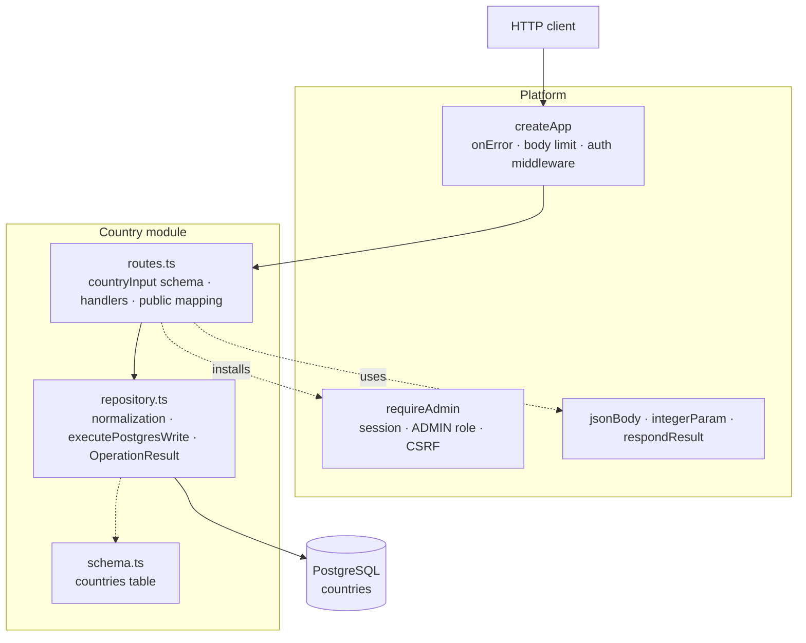

# The Country package

This guide explains the TypeScript code in
[`backend/src/modules/country`](../../../../backend/src/modules/country).
It is the **reference module**: every other module of the TypeScript backend
copies its shape, its test layout, and its conventions.

## What this package does

- a public, read-only list of countries and telephone dial codes;
- admin endpoints for listing, creating, reading, updating, and deleting
  countries;
- validation and normalization of country input;
- PostgreSQL persistence through Kysely; and
- two capabilities for other modules: `find(ids)` for Supplier and
  `isShippable(code)` for Checkout.

Application-wide authentication, the error answers, and the database startup
stay in the platform.

## The five-minute mental model



The boundaries are:

1. **The platform owns the shared HTTP mechanics**: the error answer, the body
   limit, the auth middleware, and the helpers a route answers with.
2. **The route file owns the HTTP contract**: paths, the Zod schema of the
   body, the id parameter, the messages, the public representation, and the
   mapping from a result to a status code.
3. **The repository owns persistence, the code normalization, and conflict
   detection**, and answers `OperationResult` directly. The module has no
   service: its routes only forward to the repository (see
   [Source file organization](../conventions/source-file-organization.md)).

## File map

```text
country/
|- index.ts            createCountryModule({ db }) → { routes, find, isShippable }; export type Country
|- routes.ts           countryInput schema, COUNTRY_RESPONSES, countryId, toPublicCountry, countryRoutes(repository)
|- repository.ts       createCountryRepository(db); Country, CountryInput
|- schema.ts           CountriesTable, merged into the platform's Tables
|- routes.test.ts      one happy path per route and the module-specific errors
|- repository.test.ts  conflicts, concurrency, the stored code, the two capabilities
`- validation.test.ts  the schema's field names and messages
```

The composition root calls the factory and mounts the routes:

```ts
const countries = createCountryModule({ db })
app.route('/', countries.routes)
// later: createSupplierModule({ db, countries: { find: countries.find } })
//        createCheckoutModule({ …, isShippable: countries.isShippable })
```

## HTTP API

| Method and path | Access | CSRF header | Success response |
| --- | --- | --- | --- |
| `GET /api/countries` | Public | No | `200` with a JSON array of public countries (`toPublicCountry`) |
| `GET /api/admin/countries` | Admin | No | `200` with a JSON array of `Country` |
| `POST /api/admin/countries` | Admin | Yes | `201` with `Country` and a relative `Location` header |
| `GET /api/admin/countries/{id}` | Admin | No | `200` with `Country` |
| `PUT /api/admin/countries/{id}` | Admin | Yes | `200` with `Country` |
| `DELETE /api/admin/countries/{id}` | Admin | Yes | `204` with no body |

| Result or failure | HTTP status | `message` |
| --- | --- | --- |
| `notFound` | `404` | `Country not found` |
| `conflict` | `409` | `Country name or code already exists` |
| invalid country input | `400` | `Validation failed`, with the field-error map |
| invalid country id | `400` | `Invalid country id` |
| a body that is not JSON | `400` | `Malformed request body` |
| unsupported content type | `415` | `Unsupported media type` |
| an exception | `500` | `Internal server error` |

Paths are case-sensitive and the trailing slash is not accepted:
`/API/COUNTRIES` and `/api/countries/` answer `404`. One difference to the
Kotlin backend: the admin protection is installed on the whole
`/api/admin/countries` subtree, so `/api/admin/countries/` answers `401` to an
anonymous caller and `404` to an admin, where Ktor answered `404` to both.

### Canonical paths and ids

The `/:id` route matches any single segment. The protection runs first, then
`integerParam('id', 'Invalid country id')` converts the value: an anonymous
request for `/api/admin/countries/not-a-number` receives `401`, a non-admin
`403`, an admin `400`. No country operation runs for an invalid id.

### The request body

Create and update share one schema, declared in `routes.ts`:

```ts
export const countryInput = z.strictObject({
  name: z.string({ error: 'Name is required' }).trim().min(1, 'Name is required').max(255, …),
  countryCode: z.string({ error: 'Country code is required' }).trim().min(1, …).length(2, …).regex(…),
}) satisfies z.ZodType<CountryInput>
```

| Field | Rule | Normalization |
| --- | --- | --- |
| `name` | required after trimming; at most 255 characters | trimmed by the schema |
| `countryCode` | required; exactly two ASCII letters | trimmed by the schema, upper-cased by the repository on write |

A missing, `null`, or non-string field answers its "is required" message; an
unknown property answers `Unknown property` under its name. See
[Request validation](../conventions/request-validation.md) for the mechanism.

## Follow one create request

An admin posts `{"name":" Denmark ","countryCode":" dk "}`:

1. `createApp`'s middleware opens the `voenix.auth` and `XSRF-TOKEN` cookies.
2. `requireAdmin` on the admin sub-app checks the principal, the role, and, for
   a `POST`, the `X-XSRF-TOKEN` header.
3. `jsonBody(countryInput)` checks the content type, parses the body, and runs
   the schema; the handler receives `{ name: 'Denmark', countryCode: 'dk' }`
   from `c.req.valid('json')`.
4. `countries.create(input)` in the repository upper-cases the code to `DK`
   and runs the single `INSERT … RETURNING id` directly on `db` (one statement
   is atomic on its own, so it needs no `write` transaction) inside
   `executePostgresWrite({ uniqueViolation: conflict }, …)`. A unique
   violation becomes the `conflict` value of `OperationResult`; success is
   `ok(country)`.
5. The route answers `201`, the new `Country`, and `Location:
   /api/admin/countries/9`, or hands a failure to `respondFailure`.

## Admin and public representations

```text
Country:            id, name, countryCode
public country:         name, countryCode, dialCode
```

`toPublicCountry` in `routes.ts` hides the id and adds the dial code through
`libphonenumber-js` (`+49` for `DE`); an unknown region has `dialCode: null`.
The code needs no conversion there: the repository stores every code
upper-case. Lists are ordered by `country_code`, then `id`, and are bare
JSON arrays.

## The two capabilities

```ts
find: (ids: Iterable<number>) => Promise<Map<number, Country>>
isShippable: (countryCode: string) => Promise<boolean>
```

`find` answers the countries with these ids keyed by id; unknown ids are
absent. `isShippable` answers whether the shop ships to a code: exactly when a
row with it exists, because the `countries` table *is* the list of
destinations (there is no `active` column). The code is trimmed and
upper-cased first, so `de`, `DE`, and `" de "` ask the same question; a blank,
an unknown, or a three-letter code answers `false`. The admin opens a
destination by creating the row and closes it by deleting it. Deleting a
country also blanks `suppliers.country_id` (`ON DELETE SET NULL`) and shrinks
the public list the frontend's address form is rendered from; it never
touches an order, whose country is plain text.

Both are the repository's functions, exported directly from the factory's
result. An exception in either surfaces to the caller, which answers it with
its own error policy.

## Conflict handling and concurrency

PostgreSQL enforces the case-insensitive name uniqueness
(`ux_countries_name_lower`) and the code uniqueness. Any `23505` becomes the
generic conflict, without asking which rule rejected the write; see
[Persistence error handling](../conventions/persistence-error-handling.md).
The repository tests cover a normal duplicate, a case-variant duplicate, and two
concurrent creates that leave one row and one conflict.

## Persistence

`schema.ts` maps the `countries` table of
[`V1__create_countries.sql`](../../../../backend/migrations/V1__create_countries.sql)
(`id bigint identity`, `name varchar(255)`, `country_code varchar(2)`) and
merges it into the platform's `Tables`. Ids arrive as numbers because the
platform's pool parses `bigint` columns to `number`. The repository selects
`country_code as countryCode`, so a row is already a `Country`.

## Tests

Run from `backend/`:

```sh
bun test src/modules/country    # this module only
bun run check                   # the full gate
```

The tests need Docker: `test-support/preload.ts` starts one PostgreSQL
container per run and migrates a template database. Each test file takes its
own copy:

```ts
const database = testDatabase()                                   // beforeAll/afterAll inside
const app = () => testApp(createCountryModule({ db: database.db }).routes)
const admin = () => signedInHeaders({ roles: ['ADMIN'] })

const response = await app().request('/api/admin/countries', { headers: await admin() })
```

| Test | What it states |
| --- | --- |
| [`routes.test.ts`](../../../../backend/src/modules/country/routes.test.ts) | One happy path per route against the real database, the seeded public list with dial codes, `404`, `409` for a duplicate name and a duplicate code, the protection on the admin subtree |
| [`repository.test.ts`](../../../../backend/src/modules/country/repository.test.ts) | Conflicts and normalization, a self update, concurrency, delete, the upper-cased stored code, `find`, `isShippable`, and opening and closing a destination |
| [`validation.test.ts`](../../../../backend/src/modules/country/validation.test.ts) | The five messages of `countryInput` and the unknown-property answer |

The platform cases (`401`/`403` on every method, CSRF, malformed ids and
bodies, the body limit) are pinned once in `src/platform/**/*.test.ts` and are
not repeated here.

## Safe change recipes

### Add a persisted country field

1. Add a migration under `backend/migrations/`.
2. Add the column to `CountriesTable` in `schema.ts` and to `Country` and the
   `columns` list in `repository.ts`.
3. Decide whether it belongs in `toPublicCountry`.
4. If clients may write it, add it to `countryInput` and `CountryInput` and
   normalize it in the repository's `create` and `update`.
5. Extend the tests and this guide, then run `bun run check`.

### Add an operation or endpoint

1. Add the function to the repository, returning `OperationResult`. Add a
   `service.ts` only when a use case does more than the repository answers,
   such as a join with another module.
2. Add the route on the public app or the admin sub-app; the admin sub-app is
   already protected.
3. Add one happy-path test and the module-specific error cases.
