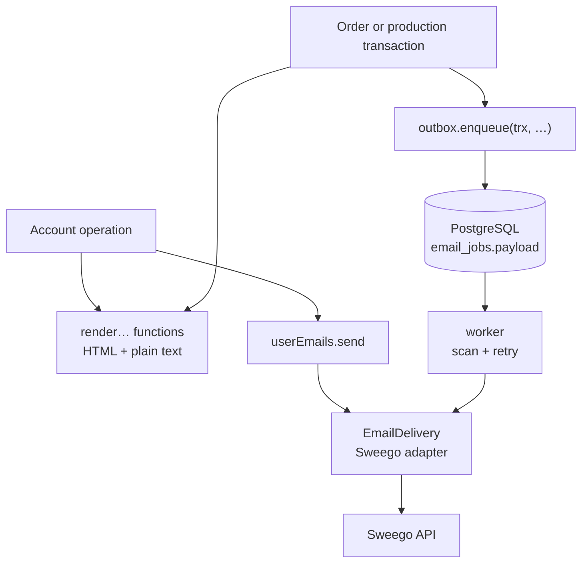
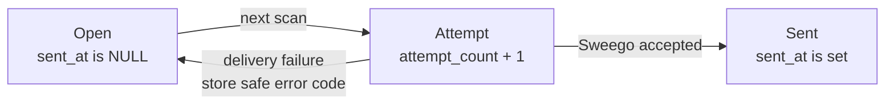

# The Email package

This guide explains the TypeScript code in
[`backend/src/modules/email`](../../../../backend/src/modules/email).

## What this package does

The Email module renders and delivers the shop's transactional mails. It is a
**leaf**: it imports no other module and never asks one for data. It offers

- one `render…` function per mail, which turns plain values into a complete
  `RenderedEmail` (subject, HTML, and plain text);
- `userEmails.send(email)`, which sends a mail of an interactive user action
  directly;
- `outbox.enqueue(trx, email, { orderId })`, which stores a mail inside the
  caller's transaction for unattended delivery, attributed to the order it is
  about when the caller passes one;
- `outbox.findings(now)` and `outbox.ofOrder(orderId)`, two reads of the
  stored mails for the [operations module](operations-package.md); and
- the background worker that delivers the stored mails through Sweego.

There is no HTTP route and no table besides `email_jobs`.

## The five-minute mental model



The owning module always renders. What it does with the result decides the
path:

- the **direct path** carries a mail that may contain a secret action link (a
  confirmation or reset token). It is sent at once and never written to the
  database;
- the **queued path** commits the rendered mail with the owner's business
  change. The worker sends it later, exactly as stored.

The two entry points are typed apart: `send` accepts only the six user-mail
kinds, `enqueue` only the four queued kinds. A reset link therefore cannot
reach the database by mistake, and an order mail cannot skip the retries.

## File map

```text
email/
|- index.ts                 createEmailModule({ db, settings, fetch }) → { userEmails, outbox, worker };
|                           the render functions, EmailDeliveryError, and the types
|- schema.ts                EmailJobsTable, merged into the platform's Tables
|- outbox.ts                enqueue(trx, email, { orderId }): the insert in the caller's transaction;
|                           stalledEmails(db, now) and emailsOfOrder(db, orderId), the two reads
|- user-emails.ts           createUserEmails(settings, delivery) → { send }; EmailDeliveryError
|- worker.ts                createEmailWorker({ db, settings, delivery }) → { runOnce, start, stop }
|- delivery/sweego.ts       the EmailDelivery interface, DeliveryResult, createSweegoDelivery (its `fetch` is
|                           typed by the platform's `Fetch` from `@/platform/fetch`)
|- templates/layout.ts      RenderedEmail and the kinds, the escaping markup tag, the HTML and
|                           text layouts, German date and money formatting, the shared link sentence
|- templates/<mail>.ts      one file per mail: its data, subject, HTML, and text
|- outbox.test.ts           outbox, worker, and userEmails against the real database
|- delivery/sweego.test.ts  the request Sweego receives, against a stubbed fetch
`- templates/templates.test.ts  one test per mail kind, escaping, money and dates
```

The composition root creates the module, hands `userEmails` to account and
`outbox` to order, production, and operations, and runs the worker:

```ts
const email = createEmailModule({ db, settings: settings.email, fetch })
email.worker.start()
// at shutdown
await email.worker.stop()
```

## The mails

| Kind | Render function | Path | Recipient name |
| --- | --- | --- | --- |
| `ACCOUNT_CONFIRMATION` | `renderAccountConfirmation({ recipient, confirmationUrl })` | direct | — |
| `CHANGE_EMAIL_CONFIRMATION` | `renderChangeEmailConfirmation({ recipient, confirmationUrl })` | direct | — |
| `PASSWORD_RESET` | `renderPasswordReset({ recipient, resetUrl })` | direct | — |
| `SUPPLIER_INVITATION` | `renderSupplierInvitation({ recipient, invitationUrl })` | direct | — |
| `PASSWORD_CHANGED` | `renderPasswordChanged({ recipient })` | direct | — |
| `CHANGE_EMAIL_NOTIFICATION` | `renderChangeEmailNotification({ recipient, newEmail })` | direct | — |
| `ORDER_CONFIRMATION` | `renderOrderConfirmation(OrderConfirmationData)` | queued | shipping first and last name |
| `PRODUCER_PDF_NOTIFICATION` | `renderProducerPdfNotification({ …, producerName })` | queued | producer name, else the destination label |
| `SHIPPING_NOTIFICATION` | `renderShippingNotification(ShippingNotificationData)` | queued | customer first name |
| `SPOD_OPS_ALERT` | `renderSpodOpsAlert({ …, reason, externalReference })` | queued | — (an operations mailbox is not a person) |
| `OPERATIONS_ALERT` | `renderOperationsAlert({ recipient, frontendBaseUrl, findings })` | queued | — (an operations mailbox is not a person) |

Every function returns a `RenderedEmail`:

```ts
interface RenderedEmail<K extends EmailKind = EmailKind> {
  kind: K
  recipient: string
  recipientName: string | null
  subject: string
  html: string
  text: string
}
```

Some decisions live in the copy and stay as the Kotlin backend made them:

- `SUPPLIER_INVITATION` links to the same set-password page as the reset, but
  has its own text: the reset says "you requested this", which is wrong for
  someone who was invited.
- The order confirmation is sent when the order is **placed**, so every
  sentence is payment-neutral. It and the shipping notification carry the
  permanent order link and the same `DURABLE_LINK_HINT` sentence, owned once in
  `layout.ts`.
- The shipping notification reports one package: it names no price, never
  says the order is complete, and shows a tracking button only when the shop
  built a tracking link from its own carrier list.
- The SPOD ops alert names the job, the order, and the partner's order id
  (`noch keine` while none is known). Its `reason` is a bounded union, so no
  provider text reaches a mail.
- The operations alert lists the new findings of one operations scan, one
  block per finding with the German name of its kind (a bounded union with a
  table of cases), the subject, the order number, since when, the attempts and
  error code, and the link to the admin timeline of the order; the subject
  names the count. It carries no customer data (see
  [The alert](operations-package.md#the-alert)).

### Links

The email module builds no link. The owning module knows its frontend route,
builds the complete URL from `settings.frontend.baseUrl` (already normalized
without a trailing slash), percent-encodes its query parameters, and passes the
URL in: account builds `/confirm-email?userId=…&token=…`, order builds
`/order/{token}`. A frontend route is knowledge of the module that sends
somebody there, which is why `createEmailModule` does not take the base URL.

### HTML escaping

Templates build HTML with the `markup` tagged template of `layout.ts`. Every
interpolated string or number is escaped (`&`, `<`, `>`, `"`, `'`), so a name,
an address, or a link cannot break out of its element or its `href`; an `Html`
value from another `markup` call, or a list of them, is inserted unchanged, and
`null` inserts nothing. Keep every dynamic value on this path and never build
HTML by string concatenation. The tag is deliberately not called `html`:
Prettier would reformat a template tagged `html` and change the whitespace of
the mail.

Dates arrive as ISO calendar dates (`2026-12-31`) and print as `31.12.2026`;
the owning module decides the time zone. Money arrives in cents and prints as
`1.234,50 €`; free shipping prints `Kostenlos`, and a zero discount prints no
line at all.

## Direct user mails

```ts
await userEmails.send(renderPasswordReset({ recipient: email, resetUrl }))
```

When `EMAIL_ENABLED=false`, `send` does nothing. When enabled, it makes
exactly one Sweego request without a campaign id. Success means Sweego
accepted the request, not that a mailbox received it. A refusal, a timeout,
or an unreachable provider throws `EmailDeliveryError`, whose message is fixed
and carries no recipient, token, or provider text.

`EmailDeliveryError` is the **only** failure a caller may treat as "the
provider let us down". Anything else that escapes `send` is a bug and must
travel on to the caller's `500` path. Account catches `EmailDeliveryError` for
its required mails (answering `502`) and everything for its best-effort
notifications.

## Durable queued mails

```ts
await write(db, async (trx) => {
  const orderId = await insertOrder(trx, …)
  await email.outbox.enqueue(trx, renderOrderConfirmation({ …, orderId, orderUrl }))
})
```

`enqueue` inserts one `email_jobs` row inside the caller's transaction and
returns its id. If the business change rolls back, the mail rolls back with
it. Email never opens or commits a transaction of its own here.

The optional third argument `{ orderId }` stores the order the mail is about
in `email_jobs.order_id`. The three order mails pass it: the order
confirmation (order module, at placement), the producer notification
(production, when a delivery closes), and the shipping notification
(production, in the ship transaction). The SPOD ops alert and the operations
alert pass none. The
column has no foreign key on purpose: email stays a leaf that knows no order
table, and deleting an order must never fail on an unrelated mail.

### The two reads for operations

The [operations module](operations-package.md) reads the outbox through two
capabilities on `outbox`, both plain read transactions over `email_jobs`:

- `findings(now)` reports every **stalled** mail as an `EmailFinding` of kind
  `EMAIL_STALLED`: `sent_at IS NULL` and either `created_at` more than an hour
  before `now` or `attempt_count >= 3`. The subject is the job (`EMAIL`, its
  id), `since` its `created_at`, and the finding carries the mail's own kind
  (`emailKind`, read from `payload->>'kind'`), so the operations module can
  tell a stalled order mail from a stalled alert. In a deployment with
  `EMAIL_ENABLED=false` (the development default) every enqueued mail becomes
  a finding after an hour, because the email worker sends nothing.
- `ofOrder(orderId)` lists the mails attributed to one order, oldest first,
  as `{ emailJobId, kind, recipient, attemptCount, lastErrorCode, createdAt,
  sentAt }`, without the subject, the HTML, or the text.

### Decision: the outbox stores the rendered mail

The owner renders at enqueue time and the row stores the complete mail as
`payload jsonb`. The worker sends that payload as it is.

The reason is the module graph. A reference-only outbox needs the worker to
ask the owning modules for the current values on every attempt, which makes
email depend on order and production at runtime while they depend on email at
compile time: a cycle, bridged with late-bound sources and an aggregating
resolver in the composition root. Storing the payload removes the cycle and
the bridge, and email becomes a leaf. A mail is also exactly what was true when
the business event happened, and the worker cannot fail to find its data.

What this gives up:

- **A corrected address or changed copy is not picked up between retries.**
  The retry sends the stored mail again. A customer who fixes a typo in their
  address after the order receives the confirmation at the old one.
- **The database holds personal data and the order link.** The payload
  contains the recipient, the names and addresses in the mail, and the
  permanent order link, which is a bearer credential. Treat `email_jobs` like
  the order tables it copies from. Direct mails, which carry short-lived
  account tokens, never reach the table.
- **Email no longer deduplicates.** There is no `(kind, source_id)` key: two
  `enqueue` calls are two mails. "One confirmation per order", "one shipping
  mail per shipped job", and "one ops alert per job however often the partner
  redelivers the webhook" are guarded by the owner, by enqueuing in the same
  transaction as the state change that happens only once.

## Worker lifecycle

A job is **open** while `sent_at` is `NULL` and **sent** once Sweego accepted
it.



`worker.start()` scans at once and then every `EMAIL_POLL_INTERVAL_MINUTES`
(5 by default). A scan reads every open job oldest first and, per job:

1. increments `attempt_count` in SQL, only while the job is still open;
2. delivers the payload with the campaign id `voenix-email-<job id>`;
3. on acceptance sets `sent_at = now()` and clears `last_error_code`; on a
   failure stores the bounded code (`PROVIDER_HTTP_503`, `REQUEST_TIMEOUT`,
   `PROVIDER_UNAVAILABLE`, …) and leaves the job open.

There is no retry maximum and no terminal failed state. An exception during a
scan (the database is gone) is logged with its class only and the next scan
tries again. With `EMAIL_ENABLED=false` a scan returns at once and every job
stays untouched; `start()` then logs one warning, because nothing else in the
log tells you that no mail goes out.

`worker.stop()` aborts the `AbortController`: the sleep between scans ends
immediately, a running scan stops before its next job, and the returned
promise resolves when the loop has ended. A second `start()` throws.

One active worker is supported, not several processes sharing the table. The
queue guarantees at-least-once delivery: a crash between Sweego's acceptance
and the `sent_at` update sends that mail again. The campaign id is correlation
metadata, not a provider idempotency key.

## The Sweego adapter

`createSweegoDelivery(settings, fetch)` posts to `https://api.sweego.io/send`
with the `Api-Key` header and this body:

```json
{
  "channel": "email",
  "provider": "sweego",
  "recipients": [{ "email": "kunde@example.com", "name": "Max Mustermann" }],
  "from": { "email": "<EMAIL_FROM_EMAIL>", "name": "<EMAIL_FROM_NAME>" },
  "subject": "…",
  "message-html": "…",
  "message-txt": "…",
  "campaign-type": "transac",
  "campaign-id": "voenix-email-42"
}
```

`campaign-id` is omitted for a direct mail, and the recipient name is `""`
when the mail has none. Any `2xx` is acceptance. The response body is drained
but never parsed, stored, or logged. Redirects are not followed
(`redirect: 'manual'`): walking one would replay the message and the API key
against a URL the adapter never chose, so a `302` becomes `PROVIDER_HTTP_302`
like any refusal. The request times out after 30 seconds
(`REQUEST_TIMEOUT`); any other thrown error is `PROVIDER_UNAVAILABLE`.

`EmailDelivery` is an interface because it has two implementations: the
Sweego adapter, and the recording delivery of `outbox.test.ts`, which records
every mail and answers from a script. The adapter takes `fetch` as a
parameter, so the composition root passes the global one and a test passes a
stub; nothing mocks a global.

## Configuration

| Variable | Default | Meaning |
| --- | --- | --- |
| `EMAIL_ENABLED` | `false` | `false`: `send` is a no-op and the worker never sends |
| `EMAIL_POLL_INTERVAL_MINUTES` | `5` | between 1 and 1440 |
| `EMAIL_API_KEY` | — | the Sweego key; required when enabled |
| `EMAIL_FROM_EMAIL` | — | the sender address; required when enabled |
| `EMAIL_FROM_NAME` | `Voenix Shop` | the sender name |

The platform's `loadSettings` validates them before anything touches the
database. Real keys belong in `backend/.env.local`.

## Persistence

`schema.ts` maps `email_jobs` as
[`V5__create_email_jobs.sql`](../../../../backend/migrations/V5__create_email_jobs.sql)
created it and
[`V32__email_jobs_payload.sql`](../../../../backend/migrations/V32__email_jobs_payload.sql)
reshaped it: `id`, `payload jsonb`, `attempt_count`, `last_error_code`,
`created_at`, `sent_at`. V32 drops `email_kind`, `source_id`, the unique
reference, and the kind and source-id checks.
[`V33__operations_findings.sql`](../../../../backend/migrations/V33__operations_findings.sql)
adds the nullable `order_id bigint` without a foreign key, with the index
`ix_email_jobs_order_id` for `ofOrder`. `payload` is typed as
`JSONColumnType<RenderedEmail>`: it is written as a JSON string and read back
as the object.

## Tests

Run from `backend/`:

```sh
bun test src/modules/email
```

| Test | What it states |
| --- | --- |
| [`outbox.test.ts`](../../../../backend/src/modules/email/outbox.test.ts) | The payload is stored in the caller's transaction, with the order id when one is passed, and a failing transaction leaves no job; `findings` reports an unsent mail older than an hour or failed three times, and nothing at the thresholds or once sent; `ofOrder` lists one order's mails; a disabled worker sends nothing; an enabled one sends and marks every job with its campaign id; a failure keeps the job open with its code and the next scan resends the stored mail, without an attempt maximum; `start` scans at once and `stop` ends the loop without waiting for the interval; `userEmails.send` sends once, stores nothing, is a no-op when disabled, and throws `EmailDeliveryError` on a refusal |
| [`delivery/sweego.test.ts`](../../../../backend/src/modules/email/delivery/sweego.test.ts) | The exact request (URL, method, headers, body, `redirect: 'manual'`, timeout signal); an omitted campaign id; a `503` and a `302` as status codes without the body; timeout and unreachable provider |
| [`templates/templates.test.ts`](../../../../backend/src/modules/email/templates/templates.test.ts) | One test per kind with its subject and, where the mail has one, the link built from the base URL as `href` and as text; exact plain texts; escaping; German money with thousands, discount, and free shipping; the producer greeting fallback; the shipping mail without prices or tracking; every ops-alert reason reads differently |

## Differences to the Kotlin backend

- The outbox stores the rendered mail, so the worker can only fail at
  delivery; `UserEmail` and `QueuedEmail` are replaced by the render functions,
  and the two entry points keep their separation through the kind types.
- The display-value checks of `EmailRecipient` and `EmailActionUrl` (non-blank,
  at most 255 characters, no control characters) are not ported: the values
  come from modules that validated them at their own route. Nothing here
  prints an object into a log line, so the redacting `toString` has no
  counterpart either.
- The order confirmation no longer checks that the total equals subtotal plus
  shipping minus discount; the order module computes those amounts.
- `EmailSettings.sendUrl` is gone: tests pass a stub `fetch`. Sweego's
  separate connect and socket timeouts are one 30-second request timeout.

## Safe change recipes

### Add a mail

1. Add its kind to `UserEmailKind` or `QueuedEmailKind` in `layout.ts`.
2. Add `templates/<mail>.ts` with one `render…` function built from the layout
   helpers, every dynamic value through `markup`.
3. Export the function from `index.ts`.
4. Add a test with the subject, the link, and the plain text.
5. Render and send or enqueue it from the owning module.

### Change the copy of a mail

Change the template file and its test. Jobs already in the outbox keep the
copy they were rendered with.
