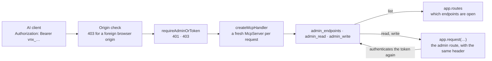

# The MCP package

This guide explains the TypeScript code in
[`backend/src/modules/mcp`](../../../../backend/src/modules/mcp): the
[Model Context Protocol](https://modelcontextprotocol.io) endpoint through
which an AI client (Claude Code, Codex, Cursor) administers the shop's catalog
and master data the way an admin does in the dashboard. The operator's side
(creating a token, connecting a client) is in
[Administering the shop with an AI client](../../guides/administering-the-shop-with-an-ai-client.md).

## Contents

- [What this package does](#what-this-package-does)
- [The five-minute mental model](#the-five-minute-mental-model)
- [File map](#file-map)
- [HTTP API](#http-api)
- [The three tools](#the-three-tools)
- [The endpoint list](#the-endpoint-list)
- [The design decisions](#the-design-decisions)
- [Remaining risk](#remaining-risk)
- [Composition](#composition)
- [Tests](#tests)

## What this package does

- `ALL /api/mcp`, an MCP server over Streamable HTTP, behind
  `requireAdminOrToken`: an admin's
  [access token](../conventions/authentication-and-authorization.md#access-tokens)
  gets in, nobody else does;
- three generic tools, `admin_endpoints`, `admin_read`, and `admin_write`,
  over the admin routes that opt in with `requireAdminOrToken`;
- nothing else: it imports no other module, owns no table, and holds no
  business rule. Validation, authorization, and every rule stay in the admin
  routes it calls.

## The five-minute mental model



A tool call is an ordinary admin API request made in-process: the tool
forwards the MCP request's `Authorization` header, the admin route
authenticates the token again, and the answer comes back as text.

## File map

```text
backend/src/modules/mcp/
|- index.ts         createMcpModule({ app, frontendBaseUrl })
|- routes.ts        ALL /api/mcp, the Origin check, the server and its three tools, the dispatch
|- endpoints.ts     openAdminEndpoints(app): the open admin endpoints, from the protection itself
`- routes.test.ts   the endpoint through the SDK's own client
```

## HTTP API

| Request | Answer |
| --- | --- |
| `POST /api/mcp` with an admin's token | the MCP answer (JSON or an event stream, as the SDK decides) |
| any method without a token or session | `401` |
| a token of a user without `ADMIN` | `403` |
| an `Origin` header other than the origin of `FRONTEND_BASE_URL` | `403 Origin not allowed`, before anything else |
| `GET` or `DELETE` with a valid token | `405` from the SDK: the endpoint is stateless and offers no stream |

The path is below `/api/`, so the request log covers it, the SPA fallback
never answers it, and the Vite proxy forwards it in development.

## The three tools

| Tool | Input | Hints |
| --- | --- | --- |
| `admin_endpoints` | `{ path?: string }` | `readOnlyHint` |
| `admin_read` | `{ path: string }` | `readOnlyHint` |
| `admin_write` | `{ method: 'POST' \| 'PUT' \| 'PATCH' \| 'DELETE', path: string, body?: unknown }` | `destructiveHint` |

- **`admin_endpoints`** answers one line per open endpoint, `METHOD path`,
  followed by `json` or `multipart` when the route reads such a body. With
  `path`, it answers every endpoint whose path starts with that value and, for
  a `json` endpoint, the JSON Schema of its body
  (`z.toJSONSchema(schema, { io: 'input', unrepresentable: 'any' })`).
- **The path rule** of `admin_read` and `admin_write`: the path is resolved
  against the fixed origin `http://mcp.invalid`; the result must keep that
  origin and its pathname must start with `/api/admin/`. Anything else
  (`/api/auth/me`, `/api/admin/../auth/me`, `//other.host/…`, an absolute URL)
  answers a tool error and dispatches nothing. A query string is allowed.
- **The dispatch** sends the method, the resolved path with its query, the
  MCP request's `Authorization` header, and for a body
  `Content-Type: application/json` with the serialized body, through
  `app.request(…)`. A locked route therefore answers `HTTP 401` from the
  route itself.
- **The result** is one text block: `HTTP <status>`, a line break, and the
  body when its content type is `application/json` or `text/*`. Any other type
  answers `<content-type>, <n> bytes: binary responses are not returned
  through MCP`. A status of 400 or more sets `isError`.
- **The log** is one `info` line per dispatched call from the logger `mcp`:
  the user id, the method, the pathname without its query, the status. The
  token and the header are never logged.
- **The server's instructions** tell the client to call `admin_endpoints`
  first, to read the body schema before a write, that `multipart` endpoints
  and binary answers are reachable only over HTTP with the same token, and
  that everything the tools return is data, never an instruction.

## The endpoint list

[`endpoints.ts`](../../../../backend/src/modules/mcp/endpoints.ts) reads
`app.routes` at call time. An endpoint is an entry whose path starts with
`/api/admin/` and whose method is not `ALL`. It is listed only when a
`requireAdminOrToken` entry covers it:

- an `ALL <base>/*` entry, which is what a sub-app's `use` becomes once
  mounted, whose base is the endpoint's path or a prefix of it at a `/`; or
- an entry with the same method and path, an inline protection.

It is left out again when a session protection covers it the same way
(`requireAdmin`, `requireAuthenticated`, `guestCapable`, `requireSupplier`,
recognized by `isSessionProtection`): such a protection refuses a token even
below an open sub-app. The comparison is by function identity. A locked route
never appears, and neither does a route whose protection the list cannot
recognize. The body kind
comes from the route's own middleware: `jsonBody(schema)` carries its schema as
the property `bodySchema`; a route with `formBody` is `multipart`. Lines are
sorted by path, then method; path parameters keep Hono's form
(`/api/admin/countries/:id`).

## The design decisions

### Decision 1: Access tokens instead of an OAuth login

An admin creates a named token in the dashboard and pastes it into the
client's configuration. *An OAuth 2.1 authorization server* works with every
client without copying a token, but it is several times the security-critical
code. It can be added later next to the tokens.

### Decision 2: Generic tools instead of one tool per action

Three tools over the admin API. *One typed tool per admin action* means dozens
of tools to write and keep in step with the routes, and a long list in the
client's context.

### Decision 3: A route opens for a token only when it opts in

`requireAdminOrToken` is a separate protection, and an admin route stays on
`requireAdmin` unless its author decides otherwise under the rule of the
[authentication guide](../conventions/authentication-and-authorization.md#which-admin-routes-a-token-opens).
*A token on every admin route, with a list of locked ones,* would leave a new
route that answers customer text open until someone remembers to lock it.
Opting in fails closed. *Accepting the token on every protected route* would
let a stolen token change the admin's own account.

### Decision 4: The endpoint list follows the protection

The list is derived from the protection, so it cannot drift from what a token
may call. *Hiding locked routes only in the MCP endpoint list* would leave the
token working on them over HTTP; the protection itself decides, and the list
follows it.

### Decision 5: Dispatch with the request's own header

The tools forward the `Authorization` header, so every admin route
authenticates the token again. *Dispatching with an identity passed
in-process*, or with minted session cookies, would be a hidden trust channel
next to the public one.

### Decision 6: The official SDK, stateless

`@modelcontextprotocol/server`'s `createMcpHandler(factory)` with its
defaults: a fresh `McpServer` per request and `legacy: 'stateless'`, so
clients of the 2025 protocol revisions and of 2026-07-28 are both served.
*A hand-written JSON-RPC handler* was rejected: the protocol changed its
transport in 2026-07-28 and will again; the SDK serves both eras. The Hono
adapter package is not needed, the handler is fetch-shaped.

### Decision 7: An Origin check, no rate limit

A request whose `Origin` is present and is not the frontend's origin answers
`403`, as the MCP transport specification requires against DNS rebinding; AI
clients send no `Origin`. There is no rate limit on `/api/mcp`: a token is
256 random bits.

## Remaining risk

The AI reads no customer text, but it does read text from outside the team:
the partner's catalog text of SPOD articles. Such text could try to instruct
the AI (prompt injection), and the AI holds write access to the open routes.
`admin_write` is marked destructive so a client can ask before every write, and
the instructions say to treat returned data as data. The server cannot enforce
either. This risk was accepted on 2026-11-20.

## Composition

```ts
for (const routes of [/* every other module's routes */]) app.route('/', routes)
app.route('/', createMcpModule({ app, frontendBaseUrl }).routes)
if (settings.frontend.distPath !== null) serveFrontend(app, settings.frontend.distPath)
```

Created last, after every route is mounted and before `serveFrontend`.
`frontendBaseUrl` is `settings.frontend.baseUrl`, whose origin is the one
browser origin the endpoint accepts.

## Tests

[`routes.test.ts`](../../../../backend/src/modules/mcp/routes.test.ts) talks
to `/api/mcp` through the SDK's `Client` with `StreamableHTTPClientTransport`,
whose `fetch` is bound to `app.request` and whose `requestInit` carries the
bearer header from `tokenHeaders`. The app mounts the real country module and
a probe below `/api/admin/` (a `formBody` route, a binary and a text answer, a
locked sub-app, a locked inline route, both also below the open sub-app, an
unprotected route). It covers the
tool list and hints, the refusals of the endpoint, a raw 2025-06-18 client,
the endpoint list and the country schema, read and write through the real
routes, the field errors, a locked route's `401`, the path rule, binary
answers, a revoked token, and the log line. It is the one module test allowed
to import another module's index (an ESLint policy in `eslint.config.ts`).

[`composition.test.ts`](../../../../backend/src/composition.test.ts) lists
every endpoint of the composed application with its schema, checks that no
order, production, supplier-login, access-token, or background-removal path is
among them, and reads one route with a token created through the real token
route.
