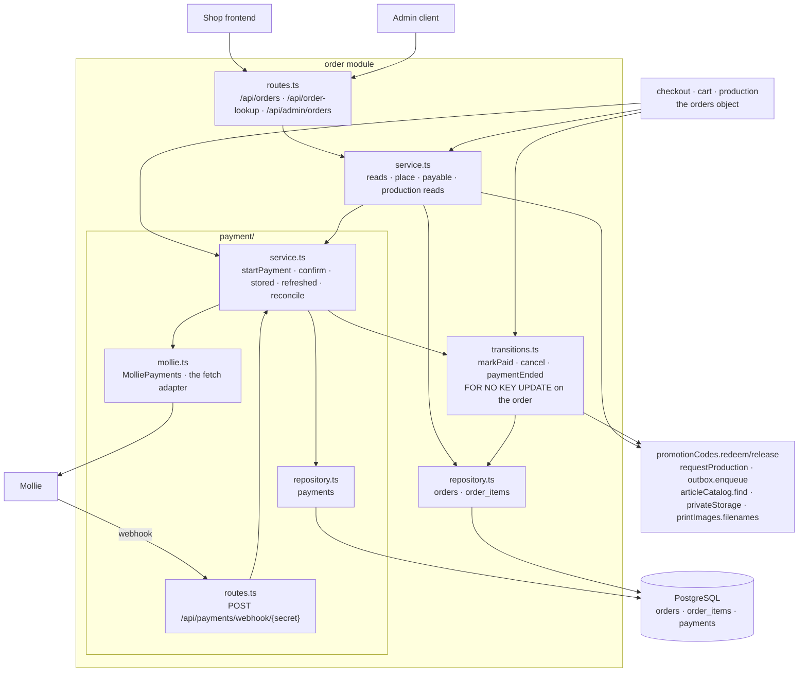

# The Order package

This guide explains the TypeScript code in
[`backend/src/modules/order`](../../../../backend/src/modules/order),
including its [`payment/`](../../../../backend/src/modules/order/payment)
subfolder.

## Contents

- [What this package does](#what-this-package-does)
- [The five-minute mental model](#the-five-minute-mental-model)
- [File map](#file-map)
- [HTTP API](#http-api)
- [Who may read an order](#who-may-read-an-order)
- [The access token and the permanent link](#the-access-token-and-the-permanent-link)
- [Placing an order](#placing-an-order)
  - [Why the confirmation mail hangs on the placement](#why-the-confirmation-mail-hangs-on-the-placement)
- [The paid transition](#the-paid-transition)
- [Cancelling an order, and a payment that ends](#cancelling-an-order-and-a-payment-that-ends)
- [Payment](#payment)
  - [Starting a payment](#starting-a-payment)
  - [The webhook](#the-webhook)
  - [Reading a status: stored versus refreshed](#reading-a-status-stored-versus-refreshed)
  - [Payments that stand still: `findings(now)`](#payments-that-stand-still-findingsnow)
  - [The Mollie adapter](#the-mollie-adapter)
  - [The spelling trap: `CANCELED` versus `CANCELLED`](#the-spelling-trap-canceled-versus-cancelled)
- [The order history](#the-order-history)
- [The admin reads](#the-admin-reads)
- [The production contract](#the-production-contract)
- [The schema](#the-schema)
- [The exported `orders` object](#the-exported-orders-object)
- [Composition](#composition)
- [Tests](#tests)
- [What the port changed](#what-the-port-changed)
- [What is deliberately not here](#what-is-deliberately-not-here)

## What this package does

When a customer buys something, the shop needs a record of it that nothing can
change afterwards, and it needs the money. The order package owns both:

- the **placed order**, with its addresses, amounts, and lines carrying the
  names and prices the customer saw (a snapshot, never a live view);
- the **transitions** to `PAID` and `CANCELLED`, and what a payment sets in
  motion: the promotion redemption and the production request;
- the **payment** through Mollie: the `payments` table, the provider adapter,
  and the webhook Mollie calls. Payment used to be a module of its own; since
  decision #248 it is the subfolder `payment/`, because its only partner was
  the order and the two modules had to be wired with late binding in both
  directions.

Two of its most important operations have no HTTP surface: placing an order
belongs to the checkout journey, and starting a payment too. Both are
functions on the exported `orders` object, which every consumer of an order
(checkout, cart, production) receives.

## The five-minute mental model



Read it in three rows. The **service** answers what an order is and who may see
it. The **transitions** are the only code that changes an order's status, and
every one of them locks the order row first. The **payment service** talks to
Mollie and never decides an order status itself: it asks the transitions.

## File map

```text
order/
|- index.ts                 createOrderModule(deps) → { routes, adminPdfRoutes, orders }; the exported types
|- schema.ts                orders, order_items, payments, order_events, merged into the platform's
|                           Tables; OrderStatus, OrderEventActorType
|- routes.ts                orderRoutes (customer + lookup subtrees), adminPdfRoutes(generator),
|                           the no-store middleware, the PRODUCTION_PDF_* table
|- service.ts               createOrderService: the three reads, place, payable, adminOrders, the
|                           production reads;
|                           PlaceOrderResult, PayableResult, PrintImageReads (the cart implements it)
|- transitions.ts           createOrderTransitions: markPaid(trx, id, by), cancel(trx, id),
|                           paymentEnded(trx, id)
|- repository.ts            createOrderRepository (the reads, adminOrder, adminOrders) and the
|                           statements taking a trx (liveOrderOfCart, insertOrder, lockOrder,
|                           setOrderStatus, recordEvent); the value types PayableOrder, OrderView,
|                           PlaceOrderInput, StoredOrder, OrderEvent, PaidBy, PaymentCause; berlinDate
|- payment/
|  |- mollie.ts             MolliePayments (the provider seam), PaymentStatus, createMolliePayments
|  |- service.ts            createPaymentService: startPayment, confirm, stored, refreshed,
|  |                        reconcile; PaymentConfirmation
|  |- repository.ts         createPaymentRepository (currentPayments, findings, underWayBefore,
|  |                        paymentByMollieId);
|  |                        livePayment, insertPayment, and moveStatus taking a trx; isLive,
|  |                        isUnderWay; OrderFinding
|  |- routes.ts             paymentRoutes: the webhook and its constant-time secret compare
|  |- mollie.test.ts        the adapter against a stubbed fetch
|  `- payment.test.ts       startPayment, the webhook, the status refresh
|- test-fixtures.ts         the module on real promotion/email/image modules, a fake catalog, the
|                           Mollie stub, SQL seeds (tests only)
`- *.test.ts                see Tests
```

`transitions.ts` is a file of its own because two callers share it: the
payment service (webhook, refresh, a refused start) and the checkout (the free
order). Putting it in either service would make the other depend on that
service. The payment subfolder has the standard shape of a module, without an
`index.ts`: the order module's `index.ts` is the one public surface for both.

## HTTP API

| Method and path | Protection | Success | Errors |
| --- | --- | --- | --- |
| `GET /api/orders` | guest-capable | `200`, a JSON array of `OrderView`, newest first | — |
| `GET /api/orders/{orderId}` | guest-capable | `200` `OrderView` | `404` (unknown, foreign, and non-numeric id alike) |
| `GET /api/order-lookup/{token}` | none; the token is the credential | `200` `OrderView` | `404` (malformed, unknown, **and** missing token) |
| `GET /api/admin/orders/{orderId}/production-pdfs` | admin | `200`, an array of `{ "supplierId": 3, "fileName": "ORD-42.pdf" }` | `404`, `409`/`500` with a `PRODUCTION_PDF_*` code |
| `GET /api/admin/orders/{orderId}/production-pdfs/{supplierId}` | admin | `200` `application/pdf` as an attachment | `404`, `409`, `500` |
| `POST /api/payments/webhook/{secret}` | none; the secret is the credential | `200` with an empty body | `403`, `400`, `502`, `500` |

Every order answer carries `Cache-Control: no-store`, a `404` included. An
order answer is personal, and a shared cache holding one is the vulnerability
the legacy PDF endpoint had. Every miss is `{"message":"Order not found"}`; an
id that is not a number is a miss as well, never a `400`, because telling the
two apart is exactly what a probe looks for. Reading never mints a guest
cookie (`guestTokens.tryGet`).

The list, the detail, and the lookup answer the same representation:

```json
{
  "orderId": 42,
  "createdAt": "2026-07-30T09:12:44.123Z",
  "status": "PAID",
  "paymentStatus": "PAID",
  "subtotal": 3980,
  "shippingCost": 490,
  "discountAmount": 400,
  "total": 4070,
  "items": [
    {
      "orderItemId": 7,
      "articleId": 3,
      "variantId": 9,
      "articleType": "MUG",
      "articleName": "Tasse Klassik",
      "variantName": "Weiß/Blau",
      "quantity": 2,
      "price": 1490,
      "promptPrice": 500,
      "imageId": 12
    }
  ]
}
```

`status` is the order's own word (`PENDING`, `PAID`, `CANCELLED`).
`paymentStatus` is the one value from another table: one of Mollie's seven
words, uppercased, or `null` when the order has no payment at all (a free
order, or one whose payment was never started). The three reads fill it
differently, and the difference is the design:

| Route | How `paymentStatus` is filled | What it costs |
| --- | --- | --- |
| `GET /api/orders` | `stored(orderIds)` | one batch read, **never** a provider call: a history of twenty orders must not become twenty HTTP requests |
| `GET /api/orders/{orderId}` | `refreshed(orderId)` | may ask Mollie about a payment that is `OPEN`, `PENDING`, or `AUTHORIZED`, and may pay the order when Mollie says it was paid |
| `GET /api/order-lookup/{token}` | `stored([orderId])` | one read, never a provider call: an anonymous request must not make the shop talk to Mollie |

The refresh is the fallback for a webhook that never arrived: the customer
looking at their order repairs it. When the refresh itself paid the order, the
detail read reads the order once more, so the answer does not say
`"status":"PENDING"` next to `"paymentStatus":"PAID"`. The ownership-filtered
read always comes first, so nobody can drive provider calls for somebody
else's order by guessing ids.

The admin PDF routes generate through production's `productionPdfGenerator`
and store nothing. The failure table:

| Generator answer | Status | `code` |
| --- | --- | --- |
| `orderNotFound` | `404` | — |
| `MISSING_IMAGE` | `409` | `PRODUCTION_PDF_MISSING_IMAGE` |
| `UNREADABLE_IMAGE` | `409` | `PRODUCTION_PDF_UNREADABLE_IMAGE` |
| `INVALID_SOURCE` | `409` | `PRODUCTION_PDF_INVALID_SOURCE` |
| `RENDER_FAILURE` | `500` | `PRODUCTION_PDF_RENDER_FAILURE` |

The first three are about the order's own data, which an admin can repair; a
renderer failure is nobody's data problem. A supplier the order has no document
for is a `404`. The download's file name is the producer-facing
`ORD-{orderId}.pdf`.

The webhook's answers are in [The webhook](#the-webhook).

## Who may read an order

One rule answers every customer read, written once as the `readable` predicate
in [`repository.ts`](../../../../backend/src/modules/order/repository.ts):

```ts
// the signed-in customer it belongs to, or the guest token it was placed with while it has no user
eb.or([
  eb('orders.user_id', '=', userId),
  eb.and([eb('orders.user_id', 'is', null), eb('orders.guest_session_token', '=', guestToken)]),
])
```

- **A guest cookie opens only orders that never belonged to an account.** A
  signed-in checkout stores both the user and the guest cookie of that
  browser, and the cookie is not rotated at logout; without the
  `user_id IS NULL` half, the cookie left behind would keep opening the
  account's order.
- **No identity matches nothing.** With neither a session nor a cookie the
  predicate is an empty `or`, which Kysely writes as `1 = 0`, and
  `GET /api/orders` answers `[]`.
- **Unknown and foreign are the same answer** on every read, `payable` and
  `orderItem` included.

## The access token and the permanent link

Every order, account orders included, carries an access token: 32 bytes from
`crypto.randomBytes`, URL-safe Base64 without padding, exactly 43 characters.
The confirmation mail links to `{FRONTEND_BASE_URL}/order/{token}`, and the
frontend resolves it through `GET /api/order-lookup/{token}`. It is the
customer's durable handle on one order: read-only, that one order, never
account access.

- 256 bits make guessing arithmetic, not a threat model, which is why the
  lookup has **no rate limit**: the limiter here is a cost gate, and this
  route spends nothing.
- A string not shaped like a token is answered `404` before the database is
  touched, exactly like an unknown one.
- The token never travels back: no answer contains it (the routes test pins
  that), and the shipping-mail read hands production the finished link, never
  the token.
- Nothing logs it. It is a bearer credential.

## Placing an order

`orders.place(trx, input)` runs inside the caller's transaction, checkout TX1
of decision #247, which already holds the cart row lock (`SELECT … FOR UPDATE`)
and has reserved the coupon. `PlaceOrderInput` is everything the checkout
decided: cart, owner (user and/or guest token), promotion, the shipping
address and an optional billing address, e-mail, phone, the three amounts, and
the lines with the prices the customer was quoted.

1. **The live order of the cart.** If the cart already has an order that is not
   cancelled, the answer is `{ kind: 'alreadyPlaced', order }`, the *stored*
   order, and nothing is written. This is what makes a double-submitted
   checkout harmless. A live order that is already `PAID` is answered as
   `{ kind: 'alreadyPaid', order }` instead, so the checkout knows there is
   nothing left to pay (its cart stayed open because a checkout died between
   its two transactions; see [the Checkout package](checkout-package.md)). The
   read is exact because the caller holds the cart lock; the partial unique
   index `ux_orders_live_cart` stays the authority behind it, and a caller
   without the lock that races a second placement gets its `23505` as an
   exception.
2. **The catalog snapshot.** `articleCatalog.find(lines)` resolves every
   `(articleId, variantId)` once, and every reference has to come back;
   otherwise the answer is `unknownArticle` and nothing is written. The line
   stores the article type, both names, the supplier article number, the five
   mug millimetres (`NULL` on a SPOD line), and the **SPOD hotspot**
   (`CatalogVariant.spodHotspot`, `NULL` on a mug): what is printed must be what
   was previewed, so a later sync cannot change it (#260, decisions 8 and 14).
3. **The write.** The order with a fresh access token and `total = subtotal +
   shipping - discount`, its lines in the customer's order (`position`), and the
   confirmation mail: `renderOrderConfirmation(...)` rendered now and
   `outbox.enqueue(trx, …, { orderId })` in the same transaction, attributed
   to the new order so its history can list it.

A `null` billing address means "same as shipping" and is stored as the
shipping values. The answer of a fresh placement is `{ kind: 'placed', order }`
with the `PayableOrder` snapshot: order id, cart id, total, e-mail, phone, and
the two stored addresses, which is everything a payment needs and nothing else
(the cart id is what the checkout's retry route closes once the payment stands).

### Why the confirmation mail hangs on the placement

| Write | Side effects in its transaction |
| --- | --- |
| placement | the confirmation mail |
| the paid transition | the promotion redemption, the production request |

The mail carries the permanent link, and a customer whose payment failed needs
that link most: it is the order they want to look at. Waiting for the payment
would hand out the handle exactly when it is least needed (issue #110, Joe's
decision 3). Because the enqueue joins the placing transaction, a placement
that rolls back leaves no mail, and a committed order is never without one.
The accepted edge: an order cancelled right after placement, because Mollie
refused to create a payment, still has its confirmation mail. The template is
payment-neutral, and the link shows the real status.

Since #248 the outbox stores the **rendered** mail, so the order module renders
it at placement from the input it was given; there is no resolver that reads
the order again per attempt.

## The paid transition

`markPaid(trx, orderId, by)` in
[`transitions.ts`](../../../../backend/src/modules/order/transitions.ts)
runs in the caller's transaction. `by` says who paid, for the
[history](#the-order-history): `SYSTEM` with the cause that asked Mollie, or
`CUSTOMER` with `FREE_ORDER`. Checkout calls it as `orders.confirmFree`
inside TX1 for an order of `0` cents; the webhook and the detail refresh run it
in one transaction together with the payment's `PAID` write (see
[The webhook](#the-webhook)).

```text
SELECT … FROM orders WHERE id = ? FOR NO KEY UPDATE   before the status is read
  → not found   'notFound'
  → PAID        'alreadyPaid'     nothing happens twice
  → CANCELLED   'cancelled'       the order stays cancelled
  → PENDING     promotionCodes.redeem(trx, …) · status = PAID · ORDER_PAID event
                · requestProduction(trx, orderId) → 'paid'
```

Everything commits together or not at all: a failing production request rolls
the status and the redemption back. The lock is what makes a double webhook,
or a webhook racing the detail refresh, idempotent: the second caller waits,
reads `PAID`, and does nothing. A redemption the promotion refuses (its usage
limit ran out while the customer was paying) does **not** stop the order from
being paid, because the money has already moved; the order becomes `PAID`
without a redemption and the reason is logged.

The lock order of the whole module is orders, then payments, then promotions.
Nothing takes them the other way round. The order lock is `FOR NO KEY UPDATE`,
not `FOR UPDATE`: every event insert into `order_events` takes a `KEY SHARE`
lock on the order through its foreign key, and the live and amount-mismatch
branches of `applyReported` lock the payment row without the order. With
`FOR UPDATE` a terminal write (orders, then payments) and a live write
(payments, then the event's `KEY SHARE` on orders) of one payment could
deadlock; `FOR NO KEY UPDATE` does not conflict with `KEY SHARE`, and no
transition changes an order's key, so the weaker lock serializes the writers
just the same.

## Cancelling an order, and a payment that ends

`cancel(trx, orderId)` locks the order the same way, in the caller's
transaction. A `PENDING` order becomes `CANCELLED`, falls out of
`ux_orders_live_cart` (so the cart can be checked out again), its promotion
reservation is released, and `ORDER_CANCELLED` with cause
`PAYMENT_START_REFUSED` (its only cause, so it is no parameter) is recorded, all in
the same commit. A `PAID` order is refused
(`'paid'`) and logged: the money moved and production is requested. The one
production caller is `startPayment` when Mollie refuses to create a payment,
and it calls `cancel` inside the transaction that already holds the order lock
(the reason is under [Starting a payment](#starting-a-payment)).

`paymentEnded(trx, orderId)` is what a payment that failed, expired, or was
cancelled by the customer does: the order stays `PENDING` (the customer may pay
again), but the reservation its cart holds is released, under the order lock
so a release never overtakes a running confirmation whose redemption is about
to consume that reservation. It runs in the caller's transaction, the one that
also writes the terminal status (see [the webhook](#the-webhook)), so the
payment ends and the reservation is released together or not at all. An
unknown order, one without a promotion, and a reservation already gone are the
same no-op, which is what makes a redelivered notification harmless.

## Payment

A payment is one *attempt* at collecting the money of one order. An order can
have several attempts over its life; at most one of them is *live*. The partial
unique index `ux_payments_live_order` decides which: a payment whose status is
`FAILED`, `CANCELED`, or `EXPIRED` falls out of it, so a retry is a second row
for the same order.

### Starting a payment

`orders.startPayment(order)` takes the `PayableOrder` (from a placement or from
`payable`) and answers the URL the customer is sent to, or `null` when no
payment was started. It runs one transaction of its own:

```text
SELECT … FROM orders WHERE id = ? FOR NO KEY UPDATE
  → not PENDING            null, no provider call
  → a live payment exists  its stored checkout_url, no provider call
  → otherwise              Mollie create (fresh Idempotency-Key) → INSERT payments → the new URL
```

The order row lock is held around "check the live payment → create at Mollie →
insert". Two concurrent starts of one order (a double-clicked checkout) queue
on the lock, and the second finds the first one's payment and answers its URL:
one provider call, one row. The adapter bounds the provider call at eight
seconds, below the 10-second `lock_timeout` every connection sets: a second
start or a status transition queued on the same order waits at most ten
seconds for the lock, so the provider call must give up first, or each waiter
would answer `500` while the first start is still talking to Mollie.

This replaces the Kotlin `PaymentLauncher`'s conflict machinery (the `23505`
on the live index, the re-read of the winner, the cancellation of the loser's
provider payment, the one bounded retry into a vacated slot): with the lock
there is no loser. Two compensations stay:

- **Mollie refuses or cannot be reached** → `cancel(trx, orderId)` in the
  *same* transaction, under the lock the start already holds: the order is
  cancelled and its reservation released, a warning names the order, and the
  caller gets `null`. Checkout does not have to cancel anything itself. The
  cancellation must not be a transaction of its own: the refusal would commit
  nothing and release the lock, a second start queued on that lock would then
  create a live payment and answer its URL, and the first start's cancellation
  would take the order away under the customer about to pay it. Under the one
  lock the queued start finds the order `CANCELLED` and starts nothing.
- **The database fails after Mollie created the payment** → the created
  payment is cancelled at Mollie (best effort) before the error travels on.
  An open payment nobody will be sent to is the one thing that could still take
  the customer's money.

A non-positive amount throws: the caller is a module, and a free order is
confirmed through `confirmFree`, never paid.

### The webhook

`POST /api/payments/webhook/{secret}`, form-encoded, called by Mollie with one
field this backend reads: `id=tr_…`. Mollie has no session and sends no CSRF
token, so the route installs no protection; the secret path segment takes its
place:

1. The secret is compared **first**, before the body is read, Mollie is called,
   or the database is touched, and in **constant time**
   (`crypto.timingSafeEqual` after a length check; the length of the
   configured secret is not the secret). The one caveat is the platform's: a
   chunked request without `Content-Length` is buffered, not parsed, by the
   application-wide body limit before the route runs (see
   [Request size limits](../conventions/request-size-limits.md#the-two-webhooks)).
   Mollie sends its form body with a `Content-Length`.
2. `MOLLIE_WEBHOOK_SECRET` has at least 16 characters, and
   `MOLLIE_WEBHOOK_URL` must be `https://` and end in the secret; the
   [settings](../../../../backend/src/platform/settings.ts) refuse to start
   otherwise, because a mismatch is a deployment whose every callback gets a
   silent `403`.
3. The body is never trusted: the status is fetched from Mollie, so a forged
   `status=PAID` changes nothing.

| Situation | Answer |
| --- | --- |
| wrong secret | `403 {"message":"Forbidden"}`, nothing read |
| no secret segment | `404`, the route does not match |
| missing or blank `id` | `400 {"message":"Missing payment id"}` |
| Mollie unreachable, unreadable, an unknown status word, or an answer about another payment | `502`, so Mollie redelivers |
| status recorded, not `PAID` | `200`; a terminal status also releases the reservation (`paymentEnded`) in the same transaction |
| `PAID`, and the order is paid now or already was | `200`; the payment's `PAID` and [the paid transition](#the-paid-transition) commit together, so a transition that fails leaves the payment under way and the redelivery confirms it |
| `PAID`, but Mollie's amount differs from the stored `amount_cents` | `200`, the order is **not** paid, ERROR log for a human |
| `PAID` for a `CANCELLED` order | `200`, ERROR log: the amount has to be refunded by hand |
| a status for a payment that is final (`PAID`, or `FAILED`, `CANCELED`, `EXPIRED`) | `200`, nothing moves: a delayed answer about an earlier state never takes a paid payment back; a `PAID` report still runs the paid transition, which finds the order paid |
| a payment Mollie knows and this backend never created | `200`, WARN |
| database failure | `500` (the application's error answer), so Mollie redelivers |

Every non-`502` outcome a redelivery would not change answers `200`: a webhook
answer is a message to Mollie about redelivery, and what a human has to settle
is in the log. The status is asked of Mollie *before* the row is looked up, so
an id Mollie does not know is a `502`, not a probe of which ids this shop has.

A terminal status (`FAILED`, `CANCELED`, `EXPIRED`) is one transaction: the
order lock first (`lockOrder`), then the payment row, then `paymentEnded`
releases the reservation, the same lock order the paid path keeps. The status
and the release commit together, so a release that fails leaves the payment
under way, and the next webhook, refresh, or reconciliation asks Mollie again
and ends it. Were the status committed first, a failed release would strand the
reservation for good: the reconciliation and the recheck only ask about
payments under way. A redelivered terminal status releases the reservation
again; the release is idempotent.

A status is written **forward only**: `moveStatus(trx, paymentId, status)` in
[`payment/repository.ts`](../../../../backend/src/modules/order/payment/repository.ts)
reads the row `FOR UPDATE` and updates it only while its status is `OPEN`,
`PENDING`, or `AUTHORIZED` (`isUnderWay`) and differs from the reported one.
It answers the locked previous status, and `PAYMENT_STATUS_CHANGED` is written
from that status and only when the row really changed: two concurrent reports
of one change (two rechecks, a webhook and a refresh) queue on the row lock,
and the second finds the status already written and records nothing. `PAID`
and the three terminal statuses are final, so a refresh whose Mollie answer
was delayed past a webhook's `PAID` writes nothing, and a dead payment can
never re-enter `ux_payments_live_order` next to a live one: there is no unique
violation left to map, and no "superseded" outcome. The paid path takes the
order lock first (`markPaid`) and the payment row second, which keeps the
module's lock order.

### Reading a status: stored versus refreshed

`stored(orderIds)` reads every payment of those orders in one statement and
picks, per order, the live payment if there is one and otherwise the last
attempt, so an order whose only payment expired answers `EXPIRED`.

`refreshed(orderId, cause)` asks Mollie only while the stored status is `OPEN`,
`PENDING`, or `AUTHORIZED`. `PAID` is never asked again (the shop tracks no
refunds), and the terminal three never move. What it does with Mollie's answer
is exactly what the webhook does, through the same function, so the amount
check and the cancelled-order rule hold whichever of the two learns it first.
A provider that cannot answer is not an error here: the stored status is a
truthful answer, logged at WARN. `cause` is what the [history](#the-order-history)
records on whatever the answer changed: the detail read passes `REFRESH`, the
reconciliation `RECONCILIATION`, the admin's recheck `ADMIN_RECHECK` together
with the admin's user id (`refreshed(orderId, cause, actorId)`); the webhook's
`confirm` uses `WEBHOOK`.

`recheck(orderId, adminUserId)`, exported as `orders.recheckPayment`, is the
admin's "ask Mollie now" button on the
[order timeline](operations-package.md#the-admin-actions): `refreshed` with the
cause `ADMIN_RECHECK` and the admin's user id, then the stored pair read again:
the order's status (`orderStatus` in the payment repository) and its current
payment's status (`currentPayments`). So a payment Mollie reports paid answers
`{ status: 'PAID', paymentStatus: 'PAID' }` and the order is paid exactly as the
webhook would have paid it, and the answer is what is stored, never Mollie's
word: when a webhook commits `PAID` while the recheck still waits for an older
`PENDING` answer, the recheck writes nothing and answers `PAID` on both. An
unknown order is `notFound`; an order without a payment (`currentPayments` has
none) is `conflict`.

`reconcile(now, signal)`, exported as `orders.reconcilePayments(now, signal)`, is the third
reader and the one that needs no customer: the
[operations worker](operations-package.md#the-scan) calls it first in every
scan. It reads, in id order, the order of every payment that is under way and
was created more than 15 minutes before `now` (`underWayBefore` in the payment
repository), and sends each through `refreshed` with the cause `RECONCILIATION`. So a lost webhook is repaired
within one scan, whether or not the customer ever opens the order again: a
`PAID` answer pays the order exactly as the webhook would, and an `EXPIRED`,
`FAILED`, or `CANCELED` answer ends the payment through `paymentEnded`, which
releases the reservation and leaves the order `PENDING`. There is no upper age
bound and no back-off: Mollie expires its own payments, and asking once per
scan about a payment method that expires in days is a few hundred reads a day.
A provider that cannot answer is `refreshed`'s WARN line; any other failure
(say, a paid transition the database refuses) is logged with the payment's
order and the error's class, and the loop moves on to the next payment, so one
broken order never keeps the others waiting. The next scan asks again. Once
the optional `signal` is aborted (the worker's `stop`), the loop returns
between two payments, so a shutdown waits for at most one Mollie read.

### Payments that stand still: `findings(now)`

The [operations module](operations-package.md) asks every five minutes which
payments stand still. `orders.findings(now)` answers from `payments` joined
with `orders`, in one read transaction, oldest payment first:

| Kind | Rule | `since` |
| --- | --- | --- |
| `PAYMENT_UNRESOLVED` | the order is `PENDING`, its payment is under way (`OPEN`, `PENDING`, `AUTHORIZED`), and the payment was created more than an hour before `now`: usually a webhook that never arrived | the payment's `created_at` |
| `PAYMENT_PAID_ORDER_UNPAID` | the payment is `PAID` and the order is not: the two `notConfirmed` outcomes of the webhook (an amount that differs, a payment on a `CANCELLED` order), which are otherwise only an `error` log line | the payment's `updated_at` |

The subject of both is the payment (`{ type: 'PAYMENT', id }`); neither has an
attempt counter or an error code. Only a *live* payment can match either rule,
and a live payment is always its order's current one (the
`ux_payments_live_order` index allows one per order), so the query needs no
"current payment" selection of its own. A `PENDING` order whose payment ended
is an abandoned checkout, not a finding: the customer left, and listing every
such order would bury the real findings.

### The Mollie adapter

[`mollie.ts`](../../../../backend/src/modules/order/payment/mollie.ts)
declares `MolliePayments`, the provider seam with `create`, `find`, and a
best-effort `cancel`, and `createMolliePayments(settings, fetch)`, the
hand-written adapter on `fetch`. It is an interface because it has a second
implementation: the stub the tests (and the checkout's tests) hand in.

Every way a call can go wrong ends in `null` (or `false` for `cancel`). What
counts as unusable is strict, because the alternative is a plausible-looking
payment that gets written down: `id`, `status`, and `amount` are required; an
amount is only usable in `EUR` with at most two significant decimals; a status
word outside the seven is unusable; `find` refuses an answer about a different
payment id; a missing or blank checkout URL makes a `create` unusable.

**Nothing the provider wrote reaches a log** (`backend/AGENTS.md`): a refusal
is logged by its status number, a transport failure and an unreadable answer by
the error's class (a parse error's message quotes the input it failed on), an
unknown status word not at all. That rule is why there is no SDK.

The request shape:

- `POST https://api.mollie.com/v2/payments` with `Authorization: Bearer
  <MOLLIE_API_KEY>` and a fresh `Idempotency-Key` per attempt (Mollie replays a
  key for an identical repeat and refuses it for a different one);
- `amount.value` is built from integer cents with string arithmetic
  (`4070` → `"40.70"`), never from a float;
- `description` `Order #42`, `metadata` `{ "orderId": 42 }`, the
  `webhookUrl`, and the `redirectUrl` with `orderId` appended through `URL`, so
  a configured URL that already has a query keeps it;
- both addresses with `streetAndNumber` joined from the two stored fields, the
  order's e-mail, and the phone in E.164 through `libphonenumber-js` (a number
  with `+` carries its country, one without is read in the address's country);
  a phone that cannot be E.164 is left out, because Mollie rejects the whole
  payment over one malformed field.

Every request runs under `AbortSignal.timeout(8_000)` with
`redirect: 'manual'`: Mollie never redirects, so a `3xx` is a refusal, and
following one would replay the bearer key against a URL the adapter never
chose. There is **no dummy mode**: a payment provider that silently answers
"paid" is the one stub whose accidental activation nobody would notice until
the bank statement. Local development uses a Mollie test key and a tunnel.

### The spelling trap: `CANCELED` versus `CANCELLED`

| Word | Where | Meaning |
| --- | --- | --- |
| `CANCELED`, one L | `payments.status`, `PaymentStatus` | Mollie cancelled a *payment* |
| `CANCELLED`, two Ls | `orders.status`, `OrderStatus` | the shop gave up an *order* |

Do not "fix" either. Unifying them would make a word silently valid on the
wrong side, and a cancelled payment leaves the order `PENDING`.

## The order history

Status columns are overwritten, so who or what moved an order would otherwise
live only in the log stream. `order_events` (`V34`) is the order's append-only
history: one row per transition that overwrites a column or has an actor, with
the order, `occurred_at`, the `kind`, the `actor_type` (`SYSTEM`, `CUSTOMER`,
`ADMIN`, `SUPPLIER`, `CHANNEL`), the `actor_id` of an admin or supplier, a
`cause`, and `details`, a small JSON object of bounded values (ids, status
words), never provider text. Facts that already have a timestamp column of
their own (the request's `processed_at`, a job's `generated_at` and
`prepared_at`, a delivery's `delivered_at`, the SPOD `confirmed_at`, a mail's
`sent_at`) are read from that column and not repeated here.

`recordEvent(trx, orderId, event)` in
[`repository.ts`](../../../../backend/src/modules/order/repository.ts) is the
one write. Every caller passes the transaction of the transition it describes,
and writes only when that transition changed something: the event commits with
the change or not at all, and a repetition that changed nothing (a redelivered
webhook, a second `markPaid`, a second start that answers the live payment)
writes nothing.

| Kind | Written by | actor / cause / details |
| --- | --- | --- |
| `ORDER_PLACED` | `service.place`, in checkout TX1 | `CUSTOMER` |
| `PAYMENT_STARTED` | `startPayment`, when it inserted a payment | `CUSTOMER`; `{ paymentId }` |
| `PAYMENT_STATUS_CHANGED` | `applyReported`, when `moveStatus` changed the row, `from` the locked previous status | `SYSTEM`; cause `WEBHOOK`, `REFRESH`, `RECONCILIATION`, or `ADMIN_RECHECK`, the last with the admin's user id as `actor_id`; `{ paymentId, from, to }` |
| `ORDER_PAID` | `markPaid`, when it paid | `SYSTEM` with the cause of the payment answer, or `CUSTOMER` with `FREE_ORDER` (`confirmFree`) |
| `ORDER_CANCELLED` | `cancel`, when it cancelled | `SYSTEM`; cause `PAYMENT_START_REFUSED`, the only caller |
| `SPOD_REMOTE_STATE_CHANGED` | production, `recordRemoteState` when the row changed | `CHANNEL`; `{ jobId, state }` |
| `JOB_SHIPPED` | production, the one ship write | `SUPPLIER` or `ADMIN` with the user id, or `CHANNEL`; `{ jobId, carrier }` |
| `SPOD_JOB_RELEASED` | production, an admin's release of a quarantined SPOD job | `ADMIN` with the user id; `{ jobId, decision }` |

The `OrderEvent` type is a union of exactly these shapes, so a caller cannot
write a kind with the wrong actor or a detail the table does not name.
Production's three kinds are declared in production as `ProductionOrderEvent`
(see [The production contract](#the-production-contract)) and are part of the
union. On the paid path `markPaid` runs before the payment's own write (the
lock order is orders, then payments), so `ORDER_PAID` is written just before the
`PAYMENT_STATUS_CHANGED` that caused it.

## The admin reads

The [operations module](operations-package.md#the-order-timeline) shows an
order to an admin. Two reads serve it, without an ownership rule (only the
admin routes of operations reach them) and never with the access token:

- `adminOrder(orderId)` answers, in one read transaction, `{ order, payments,
  events }`: the `OrderView` plus `email`, `phone`, both addresses, `cartId`,
  `promotionId`, and `updatedAt`; every payment attempt in id order
  (`paymentId`, `molliePaymentId`, `status`, `amount`, `createdAt`,
  `updatedAt`); and the history, oldest first. `paymentStatus` is the current
  payment's, picked as `currentPayments` picks it. An unknown id is `undefined`.
- `adminOrders({ email, limit })` answers the newest `limit` orders (newest
  `created_at` first, ties on the id) as `{ orderId, createdAt, status,
  paymentStatus, total, email }`; with `email` only the orders whose address
  equals it with `lower()` on both sides. The payment status comes from the
  same batch read the history uses.

## The production contract

Production declares what it needs from this module as types
(`ProductionOrders` in
[`production/orders.ts`](../../../../backend/src/modules/production/orders.ts),
called `ProductionOrderReads` until it gained a write) and this module
implements them; production never imports order. None of them has an
ownership predicate (a worker is not a customer), and no route reaches them.
The fourth member, `recordEvent`, is the [history](#the-order-history) write
above, narrowed to production's three event kinds.

| Read | Answer |
| --- | --- |
| `productionData(orderId)` | the shipping address, the customer's e-mail and phone (for the SPOD partner), the Berlin order date, and the lines in `position` order: article and variant id, the snapshotted names, quantity, `unitPriceCents` (price plus prompt price, for the SPOD partner), the five mug millimetres, the snapshotted `spodHotspot`, and `imagePath`, the absolute path from `images.privateStorage.originalPaths`; `null` for an unknown order |
| `fulfillmentOrders(orderIds)` | per known id exactly nine fields: id, Berlin date, the recipient's first and last name, and the five address fields (country included). No e-mail, no phone, no amount, no token is even read |
| `shippingNotificationOrder(orderId)` | the recipient's e-mail, first name, and the finished order link; the token itself never crosses |

The supplier and the partner's product ids are **not** in the answer:
production resolves them live through `articleCatalog.find` with the article
and variant id, so a supplier assigned later heals a waiting request. A print
image whose file is gone leaves `imagePath` `null`, which production records as
retryable instead of losing the line.

`orderDate` is `berlinDate(created_at)`, the `Europe/Berlin` calendar day: an
order placed at 00:30 Berlin time belongs to that day. The confirmation mail,
the production PDF, and the supplier pages all take the date from that one
function.

The print image's file name lives in `print_images`, a table the **cart**
module owns, and a module queries only its own tables (`AGENTS.md`). Cart
depends on order, so order cannot import cart; it does what production does
with order: `service.ts` declares the read it needs as the type
`PrintImageReads` (`filenames(imageIds)`, a `Map` of id to file name, no
ownership rule), the cart module implements it as `createPrintImageReads(db)`,
and the composition root hands the implementation to `createOrderModule`.
`storedOrder` answers each line's `printImageId`; `productionData` resolves the
ids to file names through `printImages` and the file names to paths through
`images.privateStorage`.

## The schema

`V16` creates `orders` and `order_items`, `V17` creates `payments`, `V21` adds
`order_items.article_type`, `V31` adds `order_items.spod_hotspot`
(`varchar(64) NULL`), and `V34` creates `order_events`, the
[order history](#the-order-history).

| Rule | Why |
| --- | --- |
| `article_id`, `variant_id` carry no catalog foreign key | an order survives the deletion of what it bought |
| `CHECK (total = subtotal + shipping - discount)`, all amounts non-negative | the amounts are stored, so the database keeps them one consistent statement |
| `ux_orders_live_cart` on `(cart_id) WHERE status <> 'CANCELLED'` | one live order per cart; a cancelled order frees the cart |
| `access_token NOT NULL` with `ux_orders_access_token` | every order has a durable handle, and a token names at most one order |
| `orders.promotion_id`, `order_items.print_image_id` `RESTRICT` | a promotion an order used, and an image an order prints, must not vanish |
| `ux_payments_live_order` on `(order_id) WHERE status NOT IN ('FAILED','CANCELED','EXPIRED')` | one live payment per order |
| `payments.amount_cents > 0`, `checkout_url NOT NULL`, `mollie_payment_id` unique | what the shop asked for (the amount check), the URL a repeated start answers, the webhook's lookup key |
| `order_events.order_id` `ON DELETE CASCADE`, `ck_order_events_actor_type` | the history belongs to its order and goes with it; the actor is one of five types |

`V16` also adds `promotion_redemptions.order_id` and the
`production_requests.order_id` foreign key, both deferred by their own
migrations until `orders` existed.

## The exported `orders` object

| Function | Caller | What it does |
| --- | --- | --- |
| `place(trx, input)` | checkout TX1 | [Placing an order](#placing-an-order); answers `placed`, `alreadyPlaced`, `alreadyPaid`, or `unknownArticle` |
| `confirmFree(trx, orderId)` | checkout TX1, free order | [the paid transition](#the-paid-transition) in the caller's transaction, recorded as `CUSTOMER` with cause `FREE_ORDER` (supplied here, so the checkout passes no actor); answers `'paid' \| 'alreadyPaid' \| 'cancelled' \| 'notFound'` |
| `startPayment(order)` | checkout, after TX1, and the retry route | [Starting a payment](#starting-a-payment); its own transaction, never the caller's |
| `payable(orderId, userId, guestToken)` | the retry route | `payable` with the `PayableOrder`, or `notFound` (unknown and foreign), `alreadyPaid`, `cancelled`, `free` |
| `cancel(trx, orderId)` | `startPayment` itself, cause `PAYMENT_START_REFUSED` | [Cancelling](#cancelling-an-order-and-a-payment-that-ends) in the caller's transaction; answers `'cancelled' \| 'alreadyCancelled' \| 'paid' \| 'notFound'` |
| `orderItem(orderItemId, userId, guestToken)` | cart reorder | `{ articleId, variantId, promptId, printImageId }` of an owned line, or `undefined`; no price and no quantity, because a reorder is an ordinary add at today's price |
| `productionData`, `fulfillmentOrders`, `shippingNotificationOrder` | production | [The production contract](#the-production-contract) |
| `recordEvent(trx, orderId, event)` | production, the ship write, `recordRemoteState`, and the SPOD release | appends one of production's three events to the order's [history](#the-order-history) in the caller's transaction |
| `adminOrder(orderId)` | operations, the admin timeline | [The admin reads](#the-admin-reads); `undefined` for an unknown order |
| `adminOrders({ email, limit })` | operations, the admin order list | [The admin reads](#the-admin-reads) |
| `findings(now)` | operations | the stalled payments, see [Payments that stand still](#payments-that-stand-still-findingsnow) |
| `reconcilePayments(now, signal?)` | operations, first step of every scan | asks Mollie about every payment under way for over 15 minutes, stopping between payments once `signal` is aborted, see [Reading a status](#reading-a-status-stored-versus-refreshed) |
| `recheckPayment(orderId, adminUserId)` | operations, the admin's recheck route | asks Mollie about the order's payment now, recorded with the admin; answers the stored `{ status, paymentStatus }`, `notFound`, or `conflict` (no payment), see [Reading a status](#reading-a-status-stored-versus-refreshed) |

Database failures are exceptions everywhere; each caller answers them with its
own error policy.

## Composition

Production is created *with* `orders`, and order needs two things from
production: `requestProduction` for the paid transition and
`productionPdfGenerator` for the two admin routes. The cart is created with
`orders` too, and order needs one read of the cart, the print image file
names. None of this needs late binding:

- `requestProduction(trx, orderId)` is a plain function that production's
  `index.ts` exports. The transition imports it; no instance of production is
  involved.
- The admin PDF routes are not part of `routes`. `createOrderModule` returns
  `adminPdfRoutes(generator)`, a function the composition root calls once
  production exists, the same shape as the image module's
  `guestImageRoute(resolver)`.
- The cart's `createPrintImageReads(db)` is a factory the composition root
  calls *before* `createOrderModule`, not a member of the cart module: it is a
  plain read of `print_images` that needs no cart instance.

```ts
const order = createOrderModule({
  db,
  settings: { mollie: settings.mollie, frontendBaseUrl: settings.frontend.baseUrl },
  articleCatalog: article.articleCatalog,
  promotionCodes: promotion.promotionCodes,
  email,                                  // its outbox
  images,                                 // its privateStorage
  printImages: createPrintImageReads(db), // the cart's PrintImageReads
  guestTokens: auth.guestTokens,
  // mollie: defaults to createMolliePayments(settings.mollie) on the global fetch
})
app.route('/', order.routes)              // /api/orders, /api/order-lookup, the webhook

const production = await createProductionModule({ …, orders: order.orders })
app.route('/', order.adminPdfRoutes(production.productionPdfGenerator))
// createCartModule({ …, orders: order.orders })       orderItem
// createCheckoutModule({ …, orders: order.orders })   place, confirmFree, startPayment, payable
// createOperationsModule({ …, orders: order.orders }) reconcilePayments, findings, adminOrder, adminOrders, recheckPayment
```

`mollie` is the one optional dependency: the composition root leaves it out
and gets the real adapter, a test hands in a `MolliePayments` stub.

## Tests

All database tests run against the Testcontainer database with the real
promotion codes, the real email outbox, the real private image storage in a
temporary root, and the real `requestProduction`. The article catalog is a
fake map with one mug and one SPOD variant (the snapshot is what is under test,
not the catalog), and Mollie is a stub that records its calls and lets a test
play the provider's side
([`test-fixtures.ts`](../../../../backend/src/modules/order/test-fixtures.ts)).
Atomicity is proven with a temporary trigger that makes one insert of the
transaction fail.

| File | What it states |
| --- | --- |
| `routes.test.ts` | the history (own orders newest first, the account/guest separation, nobody gets `[]`), the exact wire shape, the detail's `404` for foreign, unknown, and malformed ids, the lookup with its uniform `404` and no token in the answer, `no-store` everywhere, the admin PDF list, download, and failure codes against a fake generator |
| `placement.test.ts` | the snapshot of a mug and a SPOD line (`spod_hotspot` included), the billing fallback, the mail payload with the permanent link and the order id on the job; one `ORDER_PLACED` event and none for `alreadyPlaced` (and `alreadyPaid` in the checkout journeys); a cancelled order freeing the cart; `unknownArticle` writing nothing; order and mail as one commit (a failing enqueue, a rolled-back caller); the `payable` matrix; `orderItem` for owner and stranger |
| `transitions.test.ts` | the paid transition: redemption plus production request in one commit, exactly once, also for two concurrent calls; rolled back by a failing production request; an exhausted coupon still paying; a cancelled order never paid; `cancel` releasing the reservation and refusing a paid order; `ORDER_PAID` (`CUSTOMER`, `FREE_ORDER`) and `ORDER_CANCELLED` (`PAYMENT_START_REFUSED`) written once, nothing for a no-op |
| `findings.test.ts` | `orders.findings` against seeded orders and payments with a fixed `now`: both kinds, a payment just below and exactly at the hour, a cancelled order's open payment, an abandoned checkout, and a retried order whose old payment ended while the current one is young |
| `production-reads.test.ts` | `productionData` with the snapshot, the image path, and the Berlin date across midnight; a vanished image file; `fulfillmentOrders`; `shippingNotificationOrder`. The `PrintImageReads` here is a one-statement fake in `test-fixtures.ts` (order may not import cart); the cart's implementation is tested in the cart module |
| `payment/payment.test.ts` | `startPayment`: one row and no second provider call on repeat, three concurrent starts making one payment, a second payment after an expired one, a refusal cancelling the order and releasing the reservation, a refusal racing a second start (the order ends cancelled with no payment), no payment for a non-pending order; the webhook: a double and concurrent `PAID` paying once, `PAID` and the paid transition rolled back together by a failing production request and confirmed by the redelivery, `OPEN` after `PAID` leaving `PAID`, the amount mismatch, a failed payment releasing the reservation, `403`, `400`, `502`, and the unknown payment; the history never calling Mollie, the detail refresh repairing a missed webhook, the degraded refresh; the reconciliation: only payments under way and older than 15 minutes asked, once each and in id order (exactly 15 minutes, a younger, and an ended payment untouched), `PAID` paying the order with its production request and redemption, `EXPIRED`, `FAILED`, and `CANCELED` releasing the reservation and leaving the order `PENDING`, a payment Mollie cannot answer about and a paid transition the database refuses each leaving the other payments reconciled (the refused one with no event), a release the database refuses leaving the payment under way until the next scan ends it, an aborted signal stopping after the first payment; the history: `PAYMENT_STARTED` once for a repeated start, `ORDER_PAID` and `PAYMENT_STATUS_CHANGED` once with the cause `WEBHOOK`, `REFRESH`, or `RECONCILIATION` however often the answer repeats, the amount mismatch recording the payment but not the order, a refused start recording `ORDER_CANCELLED`; the recheck: a paid answer paying the order with its production request and redemption, `PAYMENT_STATUS_CHANGED` with `ADMIN_RECHECK` and the admin's id written once over two rechecks, an unchanged status recording nothing, two concurrent rechecks of one change recording it once, a webhook paying while the recheck waits for Mollie answering the stored `PAID` pair and recording nothing, `conflict` without a payment and `notFound` for an unknown order |
| `payment/mollie.test.ts` | the adapter against a stubbed `fetch`: the full request body and headers, phone normalization and amount formatting, the seven status words, every unusable answer (refusal, redirect, transport failure, missing checkout URL, truncated body, foreign currency, a third decimal, another payment's id), `cancel` |

There is no `validation.test.ts`: no route of this module takes a JSON body.

Run them with `bun test src/modules/order` from `backend/`; they need Docker.

## What the port changed

- **Payment is a subfolder (#248).** The payment service calls the
  transitions directly and the order service calls the payment status reads
  directly; the single-implementation ports collapse into the one `orders`
  object. `MolliePayments` stays, because it has a second implementation (the
  test stub).
- **Production is one-way (#248).** The paid transition calls
  `requestProduction(trx, orderId)`; the production read answers the snapshot
  plus the article and variant id, and production resolves the supplier and
  the partner ids itself.
- **Placement runs in the caller's transaction (#247).** No `23505` catch, no
  bounded retry, no `AlreadyPlaced`-by-conflict and no access-token collision
  retry (deviation D27 is gone): checkout holds the cart lock, so the live order
  is read first, and a token collision at 2^-256 surfaces as an exception.
- **`Invalid` is no longer a placement result.** The checkout's request schema
  validates what the customer sent, the checkout computes the amounts from the
  cart lines, and the table's CHECKs refuse an inconsistent total.
- **`notPending`.** `startPayment` checks the locked order's status and starts
  no payment for an order that is no longer `PENDING` (Kotlin relied on the
  caller's earlier `payable` read).
- **Timestamps** are ISO strings with millisecond precision.

## What is deliberately not here

- **Checkout orchestration.** Locking the cart, reserving the coupon, the two
  transactions, closing the cart, and the retry route belong to the checkout
  module.
- **Creating a payment over HTTP.** The legacy `POST /api/payments` and
  `GET /api/payments/{id}` stay gone.
- **Cancelling an order because a payment failed.** A failed, expired, or
  cancelled payment leaves the order `PENDING`; only a provider that refused to
  create a payment at all takes the order back.
- **Refunds** and a **dummy payment mode**.
- **Taking a reservation.** That is the checkout's `promotionCodes.reserve`;
  this module only ends one (redemption, cancellation, payment ended).
