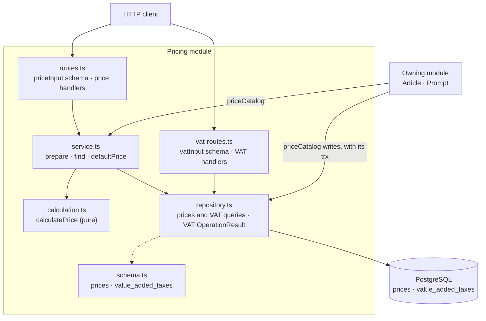

# The Pricing package

This guide explains the TypeScript code in
[`backend/src/modules/pricing`](../../../../backend/src/modules/pricing).
The module has two halves: **prices**, calculated from integer cents,
percentages, and two VAT entries, and the **VAT entries** themselves, which an
admin maintains. In the Kotlin backend they were two modules, `pricing` and
`vat`; the port merged them (see [What the port changed](#what-the-port-changed)).

## What this package does

- calculates a Price without saving it, and builds a default Price for a new
  form;
- owns the `prices` table for every module that owns a Price (Article and
  Prompt), through the `priceCatalog` capability: prepare, store, replace,
  delete, and a batched read;
- carries an optional **discount** on a Price (see [The discount](#the-discount));
- admin endpoints for listing, creating, reading, updating, and deleting VAT
  entries; and
- validation of both request bodies with Zod.

Only calculation inputs and VAT ids are stored. Net, tax, gross, and the
calculated percentages are derived every time a Price is read, so a later VAT
name or percent change changes the next answer. Prices are not historical
snapshots.

Application-wide authentication, the error answers, and the database startup
stay in the platform.

## The five-minute mental model



- Money is integer cents in a plain `number`; percentages are `number`s with at
  most two decimals. The arithmetic scales to integers before it divides, so it
  rounds exactly like the Kotlin `BigDecimal … HALF_UP` code did (see
  [Money without a decimal library](#money-without-a-decimal-library)).
- `calculatePrice` is pure: purchase price, then purchase cost, then the
  purchase total, then sales, then the discount, with half-up rounding and `0`
  for a zero base.
- On the sales side an unqualified name is the **effective** value, what the
  customer pays, and a `regular*` name is the value **before** the discount.
  `salesTotal` is therefore always the amount to charge.
- The Zod schema `priceInput` owns the field rules, once. `prepare` owns the
  rules that need the database or the calculation: the VAT entries must exist,
  the regular total must not be negative, and a discount must fit the price.
- `priceCatalog` splits `prepare` (no transaction, no write) from the three
  writes, which take the caller's Kysely transaction as their first parameter,
  so an Article and its Price commit or roll back together.
- Only this module touches `prices` and `value_added_taxes`. The VAT lookup a
  calculation needs is an internal repository function, not a capability.

## File map

```text
pricing/
|- index.ts             createPricingModule({ db }) → { routes, priceCatalog }; priceInput; the value types
|- calculation.ts       calculatePrice; PriceInput, CalculatedPrice, PriceAmount, PriceDiscount, the enums
|- routes.ts            priceInput schema, PRICE_RESPONSES, priceRoutes(prices)
|- vat-routes.ts        vatInput schema, VAT_RESPONSES, VAT_DELETE_RESPONSES, vatRoutes(vats)
|- service.ts           createPriceService(repository): prepare, find, defaultPrice
|- repository.ts        createPricingRepository(db); Vat, VatInput
|- schema.ts            PricesTable, ValueAddedTaxesTable, merged into the platform's Tables
|- calculation.test.ts  the calculation table: the oracle ported from PriceCalculatorTest
|- routes.test.ts       one happy path per route and the module-specific errors
|- service.test.ts      prepare, find, the default, the transaction proof, VAT conflicts and concurrency
`- validation.test.ts   both schemas' field names and messages
```

`calculation.ts` is a concern of its own, named after the concept, because the
calculation is the largest piece of the module and the only one that is pure.
It owns the price value types, because it produces `CalculatedPrice` and
consumes `PriceInput`. `Vat` lives in `repository.ts`, because the repository
produces it. The VAT entries have no service: `vatRoutes` takes the
repository and calls `listVats`, `getVat`, `createVat`, `updateVat`, and
`deleteVat`, which answer `OperationResult` themselves.

The composition root creates the module once, mounts its routes, and hands the
capability to the price owners:

```ts
const pricing = createPricingModule({ db })
app.route('/', pricing.routes)
// later: createArticleModule({ db, …, prices: pricing.priceCatalog })
//        createPromptModule({ db, …, prices: pricing.priceCatalog })
```

## HTTP API

Every route requires an authenticated admin. `POST`, `PUT`, and `DELETE` also
require the `X-XSRF-TOKEN` header. The admin protection is installed on the
whole `/api/admin/prices` and `/api/admin/vat` subtrees.

### Prices

| Method and path | Success | Persistence |
| --- | --- | --- |
| `POST /api/admin/prices/calculate` | `200` with a `CalculatedPrice`, `id: null` | none |
| `GET /api/admin/prices/default` | `200` with a `CalculatedPrice`, `id: null` | none |

| Result or failure | HTTP status | `message` |
| --- | --- | --- |
| invalid price input, unknown VAT, a negative total, a discount that does not fit | `400` | `Validation failed`, with the field-error map |
| no VAT entry exists (default only) | `400` | `No VAT is configured`, with `errors: {}` |

The default endpoint prefers the VAT marked as default. If none is marked, it
uses the VAT with the smallest id. Every other input is zero, the modes are
`NET` for purchase and `GROSS` for sales, the active rows `COST` and `TOTAL`,
and there is no discount.

### VAT entries

| Method and path | Success |
| --- | --- |
| `GET /api/admin/vat` | `200` with a direct array, ordered by name, then id |
| `GET /api/admin/vat/{id}` | `200` with one `Vat` |
| `POST /api/admin/vat` | `201` with the `Vat` and `Location: /api/admin/vat/{id}` |
| `PUT /api/admin/vat/{id}` | `200` with the updated `Vat` |
| `DELETE /api/admin/vat/{id}` | `204` with no body |

| Result or failure | HTTP status | `message` |
| --- | --- | --- |
| `notFound` | `404` | `VAT not found` |
| `conflict` on create or update (a duplicate name, a concurrent second default) | `409` | `VAT entry already exists` |
| `conflict` on delete (a price references the entry) | `409` | `VAT is in use` |
| invalid VAT input | `400` | `Validation failed`, with the field-error map |
| invalid VAT id | `400` | `Invalid VAT id` |

The `Vat` JSON is:

```json
{ "id": 1, "name": "Standard", "percent": 19, "description": "German standard rate", "isDefault": true }
```

## The two request bodies

### `priceInput`

The schema lives in `routes.ts` and is exported from `index.ts`, because a
module that owns a Price embeds it in its own request (`price: priceInput`).
Zod then reports a nested field under its path, `price.purchaseVatId`, which is
what the Kotlin article code built by hand.

| Field | Default | Rule (checked only while the row is active) | Message |
| --- | --- | --- | --- |
| `purchaseVatId`, `salesVatId` | — | a positive integer; missing, `null`, or not an integer counts as missing | `Purchase VAT id is required`, `Sales VAT id is required` |
| `purchaseCalculationMode`, `salesCalculationMode` | `NET`, `GROSS` | `NET` or `GROSS` | Zod's option message |
| `purchaseActiveRow` | `COST` | `COST` or `COST_PERCENT` | Zod's option message |
| `salesActiveRow` | `TOTAL` | `MARGIN`, `MARGIN_PERCENT`, or `TOTAL` | Zod's option message |
| `purchasePriceInputCents` | `0` | not negative (always active) | `Purchase price input must not be negative` |
| `purchaseCostInputCents` | `0` | not negative | `Purchase cost input must not be negative` |
| `purchaseCostPercent` | `0` | not negative; two decimals; at most `9999.99` | `… must not be negative`, `… must have at most two decimal places`, `… must not exceed 9999.99` |
| `salesMarginPercent` | `0` | two decimals; from `-9999.99` to `9999.99` | `… must have at most two decimal places`, `… must be between -9999.99 and 9999.99` |
| `salesTotalInputCents` | `0` | not negative | `Sales total input must not be negative` |
| `salesMarginInputCents` | `0` | none: a negative margin is valid | — |

Every cent field is a 32-bit integer, the range of the `*_cents integer`
columns. A value such as `12.340` is accepted, because JSON parses it to the
same number as `12.34`.

The discount pair has its own rules:

| Input | Field | Message |
| --- | --- | --- |
| both fields absent or `null` | – | no error, no discount |
| type without value | `discountValue` | `Discount value is required` |
| value without type | `discountType` | `Discount type is required` |
| unknown type | `discountType` | `Discount type must be PERCENTAGE or FIXED_AMOUNT` |
| value `<= 0` | `discountValue` | `Discount value must be positive` |
| percentage `> 100` | `discountValue` | `Discount value must be at most 100 for a percentage discount` |
| percentage with three decimals | `discountValue` | `Discount value must have at most two decimal places` |
| fixed amount with a fractional part | `discountValue` | `Discount value must be whole cents for a fixed amount discount` |

`discountType` is parsed as a plain string and narrowed to the union only after
the rules have run, so an unknown value is a field error with its own message,
not Zod's option message. The field rules live in one `superRefine`, which
runs once every field has the right JSON type; it reports all the rule
failures of a body at once, in the order of the table.

### `vatInput`

| Field | Rule | Message | Normalization |
| --- | --- | --- | --- |
| `name` | required after trimming | `Name is required` | trimmed |
| `name` | at most 255 characters | `Name must be at most 255 characters` | |
| `percent` | required, an integer | `Percent is required` | |
| `percent` | from 0 through 100 | `Percent must be between 0 and 100` | |
| `description` | optional, may be `null` | | trimmed; blank becomes `null` |
| `isDefault` | optional | | defaults to `false` |

An unknown property answers `Unknown property` under its name; see
[Request validation](../conventions/request-validation.md).

## How a calculation works

`PriceAmount` contains `net`, `tax`, and `gross`, and `net + tax == gross`
always holds. `NET` means a submitted value excludes VAT; `GROSS` means it
includes it. `calculatePrice(id, input, purchaseVat, salesVat)` works in this
order:

1. calculate the purchase price with the purchase VAT;
2. calculate the purchase cost from a fixed amount (`COST`) or a percentage of
   the purchase price (`COST_PERCENT`);
3. add the net, tax, and gross components separately to form the purchase
   total;
4. calculate sales from a fixed margin (`MARGIN`), a percentage margin
   (`MARGIN_PERCENT`), or the final total (`TOTAL`), against the purchase total
   in the sales mode;
5. apply the discount, if the price has one; and
6. return every input and every derived value.

`CalculatedPrice` carries the complete current `Vat` for purchase and sales,
so its JSON includes each VAT's `description` and `isDefault`. Calculated
percentages have two decimals; a zero base answers `0` instead of dividing by
zero. A negative margin is allowed while the regular sales total stays
non-negative.

Inactive inputs are not validated. `prepare` replaces them with zero before it
calculates, so selecting `COST_PERCENT` stores `purchaseCostInputCents` as `0`,
and the same price always produces the same row.

### Money without a decimal library

The Kotlin calculator used `BigDecimal` with `RoundingMode.HALF_UP`. The port
uses the two helpers of [`money.ts`](../../../../backend/src/platform/money.ts)
and scales to integers before every division, so a quotient that is exactly
half a cent is exact in floating point and rounds away from zero:

| Step | Formula |
| --- | --- |
| tax of a net amount, a percentage of an amount, the percentage saving | `percentOfCents(cents, percent)`: `roundHalfUp(cents × percent·100 / 10 000)` |
| net of a gross amount | `roundHalfUp(gross × 100 / (100 + vat))` |
| a calculated percentage | `roundHalfUp(amount × 10 000 / base) / 100` |

The ported table tests in `calculation.test.ts` are the oracle: they assert the
Kotlin results cent for cent, the midpoint cases included.

Every cent value is checked against the 32-bit range of the `*_cents` columns
where the Kotlin code used `Math.addExact` and `intValueExact`. A result
outside it throws a `RangeError`, which reaches the app's `onError` as a `500`,
as the Kotlin `ArithmeticException` did.

`numeric` columns (`purchase_cost_percent`, `sales_margin_percent`,
`discount_value`) arrive from `pg` as strings; `findPrices` parses them with
`Number` once. The JSON answers plain numbers, so a stored `20.00` answers `20`
where Kotlin wrote `20.00`; a JSON client reads both as the same number.

## The discount

A shop owner discounts a single article or prompt by giving its Price a
discount: the pair `discountType` (`PERCENTAGE` or `FIXED_AMOUNT`) and a
positive `discountValue`. Both absent means "no discount"; `0` is not a
discount, it is an invalid value.

A discount is **not** a coupon. A coupon (the Promotion module) is a
cart-level campaign with a code, a time window, and usage limits, and it is
capped when it exceeds the cart. A price discount has none of that: it is
switched on by setting the pair and off by clearing it, and a fixed amount
larger than the price is *rejected* on write. Pricing therefore owns its own
`PriceDiscountType`.

### The naming rule

| Field | Meaning |
| --- | --- |
| `regularSalesTotal` | the configured price, before the discount |
| `salesDiscount` | what the customer saves |
| `salesTotal` | what the customer pays |
| `regularSalesMargin`, `calculatedRegularSalesMarginPercent` | margin before the discount |
| `salesMargin`, `calculatedSalesMarginPercent` | margin after the discount |

Without a discount both are equal, `discount` is `null`, and `salesDiscount` is
`{ "net": 0, "tax": 0, "gross": 0 }`. Every consumer that charges money reads
`salesTotal`, so it charges the discounted price without any change. A
forgotten caller can undercharge, never overcharge.

### How the saving is calculated

1. `saving` is `regularSalesTotal.gross × percent / 100`, rounded half up, or
   the fixed number of cents, **capped at `regularSalesTotal.gross`**;
2. the effective gross is `regularSalesTotal.gross − saving`; its net and tax
   come from the same gross-mode arithmetic every other amount uses;
3. `salesDiscount` is the component-wise difference of the two totals, so
   `salesDiscount + salesTotal == regularSalesTotal` for net, tax, and gross;
   and
4. the effective margin is derived from the effective total against the
   purchase total, exactly as the `TOTAL` row derives the regular one.

A discount of `100` is allowed; the price is then `0`, which the checkout
confirms without a payment. The cap in step 1 only ever bites on a fixed
amount: `prepare` rejects one larger than the price on write, but a price is
recalculated on every read, and a later VAT change can shrink the regular gross
below it. The article then sells for `0` until the operator adjusts the
discount. The shop never charges a negative amount.

### The write rules after the calculation

Two discount rules depend on the sales VAT and the active sales row, so
`prepare` checks them on the calculated price and reports them on
`discountValue`:

- a fixed amount larger than the regular gross:
  `Discount must not exceed the sales total` (the *submitted* amount is
  compared, because the calculator caps the saving; this also keeps an amount
  beyond the cent range a field error); and
- a saving that rounds to `0` cents, for example `0.01 %` of `4.99 €`:
  `Discount must reduce the sales total`.

A separate guard rejects a negative `regularSalesTotal` with
`Sales total must not be negative`, reported on the active sales input
(`salesMarginInputCents`, `salesMarginPercent`, or `salesTotalInputCents`). It
watches the regular total, because a discount may legitimately take the
effective total to `0`.

These are *write* rules. `find` recalculates but never re-validates: a stored
price a later VAT change put out of their reach still answers what it costs
today.

### The storefront fields

`PublicMug.regularPrice`, `PublicSpodArticle.regularPrice`, and
`PromptPrice.regularSalesTotalGross` are `null` unless the price has a
discount, and the key is always present in the JSON. `regularPrice === null`
is the reliable test for "not discounted".

### The reference price is the operator's responsibility

The crossed-out price the shop shows is the configured regular price. The
backend does not track the lowest price of the previous 30 days and therefore
does not enforce the German Preisangabenverordnung (§ 11 PAngV). The operator
decides which regular price is lawful to advertise, and the admin discount card
says so. An automated price history is a follow-up (issue #239).

Why (issue #238, decided by Joe): § 11 PAngV requires a shop that announces a
price reduction to state the **lowest price applied within the previous 30
days**, and this shop cannot know it. A `prices` row holds the current inputs
and an update overwrites them, and net, tax, and gross are derived from the VAT
entries on every read, so a history rebuilt from today's rows would be a
reconstruction, not a record. A wrong reference price is the exact failure the
rule is about, so no column, field, or view claims to know a 30-day low.

Two alternatives were rejected. **Building the price history now** needs a
write on every price change, a rule for what a VAT change means for a
historical amount, a backfill, and an admin view: a feature of its own.
**Calculating the discount but never highlighting it** avoids the rule, but the
crossed-out amount and the saving badge *are* the requirement.

The consequence is accepted on purpose while one owner sets the prices
personally. It stops being fine as soon as discounts are used on many articles
or by more than one operator, which makes #239 a **prerequisite** for that
step.

## The `priceCatalog` capability

Most prices belong to an Article or a Prompt, which must create, change, and
delete itself and its Price together: a failed Article write must not leave a
stray price row. `createPricingModule` returns the capability as
`priceCatalog`:

```ts
prepare: (input: PriceInput) => Promise<OperationResult<CalculatedPrice>>
storeInTransaction: (trx: Transaction<Tables>, price: CalculatedPrice) => Promise<number>
replaceInTransaction: (trx: Transaction<Tables>, id: number, price: CalculatedPrice) => Promise<boolean>
deleteInTransaction: (trx: Transaction<Tables>, id: number) => Promise<boolean>
find: (ids: Iterable<number>) => Promise<Map<number, CalculatedPrice>>
```

| Operation | Transaction |
| --- | --- |
| `prepare` | none; it never touches `prices` |
| `storeInTransaction` | the caller's; answers the new id |
| `replaceInTransaction` | the caller's; whether the price existed |
| `deleteInTransaction` | the caller's; whether the price existed |
| `find` | two short read-only transactions of its own |

`prepare` does the slow part: it resolves both VAT entries in one lookup,
zeroes the inactive inputs, calculates, and applies the write rules. It answers
`invalid` with `purchaseVatId: ["Purchase VAT not found"]`,
`salesVatId: ["Sales VAT not found"]`, or one of the rules above. It does not
repeat the field rules: the owner's request schema embeds `priceInput`, so the
value is already valid. Because `prepare` stores nothing, the owner runs it
*before* opening its transaction and keeps that transaction as short as the
writes. `priceCatalog.prepare` reports its field errors under `price.`
(`price.salesVatId`), the path at which every owner embeds `priceInput`, so an
owner passes an `invalid` answer on unchanged. Only `POST
/api/admin/prices/calculate`, which takes a bare `priceInput`, answers the
unprefixed field names.

The three writes take the owner's `Transaction<Tables>` and run on it. They
never open a transaction of their own, so they commit and roll back with the
owner. The store and the replace first lock the price's two VAT entries
(`SELECT id FROM value_added_taxes WHERE id IN (…) FOR KEY SHARE`) until the
owner's transaction ends: a VAT delete that races the write waits for it and
then fails as in use. An entry that was deleted between `prepare` and the write
is no longer there to lock; the write then throws a plain error (a `500`),
never the foreign-key violation `23503`. That keeps the owner's foreign-key
mapping unambiguous: the prompt maps `23503` around its whole transaction to
"unknown slot variant", and a price insert failing on a VAT must not reach that
mapping. Pass them only a value `prepare` produced: they write exactly
the inputs of the `CalculatedPrice`, through one column mapping (`priceRow`).
An update rewrites the row in place, so the id an owner stores never changes.
The owner deletes its own row first, because the referencing foreign key is
restricted.

`find(ids)` is the read side for list pages: one query for the prices and one
for every VAT they reference; unknown ids are absent from the map.

Price ownership needs no `owner_kind` column: an id only exists after
`storeInTransaction` handed it to its owner, and no owner contract accepts a
price id from a client.

## VAT entries and the single default

At most one entry is the default; having none is valid. Updating the default
with `isDefault: false` or deleting it does not choose another one.

A create or update with `isDefault: true` clears the current default and writes
the row in one `write` transaction. The partial unique index
`ux_value_added_taxes_single_default` is the concurrency-safe guarantee: two
concurrent default writes leave exactly one default: the second waits for the
first to commit and then fails with `23505`, answered as the generic `409`. An update
first locks its row (`SELECT … FOR UPDATE`) and answers `notFound` before it
demotes anything, so an unknown id never clears the default.

PostgreSQL decides every conflict, as
[Persistence error handling](../conventions/persistence-error-handling.md)
describes. `createVat` and `updateVat` declare `uniqueViolation: conflict`:
the case-sensitive `ux_value_added_taxes_name` and the single-default index
both become the same conflict, without asking which one fired. `deleteVat`
declares `foreignKeyViolation: conflict` and runs its single `DELETE` on `db`: both foreign keys from `prices` are
`ON DELETE RESTRICT`, and either one means the same thing, "a price still uses
this entry", so the result is unambiguous. The route answers it as
`409 VAT is in use`.

## Persistence

`schema.ts` maps two tables and merges them into the platform's `Tables`:

- `value_added_taxes` from
  [`V2__create_value_added_taxes.sql`](../../../../backend/migrations/V2__create_value_added_taxes.sql):
  `percent` checked from 0 to 100, the unique name, and the partial unique
  default index.
- `prices` from
  [`V4__create_prices.sql`](../../../../backend/migrations/V4__create_prices.sql)
  and [`V28__price_discounts.sql`](../../../../backend/migrations/V28__price_discounts.sql):
  the inputs, two restricted foreign keys to `value_added_taxes` with an index
  each, checks for every enum string and the four non-negative inputs, and the
  discount pair with five checks (`ck_prices_discount_pair`,
  `ck_prices_discount_type`, `ck_prices_discount_value_positive`,
  `ck_prices_discount_percentage_max`, `ck_prices_discount_fixed_whole_cents`)
  that repeat the input rules the database can express.

The text columns are typed as the unions their check constraints allow, so a
row read back is already a `PriceInput` apart from the parsed `numeric`s.
Other modules reference `prices.id` from their own tables (articles, prompts)
but never query `prices`; they ask `priceCatalog`.

## What the port changed

- **#252: VAT is part of Pricing.** The Kotlin `vat` module exported
  `VatReader`; one module owns both tables now, so the lookup is the
  repository's `findVats`. The routes did not change.
- **#251 point 6: the unused price CRUD is gone** (`POST /api/admin/prices`,
  `GET` and `PUT /api/admin/prices/{id}`, and `Price not found`); every Price
  is written through `priceCatalog`.
- **The transaction is a parameter.** Kotlin made the writes non-`suspend` and
  checked at runtime that an Exposed transaction was open. Here the writes take
  the `Transaction<Tables>`, so calling one outside a transaction does not
  compile.
- **Wrong JSON types are field errors.** Kotlin answered a wrong JSON type
  (`"NET"` misspelled, `"12.34"` as a string, a fractional cent value) with
  `400 Invalid request body`. Zod reports it under the field, and an unknown
  property is rejected (`z.strictObject`). A wrong-typed VAT id, `name`, or
  VAT `percent` answers its required message, as `null` did before.

## Tests

Run from `backend/`:

```sh
bun test src/modules/pricing    # this module only
bun run check                   # the full gate
```

| Test | What it states |
| --- | --- |
| [`calculation.test.ts`](../../../../backend/src/modules/pricing/calculation.test.ts) | The Kotlin `PriceCalculatorTest` table as unit tests of `calculatePrice`: both modes, every active row, negative margins, zero bases, midpoint rounding, the discount arithmetic, the cap, and the 32-bit bound |
| [`validation.test.ts`](../../../../backend/src/modules/pricing/validation.test.ts) | `priceInput` (defaults, active-row rules, percentage precision and range, the discount pair) and `vatInput` (messages and normalization) through `validationFailed` |
| [`service.test.ts`](../../../../backend/src/modules/pricing/service.test.ts) | `prepare` (zeroed inactive inputs, unknown VATs, the write rules), `find` after a VAT change and with a capped discount, the default selection, the proof that the three writes join the caller's transaction (a failing outer transaction leaves no stored, replaced, or deleted price), VAT ordering, the moving default, a duplicate name normally and concurrently, concurrent defaults, and the in-use delete |
| [`routes.test.ts`](../../../../backend/src/modules/pricing/routes.test.ts) | One happy path per route, `400 No VAT is configured`, an unknown VAT on calculate, VAT `404`, `409 VAT entry already exists`, and `409 VAT is in use` |

The platform cases (`401`/`403`, CSRF, malformed ids and bodies, unknown
properties through the route, the body limit) are pinned once in
`src/platform/**/*.test.ts` and are not repeated here.

## Safe change recipes

### Add a calculation input

1. Add a migration with the column and its check.
2. Add the column to `PricesTable`, the field to `PriceInput` and
   `CalculatedPrice`, and map it in `findPrices` and `priceRow`.
3. Add it to `priceInput` with its default and rule, and to `defaultPrice`.
4. Use it in `calculatePrice`; add table rows to `calculation.test.ts` first.
5. Extend this guide, then run `bun run check`.

### Add a VAT field

1. Add a migration, the column to `ValueAddedTaxesTable`, the field to `Vat`,
   `vatColumns`, and `vatRow`.
2. Add it to `vatInput` with its message and normalization.
3. Extend the tests and this guide.
