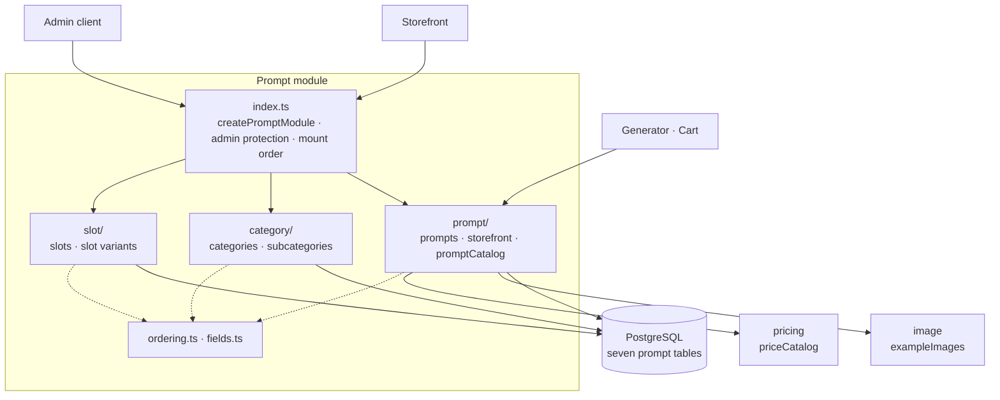

# The Prompt package

This guide explains the TypeScript code in
[`backend/src/modules/prompt`](../../../../backend/src/modules/prompt):
the generation prompts, that is the texts the image generator builds its request
from, the category structure that orders them for the storefront, and the
**slots** a prompt is composed of.

## What this package does

The package owns the admin side of the prompt catalog and the storefront read
of it. Behind `/api/admin/prompts` it manages slots and slot variants, prompt
categories and subcategories, and the prompts themselves together with the
price each prompt owns, its example image, and its position in the display
order. `GET /api/prompts` lists the visible prompts anonymously and never
carries the prompt text. To other modules it exports one capability,
`promptCatalog`, which answers the composed generation text and the effective
gross sales price of a prompt.

All seven tables come from one migration,
[`V14__create_prompts.sql`](../../../../backend/migrations/V14__create_prompts.sql).

## The five-minute mental model

- A prompt is a base text plus chosen slot variants. The composed generation
  text is the prompt's own text followed by the text of every mapped variant,
  ordered by the database and trimmed on read, while the stored prompt text
  keeps its whitespace verbatim.
- Five admin route groups sit behind one admin protection; `GET /api/prompts`
  is the one anonymous route and never carries `promptText`.
- A prompt owns exactly one price row of the pricing module: `prepare` runs
  before the transaction, the write inside it, so a rejected price never creates
  a prompt and a failed prompt never leaves a price row behind.
- Positions are decided under a lock on an anchor row in `prompt_ordering`:
  slots only append, categories and prompts also reorder with a dense rewrite,
  subcategory positions count per category with the category row as anchor.
- A failed write is recognized by its SQL state, never by a constraint name.
- Prompts are never deleted, only archived, and the reorder is the one prompt
  write that can answer `409`.
- `promptCatalog` ignores the category `active` flags, so a prompt in a
  deactivated category disappears from the storefront while staying generatable
  and buyable by id.



## File map

```text
prompt/
|- index.ts              createPromptModule({ db, priceCatalog, exampleImages }) → { routes, promptCatalog, imageReferences };
|                        the admin sub-app with requireAdmin and the mount order; the example-image folder
|- schema.ts             the seven table interfaces, merged into the platform's Tables
|- fields.ts             Zod fragments every request schema shares: requiredName, optionalText, reorderInput
|- ordering.ts           lockSequence (the three anchors), lockCategories (ascending ids), moved (find,
|                        density check, move), rewritePositions (the dense single-phase rewrite)
|- slot/
|  |- routes.ts          slotInput, slotVariantInput, slotVariantUpdate; slotRoutes, slotVariantRoutes
|  `- repository.ts      createPromptSlotRepository; PromptSlot, PromptSlotVariant, SlotVariantInput;
|                        the slotId field error
|- category/
|  |- routes.ts          categoryInput, subcategoryInput; categoryRoutes, subcategoryRoutes
|  `- repository.ts      createPromptCategoryRepository; PromptCategory, PromptSubcategory; the two
|                        categoryId field errors; the retry when a subcategory moved between its
|                        read and its lock
|- prompt/
|  |- routes.ts          promptInput; promptAdminRoutes (incl. the example-image pre-upload), publicPromptRoutes
|  |- service.ts         createPromptService (admin lifecycle, storefront read), createPromptCatalog;
|  |                     PromptInput, Prompt, PromptListItem, PromptPrice, PublicPrompt
|  `- repository.ts      createPromptRepository(db, priceCatalog): the writes with their price, the reorder,
|                        the storefront read (prompt_text never selected), the two catalog reads
|- validation.test.ts    every request schema
|- slot.test.ts          the slot and slot-variant routes
|- category.test.ts      the category and subcategory routes and their ordering rules
|- prompt.test.ts        the prompt admin routes, price atomicity, reorder, example images
`- storefront.test.ts    GET /api/prompts and promptCatalog
```

The three sub-folders group the files by concern; each keeps the module shape
of [Source file organization](../conventions/source-file-organization.md).
Only `prompt/` has a `service.ts`, because only the prompts join other
modules (the price and the example images); the slot and category routes take
their repository, which answers `OperationResult` itself. The three files at the top are
shared by more than one sub-folder. Nothing but `index.ts` is importable from
another module.

## Composition

```ts
const pricing = createPricingModule({ db })
const images = createImageModule({ settings: settings.image, guestTokens: auth.guestTokens })
const prompts = createPromptModule({
  db,
  priceCatalog: pricing.priceCatalog,
  exampleImages: images.exampleImages,
})
app.route('/', prompts.routes)
// later: createGeneratorModule({ …, composedText: prompts.promptCatalog.composedText })
//        createCartModule({ …, promptPrices: prompts.promptCatalog.findSalesGrossPriceCents })
```

`exampleImages` is the image module's factory `(folder, logger) => ExampleImages`.
The prompt module calls it once with its own folder, `prompt-example-images`,
and its own logger (`prompt`), so the folder name stays in this module and a
failed cleanup is logged under its name.

The exported surface of `index.ts`:

| Export | What it is |
| --- | --- |
| `createPromptModule({ db, priceCatalog, exampleImages })` | the factory |
| `.routes` | `GET /api/prompts` and the admin tree under `/api/admin/prompts` |
| `.promptCatalog.composedText(promptId)` | `Promise<string \| null>` |
| `.promptCatalog.findSalesGrossPriceCents(promptIds)` | `Promise<Map<number, number>>`, takes any `Iterable<number>` |
| types | `PromptModule`, `PromptCatalog` |

`index.ts` installs `requireAdmin` once on the admin sub-app and mounts the four
sub-path groups (`/slots`, `/slot-variants`, `/categories`, `/subcategories`)
**before** the prompts themselves: Hono runs matching handlers in registration
order, and `GET /:id` of the prompts would otherwise answer
`/api/admin/prompts/categories` with `400 Invalid prompt id`. For the same
reason every `PUT /order` is registered before its group's `PUT /:id`.

## HTTP API

The five admin route groups answer with bare JSON arrays and `201 Created` plus
a relative `Location` header; the four groups that have a delete answer it with
`204 No Content`. The prompts themselves have no delete route at all; see
[The prompt routes](#the-prompt-routes).

| Route | Operations | Answer |
| --- | --- | --- |
| `/api/admin/prompts/slots` | list, get, create, update, delete | `{id, name, position, variantCount}` in `(position, id)` order |
| `/api/admin/prompts/slot-variants` | list, get, create, update, delete | `{id, slotId, slotName, name, prompt, description, llm, assignedPromptCount}` in slot order, then by name |
| `/api/admin/prompts/categories` | + reorder (`PUT /order`) | `{id, name, position, active}` in `(position, id)` order |
| `/api/admin/prompts/subcategories` | + reorder (`PUT /order`) | `{id, categoryId, name, description, position, active}` in category order, then own position |
| `/api/admin/prompts` | list, get, create, update, reorder (`PUT /order`), example-image pre-upload | list rows and the full prompt, both flat, in `(position, id)` order |
| `/api/prompts?categoryId=` (anonymous) | list | the visible prompts with nested category objects and no prompt text, in `(position, id)` order |

All three reorder routes take the same body, `{"sourceId": 42, "targetId": 8}`,
and answer with the complete new order. The categories and the prompts answer
with all of them, the subcategories with the affected category's list, because
their positions count per category and no other category can have moved. An id
the stored order does not contain is a `404`.

The subcategory relationship is flat on both sides: the request carries
`categoryId` and so does the answer.

| Route group | `404` | `400` for a malformed id |
| --- | --- | --- |
| slots | `Prompt slot not found` | `Invalid prompt slot id` |
| slot variants | `Prompt slot variant not found` | `Invalid prompt slot variant id` |
| categories | `Prompt category not found` | `Invalid prompt category id` |
| subcategories | `Prompt subcategory not found` | `Invalid prompt subcategory id` |
| prompts | `Prompt not found` | `Invalid prompt id` |

Each route can be rejected with `409` for exactly one reason, so the message is
stable per route instead of an error code inside the body:

| Route | `409` message |
| --- | --- |
| slot create, update | `Prompt slot name already exists` |
| slot delete | `Prompt slot is used by slot variants and cannot be deleted` |
| variant create, update | `Prompt slot variant name already exists` |
| variant delete | `Prompt slot variant is used by prompts and cannot be deleted` |
| category create, update | `Prompt category name already exists` |
| category delete | `Prompt category is used by subcategories or prompts and cannot be deleted` |
| category reorder | `Prompt category order changed concurrently, please retry` |
| subcategory create, update | `Prompt subcategory name already exists in this prompt category` |
| subcategory delete | `Prompt subcategory is used by prompts and cannot be deleted` |
| subcategory reorder | `Prompt subcategory order changed concurrently, please retry` |
| prompt reorder | `Prompt order changed concurrently, please retry` |

A reference the body names that does not exist is **not** a conflict but a
field error, `400 Validation failed`:

| Write | Field | Message |
| --- | --- | --- |
| variant create | `slotId` | `Prompt slot does not exist` |
| subcategory create, update | `categoryId` | `Prompt category does not exist` |
| subcategory update that moves a subcategory prompts use | `categoryId` | `Prompt subcategory is used by prompts and cannot be moved to another category` |
| prompt create, update | `categoryId` | `Prompt category does not exist` |
| prompt create, update | `subcategoryId` | `Prompt subcategory does not exist in this prompt category` |
| prompt create, update | `slotVariantIds` | `One or more prompt slot variants do not exist` |
| prompt create, update | `price.<field>` | the pricing module's message, e.g. `price.salesVatId: Sales VAT not found` |
| prompt create, update | `exampleImageFilename` | `Example image filename must be the name of an uploaded image`, `Example image does not exist` |

## The request bodies

Every schema is a `z.strictObject` in the `routes.ts` of its sub-folder, so an
unknown property answers `Unknown property` under its name. The messages are
those of the Kotlin `validate()` methods.

| Schema | Fields |
| --- | --- |
| `slotInput` | `name`: required, at most 255 characters, trimmed |
| `slotVariantInput` | `slotId`: required, positive; plus the fields of `slotVariantUpdate` |
| `slotVariantUpdate` | `name` (255) and `prompt` (10,000): required, trimmed; `description` (1000) and `llm` (255): optional, blank means `null`. No `slotId` |
| `categoryInput` | `name`: required, at most 200 characters; `active`: default `true` |
| `subcategoryInput` | `categoryId`: required, positive; `name` (200); `description` (1000), optional; `active`: default `true` |
| `reorderInput` | `sourceId`, `targetId`: required, positive, different (`TargetId must be different from SourceId`) |
| `promptInput` | see below |

`promptInput`:

| Field | Rule | Normalization |
| --- | --- | --- |
| `title` | required, at most 255 characters | trimmed |
| `promptText` | required: not blank | **none**: stored verbatim |
| `categoryId` | required, positive | |
| `subcategoryId` | optional, positive | missing means `null` |
| `slotVariantIds` | required, may be empty, every id positive | duplicates removed |
| `exampleImageFilename`, `llm` | optional, at most 255 characters | trimmed, blank means `null` |
| `active`, `archived` | optional booleans | default `false` |
| `price` | required (`Price is required`), then the pricing module's `priceInput` | its errors are reported as `price.<field>` |

The shared fragments (`requiredName`, `optionalText`, `reorderInput`) live in
[`fields.ts`](../../../../backend/src/modules/prompt/fields.ts).

## What a slot is

A prompt is not one block of text. It is a base text plus a choice per slot:

```text
prompt "Watercolor portrait"
  slot "Background"  -> variant "Meadow"     -> "in a meadow"
  slot "Style"       -> variant "Watercolor" -> "in watercolor"
```

A **slot** is the question ("which background?"), a **slot variant** is one
possible answer together with the text it contributes. Two rules of that model
are unusual:

- **A variant never changes its slot.** This is why the create body and the
  update body of a variant are two schemas: `slotVariantUpdate` has no
  `slotId`, so a body that carries one is rejected as an unknown property.
- **Variant names are unique across *all* slots**, not per slot, and
  case-insensitively. A variant should exist exactly once, whatever slot it
  fills.

The mapping table's key is only `(prompt_id, slot_variant_id)`, so one prompt
may use more than one variant of the same slot.

## The prompt routes

`/api/admin/prompts` has two properties the other four route groups do not,
and both are the contract rather than an omission:

- **there is no delete route.** A prompt is retired by setting `archived`,
  because carts, orders, and generated images keep referring to it;
- **no prompt write but `PUT /order` answers `409`.** A prompt has no unique
  name, its position is decided under a lock, and every reference a client can
  get wrong is reported as a field error of the field that named it. What is
  left is the one race a client can lose without doing anything wrong, two
  admins moving prompts at the same time.

A create body and the answer to it differ in four places, and each difference
is deliberate:

```jsonc
// POST /api/admin/prompts
{ "title": "  Watercolor portrait  ", "promptText": "Paint it.\n",
  "categoryId": 3, "subcategoryId": 7, "slotVariantIds": [12, 9, 12],
  "exampleImageFilename": "6f1c….webp",
  "llm": "  gpt-image-1  ", "active": true, "archived": false,
  "price": { "purchaseVatId": 1, "salesVatId": 1, "salesTotalInputCents": 499 } }

// 201 Created, Location: /api/admin/prompts/42
{ "id": 42, "position": 8, "title": "Watercolor portrait",
  "promptText": "Paint it.\n", "categoryId": 3, "subcategoryId": 7,
  "exampleImageFilename": "6f1c….webp", "llm": "gpt-image-1", "active": true,
  "archived": false, "slotVariantIds": [9, 12],
  "price": { "id": 77, "…": "the complete calculated price" } }
```

1. `price` is a flat input going in and the complete calculated price coming
   out, under the same field name;
2. `slotVariantIds` comes back deduplicated and sorted. Repeating an id asks for
   the same thing twice, which is not a mistake to reject;
3. `title` and `llm` are stored trimmed, while `promptText` keeps its whitespace
   **verbatim**: the composed generation text trims when it reads, so the
   stored text stays what the author typed;
4. `position` is response-only.

There is no `priceId` field anywhere in the contract, and a body that sends
`position` or `priceId` is rejected. That is what makes a price belong to
exactly one prompt by construction: ids are only minted while a prompt is
written.

The list is the second representation. It carries the display names a table
needs (`categoryName`, `subcategoryName`) and only the small price projection
`{salesTotalNet, salesTotalGross, salesTotalTax, regularSalesTotalGross,
salesVatRatePercent}` instead of the twenty fields of a calculated price. Every
read resolves its prices in **one** batched `priceCatalog.find`, and a page
without a single price asks the pricing module nothing.

The three `salesTotal*` amounts are the **effective** ones: a price may carry a
discount, and they are already reduced by it. `regularSalesTotalGross` holds
the gross total *before* the discount and is non-`null` exactly when there is
one; [the pricing guide](pricing-package.md#the-storefront-fields) explains
the field.

### The reorder

`PUT /api/admin/prompts/order` moves one prompt to the place another one holds:

```jsonc
// PUT /api/admin/prompts/order
{ "sourceId": 42, "targetId": 8 }

// 200 OK: the complete new order, in the rows of the list
[ { "id": 42, "position": 8, "title": "Watercolor portrait", "…": "…" } ]
```

- **the answer is the complete new order**, not the moved prompt;
- **the rows are the list rows**, including the small price projection, so the
  admin table can replace what it shows with what it received;
- **an unknown `sourceId` or `targetId` is `404`**, because "this id does not
  exist" is not a race.

A lost race answers `409` with `Prompt order changed concurrently, please
retry`. It is retryable and nothing was written; how that is decided is
[How the position is decided](#how-the-position-is-decided).

### The example image

Uploading and saving are two requests. `POST /api/admin/prompts/example-images`
takes a multipart body with a `file` part (anything else answers `415`
through the platform's `formBody`), stores it as WebP in the public folder
`prompt-example-images` through the image module, and answers with the name:

```jsonc
// 201 Created
{ "filename": "6f1b0f34-6f0a-4a2f-9c1a-2b7f0c9d1e55.webp" }
```

The create or update that follows carries that name in `exampleImageFilename`,
which keeps both write routes plain JSON. A body without a `file` part
(`An example image file part is required`) and a part larger than 10 MiB
(`Example image must not exceed 10 MiB`) are both `400 Validation failed` with
the message on the `file` field, and so is everything the image storage itself
rejects. See [the image guide](image-package.md#upload-limits).

The rule that follows is not written in this module. It is the image module's
`ExampleImages` (see
[the example-image rule](image-package.md#the-example-image-rule)). A submitted
name is checked before the prompt is written, and a rejection is a field error
on `exampleImageFilename`:

1. it must have the shape the storage mints, a UUID with dashes and `.webp`;
2. the file must exist.

Both checks also run for a name the prompt already stores. A file is only
removed once no prompt names it, so a stored name whose file is gone means
another writer replaced it and deleted the file in between; writing that name
back would point the row at a picture that does not exist.

After a successful write, the file the prompt stopped naming is deleted, but
only when no prompt row named it at the moment the write committed:

```text
prompt A: image X            update A to no image  → X still used by B → kept
prompt B: image X            update B to no image  → nobody uses X     → deleted
```

Nothing makes a name exclusive, so the "is anybody still using it?" question is
asked inside the write's own transaction, after its statements ran. A delete
that fails is only logged and the write still answers `200`; a file that was
uploaded but never named stays behind as an accepted orphan.

## The storefront list

`GET /api/prompts` is the one route of this module a customer's browser calls.
It sits outside the admin sub-app, so anonymous access is not a rule the
handler applies but the absence of `requireAdmin` around it.

```jsonc
// GET /api/prompts?categoryId=1  →  200 OK, a bare array
[ { "id": 1, "position": 1, "title": "Watercolor portrait",
    "category":    { "id": 1, "name": "Portraits", "position": 1 },
    "subcategory": { "id": 2, "name": "Adults",    "position": 2 },
    "exampleImageFilename": "6f1b0f34-….webp", "llm": "gpt-image-1",
    // 4,99 € with 20 % off, so the customer pays 3,99 €
    "price": { "salesTotalNet": 335, "salesTotalGross": 399,
               "salesTotalTax": 64,  "regularSalesTotalGross": 499,
               "salesVatRatePercent": 19 } } ]
```

**There is no `promptText` here, and there never is.** The composed generation
text is what this shop sells. The rule is not a filter over a shared
representation but the shape of `PublicPrompt` plus a query that does not
select the column; the storefront test compares the whole document.

The two category levels are **nested objects** here while the admin contract is
flat: the admin client loads both category lists itself, while this list is the
storefront's only source for either.

Four rules decide what the answer contains:

1. **Visibility.** A prompt is listed while it is `active`, not `archived`, its
   category is active, and it either has no subcategory or an active one.
2. **Order.** `(position, id)`, always, with and without the filter. The module
   has one global prompt order, and a filtered view of it is still that order.
3. **`categoryId`.** A value that is not an integer is `400 Invalid prompt
   category id`. A number that names no category is `[]`. An absent, empty, or
   blank parameter means no filter.
4. **`price`.** The small projection, resolved in one batched
   `priceCatalog.find` and recalculated from the current VAT entries on every
   read. A prompt whose `price_id` is empty answers `"price": null`, never `0`,
   which is a price a shop may legitimately charge.

## The exported capability

`promptCatalog` answers the two questions another module asks about a prompt it
stores a reference to, and nothing else:

```ts
composedText: (promptId: number) => Promise<string | null>
findSalesGrossPriceCents: (promptIds: Iterable<number>) => Promise<Map<number, number>>
```

`composedText` is what the generator sends to the image model: the prompt's own
text followed by the text of every slot variant the prompt is mapped to,
ordered `(slot.position, slot.id, variant.name, variant.id)` and joined by a
**blank line**:

```text
Turn the photo into art.

on a beach

in watercolor
```

The database does the ordering (one query with outer joins) and the read does
the trimming. Every part is trimmed, blank variant texts drop out, and the
answer is `null` when the prompt is unknown, inactive, archived, or has a blank
text: one absent case rather than four, because a caller can do exactly one
thing about any of them.

`findSalesGrossPriceCents` is what the cart asks before it snapshots a line. A
prompt is in the answer while it is active, not archived, and linked to a price
row; every other id is **absent**, never `0`. The value is the effective gross
(`salesTotal.gross`, a discount already subtracted). The prices of the whole
batch are resolved in one `priceCatalog.find`, and an empty input is answered
without touching the database.

Both lookups deliberately **ignore the category and subcategory `active`
flags**, unlike the storefront list: a prompt in a deactivated category
disappears from the shop while staying generatable and buyable by id.
Deactivating a category hides a group from browsing; it does not break the
carts and generator jobs that already name a prompt inside it (deviation D12 of
the migration record). The queries do not join the category tables at all.

Both answers let a database error propagate: `null` would tell a generator that
a prompt has no text, and an empty map would tell a cart that its prompts cannot
be bought.

## How a prompt and its price stay one write

```ts
const price = await priceCatalog.prepare(priceInput)   // VAT lookup and calculation, no write
// …and only then the transaction:
const priceId = await priceCatalog.storeInTransaction(trx, price.value)
```

`prepare` never touches the `prices` table, so it runs *before* the transaction
and a price that does not calculate is answered without any lock being held.
The writing half, `storeInTransaction` on create and `replaceInTransaction` on
update, takes the prompt's `trx`. That is what makes the two failure directions
symmetric: a rejected price never creates a prompt, and a prompt that fails to
be written (an unknown slot variant, found after the price row was inserted)
never leaves a price row behind. `prompt.test.ts` asserts both directions by
counting the rows.

An update writes over the same price row, so the id never churns. The
`price_id` column is nullable, so a prompt without a linked price can exist; a
valid update **creates and links** a price there, while an update without a
price stays a `400`, because a prompt is something the shop sells.

## How the position is decided

Slot positions decide the display order and nothing else. A create appends
behind the highest one:

```ts
await lockSequence(trx, 'SLOT')          // queue on the SLOT anchor row
// … then read coalesce(max(position), 0) and insert at max + 1
```

Reading the maximum without the lock would race: under PostgreSQL's default
`READ COMMITTED` isolation two creates would read the same maximum. Both
writers therefore lock the same row in `prompt_ordering` first, and only the
statements *after* the lock see what the other writer committed. Slots have no
reorder route and no compaction: a deleted slot leaves its position empty.

Category positions do all three: a create appends, a delete closes the gap it
leaves, and `PUT /order` rewrites the whole sequence. They stay `1..n`, and the
reorder checks it before it writes:

```ts
await lockSequence(trx, 'CATEGORY')
const stored = await orderedCategories(trx)
const order = moved(stored, sourceId, targetId)   // notFound, conflict for a gap, or the new order
```

Refusing a gapped sequence instead of repairing it matters, because a rewrite
would move *every* row a client can see although it asked to move one. The gap
can only come from a writer that ignored the anchor, so the answer is a
retryable `409` that leaves the evidence in place.

`rewritePositions` is single-phase: it writes each row's final position
directly. Two rows briefly share a position while it runs, and PostgreSQL
allows that because the unique rule on `position` is `DEFERRABLE INITIALLY
DEFERRED` and therefore only checked at `COMMIT`.

Prompt positions work like the category positions on their own `PROMPT` anchor,
except that prompts are never deleted, so there is no compaction. The reorder
locks the prompt rows ascending by id **after** it read the order: what the
transaction decides from is the order it read, and a position another writer
committed in the meantime is what the deferred unique rule catches at
`COMMIT`. An update decides no position and takes no anchor.

Subcategory positions count **per category**: the category row *is* the anchor
of its sequence. A move to another category appends in the target and compacts
the source, so both rows are locked. A subcategory write has to read the row
before it knows which category to lock, and the row can move in between; the
attempt then answers `'retry'` and the next one starts over in a new
transaction (at most three), because taking one more lock would break the lock
order below.

Three kinds of writers lock category rows: the category writers, which hold the
`CATEGORY` anchor first; the subcategory writers, which never take an anchor;
and the prompt writes, which lock the category the prompt is written into (the
create while it holds the `PROMPT` anchor). Two rules keep them from waiting on
each other:

- **a global anchor is taken before any category row**, and
- **category rows are locked distinct, ascending by id, one statement each**
  (`lockCategories`), never in the display order a rewrite happens to need.

## How a failed write is recognized

Never by the name of a constraint, only by the SQL state, through
`executePostgresWrite` around the `write` transaction (see
[Persistence error handling](../conventions/persistence-error-handling.md)):

| Write | SQL state | Result |
| --- | --- | --- |
| slot, variant, category, subcategory create or update | `23505` | `409` name already exists |
| insert a variant | `23503` | field error `slotId` |
| delete a slot | `23503`/`23001` | `409` still in use (variants) |
| delete a variant | `23503`/`23001` | `409` still in use (prompts) |
| delete a category | `23503`/`23001` | `409` still in use (subcategories or prompts) |
| delete a subcategory | `23503`/`23001` | `409` still in use (prompts) |
| update a subcategory | `23503` | field error `categoryId`: prompts hold it in its category |
| prompt create or update | `23503` | field error `slotVariantIds` |
| any reorder | `23505` at `COMMIT` | `409` order changed concurrently |

Each foreign-key mapping is unambiguous because every other reference of the
write is ruled out first:

- a subcategory write locks its category rows, so they cannot disappear, and
  the one reference left is the composite key `prompts(subcategory_id,
  category_id)`. A missing category is a lock that found no row;
- a prompt write locks its category row and then asks whether the subcategory
  belongs to that category. The answer holds until the transaction ends,
  because every writer that deletes a subcategory or moves one in or out of a
  category locks that category row first. The price id is minted in the same
  transaction, and the price write locks its VAT entries and throws instead of
  failing on a deleted one (see the pricing guide). What is left is the slot
  variants of the mapping insert.

A create or update maps `23505` to the name conflict although the wrapper also
sees the `COMMIT`: the position it writes is decided under the anchor, so a
deferred position violation there cannot happen. Prompts have no unique name and
map no `23505` outside the reorder.

## Differences from the Kotlin module

- **Unknown properties are rejected.** A prompt body with `position` or
  `priceId`, or a variant update with `slotId`, is `400 Unknown property`; the
  Kotlin decoder ignored them. A wrong type gets a field message (`Active must
  be a boolean`) instead of a parse failure.
- **One `400` for the prompt and its price.** The Zod schema embeds
  `priceInput`, so a body with a broken title and a broken price field reports
  both at once (`title`, `price.salesVatId`); Kotlin reported the price fields
  only after the prompt fields passed.
- **The subcategory of a prompt is checked by a read under the category lock**
  instead of mapping `23503` around the `prompts` statement alone: in Kysely a
  failed statement aborts the transaction, so the port keeps one mapping
  around `write` (name conflicts included) and rules the subcategory out
  before the statement runs.
- **The oversized upload** is refused after the body arrived (the image module's
  reader), within the application-wide body limit.

## Tests

Run from `backend/`:

```sh
bun test src/modules/prompt    # this module only
bun run check                  # the full gate
```

Every test file builds the real module with the real pricing module and a real
image module on a temporary directory, and calls `testApp(module.routes)`.

| Test | What it states |
| --- | --- |
| [`validation.test.ts`](../../../../backend/src/modules/prompt/validation.test.ts) | Every request schema: messages, defaults, trimming, the verbatim prompt text, deduplication, `price.<field>` paths, the rejected `position`/`priceId`/`slotId` |
| [`slot.test.ts`](../../../../backend/src/modules/prompt/slot.test.ts) | One happy path per slot and variant route, the gapped append, case-insensitive and cross-slot duplicates, the unknown slot field error, both in-use deletes, concurrent creates appending `1..n`, and concurrent case-variant creates leaving one row and one `409` |
| [`category.test.ts`](../../../../backend/src/modules/prompt/category.test.ts) | One happy path per category and subcategory route, compaction, the reorder answers, the cross-category move, the two `categoryId` field errors, the in-use deletes, concurrent creates and case-variant races, two serialized reorders, the refused gap, a rotation committed outside the anchor that makes the reorder lose at `COMMIT`, and a category reorder next to a subcategory move |
| [`prompt.test.ts`](../../../../backend/src/modules/prompt/prompt.test.ts) | Create, list, get, update, and the absent delete; both price-atomicity directions; the three reference field errors; the price linked on update; the reorder answer, `404`, the refused gap, the lost `COMMIT`, and creates next to reorders; the pre-upload's three answers; the malformed, unknown, and vanished names; the shared file kept and the last reference deleted |
| [`storefront.test.ts`](../../../../backend/src/modules/prompt/storefront.test.ts) | The whole storefront document without `promptText`, the visibility matrix, the order with and without the filter, blank and invalid `categoryId`, `price: null`, a VAT change; `composedText` ordering (slot ids against positions), trimming, joining, the four `null` cases, the deactivated category; `findSalesGrossPriceCents` with a discount, a `0` price, the ineligible ids, and an empty input |

The platform cases (`401`/`403` on the admin tree, CSRF, malformed bodies, the
body limit) are pinned once in `src/platform/**/*.test.ts`.

## Safe change recipes

### Add a prompt field

1. If it is persisted, add a migration and the column to `PromptsTable` in
   `schema.ts`.
2. Add it to `promptColumns` and `promptRow` in `prompt/repository.ts`, to the
   list query if the table shows it, and to `publicRows` only if a customer may
   see it.
3. Add it to `PromptInput` and `promptInput`.
4. Extend `validation.test.ts`, the route tests, and this guide.

### Add a route group

1. Create the sub-folder with `routes.ts` and `repository.ts`, and a
   `service.ts` only if its use cases join another module.
2. Mount it in `index.ts` **before** `promptAdminRoutes`, so the prompts'
   `/:id` cannot answer its path.
3. A writer of category rows locks them through `lockCategories`, after any
   global anchor.
