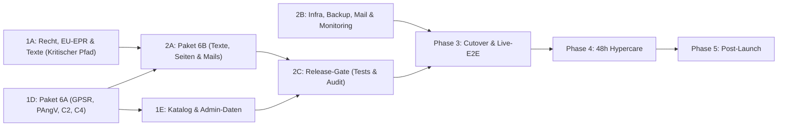

# Go-Live-Fahrplan & offene Checkliste – Voenix Shop

**Stand:** 2026-11-26  
Zentrale Arbeitsliste für alle **noch offenen** Aufgaben bis zum Go-Live (konsolidiert aus Audit, Fahrplan und offenen Arbeitspaketen; erledigte Pakete und Punkte wurden entfernt).  
*Hinweis: Rechtliche Punkte sind eine technische Einschätzung, keine Rechtsberatung.*

---

## 1. Festgezurrte Entscheidungen

| Thema | Ref. | Entscheidung |
|---|---|---|
| **Versandländer & Kosten** | `D3`, `A21`, `F3` | Start in **mehreren EU-Ländern** mit **länderspezifischen Versandkosten in `countries`** *(Code umgesetzt; EU-Werte im Admin pflegen)*. |
| **Stil-Aufpreis** | `C2` | **Aktiv** — `promptId` bis `addToCart` durchreichen ([Paket 6A](paket-6-recht-ui-mails.md)). |
| **Werbeaussagen** | `A11` | **„Made in Germany“** und **„DHL aus Deutschland“** bleiben; nur nicht existierende Produkte („Poster“, „Als Karte“) entfernen. |
| **`/royal-dog`** | `C4` | Für den Launch **vorerst ausblenden** ([Paket 6A](paket-6-recht-ui-mails.md)). |
| **Footer-Seiten** | `C1` | **Alle** Seiten (`/about`, `/faq`, `/contact`, `/support`, `/payment`, `/terms`, `/returns`) bekommen Inhalte (DE + EN). |
| **Rechnungen & Buchhaltung** | `D1` | **Externer Workflow** zum Start (Mollie → Lexoffice/sevDesk + manuelles PDF auf Anfrage im Support-SOP). |
| **Streichpreise / Rabatte** | `A19` | Zum Launch **deaktiviert** lassen, bis 30-Tage-Tiefstpreis-Historie (Issue `#239`) existiert. |

---

## 2. Offene Code-Pakete im Überblick

Jedes Paket ist für eine eigene Session (bei Bedarf in getrennten Worktrees) geschnitten:

| Paket | Schwerpunkt | Enthaltene Punkte | Workflow / Reihenfolge |
|---|---|---|---|
| **[Paket 6 (6A + 6B)](paket-6-recht-ui-mails.md)** | **6A** (sofort ohne externe Texte): PAngV, Button-Lösung, EU-GPSR, UWG, Upload-/DSGVO-Hinweise, Legal-Leiste, iubenda-Fallback, `C2`, `C4`. **6B** (nach Text-Zulieferung): Rechtsseiten, Footer-Seiten, Bestellmail. | `A1`–`A5`, `A7`–`A8`, `A10`–`A11`, `A13`–`A14`, `A16`, `A18`, `A20`–`A21`, `C1`, `C2`, `C4` | **6A** sofort; **6B** sobald alle Texte & Mollie-Zahlarten vorliegen. |

---

## 3. Phase 1 – Parallele Umsetzung

### Strang 1A: Recht, EU-EPR, externe Vorlaufzeiten & Texte *(kritischer Pfad – sofort anstoßen!)*
- [ ] **`D3` / `F3` Finale EU-Zielländer & Verpackungsrecht (EPR) + OSS:**
  - Finale EU-Zielländerliste mit Konditionen (Versandkosten, Freigrenze, Lieferzeit, Lieferbarkeit bei SPOD & Tassen-Lieferant) festlegen.
  - Nationale Verpackungspflichten **ab Paket 1** für jedes aktivierte EU-Land anmelden (u. a. **Österreich**: VerpackVO + Bevollmächtigter; **Frankreich**: CITEO / UIN / Triman; ggf. ES/IT/NL/BE/SE). *Nur Länder im Admin aktivieren, deren EPR-Registrierung zum Launch steht.*
  - **USt. / OSS:** 10.000-€-EU-Fernverkaufsschwelle überwachen bzw. vorab für OSS registrieren (mit Steuerberater / Lexoffice abstimmen).
- [ ] **`F2` Verpackungsregistrierung Deutschland (LUCID / VerpackG):** Registrierung + Duales System vor dem ersten deutschen Paket abschließen (Rollenverteilung mit SPOD und Tassen-Lieferant klären).
- [ ] **`F1` Auftragsverarbeitungsverträge (AVV / Art. 28 DSGVO) & Doku:** AVVs mit Sliplane, Sweego, **fal.ai (US-Drittlandtransfer, SCCs/DPF, Zero-Training/Retention für Kundenfotos prüfen!)**, SPOD/Spreadshirt, Tassen-Lieferant und iubenda abschließen; Verarbeitungsverzeichnis (Art. 30) & TOMs (Art. 32) dokumentieren.
- [ ] **`A1` iubenda-Policy `48736531` aktualisieren (DE + EN):** Sliplane, Mollie, Sweego, **fal.ai (Foto-Upload, US-Drittlandtransfer)**, SPOD, Tassen-Lieferant, Cookies (`voenix.auth`, `XSRF-TOKEN`, `voenix.guest`), `localStorage` und Kundenkonto aufnehmen; alte Einträge (Stripe, Tag Manager, Facebook-Pixel) entfernen; englische Policy-ID für `en`-Locale bereitstellen.
- [ ] **`A2` / `A3` / `A5` Rechtstexte & Impressumsdaten beschaffen (DE + EN):**
  - Finale **AGB** (DE + EN; korrekte Adresse/Mail, DE-/EU-Lieferzeiten, Verbrauchervorbehalt, Vertragstext-Speicherung & Vertragssprache).
  - **Widerrufsausschluss** für personalisierte Ware (§ 312g Abs. 2 Nr. 1 BGB / Art. 246a § 1 Abs. 3 Nr. 1 EGBGB, DE + EN). *(Kein §-356a-Widerrufsbutton nötig, solange ausschließlich personalisierte Ware verkauft wird.)*
  - **Telefonnummer** fürs Impressum & Mail-Footer festlegen und besetzen.
- [ ] **`C1` Redaktionelle Inhalte für Footer-Seiten verfassen (DE + EN):** Texte für `/about`, `/faq`, `/contact` und `/support`.
- [ ] **`F4` / `D1` / `D2` Kosten-, Konto- & Support-Schutznetze:**
  - **Mollie Live-KYC** abschließen und verbindliche Liste aller aktivierten Zahlarten (DE + EU) fixieren.
  - Hard-Spend-Limit + Low-Credit-Alert bei **fal.ai** setzen.
  - Externen Buchhaltungs-Workflow (**Mollie → Lexoffice/sevDesk**) einrichten.
  - **Support-Postfach** (`write-us@voenix.shop`) & Telefonnummer besetzen; kurzes **Support-SOP** festhalten (manuelle Refunds im Mollie-Dashboard, Reklamation/Neudruck, manuelle Kundenrechnungen auf Anfrage, `SPOD_QUARANTINED`, Chargebacks).
  - **BFSG-Kleinstunternehmer-Ausnahme** (<10 MA & ≤2 Mio. € Umsatz, § 3 Abs. 3 BFSG) intern dokumentieren.

### Strang 1D: Offene Code-Pakete (Phase 1)
- [ ] **[Paket 6 – Teil 6A](paket-6-recht-ui-mails.md):** `A1`-Fallback/EN, `A7`, `A8`, `A10`, `A11`-Streichungen („Poster“/„Als Karte“), `A13` (EU-GPSR), `A14`, `A18`, `A20`, `C2`, `C4`.

### Strang 1E: Katalog & Admin-Daten bereinigen
- [ ] **`A12` Stilnamen mit fremden Rechten umbenennen:** „Hundertwasser“, „Picasso“, „Funky Pop Toy Style“, „Instagramm Beauty“ im Admin ändern.
- [ ] **`C22` Testdaten & Datenqualität im Katalog bereinigen:**
  - Tassen-Langbeschreibungen (`.`, `asf`, `qwef`, `sdg`) ersetzen.
  - Tippfehler in Stilnamen beheben (`Stylizet Anime`, `Expressive Oil Paining`).
  - Saisonale Kategorie „Valentinstag“ (7,08 €) und „Western Comic“ (0,00 €) prüfen/deaktivieren.
  - Stil-/Kategorienamen sprachlich vereinheitlichen; Marge, MwSt. und Lieferanten-Zuordnung je aktivem Artikel prüfen.
- [ ] **`D3` Länder & Versandkosten im Admin pflegen:** Genau die EPR-fertigen EU-Länder mit realen Versandkosten und Versandfreigrenzen in `/admin/countries` eintragen.
- [ ] **`A19` Rabatte prüfen:** Sicherstellen, dass zum Go-Live keine Artikel-/Prompt-Streichpreise aktiv sind.
- [ ] **`A13` GPSR-Herstellerdaten pflegen (nach Paket 6A):** Herstellername, Anschrift, E-Mail (+ ggf. Warnhinweise) für alle aktiven Artikel eintragen.

---

## 4. Phase 2 – Integration, Infrastruktur & Release-Gate

### Strang 2A: Finalisierung Code
- [ ] **[Paket 6 – Teil 6B](paket-6-recht-ui-mails.md):** Finale DE/EN-Rechtstexte (`/terms` inkl. Ersatz des toten WordPress-PDF-Links, `/returns`, `/imprint`, `/payment`, `/shipping`), redaktionelle Footer-Seiten (`/about`, `/faq`, `/contact`, `/support`), Zahlungs-Logos in `Footer.vue` & Bestellbestätigungs-Mail (`A4`) einbauen; DE & EN komplett durchprüfen.

### Strang 2B: Infrastruktur, Mail-Zustellbarkeit & Monitoring
- [ ] **`D4` Sliplane & Backups absichern:**
  - Sliplane zwingend auf **genau 1 Instanz (Single Replica)** begrenzen (lokales `/app/data`, In-Memory-Rate-Limiter, nicht-idempotenter SPOD-Worker — 2 Instanzen können doppelte bezahlte SPOD-Orders erzeugen!).
  - Persistentes Volume `/app/data` prüfen (Kapazität + Schreibrechte für Container-User `app`).
  - Automatisierte tägliche **Postgres-Backups + 1× Restore-Test** durchführen.
  - Backup-Konzept für **`/app/data`** (Katalogbilder, Kunden-Printdaten, PDFs) einrichten.
- [ ] **`D4` Externes Monitoring & Error-Tracking:**
  - Externes Uptime-Monitoring gegen `GET https://voenix.shop/api/ready` einrichten (unabhängig von Sweego, da bei Sweego-Ausfall auch `OPERATIONS_ALERT`-Mails nicht rausgehen!).
  - Error-Tracking (Sentry / GlitchTip) anbinden.
  - `/admin/access-tokens` (für `/api/mcp`) auf alte Dev-Tokens prüfen und aufräumen.
- [ ] **`E3` Mail-Zustellbarkeit (Sweego):** SPF von `voenix.shop` um Sweego ergänzen, DKIM & Return-Path CNAME einrichten, DMARC prüfen; Zustelltests an **Gmail, GMX, Web.de und Outlook.de** (Inbox statt Spam). *(Sweego-Bounces sind nicht im Shop sichtbar → regelmäßig im Sweego-Dashboard prüfen.)*
- [ ] **`E1`-Infra Testinstanz absichern:** `voenix-shop-test-ts.sliplane.app` abschalten, per Auth sperren oder mit `noindex` versehen.

### Strang 2C: Technisches Release-Gate (auf `main`)
- [ ] **Backend:** `cd backend && bun install && bun run check` (`typecheck`, `lint`, `format:check`, `bun test` inkl. Testcontainers) + `bun audit` grün.
- [ ] **Frontend:** `cd frontend && bun install && bun run build && bun run test:unit -- --run && bunx eslint .` grün.
- [ ] **Frontend-Audit-Triage:** Die 29 Prod-Findings aus `bun audit` prüfen (kritische/hohe patchen, Rest dokumentieren).
- [ ] **Docker-Build:** Full-Stack-Image bauen und starten; `GET /api/health` und `GET /api/ready` prüfen.

---

## 5. Phase 3 – Cutover & Launch-Tag (T-1 bis T0)

### Vorbereitung (T-1)
- [ ] **`E4` Rollback vorbereiten:** DB-Snapshot erstellen; altes WordPress **48–72 h read-only** als DNS-Rollback belassen *(DB-Migrationen sind forward-only)*.
- [ ] **`E2` Produktiv-Konfiguration & Secret-Rotation (alle Variablen explizit setzen!):**
  - `FRONTEND_BASE_URL=https://voenix.shop` *(zwingend HTTPS, sonst sind `Secure`-Cookies still deaktiviert!)*
  - `MOLLIE_API_KEY=live_...` & `MOLLIE_WEBHOOK_URL=https://voenix.shop/api/payments/webhook/<NEUES_SECRET>`
  - **Neu generierte/rotierte Secrets:** `AUTH_SESSION_SECRET` (≥32 Bytes), `MOLLIE_WEBHOOK_SECRET` (rotieren!), `PRODUCTION_SPOD_WEBHOOK_SECRET` (rotieren!), plus **neuer `PRODUCTION_SECRETS_KEY`** (≥32 Bytes, ≠ `AUTH_SESSION_SECRET`) *(sicher im Passwort-Manager ablegen, nicht im DB-Backup — ohne ihn sind die gespeicherten SFTP-/SPOD-Zugangsdaten unlesbar)*
  - `EMAIL_ENABLED=true`, `EMAIL_API_KEY=<live>`, `EMAIL_FROM_EMAIL=<verifiziert>`, `EMAIL_POLL_INTERVAL_MINUTES=1`
  - `GENERATOR_DUMMY_MODE=false`, `GENERATOR_API_KEY=<live fal.ai>`
  - `RATE_LIMIT_TRUST_FORWARDED_FOR=true` *(nach Proxy-Hop-Check auf Sliplane)*
  - `DATABASE_SSL_MODE=require` (bzw. `verify-full`), `DATABASE_MAXIMUM_POOL_SIZE=20`
  - `OPERATIONS_ALERT_EMAIL=<überwachtes Ops-Postfach>`
  - Start-Logs prüfen: Mollie-Modus `live`, keine Konfigurations-`WARN`-Logs.
- [ ] **`E2` Fulfillment live schalten (Admin `/admin/logistics/destinations`):**
  - SPOD von `STAGING` auf `PRODUCTION` + Live-Token umstellen, Katalog neu synchronisieren, Live-Webhooks registrieren (`Shipment.sent`, `Order.cancelled`, `Order.needs-action`).
  - Tassen-SFTP-Zugang + SHA-256-Host-Key-Fingerprint verifizieren; SFTP-Passwort und SPOD-Token im Admin neu eingeben (Migration `V43` hat alle Klartext-Secrets geleert).

### Domain-Umzug & Live-Abnahme (T0, vor Traffic/Werbung)
- [ ] **`E1` DNS & Kanonisierung:** `voenix.shop` umstellen; `www.voenix.shop` ↔ `voenix.shop` kanonisch per 301 weiterleiten; HTTPS & Legacy-301-Redirects (`/impressum`, `/pdf/AGBs.pdf`, etc.) stichprobenartig testen.
- [ ] **`E4` Echte End-to-End-Live-Testbestellungen auf iOS Safari & Android Chrome (mit Live-Mollie-Key):**
  1. **Tasse (SFTP, DE):** Foto → KI-Generierung → Editor (inkl. Stil-Aufpreis `C2`) → Warenkorb (mit/ohne Gutschein) → Live-Zahlung → Bestellmail in Inbox (inkl. AGB/Widerruf/Footer) → `/order/:token` → PDF auf SFTP + Lieferanten-Mail → Versandmarkierung → Versandmail + Tracking.
  2. **Textil (SPOD, EU-Zielland & `en`-Oberfläche):** Länderwechsel im Checkout prüft EU-Versandkosten (Paket 7) → Telefon-Validierung → Live-Zahlung → Live-Order in Spreadconnect inkl. Motiv/Hotspot (insb. falls `OVERALL_FRONT`-Artikel aktiv sind).
  3. **Konto & Fehlerpfade:** Registrierung → E-Mail-Bestätigung → Passwort-Reset → abgebrochene Mollie-Zahlung → Retry-Zahlung erfolgreich.

---

## 6. Phase 4 – Erste 48 Stunden nach Go-Live (`E5`)

- [ ] `/admin/operations` regelmäßig prüfen (`lastScanAt <= 5 min`, keine offenen Findings).
- [ ] Sliplane-Logs (`ERROR`, `5xx`, `429`), Mollie-Webhook-Logs und Sweego-Bounces aktiv überwachen.
- [ ] `/app/data`-Speicherverbrauch, Postgres-Connections und `fal.ai`-Verbrauch gegen Limits prüfen.
- [ ] `https://voenix.shop/sitemap.xml` in Google Search Console einreichen.

---

## 7. Phase 5 – Post-Launch Backlog (nicht Go-Live-blockierend)

- [ ] **Vor ersten Rabattaktionen zwingend (`A19` / Issue `#239`):** 30-Tage-Tiefstpreis-Historie nach PAngV § 11.
- [ ] **`C20`-Rest (Platten- & DB-Retention):** Retention für alte `email_jobs`-Payloads sowie Ablauf/Cleanup für abgebrochene `ACTIVE`-Warenkörbe und alte Produktions-PDFs (`backend/src/modules/image/orphans.ts`, `backend/src/modules/production/pdf/artifact-store.ts`).
- [ ] **`D2`-Rest (Support-Komfort):** Storno-UI für bezahlte Orders (inkl. SPOD-stornierter Jobs) und separate Zahlungseingangs-Mail.
- [ ] **Fulfillment & Architektur (offene GitHub-Issues):** `#225` (SPOD-IDs statt Variantennamen im Submission-Tripwire), `#281` (SPOD-Deduplizierung `422 ORDER_ALREADY_EXISTS`), `#249` (gemeinsames Kategoriemodell), `#250` (gemeinsame Artikel-Basistabelle), spätere Reaktivierung von `/royal-dog` (`C4`) mit Prompt-ID + Full-Bleed-Layout.
- [ ] **`G1` Doppelte Backend-Helper vereinheitlichen:** `readCapped` (`backend/src/modules/spod/client.ts:494`, `backend/src/modules/generator/fal.ts:280` → `backend/src/platform/fetch.ts`); `MAX_IMAGE_BYTES` (`image/codec.ts:14`, `generator/upload.ts:13`, `spod/client.ts:152` → zentral aus `image/codec.ts`).
- [ ] **`G2` `PENDING`-Order-Kante:** `PENDING`-Bestellung ohne Zahlung verschluckt spätere Warenkorb-Änderungen (`alreadyPlaced`, `backend/src/modules/checkout/service.ts:150`).
- [ ] **`G3` E-Mail-Case-Änderung:** E-Mail-Änderung nur in Groß-/Kleinschreibung liefert `409` (`backend/src/modules/account/service.ts:249`).
- [ ] **`G4` Toter Code:** Unerreichbare `userId === undefined`-Zweige in `backend/src/modules/account/routes.ts:294,301,312,334,420` entfernen.
- [ ] **`G5` ID-Param-Validatoren vereinheitlichen:** Kopierte Validatoren in `cart`, `checkout`, `order`, `operations`, `production/fulfillment` → `integerParam` in `backend/src/platform/http/respond.ts` mit Status-Option.

---

## 8. Go / No-Go-Checkliste am Launch-Tag

1. **Recht & Content (DE + EN):** Impressum (inkl. Telefon & § 36 VSBG), aktuelle iubenda-DSGVO (DE/EN + Fallback), neue AGB, Widerrufshinweis, PAngV-Preisangaben, Button-Lösung, GPSR-Herstellerdaten, beide Upload-Hinweise, Bestellmail mit Pflichtangaben, keine Fake-Reviews, alle Footer-Seiten gefüllt.
2. **EU & Extern:** LUCID + Duales System (DE) **und** nationale EPR-Pflichten für **jedes** aktivierte EU-Land erfüllt; AVVs (inkl. fal.ai) geschlossen; Mollie-KYC & aktive Zahlarten deckungsgleich mit Shop; fal.ai-Spend-Limit & Buchhaltungs-Workflow aktiv.
3. **Versand & Katalog:** Versandkosten in `countries` gepflegt; keine Testtexte/Tippfehler/Marken-Stilnamen; keine Rabatte aktiv; Stil-Aufpreis (`C2`) korrekt berechnet; `/royal-dog` ausgeblendet.
4. **Release-Gate grün:** Backend `bun run check`, Frontend Build/Tests/Lint, kritische `bun audit`-Findings behoben.
5. **Infra gehärtet:** Sliplane exakt **1 Instanz**, Postgres-Backup + Restore getestet, `/app/data`-Backup aktiv, externes `/api/ready`-Monitoring & Error-Tracking aktiv.
6. **Secrets & Mail:** Alle Prod-Env-Vars inkl. `PRODUCTION_SECRETS_KEY` gesetzt, Webhook-/Session-Secrets rotiert, Sweego SPF/DKIM/DMARC im Inbox-Test bestanden.
7. **Live-E2E bestanden:** Echte Live-Bestellungen (Tasse SFTP + DE + Stil-Aufpreis, Textil SPOD + EU-Versandkosten + EN, Abbruch+Retry) auf echten Mobilgeräten komplett durchgelaufen.
