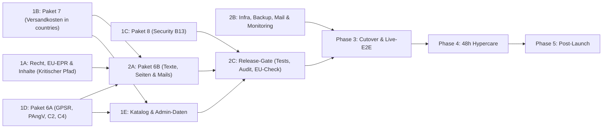

# Go-Live-Fahrplan – Voenix Shop

**Stand:** 2026-11-25 (Basis: [`GOLIVE-TODO.md`](../../GOLIVE-TODO.md), [`docs/golive/README.md`](README.md), Git `main` @ `eb4909c`)

---

## 1. Standortbestimmung & festgezurrte Entscheidungen

### Bereits erledigt (auf `main`)
Die großen technischen Risiko-Pakete **1–5** sind abgeschlossen:
- Geld-/Warenkorb-/Checkout-Integrität (`B2`–`B4`, `C13`)
- Auth-/Rate-Limit-/Header-/fal.ai-Schutz (`B5`–`B10`, `A17`)
- Frontend-Blocker, PWA, Kompression & SEO (`B1`, `C3`, `C5`–`C12`, `A15`)
- Betriebsreife, Healthchecks, Docker & Legacy-301-Redirects (`B11`–`B12`, `C14`–`C16`, `C18`, `C21`, `E1`-Code)
- Fulfillment-Retries & Mollie-Chargeback-Tracking (`C17`, `C19`, `D2`-Code)

### Festgezurrte Grundsatzentscheidungen (Phase 0 – abgeschlossen)

| # | Thema | Ref. | Entscheidung | Umsetzung im Fahrplan |
|---|---|---|---|---|
| **1** | **Versandländer & EU-Versandkosten** | `D3`, `A21`, `F3` | **Start in mehreren EU-Ländern** + **Versandkosten pro Land in `countries`** | **[Paket 7](paket-7-versandkosten-countries.md)** (DB-Migration, `countries`, `cart/totals.ts`, Checkout, Admin & `/shipping`) + EU-EPR-Registrierungen (ab Paket 1!) & DE/EN-Rechtstexte auf dem kritischen Pfad. |
| **2** | **Stil-Aufpreis** | `C2` | **Möglich machen** | In [Paket 6](paket-6-recht-ui-mails.md) (6A): `promptId` sauber durch Wizard → Editor → `addToCart` durchreichen + inkl. MwSt. ausweisen. |
| **3** | **Werbeaussagen** | `A11` | **„Made in Germany“ & „DHL aus Deutschland“ bleiben** | In `A11` nur nicht existierende Produkte („Poster“, „Als Karte“) entfernen sowie Zahlarten & Lieferzeiten abgleichen. |
| **4** | **`/royal-dog`** | `C4` | **Vorerst ausblenden** | Route/Verlinkung für Launch deaktivieren; Fake-Reviews & Fake-Stats trotzdem bereinigen. |
| **5** | **Footer-Seiten** | `C1` | **Alle Seiten bekommen Inhalt** | Inhalte (DE + EN) für `/about`, `/faq`, `/contact`, `/support` zusätzlich zu den Rechtstexten erstellen und in Paket 6B einbauen. |
| **6** | **Rechnungen & Buchhaltung** | `D1` | **Externer Workflow zum Launch** | Mollie → Lexoffice/sevDesk einrichten + „manuelle Rechnung auf Anfrage“ im Support-SOP verankern. |
| **7** | **DB-Secrets & Admin-Revocation** | `B13` | **Vor Go-Live richtig lösen** | Eigenes **[Paket 8 (`B13`)](paket-8-security-db-secrets-admin.md)** (AES-256-GCM at-rest für SFTP-/SPOD-Secrets + DB-Prüfung in `requireAdmin`) + neuer Encryption-Key in `E2`. |
| **8** | **Streichpreise / Rabatte** | `A19` | **Zum Launch deaktiviert** | Keine Artikel-/Prompt-Rabatte aktivieren, bis 30-Tage-Tiefstpreis-Historie (Issue `#239`) umgesetzt ist. |

> [!TIP]
> **Empfohlener Workflow laut `AGENTS.md`:** **[Paket 7](paket-7-versandkosten-countries.md)** (DB-Migration + Geld/Checkout + modulübergreifend) und **[Paket 8 (`B13`)](paket-8-security-db-secrets-admin.md)** (DB-Migration + Security/Auth) sind klassische Kandidaten für jeweils ein eigenes **Driving Issue + Council-Workflow**.

---

## 2. Phase 1 – Parallele Umsetzung

Die technischen Pakete (**Paket 7**, **Paket 8**, **Paket 6A**) laufen parallel zu den externen Vorlaufzeiten (**1A**). *(Merge-Hinweis im Frontend: Paket 7 und Paket 6A berühren beide `CheckoutView.vue` / `CartSummary.vue` — am saubersten erst Paket 7 mergen oder Schnittstellen sauber trennen.)*

### Strang 1A: Recht, EU-EPR, externe Vorlaufzeiten & Seiteninhalte *(kritischer Pfad – sofort anstoßen!)*
- [ ] **Finale EU-Zielländerliste & Konditionen festlegen (`D3`, `F3`):** Für jedes geplante EU-Land Lieferbarkeit (SPOD + Tassen-Lieferant), Versandkosten, Versandfreigrenze, Lieferzeit und EPR-Pflichten festlegen.
- [ ] **Verpackungsrecht DE + EU (`F2`, `F3`):**
  - **Deutschland:** LUCID / VerpackG + Duales System (Rollenverteilung mit SPOD & Tassen-Lieferant klären).
  - **Jedes aktivierte EU-Zielland:** Nationale Verpackungspflichten ab Paket 1 anmelden (z. B. **Österreich**: VerpackVO + Bevollmächtigter; **Frankreich**: CITEO / UIN / Triman; ggf. ES/IT/NL/BE/SE). *Nur Länder im Admin aktivieren, deren EPR-Registrierung zum Launch steht!*
  - **USt. / OSS (`F3`):** 10.000-€-EU-Fernverkaufsschwelle überwachen bzw. vorab für OSS registrieren (mit Steuerberater / Lexoffice abstimmen).
- [ ] **Rechtstexte beschaffen (DE + EN!) (`A2`, `A3`, `A5`):**
  - Finale **AGB** (DE & EN, korrekte Anschrift/Mail, DE-/EU-Lieferzeiten, Vertragssprache/Speicherung, kein Verweis auf totes WordPress-PDF).
  - **Widerrufsausschluss-Text** für personalisierte Ware (§ 312g Abs. 2 Nr. 1 BGB, DE & EN).
  - **Telefonnummer** fürs Impressum & Mail-Footer festlegen und besetzen (`F4`).
- [ ] **iubenda-Policy `48736531` aktualisieren (DE + EN!) (`A1`):** Sliplane, Mollie, Sweego, **fal.ai (US-Drittlandtransfer!)**, SPOD, Tassen-Lieferant, Cookies (`voenix.auth`, `XSRF-TOKEN`, `voenix.guest`), `localStorage`, Kundenkonto einpflegen; Stripe, GTM, Facebook-Pixel entfernen; **englische Policy-ID** aktivieren/prüfen.
- [ ] **AVVs & DSGVO-Doku (`F1`):** Auftragsverarbeitungsverträge (Art. 28 DSGVO) mit Sliplane, Sweego, **fal.ai** (SCCs/DPF, Zero-Training/Retention für Kundenfotos!), SPOD/Spreadshirt, Tassen-Lieferant und iubenda; Verarbeitungsverzeichnis (Art. 30) & TOMs (Art. 32).
- [ ] **Mollie Live-KYC & Schutznetze (`F4`, `A16`, `D1`, `D2`):**
  - Mollie Live-KYC abschließen und finale Liste der aktiven Zahlarten (DE + EU) fixieren.
  - **fal.ai** Hard-Spend-Limit + Low-Credit-Alert setzen.
  - Externen Buchhaltungs-Workflow (Mollie → Lexoffice/sevDesk) einrichten.
  - Internes **Support-SOP** schreiben (manuelle Refunds im Mollie-Dashboard, Reklamation/Neudruck, Kundenrechnungen auf Anfrage, `SPOD_QUARANTINED`, Chargebacks).
  - **BFSG-Kleinstunternehmer-Ausnahme** (<10 MA & ≤2 Mio. € Umsatz, § 3 Abs. 3 BFSG) dokumentieren.
- [ ] **Redaktionelle Inhalte für Footer-Seiten erstellen (DE + EN) (`C1`):** Texte für `/about`, `/faq`, `/contact` und `/support`.

### Strang 1B: Paket 7 – Länderspezifische Versandkosten in `countries` *(Council empfohlen)*
Details siehe [`paket-7-versandkosten-countries.md`](paket-7-versandkosten-countries.md):
- [ ] DB-Migration + `countries`-Modul (Versandkosten & Freigrenze pro Land, Admin-API & Public-API).
- [ ] `cart/totals.ts`, `checkout/service.ts` & Order-Snapshot auf länderspezifische Versandkosten umstellen (inkl. Live-Neuberechnung im Checkout bei Länderwechsel & Gutschein-Interaktion).
- [ ] Admin-Länderverwaltung + `/shipping` (`A21`) dynamisch an `GET /api/countries` anbinden.

### Strang 1C: Paket 8 – Security `B13` (DB-Secrets & Admin-Session-Revocation) *(Council empfohlen)*
Details siehe [`paket-8-security-db-secrets-admin.md`](paket-8-security-db-secrets-admin.md):
- [ ] SFTP-Passwörter & SPOD-Live-Tokens in PostgreSQL mit AES-256-GCM at-rest verschlüsseln.
- [ ] `requireAdmin` gegen die Datenbank prüfen (sofortige Session-Revocation bei Passwortwechsel/Sperrung/Rollenentzug).

### Strang 1D: Paket 6A – Rechtliche UI, GPSR, Stil-Aufpreis & `/royal-dog` *(ohne externe Rechtstexte)*
Details siehe [`paket-6-recht-ui-mails.md`](paket-6-recht-ui-mails.md) (Abschnitt **Teil 6A**):
- [ ] `C2` (`promptId` durchreichen), `C4` (`/royal-dog` ausblenden), `A7` (PAngV-Hinweise), `A8` (Checkout-Button-Lösung), `A13` (EU-GPSR Herstellerangaben), `A10` + Teil `A11` (Fake-Reviews & „Poster“/„Als Karte“ raus), `A14` (beide Upload-Hinweise), `A18` (DSGVO-Links Kasse/Registrierung), `A20` (Legal-Leiste Wizard/Editor), `A1`-Code (iubenda-Fallback + EN-Policy-Unterstützung).

### Strang 1E: Katalog & Admin-Daten bereinigen
- [ ] **Marken-/Rechtskritische Stilnamen umbenennen (`A12`):** „Hundertwasser“, „Picasso“, „Funky Pop Toy Style“, „Instagramm Beauty“.
- [ ] **Testdaten & Tippfehler bereinigen (`C22`):** Tassen-Langbeschreibungen (`.`, `asf`, `qwef`, `sdg`) ersetzen; Tippfehler (`Stylizet Anime`, `Expressive Oil Paining`) korrigieren; „Valentinstag“ & „Western Comic“ prüfen/deaktivieren; Sprache (DE/EN), Margen, MwSt. und Lieferanten-Zuordnung prüfen.
- [ ] **Länder & Versandkosten im Admin pflegen (`D3` / Paket 7):** Exakt die EPR-fertigen EU-Länder mit ihren realen Versandkosten und Freigrenzen eintragen.
- [ ] **Rabatte aus (`A19`):** Keine Streichpreis-Rabatte aktiv.
- [ ] **GPSR-Herstellerdaten einpflegen (`A13`):** Nach Paket 6A für alle aktiven Artikel eintragen.

---

## 3. Phase 2 – Integration, Infrastruktur & Release-Gate

Sobald die Texte aus Strang 1A sowie Paket 7 und Paket 6A fertig sind:

### Strang 2A: Paket 6B – Texte, Footer-Seiten & Bestellmails
Details siehe [`paket-6-recht-ui-mails.md`](paket-6-recht-ui-mails.md) (Abschnitt **Teil 6B**):
- [ ] Rechtsseiten (DE + EN) befüllen: `/terms` (+ toten WordPress-PDF-Link in `CheckoutView.vue` ersetzen), `/returns` (+ Ausschluss-Hinweis in Kasse), `/imprint` (+ Telefon & § 36 VSBG), `/payment` (+ Zahlungs-Logos in `Footer.vue` & Kasse exakt auf aktive Mollie-Zahlarten abstimmen), `/shipping` (inkl. DE-/EU-Lieferzeiten & Check „ab 150 € Umsatz“).
- [ ] Redaktionelle Footer-Seiten (DE + EN) befüllen (`C1`): `/about`, `/faq`, `/contact`, `/support`.
- [ ] Bestellbestätigungs-Mail (`A4`): AGB + Widerrufshinweis, `inkl. gesetzl. MwSt.`, Lieferzeit sowie vollständige Anbieterangaben im Mail-Footer (`layout.ts`, `order-confirmation.ts`).
- [ ] Vollprüfung DE & EN auf konsistente Texte, Preise, Versandkosten und Links.

### Strang 2B: Infrastruktur, Mail-Zustellbarkeit & Monitoring
- [ ] **Sliplane & Backups (`D4`):**
  - Zwingend auf **genau 1 Instanz (Single Replica)** begrenzen (lokales `/app/data`, In-Memory-Rate-Limiter, nicht-idempotenter SPOD-Worker!).
  - Persistentes Volume `/app/data` prüfen (Platz + Schreibrechte für Container-User `app`).
  - Automatisierte tägliche **Postgres-Backups + 1× echter Restore-Test**.
  - Backup-Konzept für **`/app/data`** (Katalogbilder, Printdaten, PDFs) einrichten.
- [ ] **Externes Monitoring & Error-Tracking (`D4`):**
  - Externen Uptime-Monitor (z. B. UptimeRobot / Better Stack) gegen `GET https://voenix.shop/api/ready` einrichten (unabhängig von Sweego!).
  - Error-Tracking (Sentry / GlitchTip) für Backend & Frontend anbinden.
  - `/admin/access-tokens` auf alte Entwicklungs-Tokens prüfen und aufräumen.
- [ ] **Sweego-Mail-Authentifizierung (`E3`):** SPF von `voenix.shop` um Sweego ergänzen, DKIM & Return-Path CNAME setzen, DMARC prüfen; Inbox-Tests an **Gmail, GMX, Web.de und Outlook.de**.
- [ ] **Testinstanz absichern (`E1`-Infra):** `voenix-shop-test-ts.sliplane.app` abschalten, per Auth schützen oder auf `noindex` setzen.

### Strang 2C: Technisches Release-Gate (auf `main`)
- [ ] **Backend:** `cd backend && bun install && bun run check` (`typecheck`, `lint`, `format:check`, `bun test` inkl. Testcontainers) + `bun audit` grün.
- [ ] **Frontend:** `cd frontend && bun install && bun run build && bun run test:unit -- --run && bunx eslint .` grün.
- [ ] **Frontend-Audit-Triage (`B14`):** Die 29 Prod-Findings aus `bun audit` prüfen (kritische/hohe patchen, Rest bewerten).
- [ ] **Docker-Image:** Full-Stack-Image bauen, starten, `GET /api/health` und `GET /api/ready` prüfen.

---

## 4. Phase 3 – Cutover & Launch-Tag (T-1 bis T0)

### Vorbereitung (T-1)
- [ ] **Rollback vorbereiten (`E4`):** DB-Snapshot ziehen; altes WordPress **48–72 h read-only** erreichbar halten (Achtung: DB-Migrationen sind forward-only).
- [ ] **Produktiv-Env explizit setzen & Secrets rotieren (`E2` + `B13`):**
  - `FRONTEND_BASE_URL=https://voenix.shop` *(zwingend HTTPS für `Secure`-Cookies!)*
  - `MOLLIE_API_KEY=live_...` & `MOLLIE_WEBHOOK_URL=https://voenix.shop/api/payments/webhook/<NEUES_SECRET>`
  - **Neu generierte/rotierte Secrets:** `AUTH_SESSION_SECRET` (≥32 Bytes), `MOLLIE_WEBHOOK_SECRET`, `PRODUCTION_SPOD_WEBHOOK_SECRET`, plus **neuer Encryption-Key aus Paket 8 (`B13`)** (sicher im Passwort-Manager/Backup ablegen!)
  - `EMAIL_ENABLED=true`, `EMAIL_API_KEY`, `EMAIL_FROM_EMAIL`, `EMAIL_POLL_INTERVAL_MINUTES=1`
  - `GENERATOR_DUMMY_MODE=false`, `GENERATOR_API_KEY` (live fal.ai)
  - `RATE_LIMIT_TRUST_FORWARDED_FOR=true` *(nach Proxy-Hop-Check auf Sliplane)*
  - `DATABASE_SSL_MODE=require` (bzw. `verify-full`), `DATABASE_MAXIMUM_POOL_SIZE=20`
  - `OPERATIONS_ALERT_EMAIL=<überwachtes Ops-Postfach>`
  - Start-Logs verifizieren: Mollie-Modus `live`, keine Konfigurations-`WARN`-Logs (`B11`).
- [ ] **Fulfillment live schalten (`E2`, Admin `/admin/logistics/destinations`):**
  - SPOD von `STAGING` auf `PRODUCTION` + Live-Token umstellen, Katalog neu synchronisieren, Live-Webhooks registrieren (`Shipment.sent`, `Order.cancelled`, `Order.needs-action`).
  - Tassen-SFTP-Zugang + SHA-256-Host-Key-Fingerprint verifizieren.

### Domain-Umzug & Live-Abnahme (T0, vor Traffic/Werbung)
- [ ] **DNS & Kanonisierung (`E1`):** Domain `voenix.shop` umstellen; `www.voenix.shop` ↔ `voenix.shop` kanonisch per 301 weiterleiten; SSL und Legacy-301-Redirects (`/impressum`, `/pdf/AGBs.pdf`, etc.) prüfen.
- [ ] **Echte Live-E2E-Tests auf iOS Safari & Android Chrome (`E4`):**
  1. **Tasse (SFTP, DE):** Foto → KI-Generierung → Editor (inkl. kostenpflichtigem Stil-Aufpreis `C2`!) → Warenkorb (mit/ohne Gutschein) → Live-Mollie-Zahlung → Bestellmail im Posteingang (inkl. AGB/Widerruf/Footer) → `/order/:token` → PDF auf SFTP + Lieferanten-Mail → Versandmarkierung → Versandmail + Tracking.
  2. **Textil (SPOD, EU-Zielland & EN-Oberfläche):** Länderwechsel im Checkout prüft EU-Versandkosten (Paket 7!) → Telefon-Validierung → Live-Mollie-Zahlung → Live-Order in Spreadconnect prüfen (inkl. Motiv & Hotspot, insb. bei `OVERALL_FRONT`).
  3. **Konto & Fehlerpfade:** Registrierung → E-Mail-Bestätigung → Passwort-Reset → abgebrochene Mollie-Zahlung → Retry-Zahlung erfolgreich.

---

## 5. Phase 4 – Erste 48 Stunden (Hypercare, `E5`)

- [ ] `/admin/operations` aktiv prüfen (`lastScanAt <= 5 min`, keine offenen Findings).
- [ ] Sliplane-Logs (`ERROR`, `5xx`, `429`), Mollie-Webhook-Logs und Sweego-Bounces täglich prüfen.
- [ ] `/app/data`-Plattenspeicher, Postgres-Connections und `fal.ai`-Verbrauch gegen Limits überwachen.
- [ ] `https://voenix.shop/sitemap.xml` in der Google Search Console einreichen.

---

## 6. Phase 5 – Bewusst Post-Launch

- **Vor ersten Rabattaktionen zwingend:** 30-Tage-Tiefstpreis-Historie nach PAngV § 11 (GitHub Issue `#239` / `A19`).
- **Betriebs-Hygiene:** Retention für alte `email_jobs`-Payloads sowie Cleanup für abgebrochene `ACTIVE`-Warenkörbe und alte Produktions-PDFs (`C20`-Rest).
- **Support-Komfort:** Storno-UI für bezahlte Orders (inkl. SPOD-stornierter Jobs) & separate Zahlungsbestätigungs-Mail (`D2`-Rest).
- **Fulfillment-Härtung:** SPOD-IDs statt Variantennamen im Submission-Tripwire vergleichen (Issue `#225`); SPOD-Deduplizierung `422 ORDER_ALREADY_EXISTS` neu bewerten (Issue `#281`).
- **Code-Hygiene & Refactorings:** `G1`–`G5` aus `GOLIVE-TODO.md`, Architektur-Issues `#249` und `#250`, sowie spätere Reaktivierung von `/royal-dog` (`C4`) mit echter Prompt-ID + Full-Bleed-Layout.

---

## 7. Harte „Go / No-Go“-Checkliste am Launch-Tag

1. **Recht & Content komplett (DE + EN):** Impressum (inkl. Telefon & § 36 VSBG), aktuelle iubenda-DSGVO (DE/EN + Fallback), neue AGB, Widerrufshinweis, PAngV-Preisangaben, Button-Lösung, GPSR-Herstellerdaten, Upload-Hinweise, Bestellmail mit Pflichtangaben, keine Fake-Reviews, alle Footer-Seiten gefüllt.
2. **EU & Extern abgesichert:** LUCID + Duales System (DE) **und** nationale EPR-Pflichten für **jedes** aktivierte EU-Land erfüllt; AVVs (inkl. fal.ai) geschlossen; Mollie-KYC & aktive Zahlarten deckungsgleich mit Shop; fal.ai-Spend-Limit & Buchhaltungs-Workflow stehen.
3. **Security, Versand & Katalog sauber:** Paket 8 (`B13`) & Paket 7 (länderspezifische Versandkosten in `countries`) live; keine Testtexte/Tippfehler/Marken-Stilnamen; keine Rabatte aktiv; Stil-Aufpreis (`C2`) korrekt berechnet; `/royal-dog` ausgeblendet.
4. **Tests & Audit grün:** Backend `bun run check`, Frontend Build/Tests/Lint, kritische `bun audit`-Findings behoben.
5. **Infra gehärtet:** Sliplane exakt **1 Instanz**, Postgres-Backup + Restore getestet, `/app/data`-Backup aktiv, externes `/api/ready`-Monitoring & Error-Tracking aktiv.
6. **Secrets & Mail:** Alle Prod-Env-Vars inkl. `B13`-Key gesetzt, Webhook-/Session-Secrets rotiert, Sweego SPF/DKIM/DMARC im Inbox-Test bestanden.
7. **Live-E2E bestanden:** Echte Live-Bestellungen (Tasse SFTP + DE + Stil-Aufpreis, Textil SPOD + EU-Versandkosten + EN, Abbruch+Retry) auf echten Mobilgeräten komplett durchgelaufen.
